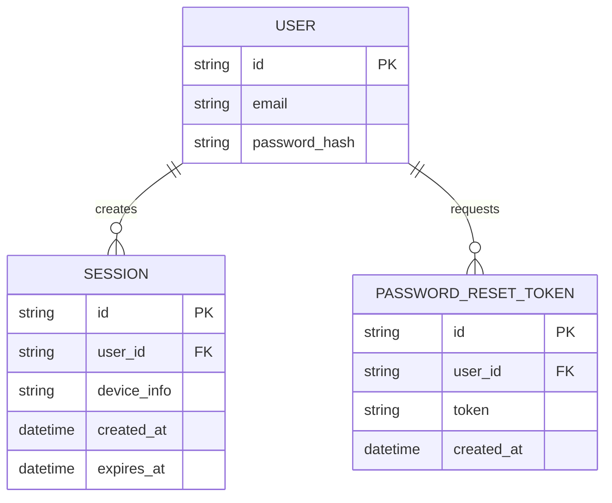
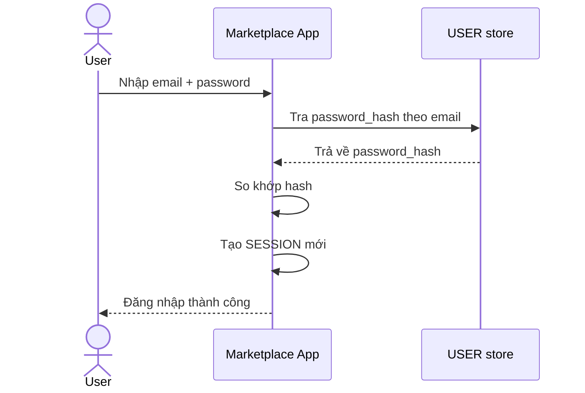
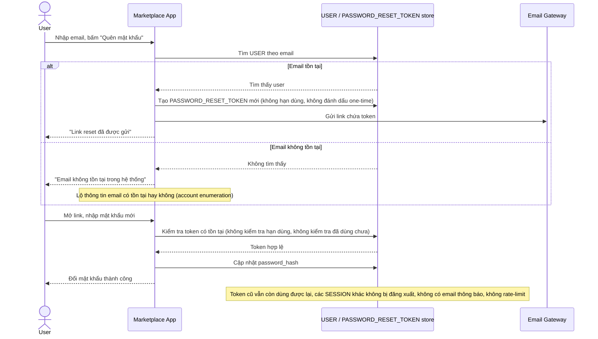
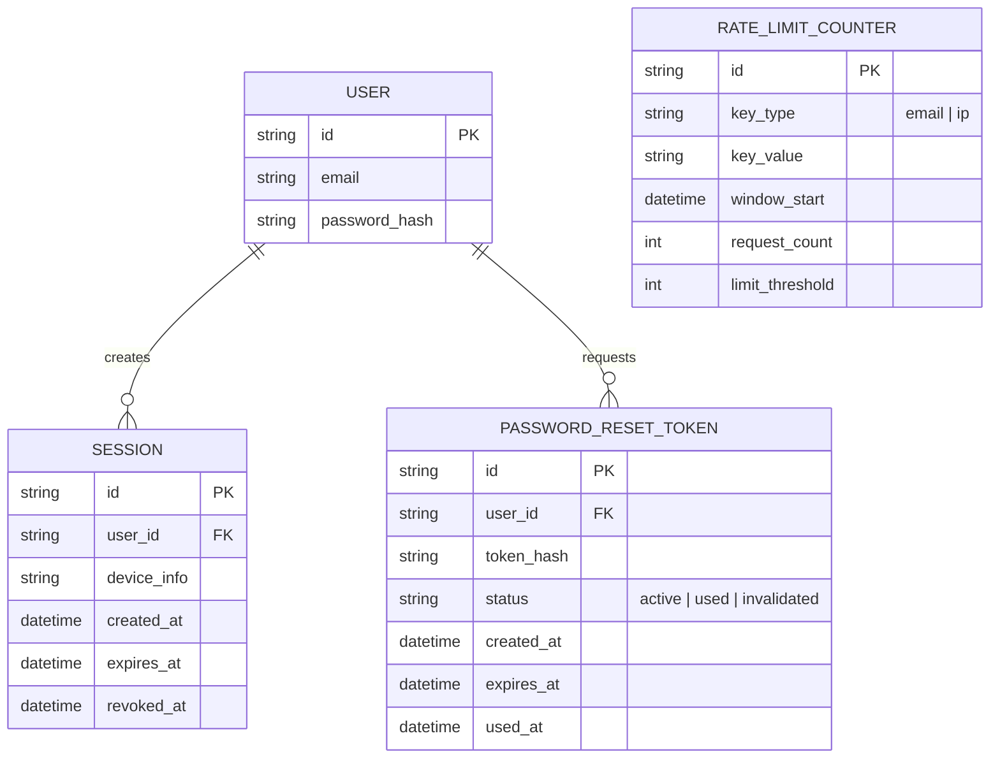
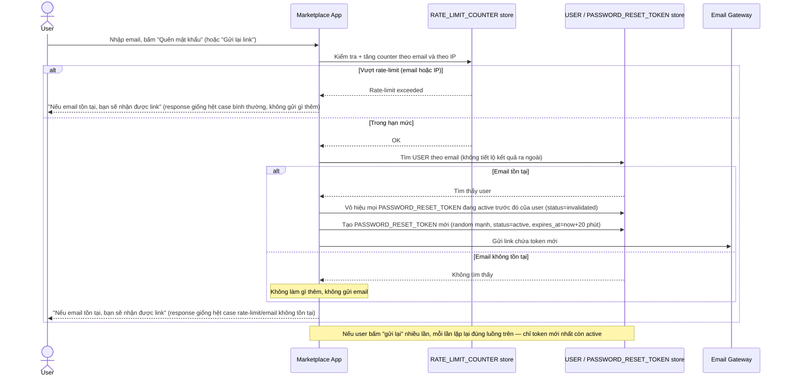
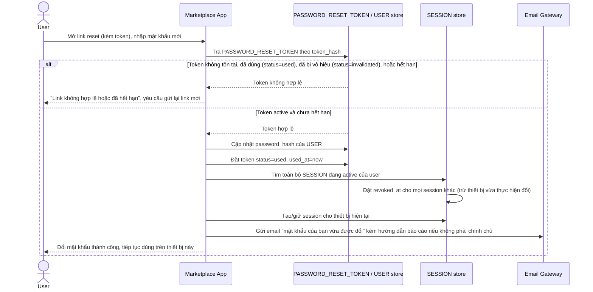

# Marketplace thương mại điện tử với quên mật khẩu qua email

**Hệ thống:** Một sàn thương mại điện tử tiêu dùng phổ thông, tài khoản đăng ký bằng email/password.

**Vai trò của flow:** Luồng quên mật khẩu tiêu chuẩn — user nhập email, nhận link reset, đặt mật khẩu mới — phải an toàn ở quy mô lớn và chống được các kiểu tấn công phổ biến.

**Yêu cầu cụ thể:**
- Không được để endpoint "quên mật khẩu" lộ thông tin email có tồn tại trong hệ thống hay không (chống account enumeration) — response phải giống nhau dù email tồn tại hay không.
- Token reset phải là random đủ mạnh, chỉ dùng được một lần, hết hạn trong khoảng thời gian ngắn (ví dụ 15-30 phút), và bị vô hiệu ngay khi user đặt mật khẩu mới thành công.
- Nếu user bấm nhiều lần vào nút "gửi lại link reset", chỉ token mới nhất còn hiệu lực — các token cũ phát trước đó phải bị vô hiệu ngay.
- Sau khi đổi mật khẩu thành công, phải tự động đăng xuất tất cả session đang hoạt động ở nơi khác (trừ thiết bị vừa thực hiện đổi), và gửi email thông báo "mật khẩu của bạn vừa được đổi" kèm cách báo cáo nếu không phải chính chủ.
- Rate-limit request reset password theo cả email và theo IP để chống spam gửi email hoặc brute-force dò token.

---

# Base ERD — Marketplace trước khi hardening flow quên mật khẩu

Đây là **base**: mô hình dữ liệu suy luận từ ngữ cảnh đề bài, thể hiện trạng thái hệ thống **trước khi** áp các yêu cầu bảo mật cho flow quên mật khẩu. Đề bài mô tả 1 flow "quên mật khẩu tiêu chuẩn" đã tồn tại (nhập email, nhận link, đặt mật khẩu mới) nhưng chưa an toàn — nên base cần đủ: user (email/password), session đăng nhập, và 1 token reset dạng thô sơ (chưa có hạn dùng/one-time/trạng thái). Chưa có entity nào phục vụ chống enumeration/rate-limit/thu hồi session — những thứ đó là phần enhance.

---

# Base sequence — Login

Đây là **base**, flow "Đăng nhập bằng email/password" — nền tảng để hiểu tại sao flow quên mật khẩu và các session đang hoạt động (mà enhance sẽ cần thu hồi) lại quan trọng.

---

# Base sequence — Forgot password (chưa hardening)

Đây là **base**, flow "Quên mật khẩu" ở trạng thái thô sơ hiện tại — chính flow này là đối tượng mà toàn bộ 5 yêu cầu của đề bài nhắm vào để siết lại.

---

# Enhance ERD — sau khi hardening flow quên mật khẩu

Đây là ERD **sau khi** enhance được áp dụng lên base. So với base, có 2 thay đổi chính, ứng trực tiếp với 5 yêu cầu trong đề bài:

- `PASSWORD_RESET_TOKEN` thêm `status` (active/used/invalidated), `expires_at`, `used_at` — phục vụ yêu cầu token one-time, hết hạn ngắn, và vô hiệu token cũ khi có token mới hoặc khi đổi mật khẩu thành công.
- `SESSION` thêm `revoked_at` — phục vụ yêu cầu đăng xuất toàn bộ session khác sau khi đổi mật khẩu thành công.
- `RATE_LIMIT_COUNTER` (mới) — đếm request theo cả email lẫn IP để chống spam/brute-force dò token.

---

# Enhance sequence — Forgot password (request phase, đã hardening)

Đây là **enhance**, cùng flow "Forgot password" đã có ở base nhưng nay thay đổi theo yêu cầu 1, 3 và 5 của đề bài: response giống hệt nhau dù email tồn tại hay không (chống enumeration), rate-limit theo cả email lẫn IP, và bấm "gửi lại" nhiều lần chỉ token mới nhất còn hiệu lực. So với base: không còn tiết lộ email tồn tại hay không, và request bị chặn khi vượt rate-limit thay vì cho gửi email vô hạn.

---

# Enhance sequence — Complete password reset

Đây là **enhance**, flow hoàn toàn mới, phát sinh từ enhance — chưa tách riêng ở base (ở base, bước "đặt mật khẩu mới" chỉ là phần cuối gộp trong 1 flow duy nhất, không có các kiểm soát này). Nối tiếp flow "Forgot password" sau khi user bấm vào link, đáp ứng yêu cầu 2 và 4 của đề bài: token chỉ dùng 1 lần + hết hạn ngắn, và sau khi đổi mật khẩu thành công thì đăng xuất mọi session khác + gửi email thông báo.

