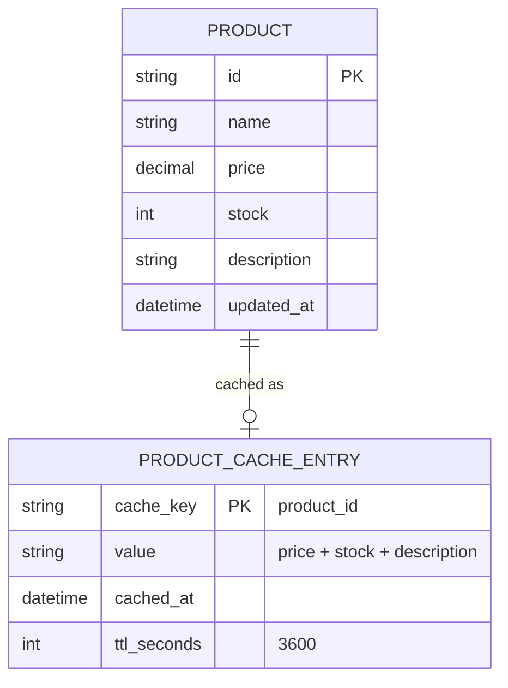
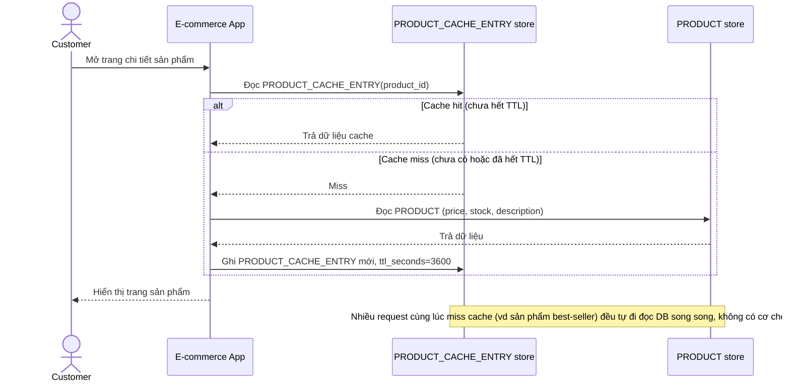
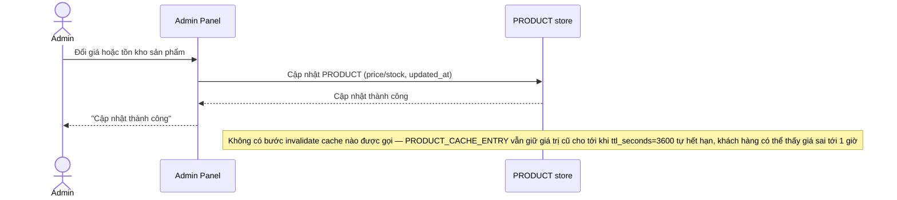
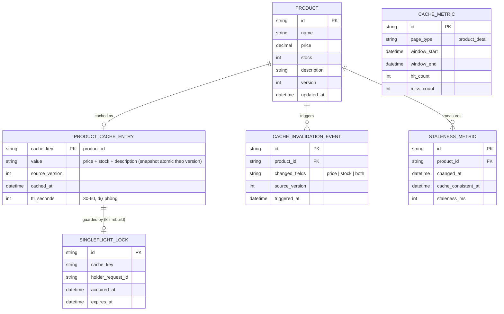
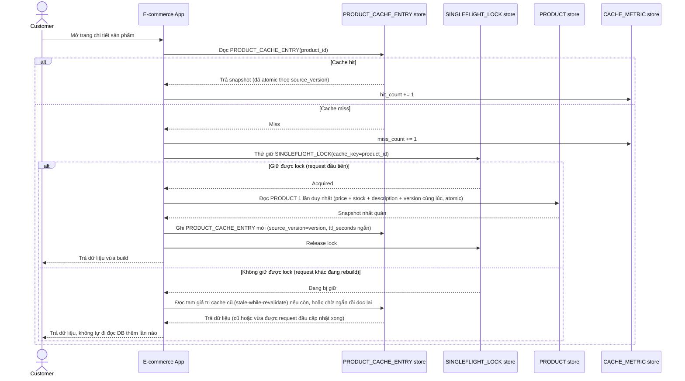
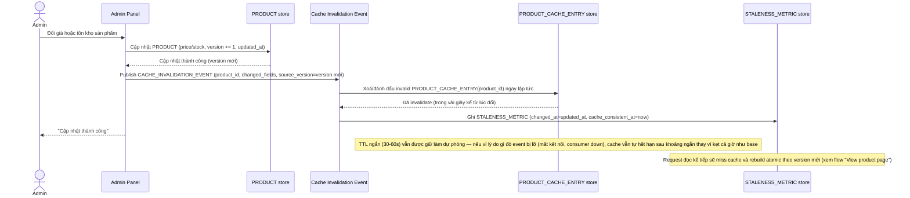

# Cache trang chi tiết sản phẩm cho e-commerce

**Hệ thống:** Trang e-commerce cache HTML/dữ liệu trang chi tiết sản phẩm (giá, tồn kho, mô tả) để giảm tải DB cho lượng truy cập lớn.

**Vai trò của flow:** Invalidate đúng cache khi sản phẩm được cập nhật (đổi giá, hết hàng) để không hiển thị thông tin sai cho khách, đồng thời giữ hiệu quả cache cao khi sản phẩm không đổi.

**Yêu cầu cụ thể:**
- Khi giá hoặc tồn kho sản phẩm thay đổi ở hệ thống quản trị, cache liên quan phải được invalidate trong vòng vài giây, không dựa hoàn toàn vào TTL cố định dài (ví dụ TTL 1 giờ là không đủ nhanh cho thay đổi giá).
- Có chiến lược rõ giữa cache invalidation theo event (khi có thay đổi, chủ động xóa) và TTL ngắn dự phòng (để tránh trường hợp event bị lỡ vẫn tự hết hạn sau một khoảng thời gian giới hạn).
- Xử lý race condition: request đọc cache đúng lúc dữ liệu đang được invalidate/update không được thấy trạng thái nửa cũ nửa mới (ví dụ giá mới nhưng tồn kho cũ).
- Với sản phẩm có traffic rất cao (best-seller), invalidate không được gây "cache stampede" (mọi request cùng lúc miss cache dội xuống DB) — cần cơ chế warm lại cache có kiểm soát (single flight hoặc pre-warm).
- Đo lường: cache hit ratio theo loại trang, và độ trễ giữa lúc dữ liệu gốc đổi tới lúc cache phản ánh đúng (staleness window thực tế).

---

# Base ERD — Cache trang sản phẩm chỉ dựa vào TTL cố định

Đây là **base**: mô hình dữ liệu suy luận từ ngữ cảnh đề bài, thể hiện trạng thái hệ thống **trước khi** có invalidation theo event. Đề bài nói cache trang chi tiết sản phẩm (giá, tồn kho, mô tả) với TTL 1 giờ — nên base cần đủ: sản phẩm và 1 cache entry theo product_id với TTL cố định dài. Chưa có entity nào phục vụ invalidation theo event/khoá chống stampede/đo lường — những thứ đó là phần enhance.

---

# Base sequence — View product page

Đây là **base**, flow "Xem trang chi tiết sản phẩm" — nền tảng cho enhance: cache chỉ dựa vào TTL cố định dài, nên khi dữ liệu gốc đổi giữa chừng, request đọc vẫn thấy dữ liệu cũ cho tới khi TTL tự hết hạn.

---

# Base sequence — Update product (chỉ dựa TTL, không invalidate)

Đây là **base**, flow "Admin đổi giá/tồn kho" ở trạng thái hiện tại — cập nhật DB xong là kết thúc, không đụng gì tới cache. Flow này liên quan mật thiết tới enhance vì toàn bộ 5 yêu cầu của đề bài đều nhằm sửa đúng lỗ hổng "chờ TTL" ở đây.

---

# Enhance ERD — sau khi có invalidation theo event + chống stampede

Đây là ERD **sau khi** enhance được áp dụng lên base. So với base, có 4 thay đổi chính, ứng trực tiếp với 5 yêu cầu trong đề bài:

- `PRODUCT` thêm `version` — dùng để xây snapshot cache atomic (giá + tồn kho cùng 1 version), tránh trạng thái nửa cũ nửa mới.
- `PRODUCT_CACHE_ENTRY` thêm `source_version` và `ttl_seconds` rút ngắn (dự phòng) — kết hợp cả invalidate theo event lẫn TTL ngắn thay vì chỉ dựa TTL dài như base.
- `CACHE_INVALIDATION_EVENT` (mới) — phát sinh ngay khi giá/tồn kho đổi, invalidate trong vài giây.
- `SINGLEFLIGHT_LOCK` (mới) — chỉ 1 request được rebuild cache khi miss, chống cache stampede.
- `CACHE_METRIC` + `STALENESS_METRIC` (mới) — đo hit ratio theo loại trang và độ trễ invalidate thực tế.

---

# Enhance sequence — View product page (atomic snapshot + chống stampede)

Đây là **enhance**, cùng flow "View product page" đã có ở base nhưng nay thay đổi theo yêu cầu 3 và 4 của đề bài: cache được đọc/ghi như 1 snapshot atomic theo `version` (không bao giờ thấy giá mới nhưng tồn kho cũ), và khi nhiều request cùng miss cache thì chỉ 1 request được rebuild (singleflight), số còn lại chờ hoặc dùng tạm dữ liệu cũ thay vì dội hết xuống DB.

---

# Enhance sequence — Update product (invalidate theo event + TTL ngắn dự phòng + đo staleness)

Đây là **enhance**, cùng flow "Update product" đã có ở base nhưng nay thay đổi theo yêu cầu 1, 2 và 5 của đề bài: cập nhật giá/tồn kho phát ngay `CACHE_INVALIDATION_EVENT` để invalidate trong vài giây, kết hợp TTL ngắn dự phòng phòng khi event bị lỡ, và đo staleness thực tế.

