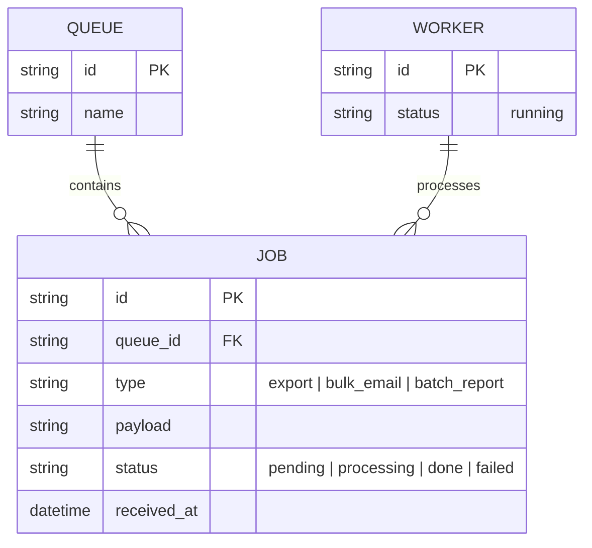
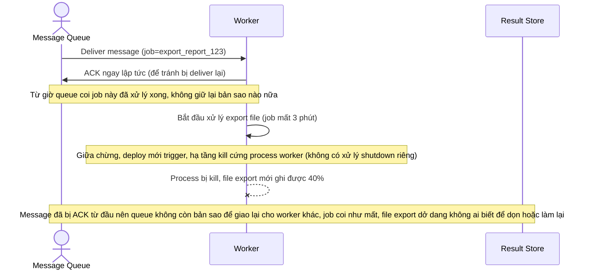
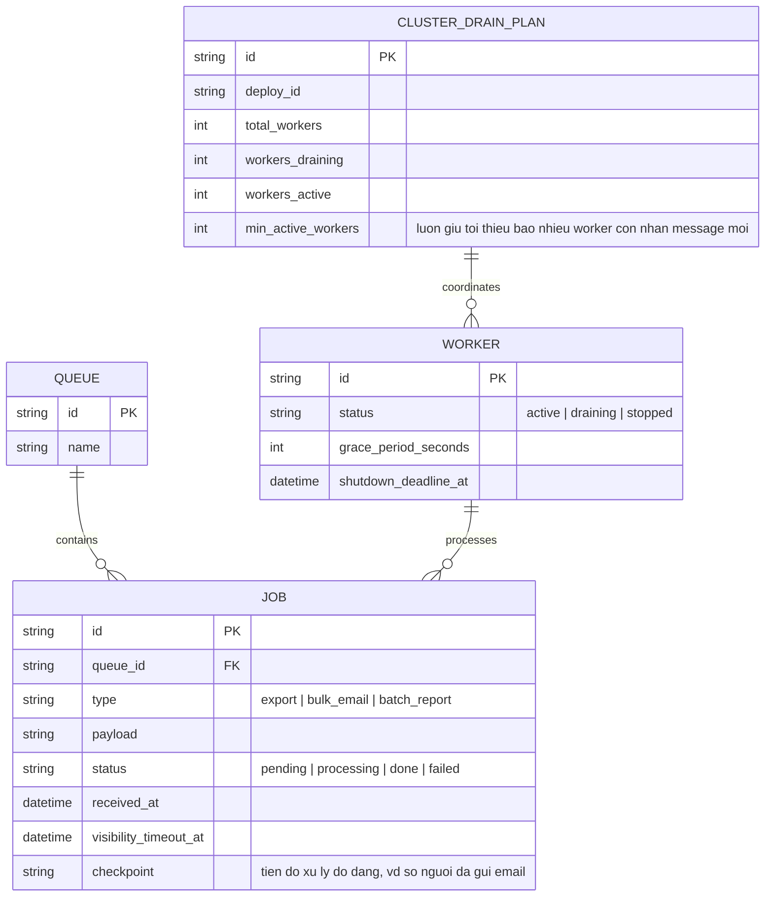
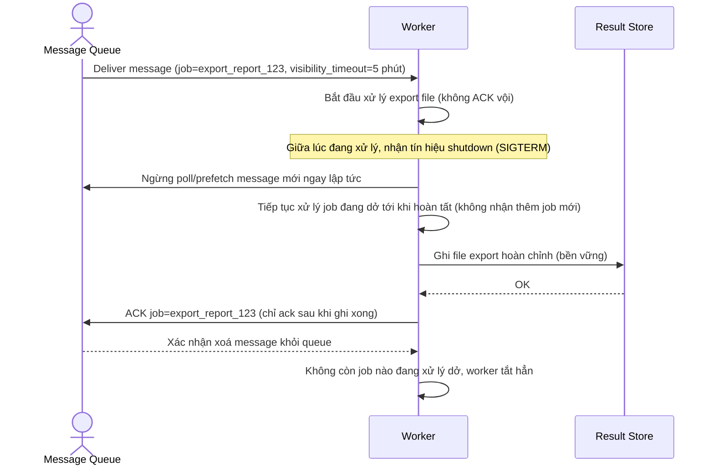
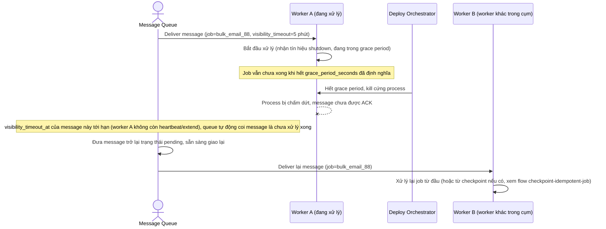
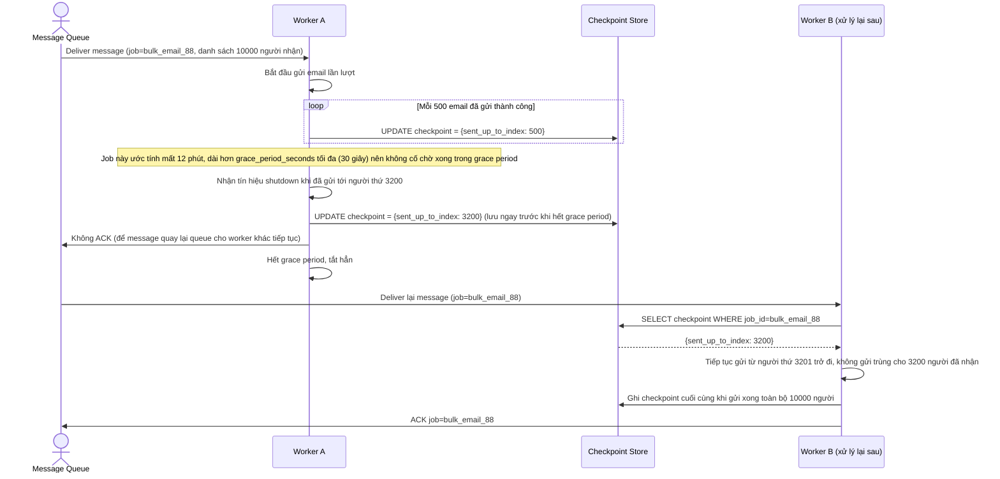
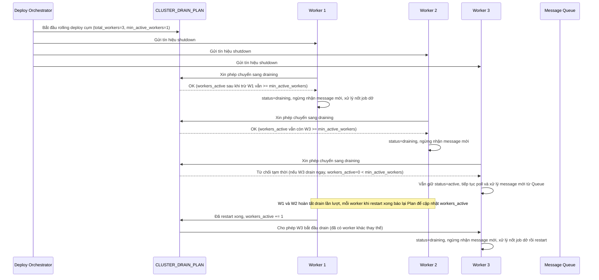

# Background worker xử lý job dài đang consume message từ queue

**Hệ thống:** Một cụm worker consume message từ hàng đợi để xử lý các job chạy lâu (export file dữ liệu lớn, gửi email hàng loạt, xử lý batch report), mỗi job có thể mất từ vài chục giây tới vài phút để hoàn tất.

**Vai trò của flow:** Khi worker bị shutdown (deploy, autoscale scale-in), phải đảm bảo message đang xử lý dở không bị mất và không bị ack sai thời điểm — ack quá sớm làm mất dữ liệu nếu worker chết giữa chừng, ack quá muộn hoặc không ack làm message bị xử lý lặp lại không cần thiết.

**Yêu cầu cụ thể:**
- Khi nhận tín hiệu shutdown, worker phải ngay lập tức ngừng nhận message mới từ queue (ngừng poll/prefetch) nhưng vẫn tiếp tục xử lý cho tới khi hoàn tất các message đã nhận trước đó, tránh tình huống nhận thêm việc mới ngay trước lúc tắt rồi phải bỏ dở.
- Message chỉ được ack (xác nhận đã xử lý xong, xóa khỏi queue) sau khi job đã hoàn tất toàn bộ và kết quả đã được ghi bền vững — nếu worker bị kill cứng giữa lúc xử lý (hết grace period), message chưa ack phải tự động được đưa trở lại queue để worker khác xử lý lại, không được để mất.
- Với các job có thể để lại tác động một phần khi bị ngắt giữa chừng (ví dụ export file đã ghi được nửa file, gửi email hàng loạt đã gửi được một số người trong danh sách), phải thiết kế idempotent hoặc có checkpoint để lần xử lý lại sau không lặp lại phần đã hoàn tất (không gửi trùng email cho người đã nhận, không tạo file export bị lỗi nửa vời).
- Định nghĩa grace period đủ dài để job dài nhất trong hệ thống có cơ hội hoàn tất bình thường (không cắt ngang job đang chạy gần xong), nhưng vẫn có ngưỡng tối đa hợp lý để không làm chậm quá trình deploy/scale toàn cụm — cân nhắc cho phép job vượt quá một độ dài nhất định tự chủ động lưu checkpoint giữa chừng thay vì cố chờ nó chạy xong trong grace period.
- Xử lý trường hợp toàn bộ worker trong cụm đều nhận tín hiệu shutdown gần như đồng thời (ví dụ rolling deploy toàn cụm) — phải đảm bảo còn ít nhất một số worker tiếp tục nhận message mới trong lúc số còn lại đang drain, tránh để hàng đợi bị dồn ứ không ai xử lý trong lúc chuyển giao.

---

# Base ERD — Background worker consume queue trước khi có graceful shutdown

Đây là **base**: mô hình dữ liệu suy luận từ ngữ cảnh đề bài, thể hiện trạng thái hệ thống **trước khi** worker biết xử lý shutdown an toàn. Đề bài nói tới cụm worker consume message từ hàng đợi để xử lý job dài — nên base chỉ cần đủ: hàng đợi (QUEUE), job/message trong hàng đợi (JOB) và worker đang xử lý (WORKER). Chưa có checkpoint, chưa có visibility timeout theo dõi rõ ràng, chưa có trạng thái draining, chưa có kế hoạch phối hợp rolling shutdown toàn cụm — tất cả những thứ đó là phần enhance.

---

# Base sequence — Consume job (ack sớm, không chống mất dữ liệu khi crash)

Đây là **base**, flow "Worker lấy job từ queue và xử lý" ở trạng thái hiện tại — worker ack message ngay sau khi nhận (trước khi xử lý xong) để tránh bị nhận trùng, và không có cơ chế nào xử lý riêng khi có tín hiệu shutdown giữa lúc đang chạy job dài. Flow này liên quan mật thiết tới enhance vì toàn bộ yêu cầu của đề bài xoay quanh việc sửa đúng thời điểm ack và cách worker phản ứng khi bị tắt.

---

# Enhance ERD — Thêm checkpoint, visibility timeout, trạng thái draining, kế hoạch drain cụm

Đây là **enhance**, mô hình dữ liệu sau khi áp toàn bộ đề bài lên base. So với base, các thay đổi:
- `JOB` có thêm cột `visibility_timeout_at` (job coi như "đang được ai đó xử lý" tới thời điểm này, hết hạn mà chưa ack thì tự động quay lại queue) và `checkpoint` (lưu tiến độ xử lý dở, ví dụ số dòng file đã ghi/số người đã gửi email) — đáp ứng yêu cầu 2 và yêu cầu 3.
- `WORKER` có thêm trạng thái `draining` và các cột `grace_period_seconds`, `shutdown_deadline_at` — đáp ứng yêu cầu 1 và yêu cầu 4 (định nghĩa grace period rõ ràng).
- Entity mới `CLUSTER_DRAIN_PLAN` — theo dõi 1 đợt rolling deploy/scale toàn cụm, đảm bảo luôn còn tối thiểu 1 số worker ở trạng thái active nhận message mới trong lúc số còn lại đang drain — đáp ứng yêu cầu 5.

---

# Enhance sequence — Consume job (ngừng prefetch ngay, ack sau khi xong và ghi bền vững)

Đây là **enhance** của flow `consume-job` đã có ở base, đáp ứng **yêu cầu 1 và 2** của đề bài. So với base: khi nhận tín hiệu shutdown, worker ngừng ngay việc poll/prefetch message mới nhưng tiếp tục hoàn tất job đang xử lý dở, và chỉ ACK sau khi job đã hoàn tất toàn bộ và kết quả đã ghi bền vững — không còn ack ngay sau khi nhận message như base.

---

# Enhance sequence — Hết grace period, bị kill cứng, message tự động quay lại queue

Đây là flow **enhance** hoàn toàn mới so với base, đáp ứng phần còn lại của **yêu cầu 2**: nếu worker bị kill cứng giữa lúc xử lý (hết grace period mà job chưa xong), message chưa được ack phải tự động được đưa trở lại queue nhờ `visibility_timeout_at` hết hạn, để worker khác xử lý lại, không được để mất.

---

# Enhance sequence — Checkpoint cho job dài, tránh gửi trùng khi xử lý lại

Đây là flow **enhance** hoàn toàn mới so với base, đáp ứng **yêu cầu 3 và yêu cầu 4** của đề bài: job gửi email hàng loạt có thể để lại tác động một phần khi bị ngắt giữa chừng, nên phải lưu checkpoint (đã gửi tới người thứ mấy) để lần xử lý lại sau không gửi trùng. Vì job này dài hơn grace period tối đa cho phép, worker chủ động lưu checkpoint giữa chừng thay vì cố chờ chạy xong trong grace period.

---

# Enhance sequence — Toàn cụm nhận tín hiệu shutdown gần đồng thời, vẫn giữ worker tiếp nhận việc mới

Đây là flow **enhance** hoàn toàn mới so với base, đáp ứng **yêu cầu 5** của đề bài: khi rolling deploy khiến toàn bộ worker trong cụm nhận tín hiệu shutdown gần như đồng thời, `CLUSTER_DRAIN_PLAN` đảm bảo luôn còn tối thiểu một số worker tiếp tục nhận message mới trong lúc số còn lại đang drain, tránh hàng đợi bị dồn ứ không ai xử lý.

