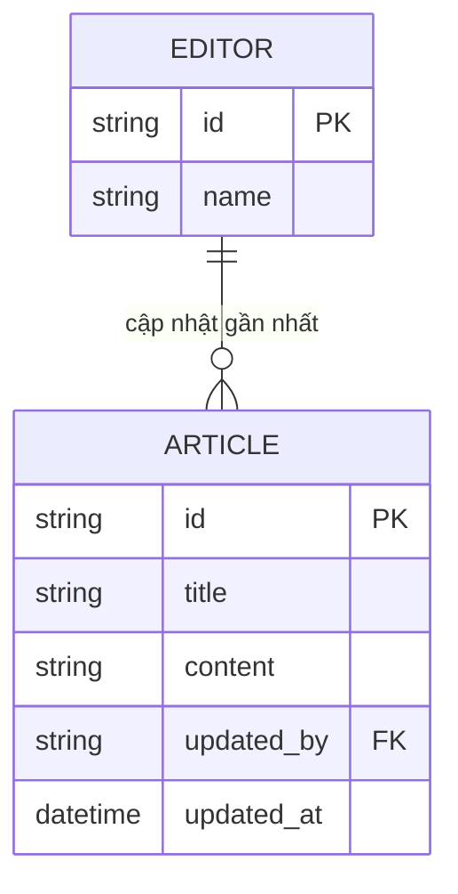
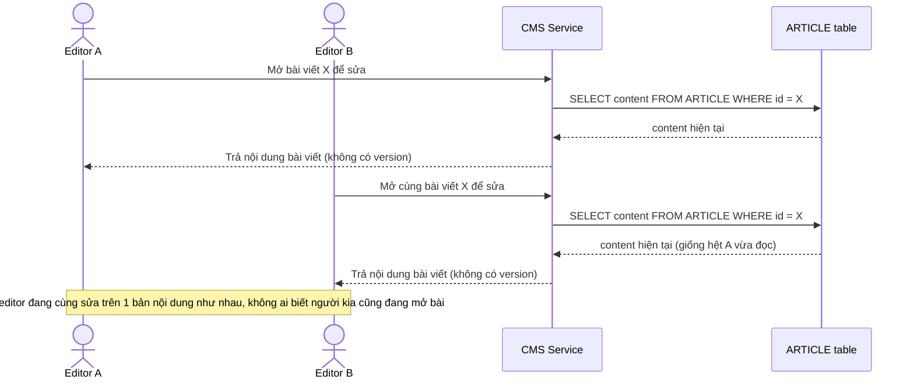
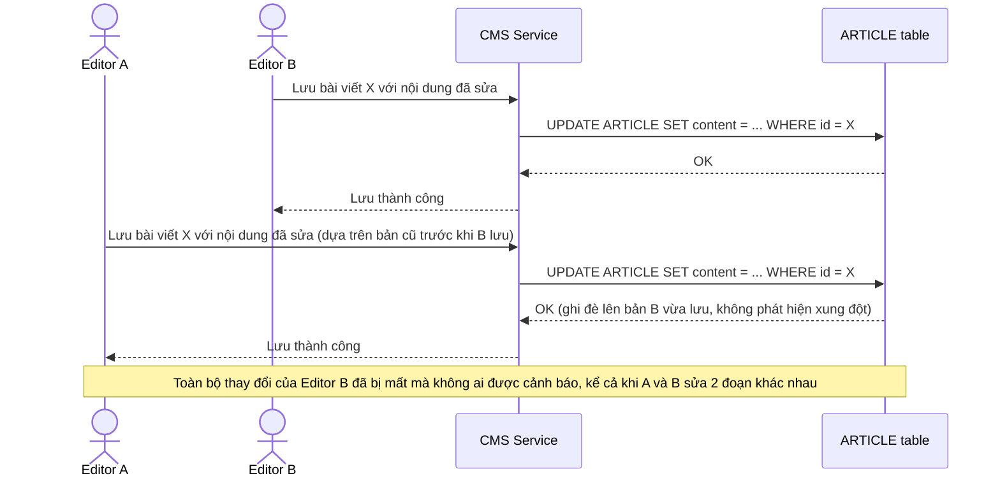
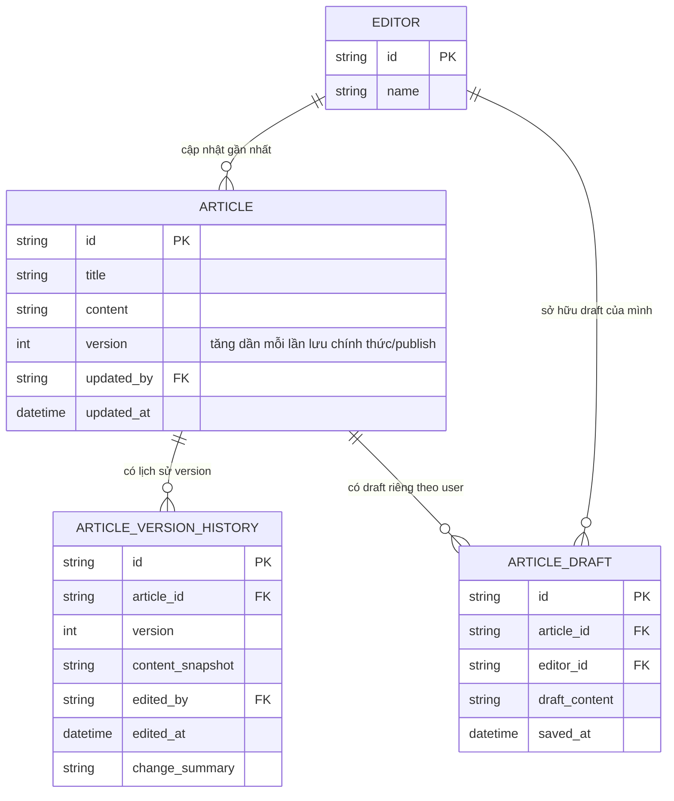
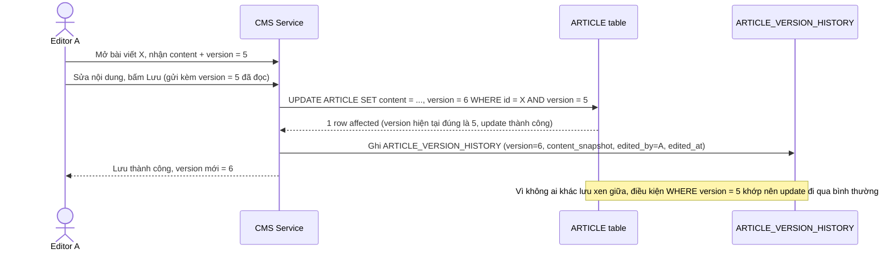
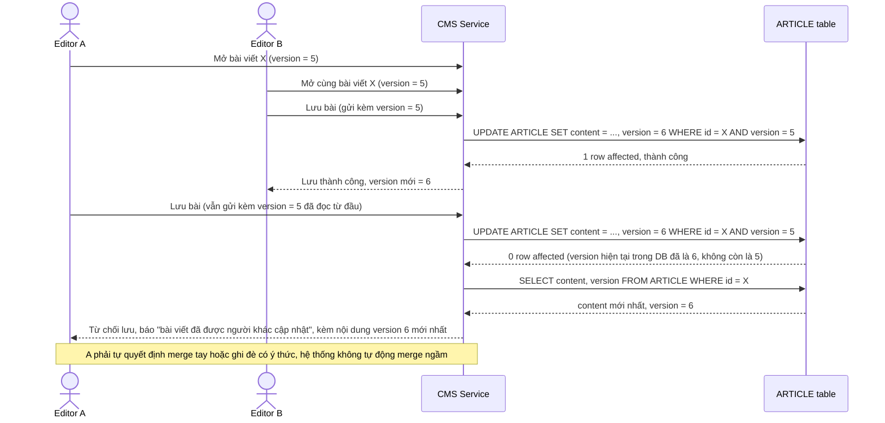
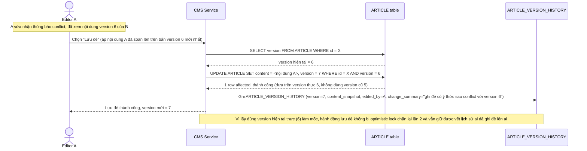
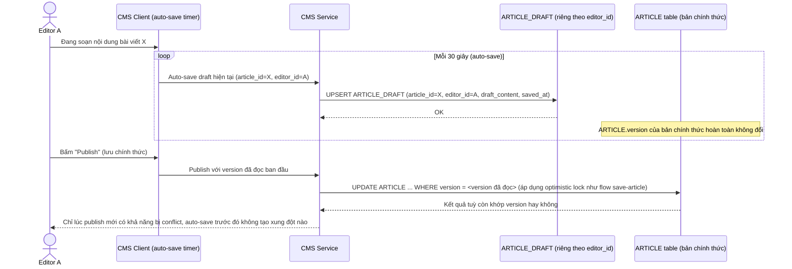
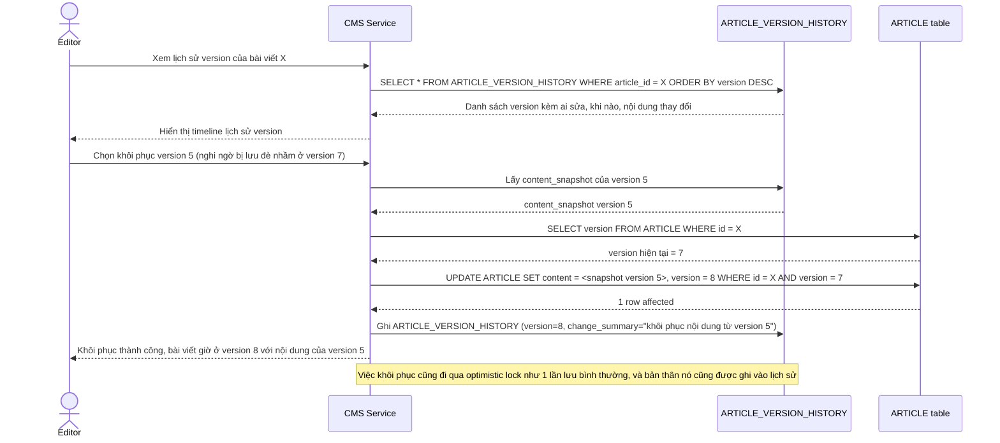

# Chỉnh sửa bài viết CMS bởi nhiều biên tập viên

**Hệ thống:** Một CMS quản lý nội dung cho tòa soạn báo online, nhiều biên tập viên có thể cùng mở và sửa 1 bài viết (ít xảy ra nhưng không hiếm, ví dụ 2 biên tập viên cùng ca trực).

**Vai trò của flow:** Vì xung đột sửa đồng thời hiếm xảy ra nhưng cần trải nghiệm mượt (không muốn khóa bài viết chặn người khác chỉ vì 1 người đang mở xem), flow lưu bài viết nên dùng optimistic locking dựa trên version, phát hiện xung đột tại thời điểm lưu thay vì chặn ngay từ khi mở bài.

**Yêu cầu cụ thể:**
- Mỗi bài viết có cột `version` tăng dần mỗi lần lưu; khi biên tập viên A mở bài ở version 5, sửa nội dung rồi lưu, request lưu phải gửi kèm version 5 đã đọc và server chỉ chấp nhận nếu version hiện tại trong DB vẫn là 5 (update kèm điều kiện `WHERE version = 5`), nếu không khớp phải trả lỗi conflict rõ ràng, không âm thầm ghi đè.
- Mô tả cụ thể: biên tập viên A và B cùng mở bài ở version 5, B lưu trước (bài chuyển sang version 6), A lưu sau vẫn gửi version 5 — request của A phải bị từ chối với thông báo "bài viết đã được người khác cập nhật", kèm hiển thị nội dung mới nhất (version 6) để A quyết định merge tay hoặc ghi đè có ý thức, không tự động merge ngầm.
- Cho phép A chọn "lưu đè" sau khi đã xem nội dung mới của B (ghi đè có ý thức, không phải ghi đè mù), hành động này phải tạo version mới dựa trên version hiện tại thực (6 → 7), không dùng lại version cũ (5) đã lỗi thời.
- Tự động lưu draft định kỳ (auto-save) trong lúc biên tập viên đang soạn không được tính là 1 "lưu chính thức" làm tăng version theo cách gây xung đột giả với người khác — quy định rõ auto-save lưu vào 1 bản riêng (draft riêng theo user) tách khỏi bản chính thức, chỉ khi publish mới áp dụng optimistic lock lên bản chính thức.
- Ghi log lịch sử các version bài viết (ai sửa, khi nào, nội dung gì thay đổi) để biên tập viên có thể xem lại/khôi phục version cũ nếu bị lưu đè nhầm.

---

# Base ERD — CMS chưa có version, lưu bài viết ghi đè mù

Đây là **base**: trạng thái CMS *trước khi* áp dụng optimistic locking theo version. Suy luận từ đề bài, base đã có `EDITOR` (biên tập viên) và `ARTICLE` (bài viết) với nội dung cơ bản, nhiều editor có thể cùng mở 1 bài viết. Base chưa có cột `version`, chưa có lịch sử version, và mỗi lần lưu chỉ ghi đè trực tiếp `content` — ai lưu sau sẽ ghi đè hoàn toàn thay đổi của người lưu trước mà không phát hiện được.

---

# Base sequence — Mở bài viết để sửa (không có khái niệm version)

Đây là **base**, flow mở bài viết hiện tại: editor mở bài, nhận toàn bộ nội dung hiện có, không có thông tin version đi kèm vì hệ thống chưa track version. Đây là tiền đề để so sánh với yêu cầu 1 (thêm cột version phải trả về khi mở bài để client gửi kèm lúc lưu).

---

# Base sequence — Lưu bài viết (ghi đè mù, mất dữ liệu của người lưu trước)

Đây là **base**, flow lưu bài viết ở trạng thái hiện tại: không kiểm tra version, ai lưu sau sẽ ghi đè toàn bộ `content` của người lưu trước, kể cả khi 2 người sửa 2 phần nội dung khác nhau. Đây chính là vấn đề "lost update" mà toàn bộ đề bài (optimistic lock theo version) phải giải quyết.

---

# Enhance ERD — Version, optimistic lock, draft riêng theo user, lịch sử version

Đây là ERD **sau khi** enhance được áp dụng lên base. So với base, thêm mới:

- `ARTICLE.version` — tăng dần mỗi lần lưu chính thức, đáp ứng yêu cầu 1 và yêu cầu 2 (điều kiện `WHERE version = 5` khi lưu, phát hiện xung đột).
- `ARTICLE_VERSION_HISTORY` (mới) — snapshot nội dung mỗi version, ai sửa/khi nào, đáp ứng yêu cầu 5 (xem lại/khôi phục version cũ). Cũng là nguồn dữ liệu để hiển thị nội dung version mới nhất khi conflict xảy ra (yêu cầu 2, 3).
- `ARTICLE_DRAFT` (mới) — draft riêng theo từng editor, tách biệt hoàn toàn khỏi `ARTICLE.version` chính thức, đáp ứng yêu cầu 4 (auto-save không được tính là lưu chính thức, không gây xung đột giả).

---

# Enhance sequence — Save article (optimistic lock theo version, ghi lịch sử)

Đây là **enhance** của flow `save-article` đã có ở base. So với base (ghi đè mù, không kiểm tra gì), giờ mọi request lưu phải gửi kèm `version` đã đọc, server chỉ chấp nhận nếu version hiện tại trong DB còn khớp (`UPDATE ... WHERE version = 5`), đồng thời ghi snapshot vào lịch sử. Đáp ứng trực tiếp yêu cầu 1 (trường hợp lưu thành công, không có xung đột) và tạo dữ liệu cho yêu cầu 5 (lịch sử version).

---

# Enhance sequence — Phát hiện xung đột khi lưu (version đã lỗi thời)

Đây là **enhance**, flow mới mô tả đúng kịch bản nêu trong yêu cầu 2 của đề bài: Editor A và B cùng mở bài ở version 5, B lưu trước (bài chuyển version 6), A lưu sau vẫn gửi version 5 — request của A phải bị từ chối rõ ràng, kèm hiển thị nội dung mới nhất (version 6), không tự động ghi đè.

---

# Enhance sequence — Lưu đè có ý thức sau khi xem nội dung mới

Đây là **enhance**, flow tiếp nối trực tiếp sau `save-conflict-detected`, đáp ứng yêu cầu 3 của đề bài: sau khi Editor A đã xem nội dung mới nhất (version 6) của Editor B, A chọn "lưu đè có ý thức" — hành động này phải tạo version mới dựa trên version hiện tại thực (6 → 7), không dùng lại version cũ (5) đã lỗi thời.

---

# Enhance sequence — Auto-save draft riêng theo user, không tăng version chính thức

Đây là **enhance**, flow hoàn toàn mới đáp ứng yêu cầu 4 của đề bài: trong lúc Editor đang soạn, hệ thống tự động lưu draft định kỳ vào `ARTICLE_DRAFT` riêng theo từng user, hoàn toàn tách khỏi `ARTICLE.version` chính thức — không gây xung đột giả với người khác đang sửa cùng bài.

---

# Enhance sequence — Xem lịch sử version và khôi phục bản cũ

Đây là **enhance**, flow hoàn toàn mới đáp ứng yêu cầu 5 của đề bài: biên tập viên có thể xem lại lịch sử các version bài viết (ai sửa, khi nào, thay đổi gì) và khôi phục 1 version cũ nếu phát hiện bị lưu đè nhầm.

