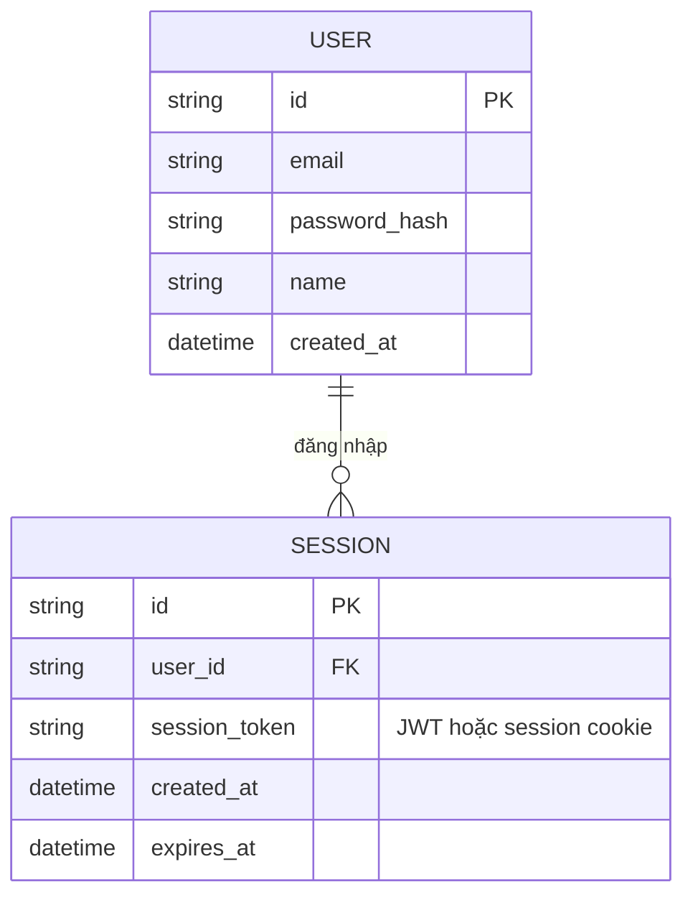
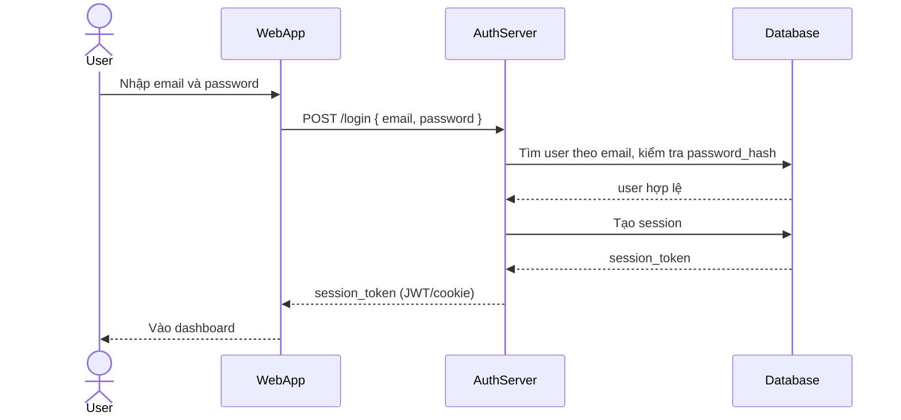
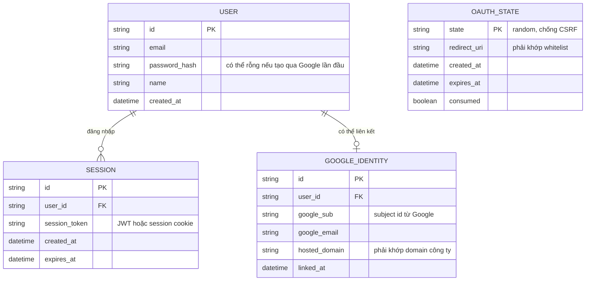
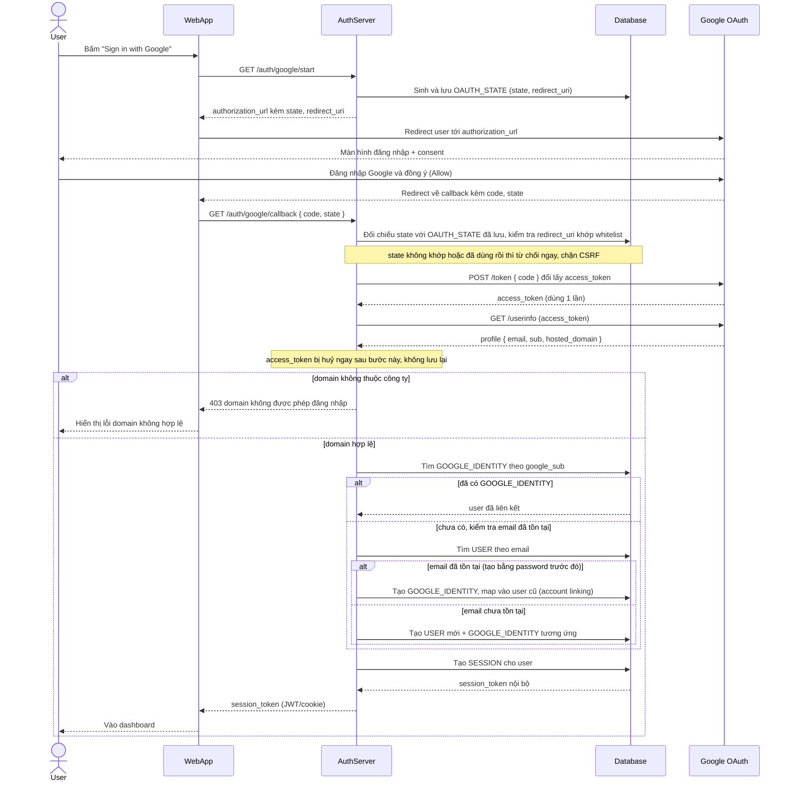
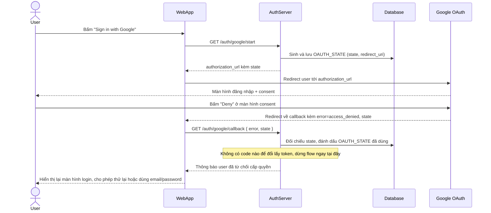

# "Đăng nhập bằng Google" cho một SaaS dashboard nội bộ

**Hệ thống:** Một dashboard quản lý task nội bộ (kiểu Trello mini) cho công ty, hiện chỉ có đăng nhập bằng email/password.

**Vai trò của flow:** Thêm nút "Sign in with Google" — app đóng vai trò OAuth Client, dùng authorization code flow để lấy identity token và định danh user, thay thế/song song với login truyền thống.

**Yêu cầu cụ thể:**
- Chỉ cho phép đăng nhập bằng các Google account thuộc domain công ty (chặn domain khác).
- Lần đầu login qua Google phải tự tạo user record và map với account cũ nếu email đã tồn tại (account linking).
- Phải dùng `state` param để chống CSRF, và validate `redirect_uri` khớp whitelist.
- Access token của Google chỉ dùng một lần để lấy profile — không lưu lại; hệ thống tự phát session token riêng (JWT/session cookie) sau khi xác thực xong.
- Xử lý được case user bấm "Deny" ở màn hình consent của Google.

---

# Base ERD — Dashboard nội bộ chỉ có login email/password

Đây là **base**: mô hình dữ liệu suy luận từ ngữ cảnh đề bài. Đề bài nói rõ hệ thống "hiện chỉ có đăng nhập bằng email/password" — nên base chỉ cần entity xoay quanh User + session đăng nhập truyền thống, không bịa thêm các entity khác của dashboard quản lý task (board, card...) vì đề bài không liên quan tới chúng. Base **chưa có** khái niệm OAuth identity liên kết Google, chưa có state chống CSRF, chưa có logic giới hạn theo domain công ty — tất cả là phần enhance.

---

# Base sequence — Login

Đây là **base**, flow "Đăng nhập bằng email/password" — tiền đề bắt buộc cho enhance, vì "Sign in with Google" được thêm để thay thế/song song với chính flow này. Chọn flow này để làm rõ cơ chế phát session token nội bộ đã có sẵn trước khi có thêm phương thức đăng nhập qua Google.

---

# Enhance ERD — Thêm Sign in with Google với account linking và CSRF state

Đây là ERD **sau khi** enhance được áp dụng lên base. `USER` và `SESSION` giữ nguyên. So với base, có 2 nhóm entity mới, ứng trực tiếp với yêu cầu trong đề bài:

- `GOOGLE_IDENTITY` (mới) — liên kết 1 user với 1 Google account (`google_sub`, `hosted_domain` để kiểm tra domain công ty), cho phép map với user cũ nếu email đã tồn tại (account linking).
- `OAUTH_STATE` (mới) — lưu tạm `state` param để chống CSRF và `redirect_uri` cần khớp whitelist, tồn tại ngắn hạn trong lúc chờ Google redirect trở lại.

Access token của Google **không** được lưu thành entity nào cả — đúng yêu cầu đề bài "chỉ dùng một lần để lấy profile, không lưu lại".

---

# Enhance sequence — Google login

Đây là **enhance**, flow hoàn toàn mới so với base — đăng nhập qua "Sign in with Google" bằng authorization code flow. Đây là flow trung tâm của enhance, thể hiện state chống CSRF + validate redirect_uri, giới hạn theo domain công ty, account linking khi email đã tồn tại, và việc access token của Google chỉ dùng 1 lần rồi không lưu lại.

---

# Enhance sequence — Google login deny

Đây là **enhance**, flow hoàn toàn mới so với base — xử lý trường hợp user bấm "Deny" ở màn hình consent của Google, đúng yêu cầu cuối trong đề bài. Chọn vẽ riêng flow này vì đây là 1 nhánh kết thúc sớm, không đi tới bước đổi code lấy token, cần xử lý gọn để không văng lỗi khó hiểu cho user.

