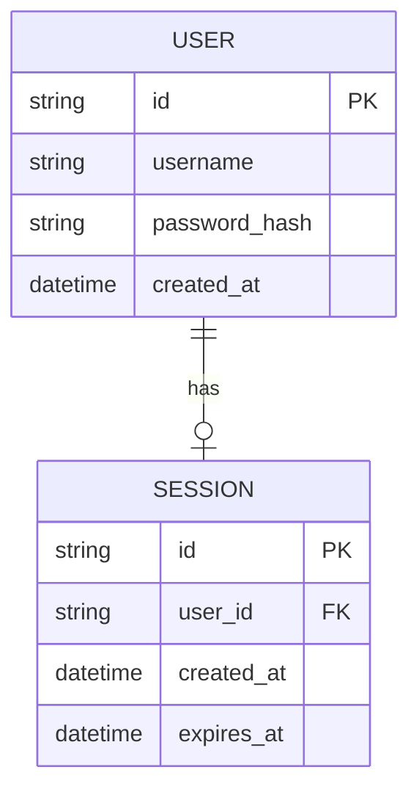
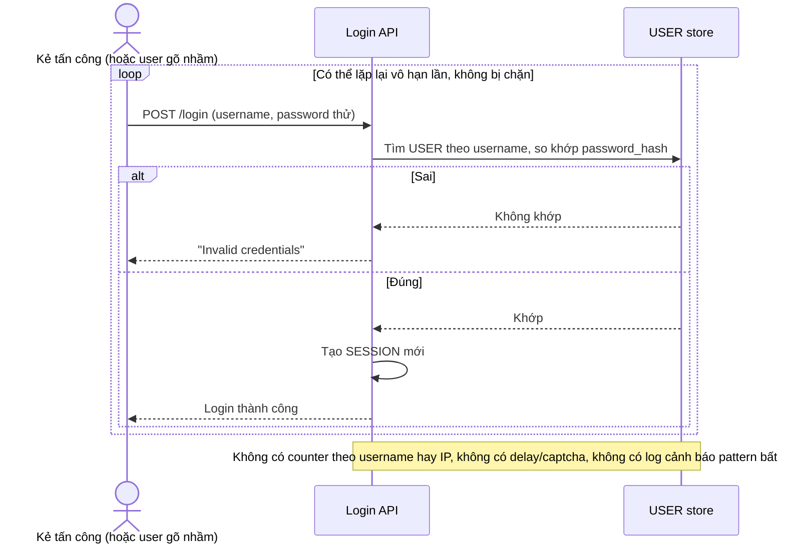
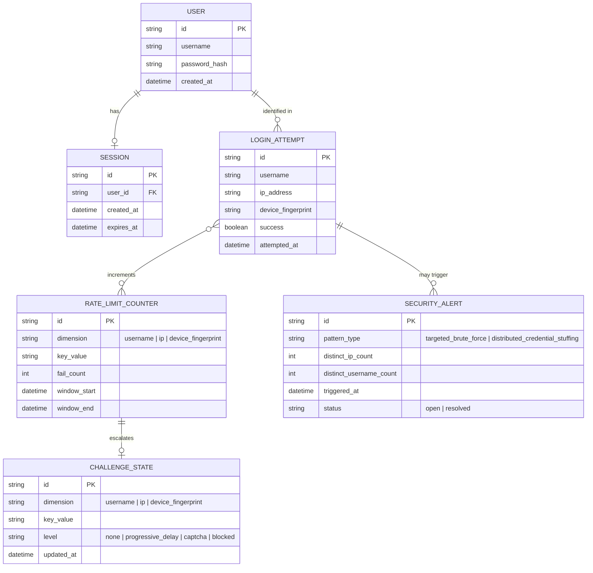
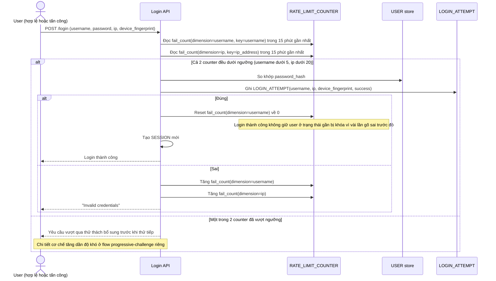
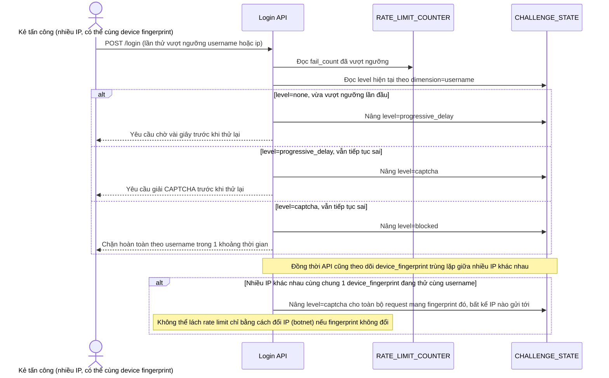
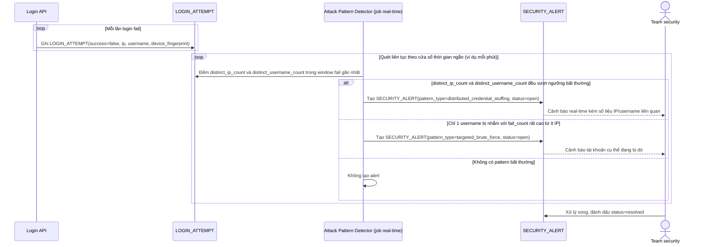

# Chống brute-force ở endpoint đăng nhập

**Hệ thống:** Một web app cần bảo vệ endpoint login khỏi tấn công dò mật khẩu (brute force/credential stuffing).

**Vai trò của flow:** Rate limiting theo nhiều chiều (theo IP, theo username, theo device) để làm chậm/ngăn tấn công dò mật khẩu mà không gây khó cho user hợp lệ gõ sai vài lần.

**Yêu cầu cụ thể:**
- Giới hạn số lần login sai theo username cụ thể (ví dụ 5 lần/15 phút) độc lập với giới hạn theo IP (ví dụ 20 lần/15 phút toàn bộ username khác nhau từ 1 IP) để bắt được cả 2 kiểu tấn công (dò 1 tài khoản nhiều lần, và dò nhiều tài khoản từ 1 nguồn).
- Sau khi vượt ngưỡng, phải có cơ chế tăng dần độ khó (progressive delay/CAPTCHA) trước khi chặn hoàn toàn, tránh chặn cứng ngay gây trải nghiệm xấu cho user thật chỉ gõ nhầm vài lần.
- Rate limit không được dựa hoàn toàn vào IP đơn lẻ vì tấn công thực tế thường dùng nhiều IP (botnet) — phải kết hợp thêm fingerprint thiết bị hoặc pattern hành vi bất thường.
- Login thành công phải reset counter rate limit của username đó, không giữ user hợp lệ trong trạng thái gần bị khóa do vài lần gõ sai trước đó.
- Log và alert khi phát hiện pattern tấn công rõ ràng (số lượng lớn login fail trong thời gian ngắn từ nhiều IP nhắm vào nhiều username) để team security theo dõi real-time.

---

# Base ERD — Login đơn giản, chưa có rate limit

Đây là **base**: mô hình dữ liệu suy luận từ ngữ cảnh đề bài, thể hiện trạng thái hệ thống **trước khi** có rate limiting chống brute-force. Đề bài nói bảo vệ endpoint login của 1 web app — nên base cần đủ: user với credential, và session tạo ra khi login thành công. Chưa có entity nào ghi nhận lịch sử các lần login (thành công/thất bại), counter theo username/IP/device, hay cảnh báo tấn công — những thứ đó là phần enhance.

---

# Base sequence — Login (không giới hạn số lần thử)

Đây là **base**, flow "Login" ở trạng thái hiện tại — kiểm tra username/password, không đếm số lần sai, không phân biệt nguồn gọi. Flow này liên quan mật thiết tới enhance vì toàn bộ vấn đề của đề bài (dò mật khẩu 1 tài khoản nhiều lần, hoặc dò nhiều tài khoản từ 1 nguồn) đều khai thác đúng việc endpoint này cho thử vô hạn lần.

---

# Enhance ERD — sau khi có rate limit đa chiều chống brute-force

Đây là ERD **sau khi** enhance được áp dụng lên base. So với base, có 4 nhóm entity mới, ứng trực tiếp với các yêu cầu trong đề bài:

- `LOGIN_ATTEMPT` (mới) — ghi nhận từng lần login kèm username, IP, device fingerprint, kết quả — nền tảng để tính counter theo nhiều chiều.
- `RATE_LIMIT_COUNTER` (mới) — đếm số lần fail theo từng chiều độc lập (`username`, `ip`, `device_fingerprint`), bắt được cả tấn công 1 tài khoản lẫn tấn công rải nhiều tài khoản từ 1 nguồn.
- `CHALLENGE_STATE` (mới) — mức độ thử thách tăng dần (delay/CAPTCHA/block) gắn theo counter, thay vì chặn cứng ngay khi vượt ngưỡng.
- `SECURITY_ALERT` (mới) — cảnh báo khi phát hiện pattern tấn công rõ ràng trên diện rộng.

---

# Enhance sequence — Login (kiểm tra rate limit đa chiều, reset khi thành công)

Đây là **enhance** của flow "Login" đã có ở base. So với base, mỗi lần login đều được ghi nhận và đối chiếu với counter theo cả username lẫn IP trước khi xử lý; login thành công reset counter theo username; login sai cả username lẫn IP đều bị tăng độc lập (đáp ứng yêu cầu 1 và 4 của đề bài).

---

# Enhance sequence — Tăng dần độ khó khi vượt ngưỡng, kết hợp device fingerprint

Đây là **enhance**, flow hoàn toàn mới, phát sinh từ enhance — chưa tồn tại ở base (base không có khái niệm thử thách hay khóa tạm). Đáp ứng yêu cầu 2 và 3 của đề bài: không chặn cứng ngay lập tức, tăng dần progressive delay/CAPTCHA trước khi block hẳn, và không chỉ dựa vào IP đơn lẻ vì tấn công thực tế thường dùng botnet nhiều IP.

---

# Enhance sequence — Phát hiện pattern tấn công diện rộng, alert real-time

Đây là **enhance**, flow hoàn toàn mới, phát sinh từ enhance — chưa tồn tại ở base (base không log hay phân tích pattern của các lần login fail). Đáp ứng yêu cầu 5 của đề bài: log và alert khi phát hiện số lượng lớn login fail trong thời gian ngắn từ nhiều IP nhắm vào nhiều username, để team security theo dõi real-time.

