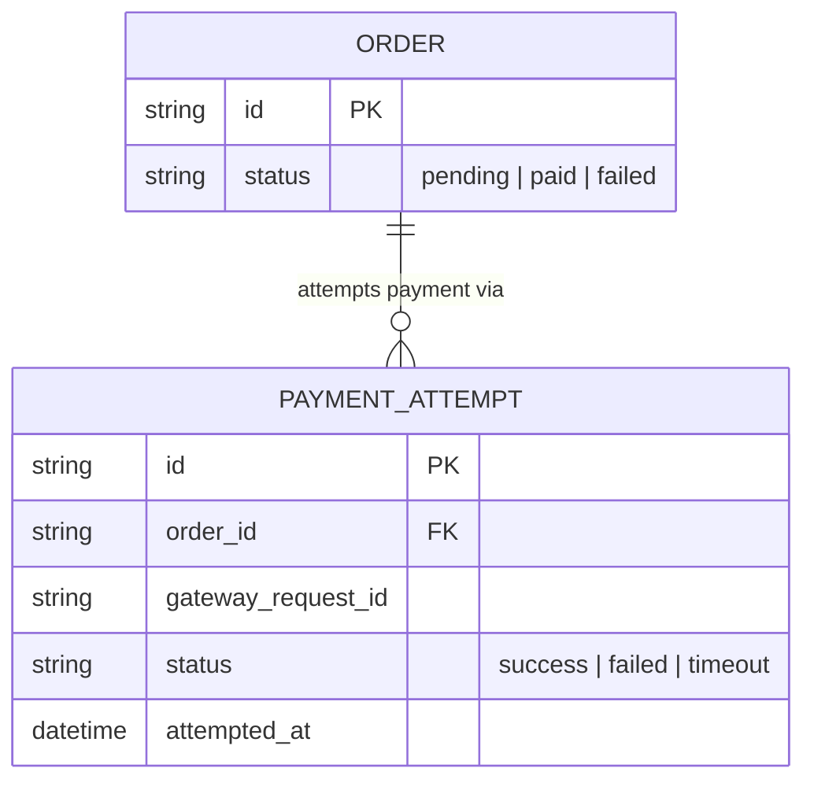
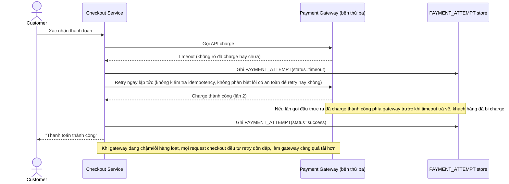
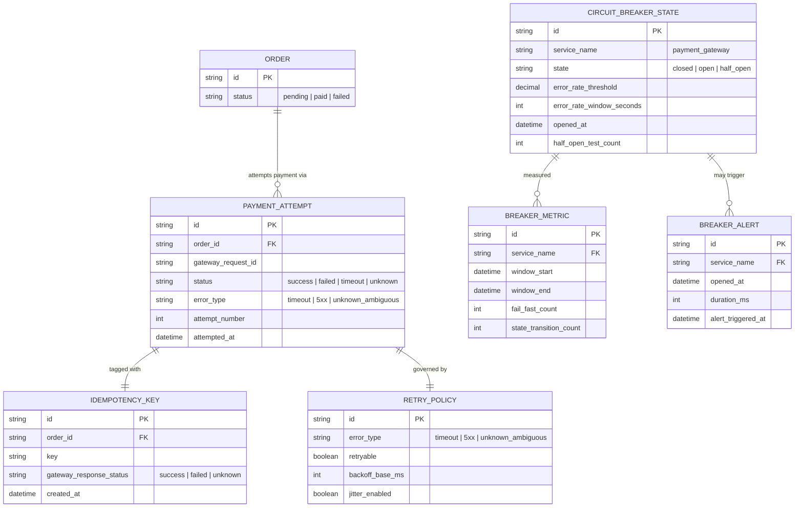
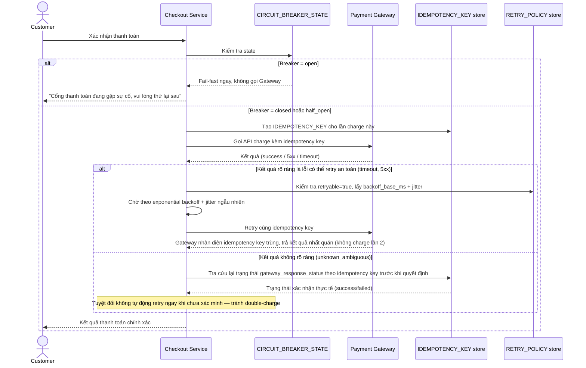
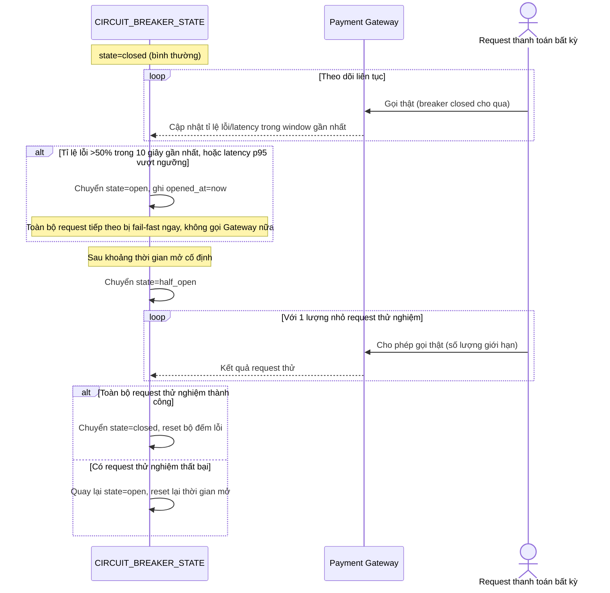
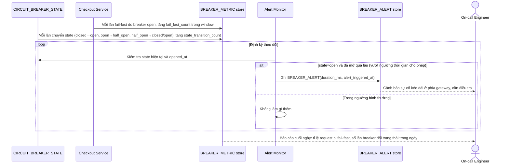

# Checkout gọi payment gateway bên thứ ba

**Hệ thống:** Trang e-commerce gọi API cổng thanh toán bên ngoài (kiểu Stripe) để xử lý thanh toán lúc checkout.

**Vai trò của flow:** Circuit breaker + retry with backoff bảo vệ hệ thống khi payment gateway chậm/lỗi, tránh làm nghẽn toàn bộ luồng checkout và tránh gọi lại dồn dập làm gateway càng quá tải.

**Yêu cầu cụ thể:**
- Định nghĩa rõ ngưỡng mở circuit breaker (ví dụ tỉ lệ lỗi >50% trong 10 giây gần nhất, hoặc latency p95 vượt X ms) và hành vi khi breaker mở (fail-fast, không gọi gateway nữa trong một khoảng thời gian).
- Retry chỉ áp dụng cho lỗi có thể retry an toàn (timeout, 5xx) — tuyệt đối không retry tự động cho response không rõ kết quả liên quan tới việc charge tiền (tránh double-charge), phải có bước kiểm tra idempotency key trước khi retry.
- Backoff phải là exponential kèm jitter (ngẫu nhiên hóa) để tránh nhiều request cùng retry đồng loạt tạo ra "retry storm" làm gateway sập thêm.
- Circuit breaker phải có trạng thái half-open để thử lại một lượng nhỏ request sau khi hết thời gian mở, và chỉ đóng lại hoàn toàn khi các request thử nghiệm đó thành công.
- Đo lường: tỉ lệ request bị fail-fast do breaker mở, số lần breaker chuyển trạng thái trong ngày, và alert khi breaker mở quá lâu (báo hiệu sự cố kéo dài ở phía gateway).

---

# Base ERD — Checkout gọi payment gateway trước khi có circuit breaker

Đây là **base**: mô hình dữ liệu suy luận từ ngữ cảnh đề bài, thể hiện trạng thái hệ thống **trước khi** có circuit breaker + retry an toàn. Đề bài nói checkout gọi trực tiếp API cổng thanh toán bên ngoài — nên base cần đủ: đơn hàng và các lần gọi thanh toán, ghi nhận đơn giản không phân loại lỗi. Chưa có entity nào phục vụ circuit breaker state/idempotency key/retry policy/metric — những thứ đó là phần enhance.

---

# Base sequence — Checkout payment (gọi trực tiếp, retry mù quáng)

Đây là **base**, flow "Thanh toán lúc checkout" ở trạng thái hiện tại — gọi thẳng gateway, retry ngay lập tức không phân biệt loại lỗi, không kiểm tra idempotency. Flow này liên quan mật thiết tới enhance vì toàn bộ 5 yêu cầu của đề bài đều nhằm sửa đúng các lỗ hổng ở đây.

---

# Enhance ERD — sau khi có circuit breaker + retry an toàn

Đây là ERD **sau khi** enhance được áp dụng lên base. So với base, có 4 nhóm entity mới, ứng trực tiếp với 5 yêu cầu trong đề bài:

- `CIRCUIT_BREAKER_STATE` (mới) — trạng thái closed/open/half_open, ngưỡng mở, thời điểm mở.
- `IDEMPOTENCY_KEY` (mới) — gắn với mỗi lần charge, dùng để kiểm tra trước khi quyết định retry cho lỗi không rõ kết quả.
- `RETRY_POLICY` (mới) — phân loại rõ lỗi nào được retry, backoff exponential kèm jitter.
- `BREAKER_METRIC` + `BREAKER_ALERT` (mới) — đo tỉ lệ fail-fast, số lần chuyển trạng thái, cảnh báo khi breaker mở quá lâu.

---

# Enhance sequence — Checkout payment (qua circuit breaker, retry an toàn)

Đây là **enhance**, cùng flow "Checkout payment" đã có ở base nhưng nay thay đổi hoàn toàn theo yêu cầu 1, 2 và 3 của đề bài: gọi qua circuit breaker, chỉ retry lỗi an toàn với exponential backoff kèm jitter, và kiểm tra idempotency trước khi retry lỗi không rõ kết quả.

---

# Enhance sequence — Circuit breaker state machine

Đây là **enhance**, flow hoàn toàn mới, phát sinh từ enhance — chưa tồn tại ở base (base không có khái niệm breaker). Đáp ứng yêu cầu 1 và 4 của đề bài: ngưỡng mở rõ ràng, hành vi fail-fast khi mở, và trạng thái half-open thử lại một lượng nhỏ request trước khi đóng hẳn.

---

# Enhance sequence — Breaker metrics & alerting

Đây là **enhance**, flow hoàn toàn mới, phát sinh từ enhance — chưa tồn tại ở base. Đáp ứng yêu cầu thứ 5 của đề bài: đo tỉ lệ fail-fast, số lần breaker chuyển trạng thái trong ngày, và alert khi breaker mở quá lâu.

