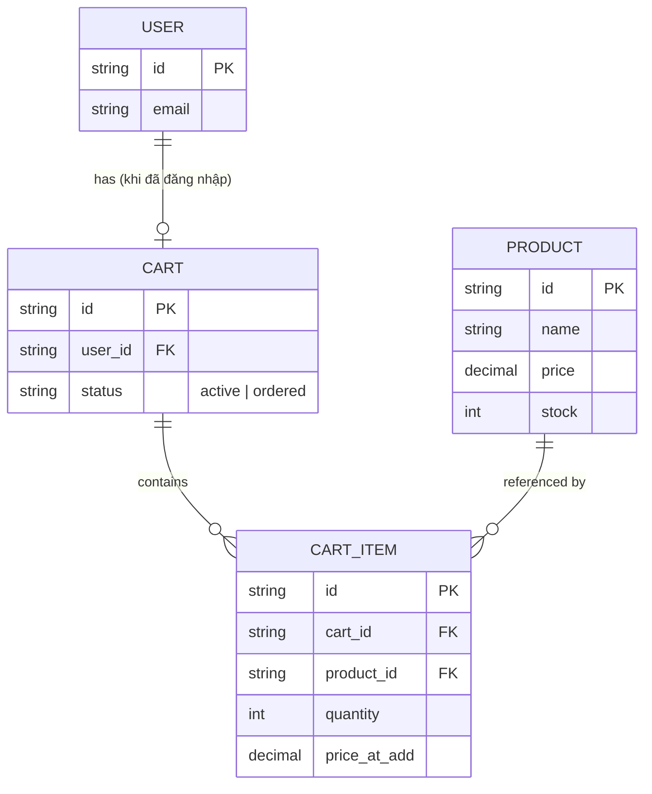
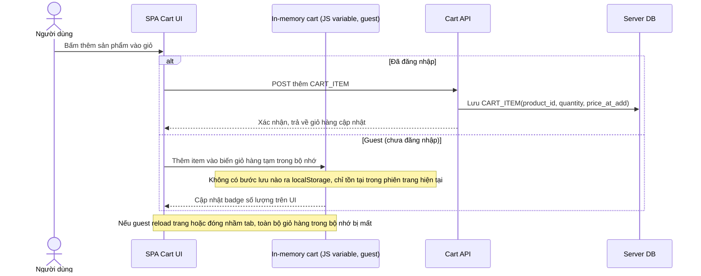
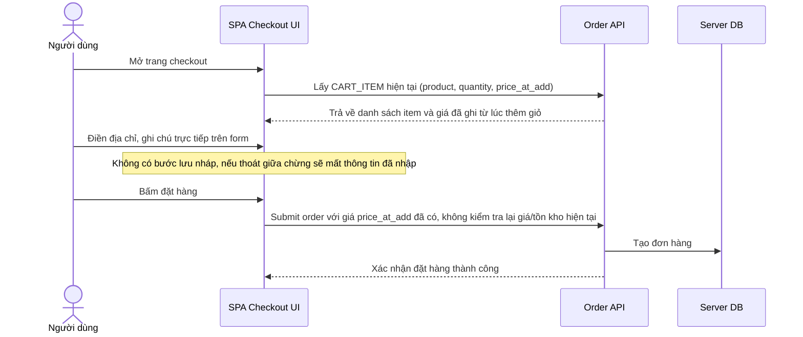
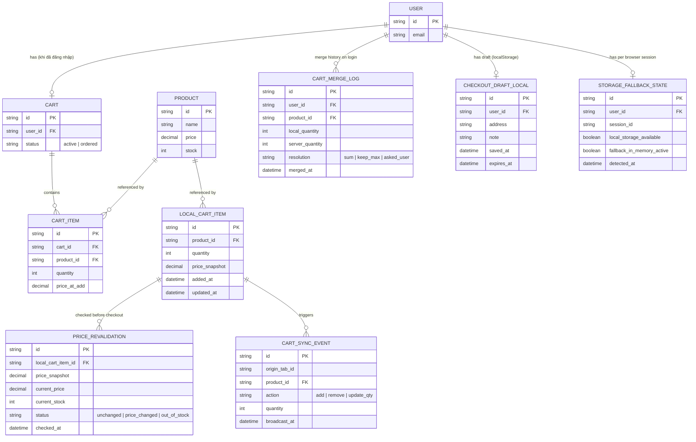
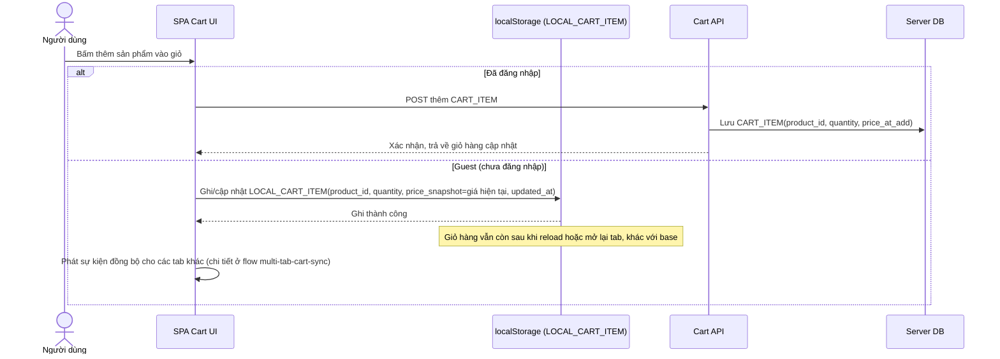
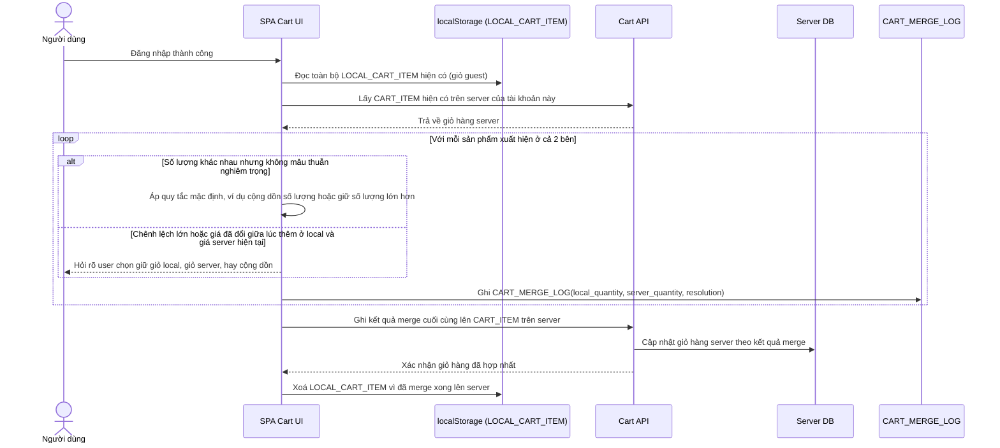
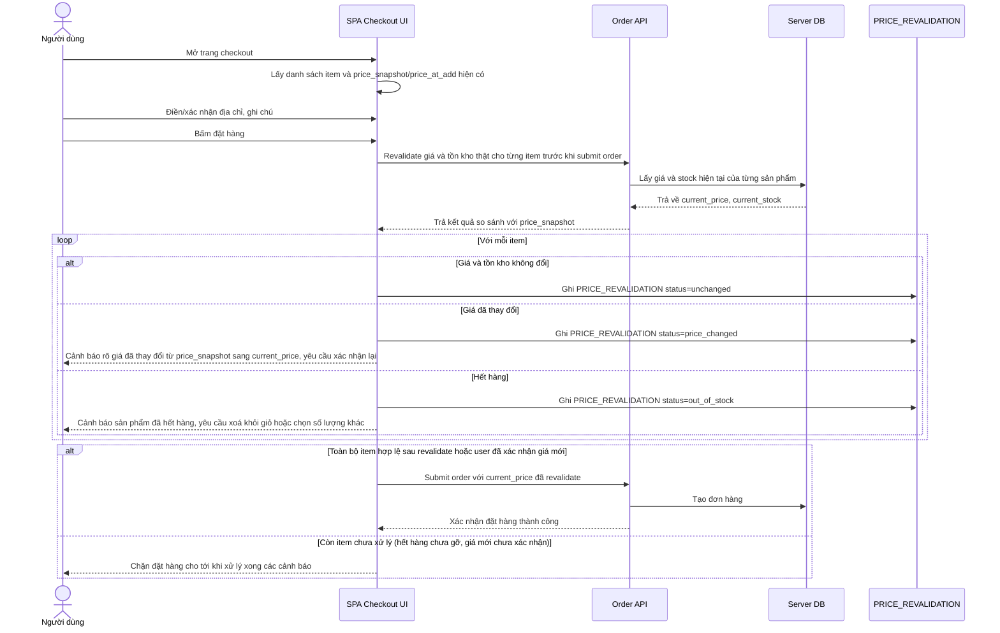
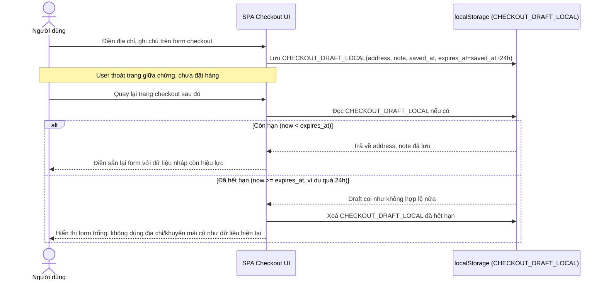
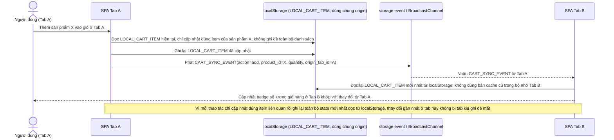
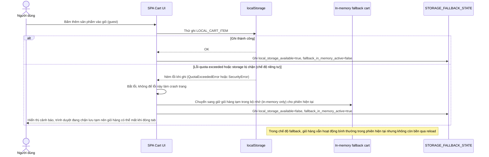

# Giữ giỏ hàng và form checkout dở dang qua localStorage

**Hệ thống:** SPA e-commerce lưu giỏ hàng và form checkout dở dang vào localStorage để user không mất dữ liệu khi reload/đóng nhầm tab, đồng thời phải đồng bộ đúng với giỏ hàng thật trên server khi đăng nhập.

**Vai trò của flow:** Đảm bảo trải nghiệm "không mất dữ liệu" khi mất mạng/đóng nhầm tab, nhưng không để dữ liệu cache phía client lấn át dữ liệu nguồn (server) gây sai lệch giá/tồn kho.

**Yêu cầu cụ thể:**
- Khi user thêm sản phẩm vào giỏ ở trạng thái chưa đăng nhập (guest), giỏ hàng lưu localStorage; khi đăng nhập, phải merge đúng với giỏ hàng đã có sẵn trên server của tài khoản đó — quyết định rõ thứ tự ưu tiên (giữ số lượng lớn hơn? cộng dồn? hỏi user khi conflict?) chứ không được ghi đè ngầm định gây mất dữ liệu.
- localStorage lưu snapshot giá tại thời điểm thêm vào giỏ; trước khi checkout phải revalidate lại giá/tồn kho thật với server, và xử lý rõ khi giá đổi hoặc hết hàng (hiển thị cảnh báo, không để user thanh toán nhầm giá cũ).
- Nhiều tab cùng mở giỏ hàng: khi 1 tab thêm/xóa item, cập nhật đồng bộ badge số lượng ở các tab khác qua `storage` event (hoặc BroadcastChannel), tránh tình trạng 1 tab ghi đè localStorage của tab khác làm mất thay đổi vừa thực hiện ở tab kia.
- Xử lý khi localStorage đầy (quota exceeded) hoặc bị user tắt qua chế độ duyệt riêng tư/tắt storage — có fallback (in-memory only, cảnh báo user) mà không crash trang.
- Dữ liệu form checkout dở dang (địa chỉ, note) có TTL tự hết hạn (ví dụ sau 24h) để tránh hiển thị lại thông tin đã lỗi thời (địa chỉ cũ, khuyến mãi hết hạn) như là dữ liệu hiện tại.

---

# Base ERD — Giỏ hàng và checkout trước khi có persistence bằng localStorage

Đây là **base**: mô hình dữ liệu suy luận từ ngữ cảnh đề bài, mô tả trạng thái hệ thống **trước khi** giỏ hàng/form checkout được lưu vào localStorage. Đề bài giả định đã có sản phẩm, giỏ hàng, và checkout hoạt động server-driven cho user đã đăng nhập; còn giỏ hàng của guest (chưa đăng nhập) chỉ tồn tại tạm trong bộ nhớ JS của trang, mất ngay khi reload/đóng tab. Chưa có bất kỳ entity nào phía client (localStorage cart, snapshot giá, đồng bộ đa tab, TTL draft) — toàn bộ phần đó là enhance.

---

# Base sequence — Add to cart (guest cart chỉ tồn tại trong bộ nhớ, mất khi reload)

Đây là **base**, flow thêm sản phẩm vào giỏ ở trạng thái trước enhance. Với user đã đăng nhập, item được ghi thẳng lên giỏ hàng server. Với guest (chưa đăng nhập), giỏ hàng chỉ tồn tại trong biến JS ở bộ nhớ trang, không có bước lưu nào ra localStorage — nên reload hoặc đóng nhầm tab là mất toàn bộ giỏ. Đây chính là vấn đề mà enhance sẽ giải quyết bằng localStorage.

---

# Base sequence — Checkout (form nhập trực tiếp, không lưu nháp, giá lấy live)

Đây là **base**, flow checkout ở trạng thái trước enhance. Người dùng điền địa chỉ/ghi chú trực tiếp trên form, không có bước lưu nháp nào — nếu thoát giữa chừng thì mất hết thông tin đã nhập. Giá sản phẩm được lấy trực tiếp từ CART_ITEM đã ghi ở bước thêm giỏ hàng, dùng luôn để đặt hàng, không có bước revalidate lại. Flow này là nền để so sánh với flow cùng tên ở enhance, nơi thêm revalidate giá/tồn kho và cơ chế TTL cho form nháp.

---

# Enhance ERD — Giỏ hàng và checkout draft qua localStorage

Đây là ERD **sau khi** enhance được áp dụng lên base. So với base (CART/CART_ITEM chỉ có ý nghĩa cho user đã đăng nhập, guest cart chỉ ở bộ nhớ), phần enhance thêm 5 nhóm entity mới ở phía client, ứng trực tiếp với các yêu cầu trong đề bài:

- `LOCAL_CART_ITEM` (mới, localStorage) — giỏ hàng guest được lưu bền thay vì chỉ ở bộ nhớ, kèm `price_snapshot` tại thời điểm thêm — nền cho yêu cầu 1 và 2.
- `CART_MERGE_LOG` (mới) — ghi lại quyết định merge giữa giỏ local và giỏ server khi đăng nhập (cộng dồn, giữ số lượng lớn hơn, hoặc hỏi user) — yêu cầu 1.
- `PRICE_REVALIDATION` (mới) — kết quả so sánh `price_snapshot` cục bộ với giá/tồn kho thật tại thời điểm checkout — yêu cầu 2.
- `CART_SYNC_EVENT` (mới) — sự kiện phát qua `storage`/BroadcastChannel khi 1 tab add/remove item, để tab khác cập nhật badge mà không ghi đè thay đổi của nhau — yêu cầu 3.
- `STORAGE_FALLBACK_STATE` (mới) — trạng thái localStorage có khả dụng không (quota exceeded hoặc bị chặn), có đang fallback in-memory không — yêu cầu 4.
- `CHECKOUT_DRAFT_LOCAL` (mới, localStorage) — form checkout dở dang (địa chỉ, note) kèm `expires_at` để tự hết hạn — yêu cầu 5.

---

# Enhance sequence — Add to cart (guest cart bền vững qua localStorage)

Đây là **enhance**, cùng flow "add-to-cart" như ở base nhưng thay đổi ở phần guest: thay vì chỉ giữ trong biến bộ nhớ JS (mất khi reload), item được ghi vào localStorage kèm `price_snapshot` tại thời điểm thêm. Đây là nền cho yêu cầu 1 (merge khi đăng nhập) và yêu cầu 2 (snapshot giá để revalidate khi checkout); việc phát sự kiện đồng bộ đa tab được nói rõ hơn ở flow multi-tab-cart-sync riêng.

---

# Enhance sequence — Merge giỏ hàng local với giỏ hàng server khi đăng nhập

Đây là **enhance**, flow hoàn toàn mới, phát sinh từ enhance. Khi user đăng nhập, giỏ hàng guest trong localStorage phải được merge đúng với giỏ hàng đã có sẵn trên server của tài khoản đó, theo quy tắc ưu tiên rõ ràng, không ghi đè ngầm định gây mất dữ liệu. Đáp ứng yêu cầu 1 của đề bài.

---

# Enhance sequence — Checkout (revalidate giá/tồn kho trước khi thanh toán)

Đây là **enhance**, cùng flow "checkout" như ở base nhưng thêm bước revalidate: vì giá dùng ở giỏ hàng có thể là `price_snapshot`/`price_at_add` đã cũ (đặc biệt với guest cart lưu lâu trong localStorage), trước khi xác nhận thanh toán hệ thống phải kiểm tra lại giá/tồn kho thật với server và xử lý rõ khi giá đổi hoặc hết hàng, không để user thanh toán nhầm giá cũ. Đáp ứng yêu cầu 2 của đề bài.

---

# Enhance sequence — Checkout draft tự hết hạn theo TTL

Đây là **enhance**, flow hoàn toàn mới, xử lý form checkout dở dang (địa chỉ, ghi chú) lưu trong localStorage. Vì thông tin này có thể lỗi thời (địa chỉ cũ, khuyến mãi hết hạn) nếu để lâu, mỗi bản nháp phải có TTL (ví dụ 24h) và tự động không được coi là dữ liệu hiện tại khi đã hết hạn. Đáp ứng yêu cầu 5 của đề bài.

---

# Enhance sequence — Đồng bộ giỏ hàng giữa nhiều tab

Đây là **enhance**, flow hoàn toàn mới, xử lý trường hợp mở nhiều tab cùng giỏ hàng guest. Khi 1 tab thêm/xoá item, các tab khác phải cập nhật badge số lượng qua `storage` event hoặc BroadcastChannel, đồng thời tránh tình trạng 1 tab ghi đè toàn bộ localStorage của tab khác làm mất thay đổi vừa thực hiện ở tab kia. Đáp ứng yêu cầu 3 của đề bài.

---

# Enhance sequence — Fallback khi localStorage đầy hoặc bị chặn

Đây là **enhance**, flow hoàn toàn mới, xử lý trường hợp localStorage bị đầy (quota exceeded) hoặc bị user tắt (chế độ duyệt riêng tư/chặn storage). Hệ thống phải phát hiện tình trạng này, chuyển sang fallback in-memory only, và cảnh báo user mà không làm crash trang. Đáp ứng yêu cầu 4 của đề bài.

