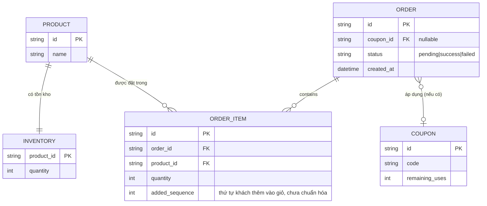
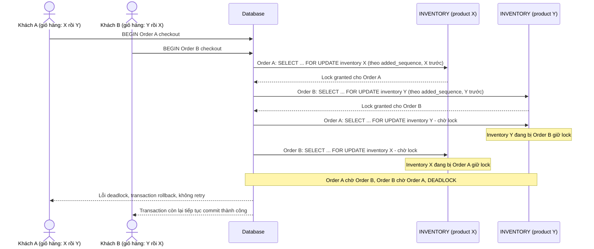
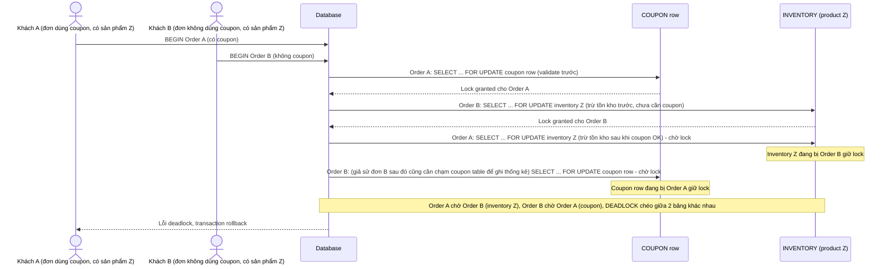
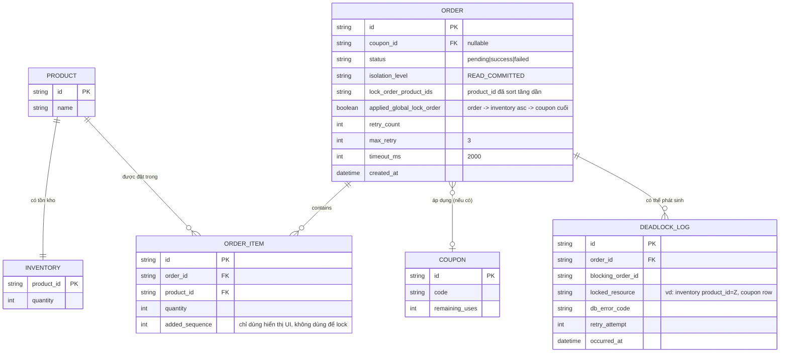
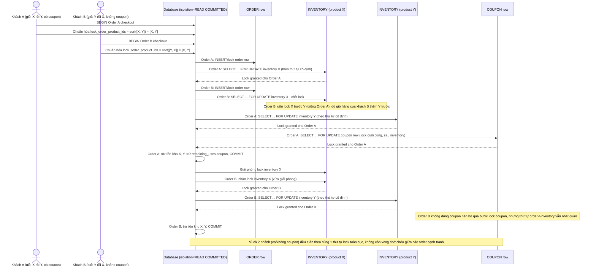
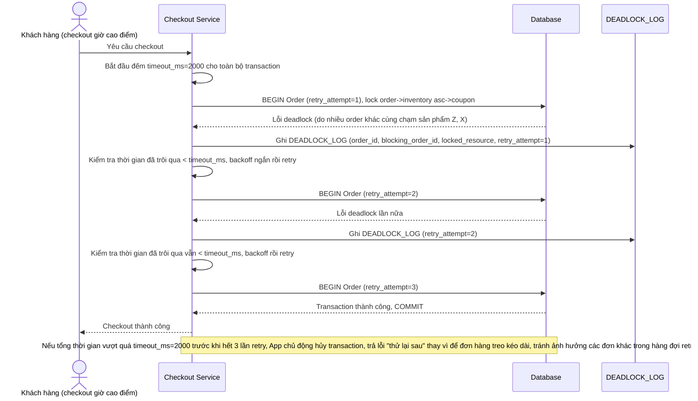
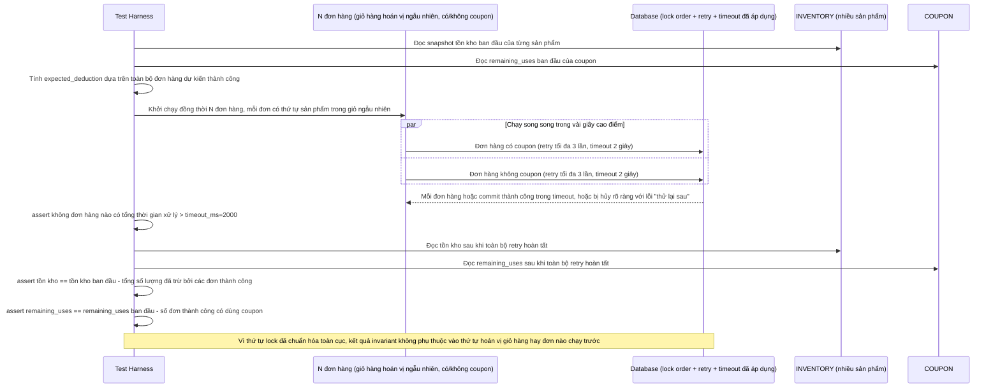

# Transaction checkout chạm nhiều bảng (đơn hàng, tồn kho, mã giảm giá) trên sàn e-commerce

**Hệ thống:** Một sàn e-commerce mà mỗi lượt checkout tạo 1 đơn hàng, trừ tồn kho của nhiều sản phẩm trong giỏ, và áp dụng mã giảm giá dùng 1 lần (giới hạn số lượt sử dụng).

**Vai trò của flow:** Transaction checkout chạm 3 nhóm bảng khác nhau (order, inventory nhiều dòng sản phẩm, coupon) trong cùng 1 lượt, thứ tự chạm các bảng này lại phụ thuộc thứ tự sản phẩm trong giỏ hàng của từng khách nên rất dễ tạo deadlock chéo giữa các đơn hàng cạnh tranh cùng lúc.

**Yêu cầu cụ thể:**
- Mô tả cụ thể: đơn hàng A có giỏ hàng gồm sản phẩm X rồi Y (khách thêm X trước), đơn hàng B có giỏ hàng gồm sản phẩm Y rồi X (khách thêm Y trước) — nếu code trừ tồn kho theo đúng thứ tự item xuất hiện trong giỏ của từng khách (không chuẩn hóa), A sẽ lock X trước rồi chờ lock Y, B sẽ lock Y trước rồi chờ lock X, tạo deadlock kinh điển; yêu cầu sort danh sách sản phẩm theo product_id tăng dần trước khi bắt đầu lock, bất kể thứ tự khách thêm vào giỏ.
- Chỉ ra rủi ro cross-table: nếu nhánh code validate mã giảm giá trước rồi mới trừ tồn kho ở 1 phần luồng (ví dụ đơn hàng dùng coupon), nhưng nhánh không dùng coupon lại trừ tồn kho trước rồi mới ghi nhận vào bảng order, thì 2 luồng có thể lock chéo giữa dòng coupon và các dòng inventory khi nhiều đơn hàng chạy song song — yêu cầu quy định 1 thứ tự lock cố định toàn cục cho mọi loại transaction checkout (ví dụ luôn: order row → inventory rows theo id tăng dần → coupon row cuối cùng), áp dụng nhất quán dù đơn có dùng coupon hay không.
- Mô tả cụ thể tình huống mùa sale: nhiều đơn hàng khác nhau chứa các sản phẩm trùng lặp một phần (đơn A có X, Y, Z; đơn B có Z, X) cùng chạy trong vài giây cao điểm — yêu cầu transaction bị deadlock phải tự động retry với backoff (tối đa 3 lần) và giới hạn thời gian tối đa cho 1 transaction checkout (ví dụ 2 giây) để tránh 1 đơn hàng bị treo kéo dài ảnh hưởng tới các đơn khác trong hàng đợi retry.
- Chọn isolation level `READ COMMITTED` kèm `SELECT ... FOR UPDATE` tường minh theo đúng thứ tự đã chuẩn hóa cho transaction checkout, giải thích vì sao dùng `SERIALIZABLE` cho toàn bộ transaction sẽ làm tăng abort rate không cần thiết trong giờ cao điểm khi nhiều đơn hàng không thực sự đụng chung sản phẩm nào.
- Viết test giả lập nhiều đơn hàng với thứ tự sản phẩm trong giỏ được hoán vị ngẫu nhiên (bao gồm cả trường hợp có/không dùng coupon), xác nhận không có transaction nào bị treo quá timeout quy định và invariant tồn kho + số lượt dùng coupon còn lại luôn đúng sau khi toàn bộ retry hoàn tất.

---

# Base ERD — Checkout chưa chuẩn hóa thứ tự lock

Đây là **base**: trạng thái hệ thống e-commerce *trước khi* áp dụng thứ tự lock cố định toàn cục. Suy luận từ đề bài, base đã có `PRODUCT`/`INVENTORY` (tồn kho theo sản phẩm), `ORDER`/`ORDER_ITEM` (đơn hàng và các dòng sản phẩm trong đơn), và `COUPON` (mã giảm giá dùng 1 lần, giới hạn số lượt). `ORDER_ITEM` có trường `added_sequence` ghi lại đúng thứ tự khách thêm sản phẩm vào giỏ — và trong base, code trừ tồn kho lại đi theo đúng thứ tự này (không chuẩn hóa), chính là nguồn gốc rủi ro deadlock nêu ở đề bài.

---

# Base sequence — Checkout (trừ tồn kho theo thứ tự giỏ hàng, gây deadlock chéo sản phẩm)

Đây là **base**, flow checkout ở trạng thái hiện tại: code trừ tồn kho theo đúng `added_sequence` (thứ tự khách thêm vào giỏ), không sort lại theo `product_id`. Đây chính là kịch bản deadlock kinh điển nêu ở yêu cầu 1 của đề bài — đơn hàng A thêm X trước Y, đơn hàng B thêm Y trước X, chạy đồng thời.

---

# Base sequence — Checkout với/không coupon (thứ tự lock khác nhau giữa 2 nhánh)

Đây là **base**, flow checkout khi 2 nhánh code (đơn dùng coupon và đơn không dùng coupon) lock tài nguyên theo thứ tự khác nhau: nhánh dùng coupon validate/lock coupon trước rồi mới trừ tồn kho, nhánh không dùng coupon trừ tồn kho trước rồi mới ghi order. Đây là kịch bản rủi ro cross-table nêu ở yêu cầu 2 của đề bài.

---

# Enhance ERD — Thứ tự lock cố định toàn cục, retry, timeout và deadlock logging

Đây là ERD **sau khi** enhance được áp dụng lên base. So với base, `ORDER_ITEM` không còn dùng `added_sequence` để quyết định thứ tự lock (giữ lại chỉ để hiển thị UI), `ORDER` thêm các trường kiểm soát isolation/retry/timeout, và có thêm entity mới `DEADLOCK_LOG`, ứng trực tiếp với các yêu cầu:

- `ORDER.lock_order_product_ids` — đáp ứng yêu cầu 1 (sort product_id tăng dần trước khi lock, bất kể thứ tự giỏ hàng).
- `ORDER.isolation_level`, `ORDER.applied_global_lock_order` — đáp ứng yêu cầu 2 (thứ tự lock cố định toàn cục: order row → inventory rows tăng dần → coupon row cuối cùng, áp dụng nhất quán cả 2 nhánh có/không coupon) và yêu cầu 4 (READ COMMITTED + FOR UPDATE tường minh).
- `ORDER.retry_count`, `max_retry`, `timeout_ms` — đáp ứng yêu cầu 3 (retry tối đa 3 lần, timeout 2 giây/transaction).
- `DEADLOCK_LOG` (mới) — ghi chi tiết mỗi lần deadlock, phục vụ debug và test invariant ở yêu cầu 5.

---

# Enhance sequence — Checkout (thứ tự lock cố định toàn cục: order → inventory tăng dần → coupon)

Đây là **enhance** của flow `checkout` đã có ở base, gộp cả 2 kịch bản base (deadlock chéo sản phẩm và deadlock chéo bảng coupon/inventory). So với base, mọi transaction checkout — dù có dùng coupon hay không — đều tuân theo đúng 1 thứ tự lock cố định: order row trước, rồi inventory rows theo `product_id` tăng dần (bỏ qua `added_sequence`), rồi coupon row lock sau cùng. Dùng isolation `READ COMMITTED` kèm `SELECT ... FOR UPDATE` tường minh theo đúng thứ tự này. Đáp ứng yêu cầu 1, 2 và 4 của đề bài.

---

# Enhance sequence — Retry với backoff và timeout tối đa cho checkout mùa sale

Đây là **enhance**, flow mới mô tả tình huống mùa sale: nhiều đơn hàng chứa sản phẩm trùng lặp một phần (đơn A có X, Y, Z; đơn B có Z, X) chạy trong vài giây cao điểm, vẫn có thể phát sinh deadlock dù đã chuẩn hóa thứ tự lock (do độ trễ, lock chờ chồng chéo nhiều đơn). Đáp ứng yêu cầu 3 của đề bài: retry tự động tối đa 3 lần với backoff, và giới hạn timeout 2 giây cho toàn bộ transaction checkout.

---

# Enhance sequence — Test giả lập checkout hoán vị giỏ hàng ngẫu nhiên, có/không coupon

Đây là **enhance**, flow mới mô tả kịch bản test tự động hoá. Đáp ứng yêu cầu 5 của đề bài: giả lập nhiều đơn hàng với thứ tự sản phẩm trong giỏ được hoán vị ngẫu nhiên (bao gồm cả có/không dùng coupon), xác nhận không transaction nào treo quá timeout và invariant tồn kho + số lượt dùng coupon còn lại luôn đúng sau khi mọi retry hoàn tất.

