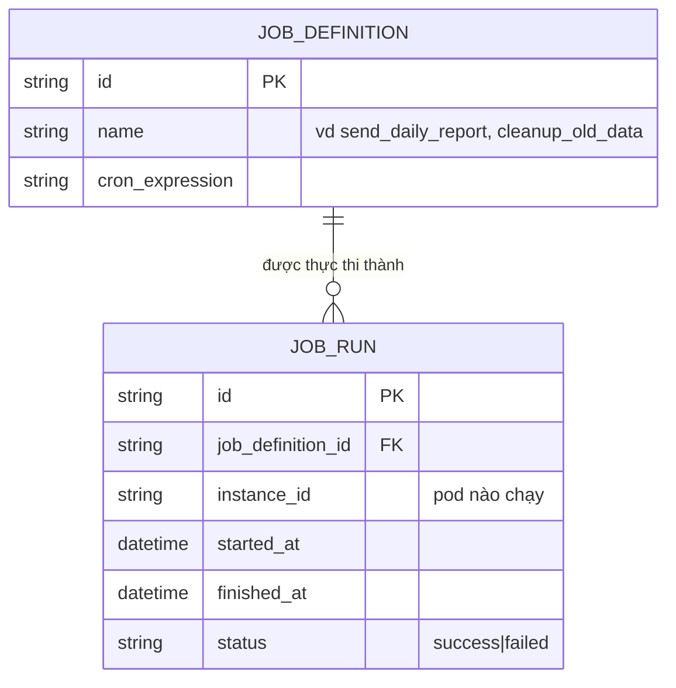
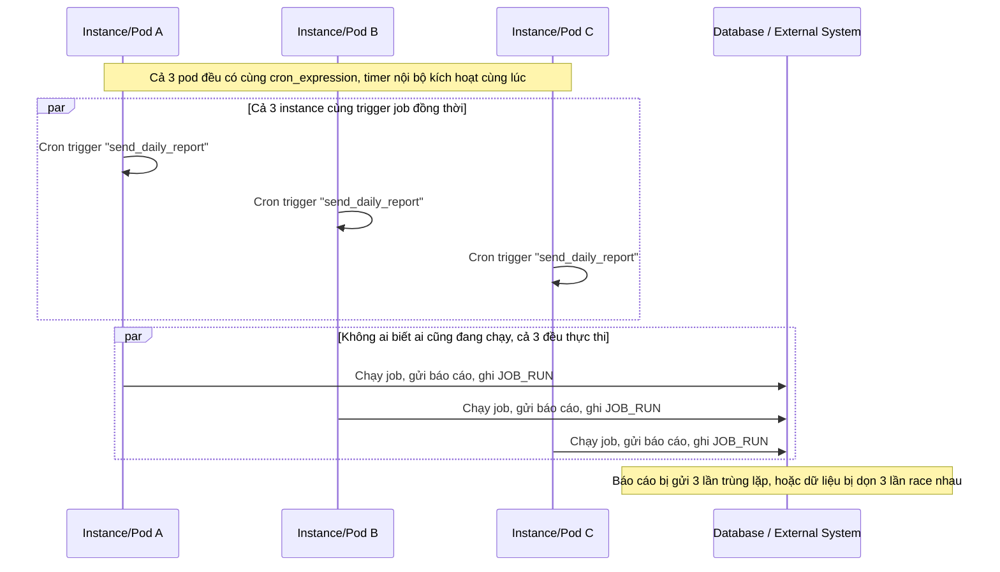
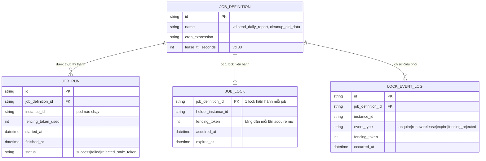
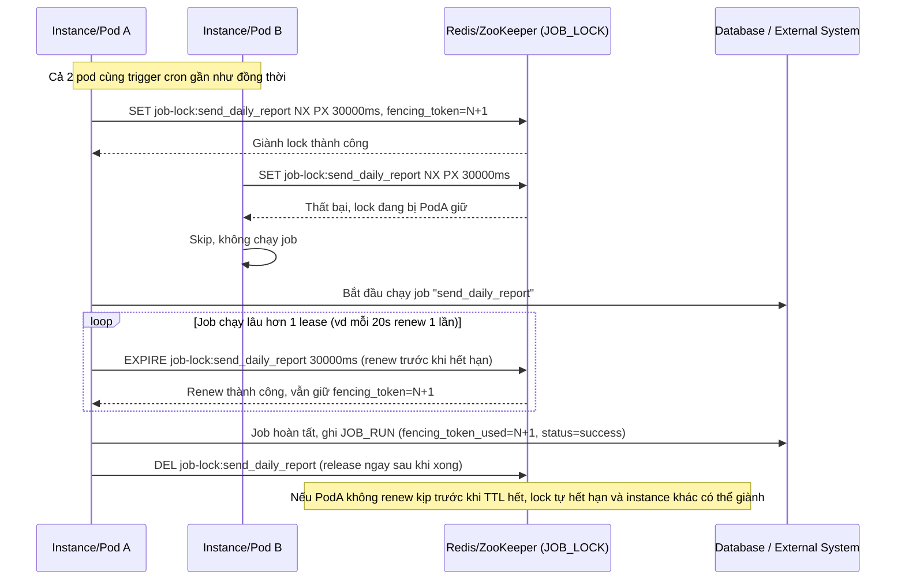
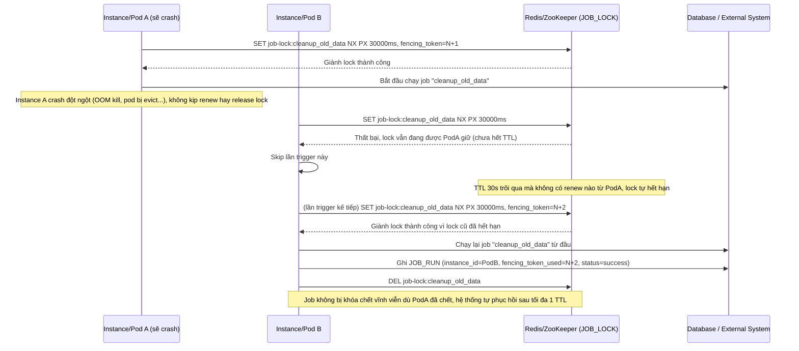
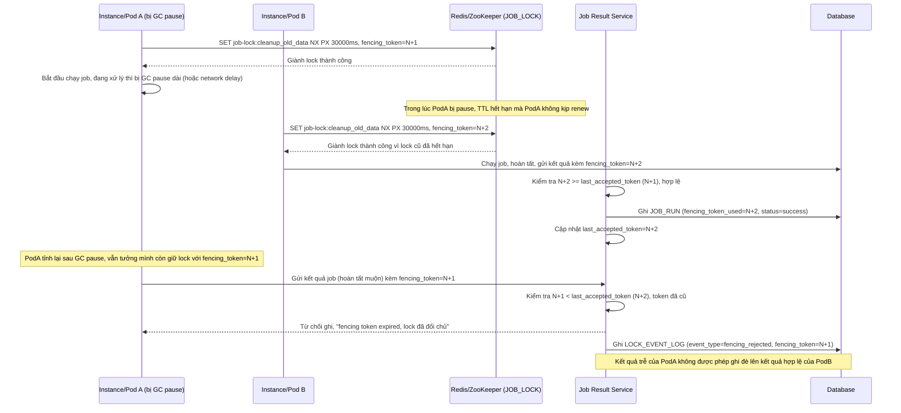
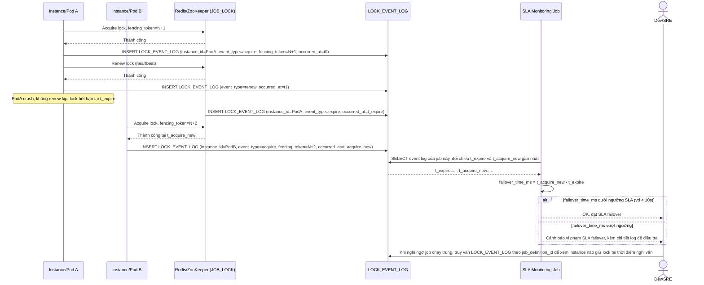

# Cron/scheduled job chạy trên nhiều instance service (horizontally scaled)

**Hệ thống:** Một service backend được scale ra nhiều instance (pod) để chịu tải, nhưng có vài job định kỳ (gửi báo cáo, dọn dữ liệu) chỉ được chạy đúng 1 lần mỗi chu kỳ.

**Vai trò của flow:** Dùng distributed lock (lease-based, TTL) trên Redis/ZooKeeper để đảm bảo chỉ một instance giành được lock mới được chạy job, các instance khác skip.

**Yêu cầu cụ thể:**
- Lock phải có TTL (lease) rõ ràng; instance giữ lock phải renew (heartbeat) trước khi TTL hết, nếu không renew kịp thì lock tự nhả cho instance khác.
- Xử lý crash: nếu instance giữ lock crash giữa job (không kịp release lock), lock phải tự hết hạn sau TTL và job có thể chạy lại bởi instance khác — không bị "khoá chết" vĩnh viễn.
- Chống trường hợp instance cũ tưởng mình còn giữ lock (do GC pause/network delay) tiếp tục ghi dữ liệu sau khi lock đã hết hạn và bị instance khác giành mất (fencing token / lock version check trước khi ghi kết quả job).
- Log rõ instance nào giữ lock, thời điểm acquire/release/renew, để debug khi nghi ngờ job chạy trùng.
- Đo SLA: thời gian tối đa từ lúc lock cũ hết hạn tới lúc instance mới giành được lock mới (failover time) phải dưới một ngưỡng cụ thể (ví dụ 10s).

---

# Base ERD — Job định kỳ chạy độc lập trên từng instance, chưa có điều phối

Đây là **base**: trạng thái hệ thống *trước khi* có distributed lock. Suy luận từ đề bài, base đã có `JOB_DEFINITION` mô tả job định kỳ (tên, biểu thức cron/lịch chạy), và mỗi lần job được kích hoạt tạo 1 `JOB_RUN` ghi lại instance nào chạy, kết quả ra sao. Vì hệ thống được scale ra nhiều instance chạy cùng một lịch cron nội bộ, base chưa có cơ chế nào đảm bảo chỉ 1 instance thực thi — mỗi instance tự trigger job theo timer riêng của mình.

---

# Base sequence — Mỗi instance tự chạy job theo lịch riêng, chạy trùng lặp

Đây là **base**, flow chạy job định kỳ hiện tại: mỗi instance/pod có timer nội bộ riêng theo `cron_expression`, khi tới giờ thì tự chạy job mà không hỏi ý kiến ai. Đây chính là vấn đề nêu trong đề bài — service được scale ra nhiều instance để chịu tải, nhưng job như gửi báo cáo hay dọn dữ liệu lại vô tình chạy nhiều lần trùng lặp mỗi chu kỳ, có thể gây gửi báo cáo trùng hoặc dọn dữ liệu race nhau.

---

# Enhance ERD — Thêm lease-based lock, fencing token và log điều phối

Đây là ERD **sau khi** enhance được áp dụng lên base. So với base, có thêm 2 entity mới và `JOB_RUN` được bổ sung trường ràng buộc với lock, ứng trực tiếp với các yêu cầu:

- `JOB_LOCK` (mới) với `holder_instance_id`, `expires_at`, `fencing_token` — đáp ứng yêu cầu 1 (lock có TTL/lease rõ ràng, holder phải renew trước khi hết hạn) và yêu cầu 2 (nếu holder crash không renew kịp, lock tự hết hạn cho instance khác giành).
- `JOB_RUN.fencing_token` — đáp ứng yêu cầu 3 (job service phải kiểm tra fencing token khi ghi kết quả, từ chối ghi nếu token cũ đã bị vô hiệu do lock đã đổi chủ).
- `LOCK_EVENT_LOG` (mới) — đáp ứng yêu cầu 4 (log rõ instance nào giữ lock, thời điểm acquire/release/renew để debug) và là nguồn dữ liệu tính `failover_time_ms` cho yêu cầu 5 (SLA failover dưới ngưỡng, vd 10s).

---

# Enhance sequence — Chỉ instance giữ lock mới chạy job, phải renew trước khi hết hạn

Đây là **enhance** của flow `run-scheduled-job` đã có ở base. So với base (mọi instance tự chạy job độc lập), enhance bắt buộc instance phải giành `JOB_LOCK` trước khi chạy, và phải renew (heartbeat) trước khi TTL hết nếu job chạy lâu hơn 1 lease. Đáp ứng yêu cầu 1: lock có TTL/lease rõ ràng, instance giữ lock phải renew trước khi TTL hết, nếu không renew kịp lock tự nhả cho instance khác.

---

# Enhance sequence — Instance crash giữa job, lock tự hết hạn, instance khác chạy lại

Đây là **enhance**, flow hoàn toàn mới mô tả trường hợp instance giữ lock crash bất ngờ giữa lúc chạy job, không kịp release lock. Đáp ứng yêu cầu 2: lock phải tự hết hạn sau TTL và job có thể chạy lại bởi instance khác, không bị khóa chết vĩnh viễn dù có 1 instance chết đột ngột.

---

# Enhance sequence — Fencing token chặn instance cũ ghi kết quả sau khi mất lock

Đây là **enhance**, flow hoàn toàn mới xử lý trường hợp instance bị GC pause/network delay tưởng mình còn giữ lock. Đáp ứng yêu cầu 3: chống trường hợp instance cũ tiếp tục ghi dữ liệu sau khi lock đã hết hạn và bị instance khác giành mất, bằng cách so sánh fencing token trước khi cho phép ghi kết quả job.

---

# Enhance sequence — Log điều phối lock và đo SLA failover time

Đây là **enhance**, flow hoàn toàn mới mô tả việc ghi log chi tiết mọi thao tác lock và tính toán chỉ số SLA từ log đó. Đáp ứng yêu cầu 4 (log rõ instance nào giữ lock, thời điểm acquire/release/renew để debug khi nghi ngờ job chạy trùng) và yêu cầu 5 (đo thời gian tối đa từ lúc lock cũ hết hạn tới lúc instance mới giành được lock mới phải dưới ngưỡng, vd 10s).

