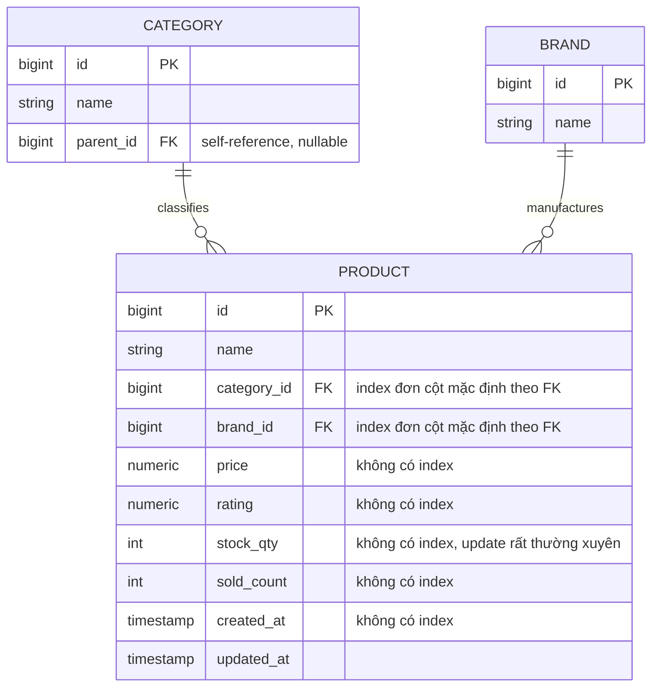
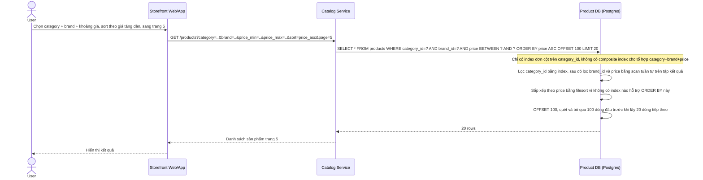
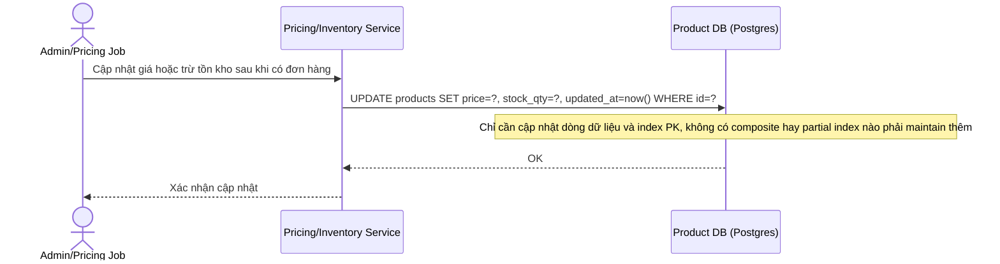
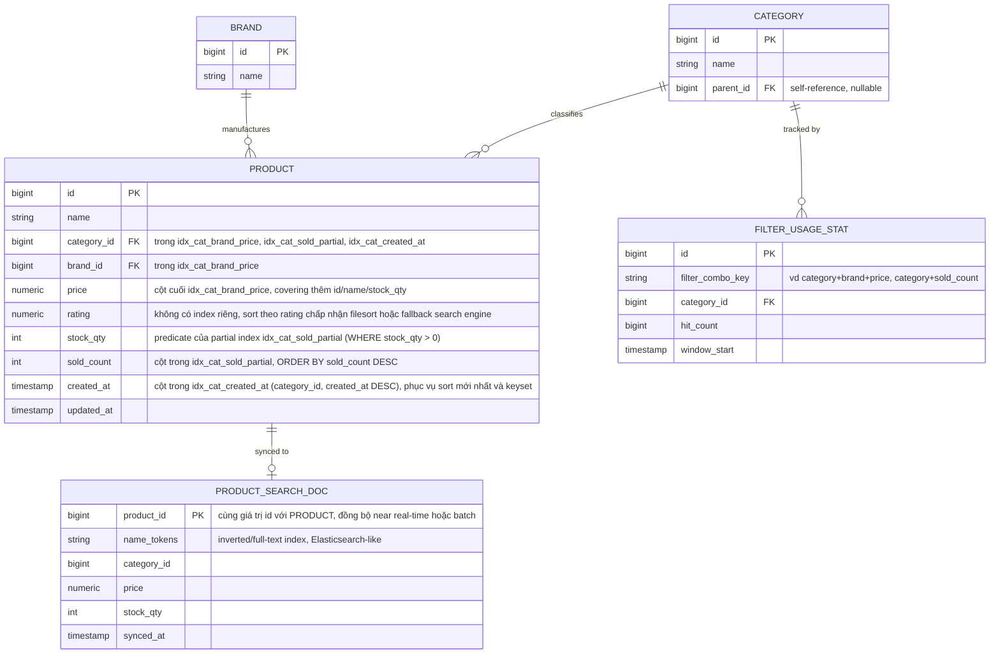
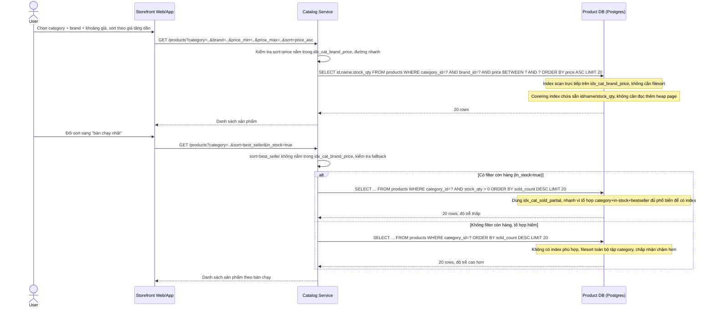
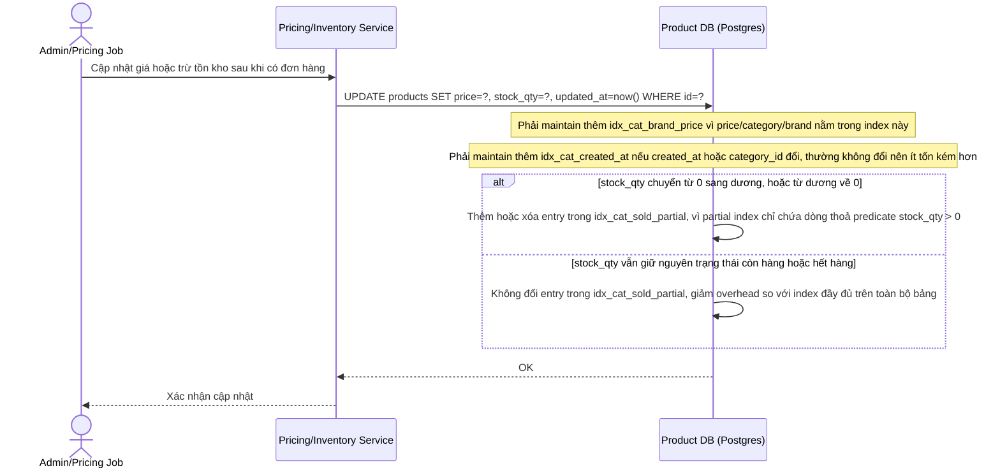
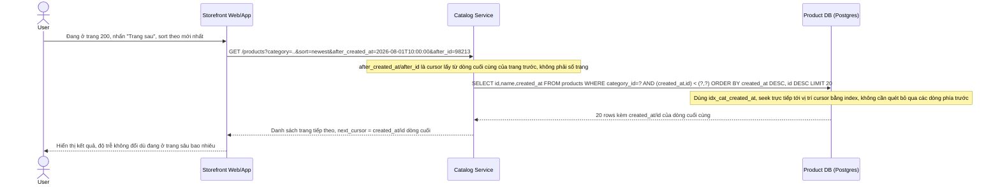
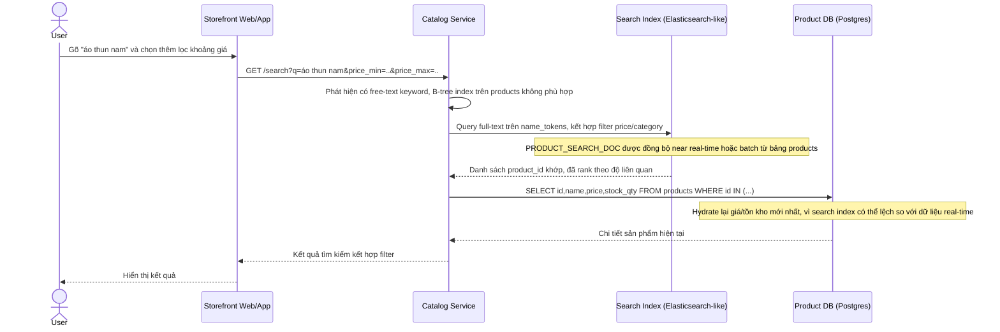

# E-commerce tối ưu query lọc & sắp xếp catalog sản phẩm nhiều điều kiện

**Hệ thống:** Sàn e-commerce có catalog hàng triệu sản phẩm, trang danh mục cho phép user kết hợp nhiều bộ lọc (category, brand, khoảng giá, rating, còn hàng) cùng lúc với nhiều kiểu sắp xếp (giá tăng/giảm, bán chạy, mới nhất).

**Vai trò của flow:** Chọn đúng loại index (composite/covering/partial) cho service catalog để trả kết quả nhanh dưới nhiều tổ hợp filter/sort khác nhau, mà không tạo tràn lan index thừa làm chậm ghi và phình dung lượng.

**Yêu cầu cụ thể:**
- Composite index cho tổ hợp category + brand + price hoạt động tốt khi ORDER BY đúng theo thứ tự cột cuối của index, nhưng khi user đổi sang sort theo tiêu chí khác (bán chạy, rating) không nằm trong index đó, DB phải filesort bổ sung — cần quyết định rõ tổ hợp sort nào được index hỗ trợ trực tiếp và tổ hợp nào chấp nhận chậm hơn.
- Số tổ hợp filter user có thể chọn là rất lớn (category × brand × price range × rating), không thể tạo index cho mọi tổ hợp — phải dựa trên phân tích tần suất sử dụng thực tế để chọn ra vài composite index phổ biến nhất, và có chiến lược fallback (query chậm hơn, hoặc đẩy sang search engine riêng) cho tổ hợp hiếm.
- Giá và tồn kho trên bảng products được cập nhật rất thường xuyên (real-time, nhiều lần/giây ở sản phẩm hot) — mỗi index thêm vào đều làm chậm write này, cần cân bằng rõ giữa số lượng index phục vụ đọc và overhead ghi.
- Khi user gõ từ khóa tìm kiếm tên sản phẩm kết hợp với filter (vd "áo thun nam" + lọc giá), B-tree index thường không đáp ứng tốt free-text search — cần xác định ranh giới khi nào dùng index DB thường, khi nào phải tách sang search index riêng (Elasticsearch-like).
- Khi user phân trang sâu (page 200+) bằng OFFSET, DB phải quét và bỏ qua toàn bộ các dòng phía trước dù có index, khiến độ trễ tăng dần theo số trang — cần chuyển sang keyset pagination (dựa trên giá trị cột index cuối cùng đã thấy) để giữ tốc độ ổn định bất kể phân trang sâu tới đâu.

---

# Base ERD - Catalog sản phẩm trước khi tối ưu index

Đây là trạng thái **base**, tức trước khi áp đề bài. Catalog service đã có 3 entity cốt lõi: Product, Category, Brand, với bảng `products` chứa trực tiếp giá và tồn kho (đúng như đề bài mô tả "giá và tồn kho trên bảng products"). Ở trạng thái này, `products` chỉ có index mặc định (primary key) và các index đơn cột tự sinh theo khoá ngoại (category_id, brand_id) — chưa có bất kỳ composite index, partial index hay covering index nào phục vụ riêng cho các tổ hợp filter/sort mà đề bài sẽ yêu cầu tối ưu.

Ghi chú: chưa có composite index (category+brand+price), chưa có partial index (lọc còn hàng), chưa có covering index, và chưa có cơ chế tách free-text search hay keyset pagination — đây chính là khoảng trống mà đề bài sẽ lấp vào.

---

# Base sequence - Browse catalog với filter/sort cơ bản

Đây là trạng thái **base**. Flow này mô tả cách user browse catalog, kết hợp filter (category, brand, price) và sort (giá tăng dần) cùng phân trang OFFSET, khi DB chưa có composite index hay keyset pagination. Flow này được chọn vì nó chính là hiện trạng "chưa tối ưu" mà đề bài yêu cầu cải thiện: DB phải scan/filesort và OFFSET quét bỏ dòng ở trang sâu.

Điểm nghẽn ở đây (thiếu composite index cho filter/sort phổ biến, filesort, OFFSET quét bỏ dòng ở trang sâu) chính là 3 vấn đề đề bài nêu ra cần giải quyết bằng index và keyset pagination.

---

# Base sequence - Update giá và tồn kho

Đây là trạng thái **base**. Flow này mô tả việc cập nhật giá/tồn kho trên bảng `products` diễn ra rất thường xuyên (real-time, nhiều lần/giây ở sản phẩm hot), khi DB chưa có index bổ sung nào cần maintain ngoài PK. Flow này được chọn vì đề bài đặt ra yêu cầu cân bằng giữa số lượng index phục vụ đọc và overhead ghi — cần thấy rõ chi phí ghi ở base (thấp) để so sánh với enhance (cao hơn do thêm index).

Chi phí ghi ở base rất thấp vì gần như không có index phụ, nhưng đổi lại là tốc độ đọc/filter/sort kém như thể hiện ở flow browse-catalog-filter-sort.

---

# Enhance ERD - Catalog sau khi áp chiến lược index

Đây là trạng thái **enhance**, tức nguyên văn đề bài đã áp dụng lên base. Vẫn giữ 3 entity Category/Brand/Product, nhưng bảng `products` giờ được gắn một tập composite/partial/covering index được chọn lọc dựa trên tần suất filter/sort thực tế (không tạo tràn lan). Thêm 2 entity mới để phục vụ các fallback mà đề bài yêu cầu: `PRODUCT_SEARCH_DOC` (search index riêng cho free-text tên sản phẩm, khi B-tree không đáp ứng tốt) và `FILTER_USAGE_STAT` (dữ liệu phân tích tần suất tổ hợp filter, làm căn cứ chọn composite index nào nên tạo, tổ hợp nào chấp nhận chậm hơn).

So với base: thêm 3 composite/partial index có mục tiêu (`idx_cat_brand_price`, `idx_cat_sold_partial`, `idx_cat_created_at`) thay vì index tràn lan cho mọi tổ hợp, thêm `PRODUCT_SEARCH_DOC` để tách free-text search khỏi B-tree, và thêm `FILTER_USAGE_STAT` làm căn cứ dữ liệu cho quyết định "index nào phổ biến, tổ hợp nào hiếm nên fallback".

---

# Enhance sequence - Browse catalog với filter/sort được index hỗ trợ

Đây là trạng thái **enhance** của flow browse-catalog-filter-sort. So với base, flow này thay đổi ở chỗ: Catalog Service giờ biết phân biệt tổ hợp sort nào được composite index hỗ trợ trực tiếp (price, nằm cuối `idx_cat_brand_price`) và tổ hợp nào không (bán chạy, rating) để chọn đường đi phù hợp — dùng partial index nếu có filter còn hàng, hoặc chấp nhận filesort chậm hơn cho tổ hợp hiếm, đúng chiến lược "vài composite index phổ biến nhất + fallback cho tổ hợp hiếm" mà đề bài yêu cầu.

---

# Enhance sequence - Update giá và tồn kho với overhead index mới

Đây là trạng thái **enhance** của flow update-price-stock. So với base, flow này thay đổi ở chỗ: mỗi lần ghi giờ phải maintain thêm các composite/partial index mới tạo (`idx_cat_brand_price`, `idx_cat_created_at`, `idx_cat_sold_partial`), đúng với đánh đổi mà đề bài nêu ra giữa số lượng index phục vụ đọc và overhead ghi trên bảng products được cập nhật real-time. Partial index được thiết kế để giảm bớt overhead này bằng cách chỉ chứa các dòng còn hàng.

So với base, chi phí ghi tăng lên do phải maintain 2-3 composite/partial index thay vì chỉ PK, nhưng đây là đánh đổi có chủ đích: chỉ giữ vài index phổ biến nhất (dựa trên `FILTER_USAGE_STAT`) thay vì tạo index cho mọi tổ hợp filter có thể có.

---

# Enhance sequence - Keyset pagination cho phân trang sâu

Đây là trạng thái **enhance**, mô tả 1 flow hoàn toàn mới phát sinh từ đề bài: chưa từng tồn tại ở base (base chỉ có OFFSET pagination). Flow này được chọn vì đề bài yêu cầu rõ chuyển từ OFFSET sang keyset pagination (dựa trên giá trị cột index cuối cùng đã thấy) để giữ độ trễ ổn định khi user phân trang sâu (page 200+), thay vì để DB quét và bỏ qua toàn bộ dòng phía trước.

Khác biệt cốt lõi so với OFFSET ở base: DB không còn phải đếm và bỏ qua N dòng đầu, mà seek thẳng tới vị trí trong index nhờ điều kiện `(created_at, id) < (cursor_created_at, cursor_id)`, nên độ trễ ổn định bất kể phân trang sâu tới đâu.

---

# Enhance sequence - Tìm kiếm từ khóa kết hợp filter

Đây là trạng thái **enhance**, mô tả 1 flow hoàn toàn mới phát sinh từ đề bài: chưa tồn tại ở base vì base chưa có nhu cầu free-text search, chỉ filter theo cột có cấu trúc. Flow này được chọn vì đề bài yêu cầu xác định ranh giới rõ ràng: khi user gõ từ khóa tên sản phẩm kết hợp filter, B-tree index không đáp ứng tốt free-text nên phải tách sang search index riêng (Elasticsearch-like), rồi hydrate dữ liệu mới nhất (giá, tồn kho) từ DB chính.

Ranh giới rút ra: mọi truy vấn chỉ filter/sort trên cột có cấu trúc vẫn đi qua composite/partial index trên `products` như các flow browse-catalog-filter-sort, còn ngay khi có free-text keyword thì route hẳn sang Search Index, không cố gắng LIKE '%...%' trên B-tree.
