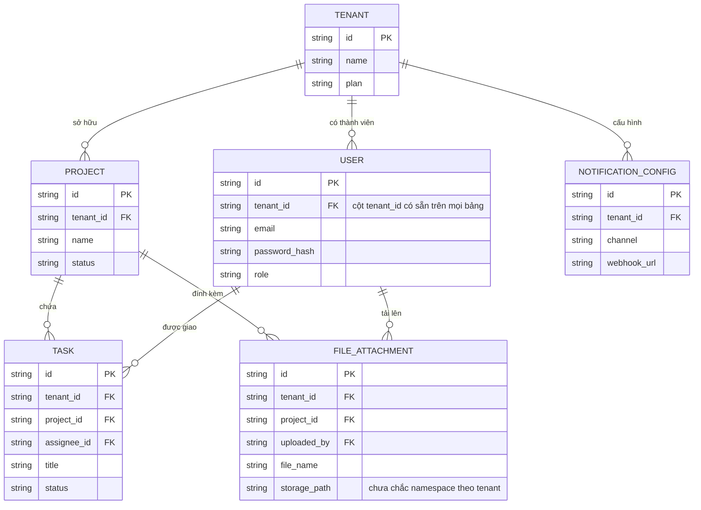
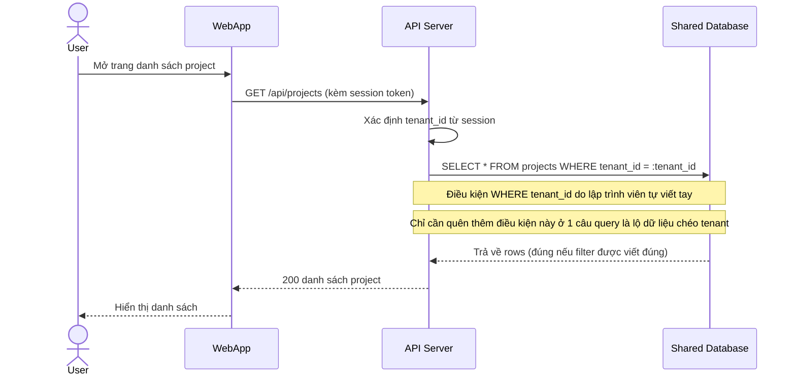
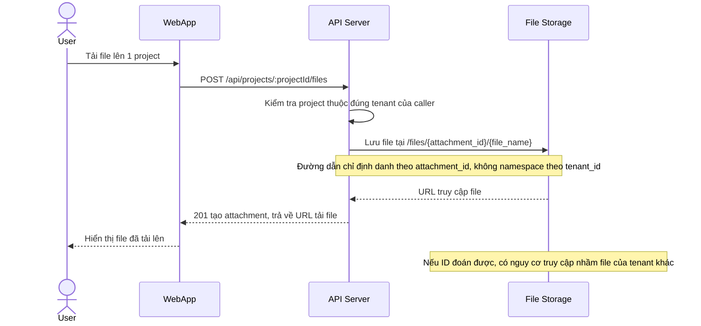
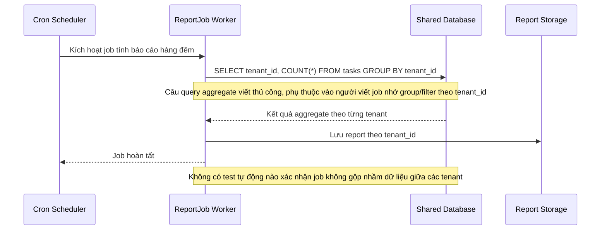
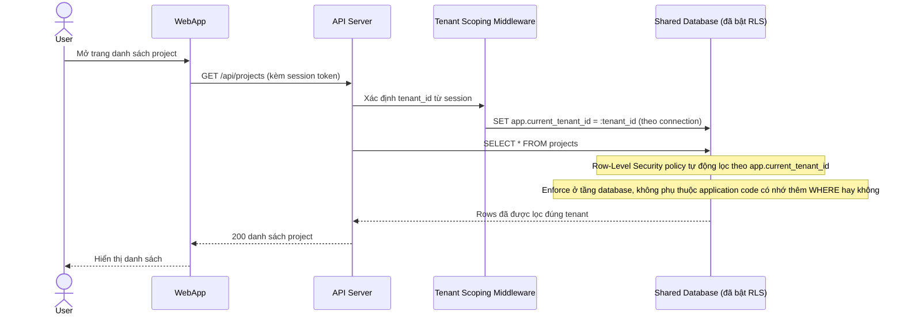
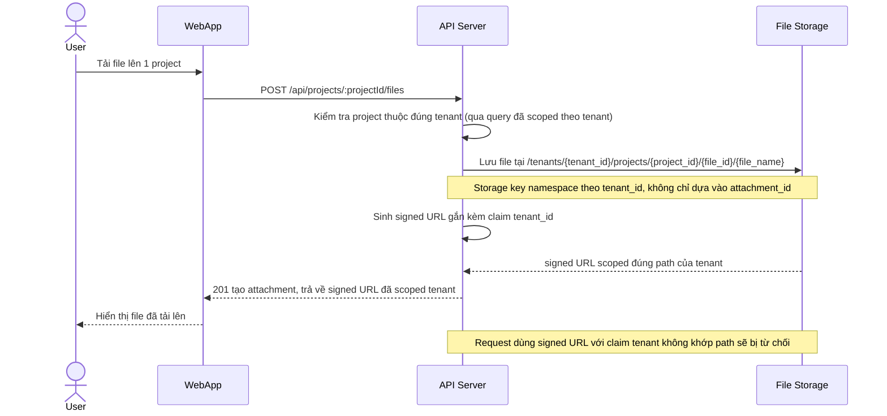
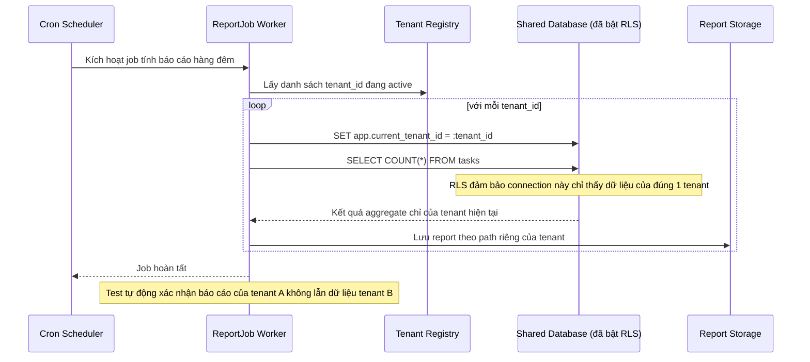
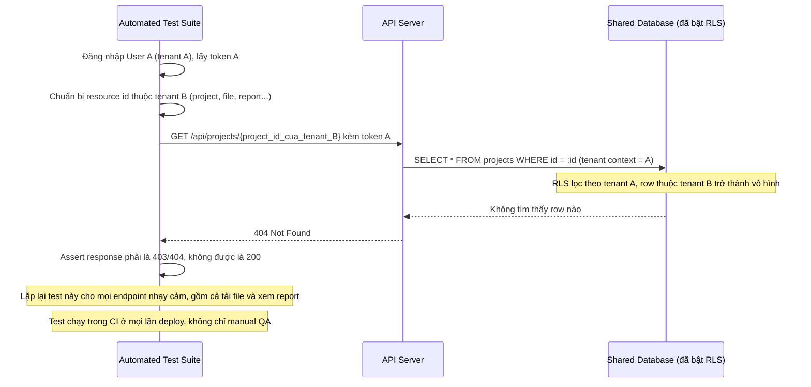
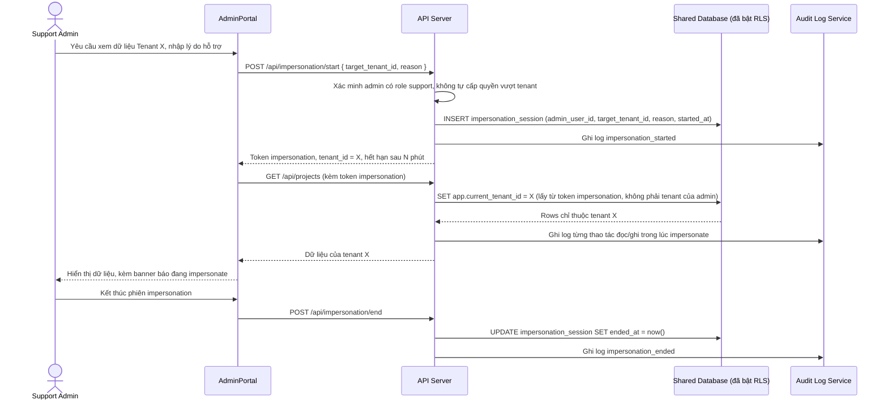

# Cách ly dữ liệu theo tenant dùng chung schema/database cho SaaS quản lý dự án

**Hệ thống:** Một nền tảng SaaS quản lý dự án cho nhiều công ty khách hàng (tenant), dùng chung một database và schema, phân biệt dữ liệu bằng cột `tenant_id` trên mỗi bảng.

**Vai trò của flow:** Đây là mô hình multi-tenancy phổ biến nhất (shared schema) — flow phải đảm bảo mọi truy vấn dữ liệu đều bị giới hạn đúng theo tenant của người dùng đang thao tác, không có đường nào truy cập nhầm sang dữ liệu tenant khác.

**Yêu cầu cụ thể:**
- Mọi query đọc/ghi dữ liệu phải bắt buộc có điều kiện lọc theo `tenant_id` ở tầng thấp nhất có thể (ví dụ qua middleware/ORM tự động thêm điều kiện, hoặc row-level security ở database) — không phụ thuộc vào việc lập trình viên nhớ thêm điều kiện này ở từng câu query riêng lẻ, vì chỉ cần quên một chỗ là có thể lộ dữ liệu chéo tenant.
- Viết test tự động (không chỉ manual test) cố tình thử truy cập dữ liệu của tenant B bằng token/session của tenant A qua mọi endpoint quan trọng, đảm bảo luôn bị chặn (403/404) không phải chỉ dựa vào việc UI không hiển thị link dẫn tới đó.
- Xử lý đúng các tài nguyên dùng chung giữa nhiều tenant nhưng cần cấu hình riêng (ví dụ file upload, cấu hình thông báo) — đảm bảo đường dẫn lưu trữ và khóa truy cập (như signed URL) đều gắn chặt với tenant, không dùng ID tài nguyên có thể đoán được để truy cập chéo tenant.
- Xử lý trường hợp một nhân viên hệ thống (support/admin nội bộ) cần truy cập dữ liệu của một tenant cụ thể để hỗ trợ — phải qua một cơ chế impersonation/xem hộ có kiểm soát, ghi log đầy đủ, không dùng chung quyền truy cập không giới hạn tenant cho mục đích vận hành.
- Đảm bảo các thao tác nền (background job, cron, cache) cũng tôn trọng ranh giới tenant — ví dụ một job tính báo cáo tổng hợp chạy sai logic gộp nhầm dữ liệu của nhiều tenant vào một kết quả chung phải được phát hiện qua test, không chỉ API request trực tiếp mới cần kiểm tra.

---

# Base ERD — SaaS quản lý dự án multi-tenant, shared schema chưa được siết isolation

Đây là **base**: mô hình dữ liệu suy luận từ ngữ cảnh đề bài. Đề bài mô tả rõ hệ thống đã theo mô hình shared schema — mọi bảng đều có sẵn cột `tenant_id` để phân biệt dữ liệu giữa các tenant. Vì vậy base **đã có** các entity cốt lõi của 1 SaaS quản lý dự án (Tenant, User, Project, Task, File đính kèm, cấu hình thông báo) với cột `tenant_id` trên từng bảng — nhưng cột này mới chỉ tồn tại ở tầng dữ liệu, **chưa có** cơ chế nào đảm bảo mọi query đều tự động lọc đúng theo nó (không có middleware/ORM enforce, không có row-level security, không có test tự động, không có cơ chế impersonation có kiểm soát, background job cũng chưa chắc tôn trọng ranh giới tenant). Đó chính là khoảng trống mà enhance lấp vào.

---

# Base sequence — List projects

Đây là **base**, flow "Đọc danh sách project của tenant hiện tại" — đại diện cho mọi query đọc/ghi dữ liệu thông thường trong hệ thống. Chọn flow này vì nó là ví dụ điển hình cho vấn đề đề bài nêu: điều kiện lọc `tenant_id` được thêm thủ công ở tầng application code, phụ thuộc hoàn toàn vào việc lập trình viên nhớ viết đúng ở từng câu query — đây chính là rủi ro mà enhance phải loại bỏ.

---

# Base sequence — Upload file

Đây là **base**, flow "Tải file đính kèm lên project" — đại diện cho nhóm tài nguyên dùng chung giữa nhiều tenant nhưng cần cấu hình riêng mà đề bài nhắc tới. Chọn flow này vì storage path/URL truy cập file ở base chỉ định danh bằng `attachment_id`, chưa gắn chặt với tenant — nếu ID này đoán được thì có nguy cơ truy cập chéo tenant.

---

# Base sequence — Generate report job

Đây là **base**, flow "Background job tính báo cáo tổng hợp định kỳ" — đại diện cho nhóm thao tác nền (background job/cron) mà đề bài yêu cầu phải tôn trọng ranh giới tenant. Chọn flow này vì đây đúng là ví dụ đề bài nêu: 1 job tính báo cáo có nguy cơ gộp nhầm dữ liệu nhiều tenant vào 1 kết quả chung nếu câu query aggregate viết thiếu group/filter theo tenant_id.

---

# Enhance ERD — Siết isolation, thêm impersonation có kiểm soát và audit log

Đây là ERD **sau khi** enhance được áp dụng lên base. Các entity nghiệp vụ (Tenant, User, Project, Task, File, Notification Config) giữ nguyên cấu trúc — điểm khác biệt nằm ở việc `tenant_id` trên các bảng này nay được enforce ở tầng thấp nhất (middleware/ORM tự động filter hoặc row-level security ở database) thay vì trông chờ code thủ công. So với base, có 2 nhóm entity mới, ứng trực tiếp với 2 yêu cầu còn lại trong đề bài:

- `IMPERSONATION_SESSION` (mới) — ghi nhận phiên nhân viên support/admin nội bộ "xem hộ" dữ liệu của 1 tenant cụ thể, có lý do, thời gian bắt đầu/kết thúc, thay vì dùng chung 1 quyền truy cập không giới hạn tenant.
- `AUDIT_LOG` (mới) — ghi log đầy đủ mọi hành động xảy ra trong lúc impersonate, cũng như các thao tác nhạy cảm khác, có thể truy vết về đúng actor và tenant liên quan.

`FILE_ATTACHMENT.storage_path` cũng đổi từ định danh theo `attachment_id` sang `storage_key` namespace theo `tenant_id`, và có thêm hạn dùng cho signed URL — khớp với yêu cầu "đường dẫn lưu trữ và khóa truy cập phải gắn chặt với tenant".

```mermaid
erDiagram
    TENANT ||--o{ USER : "có thành viên"
    TENANT ||--o{ PROJECT : "sở hữu"
    TENANT ||--o{ NOTIFICATION_CONFIG : "cấu hình"
    PROJECT ||--o{ TASK : "chứa"
    PROJECT ||--o{ FILE_ATTACHMENT : "đính kèm"
    USER ||--o{ TASK : "được giao"
    USER ||--o{ FILE_ATTACHMENT : "tải lên"
    TENANT ||--o{ IMPERSONATION_SESSION : "là đối tượng được xem hộ"
    USER ||--o{ IMPERSONATION_SESSION : "admin khởi tạo"
    TENANT ||--o{ AUDIT_LOG : "phạm vi tenant"
    USER ||--o{ AUDIT_LOG : "actor thực hiện"
    IMPERSONATION_SESSION ||--o{ AUDIT_LOG : "phát sinh"

    TENANT {
        string id PK
        string name
        string plan
    }
    USER {
        string id PK
        string tenant_id FK
        string email
        string password_hash
        string role "gồm cả internal_support"
    }
    PROJECT {
        string id PK
        string tenant_id FK
        string name
        string status
    }
    TASK {
        string id PK
        string tenant_id FK
        string project_id FK
        string assignee_id FK
        string title
        string status
    }
    FILE_ATTACHMENT {
        string id PK
        string tenant_id FK
        string project_id FK
        string uploaded_by FK
        string file_name
        string storage_key "namespace theo tenant_id, vd /tenants/{tenant_id}/..."
        datetime signed_url_expires_at
    }
    NOTIFICATION_CONFIG {
        string id PK
        string tenant_id FK
        string channel
        string webhook_url
    }
    IMPERSONATION_SESSION {
        string id PK
        string admin_user_id FK
        string target_tenant_id FK
        string reason
        datetime started_at
        datetime ended_at
        string status "active | ended"
    }
    AUDIT_LOG {
        string id PK
        string tenant_id FK
        string actor_user_id FK
        string impersonation_session_id FK "nullable"
        string action
        string resource_type
        string resource_id
        datetime created_at
    }
```

---

# Enhance sequence — List projects

Đây là **enhance**, flow "Đọc danh sách project của tenant hiện tại". So với base, điều kiện lọc `tenant_id` không còn do lập trình viên tự viết trong từng câu query — middleware tự động gán tenant context cho session, và database enforce bằng row-level security, nên dù application code có quên thêm điều kiện thì dữ liệu chéo tenant vẫn không thể lộ ra.

---

# Enhance sequence — Upload file

Đây là **enhance**, flow "Tải file đính kèm lên project". So với base, storage key không còn định danh chỉ bằng `attachment_id` mà được namespace theo `tenant_id` ngay trong đường dẫn lưu trữ, và signed URL sinh ra gắn với claim tenant — biết đúng file id nhưng sai tenant vẫn không truy cập được.

---

# Enhance sequence — Generate report job

Đây là **enhance**, flow "Background job tính báo cáo tổng hợp định kỳ". So với base, job không còn chạy 1 câu aggregate chung cho toàn bộ dữ liệu rồi group theo tenant_id — mà lặp qua từng tenant, thiết lập tenant context cho từng connection trước khi query, để row-level security đảm bảo mỗi vòng lặp chỉ thấy đúng dữ liệu của 1 tenant.

---

# Enhance sequence — Cross-tenant access test

Đây là **enhance**, flow hoàn toàn mới so với base — test tự động cố tình dùng token của tenant A để truy cập tài nguyên của tenant B qua các endpoint quan trọng, đảm bảo luôn bị chặn 403/404. Đây chính là yêu cầu "viết test tự động, không chỉ manual test" trong đề bài, chạy trong CI trên mọi lần deploy chứ không chỉ dựa vào việc UI không hiển thị link.

---

# Enhance sequence — Admin impersonation

Đây là **enhance**, flow hoàn toàn mới so với base — nhân viên support/admin nội bộ cần xem dữ liệu của 1 tenant cụ thể để hỗ trợ, thông qua 1 phiên impersonation có kiểm soát (có lý do, có thời hạn) thay vì dùng chung 1 quyền truy cập không giới hạn tenant. Mọi hành động trong phiên đều được ghi vào audit log, đúng yêu cầu đề bài.

