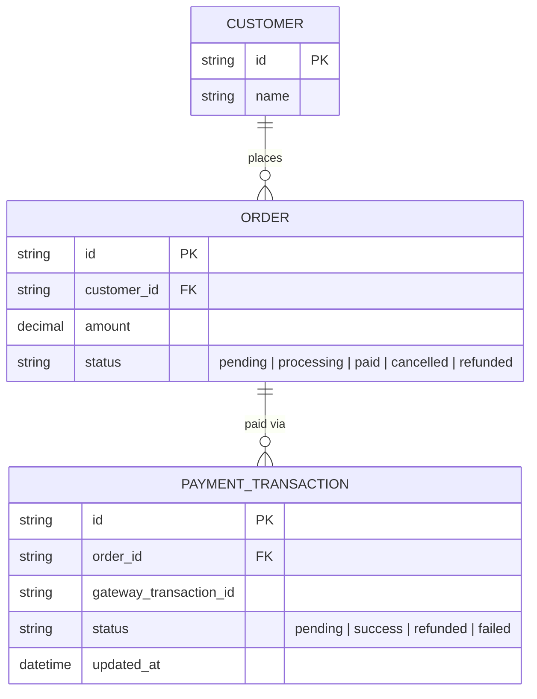
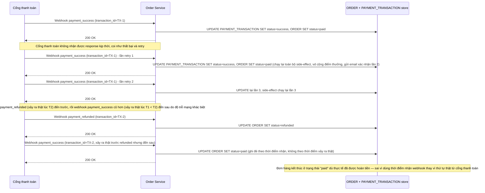
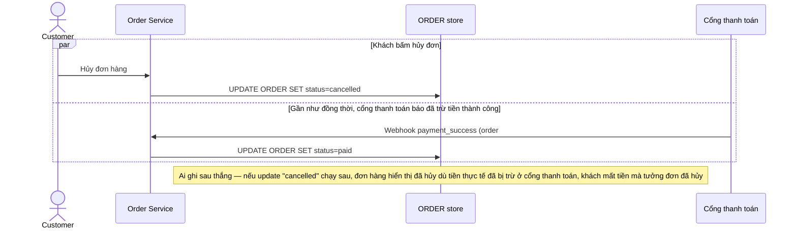
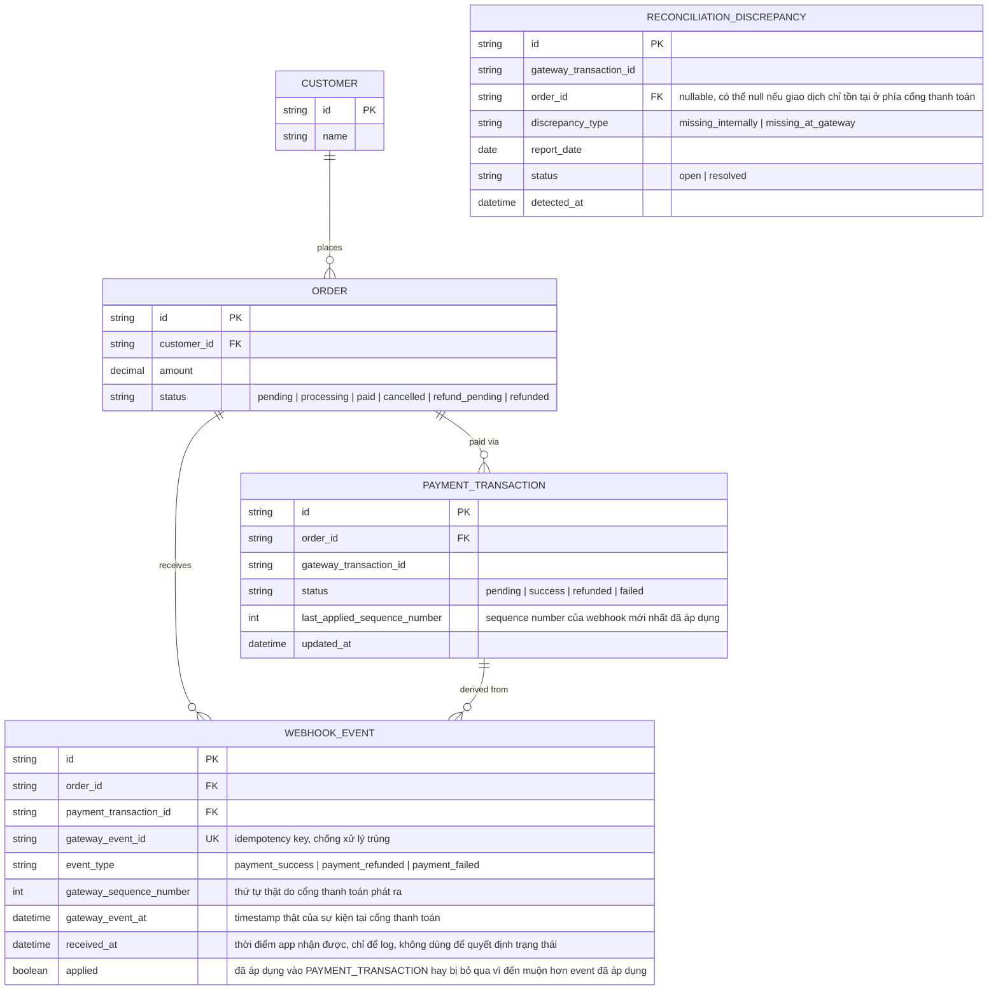
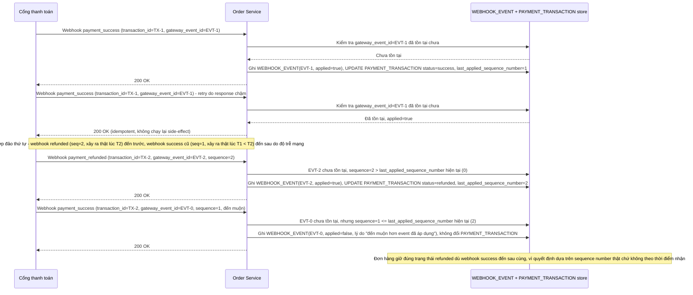
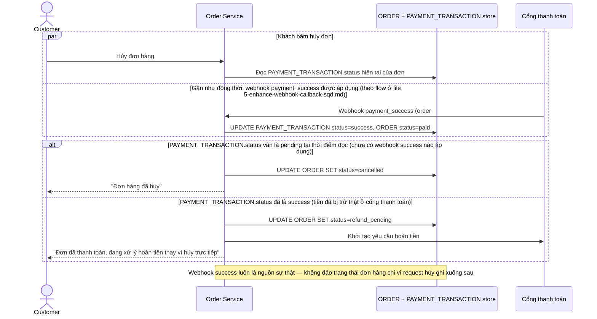
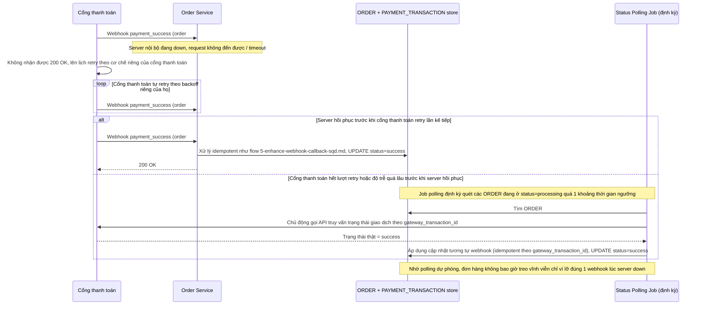
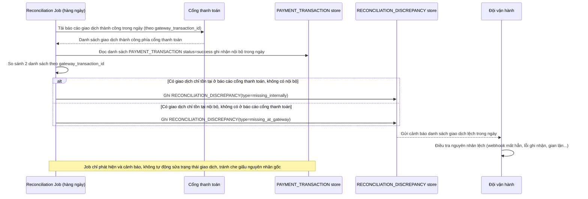

# Thanh toán qua cổng bên thứ ba với webhook callback không đảm bảo thứ tự

**Hệ thống:** Một sàn e-commerce tích hợp cổng thanh toán bên thứ ba (kiểu Stripe/VNPay), nhận callback (webhook) báo kết quả giao dịch sau khi khách thanh toán.

**Vai trò của flow:** Flow xử lý callback phải cập nhật đúng trạng thái đơn hàng dựa trên webhook nhận được, kể cả khi webhook bị gửi trùng nhiều lần hoặc đến không đúng thứ tự thời gian thực tế xảy ra.

**Yêu cầu cụ thể:**
- Webhook phải được xử lý idempotent theo `transaction_id` của cổng thanh toán: nếu nhận cùng 1 webhook 3 lần (do cổng thanh toán retry vì response chậm), chỉ áp dụng thay đổi trạng thái đúng 1 lần, 2 lần sau chỉ trả 200 OK mà không làm gì thêm.
- Mô tả cụ thể tình huống thứ tự đảo lộn: webhook "payment_success" đến sau webhook "payment_refunded" của cùng giao dịch (do độ trễ mạng khác nhau) — yêu cầu dùng timestamp hoặc sequence number từ phía cổng thanh toán để xác định thứ tự thật, không dùng thời điểm hệ thống nhận được webhook để quyết định trạng thái cuối cùng.
- Khi webhook báo thành công đến gần như đồng thời với việc khách bấm "Hủy đơn" ở app, quy định rõ ai thắng: nếu tiền đã thực sự được trừ ở cổng thanh toán (webhook success là nguồn sự thật), đơn hàng không được hủy mà phải chuyển sang luồng hoàn tiền, không đơn giản đảo trạng thái theo request đến sau.
- Nếu server nội bộ bị down đúng lúc cổng thanh toán gửi webhook, phải đảm bảo cổng thanh toán sẽ retry theo cơ chế của họ (hoặc tự chủ động polling trạng thái giao dịch định kỳ như phương án dự phòng) — không để đơn hàng bị "treo" vĩnh viễn ở trạng thái "đang xử lý" chỉ vì lỡ mất đúng 1 webhook.
- Có job đối soát hàng ngày so sánh danh sách giao dịch thành công ghi nhận nội bộ với báo cáo từ cổng thanh toán, phát hiện và cảnh báo các giao dịch lệch (có ở 1 bên nhưng không có ở bên kia).

---

# Base ERD — E-commerce tích hợp cổng thanh toán, xử lý webhook đơn giản

Đây là **base**: mô hình dữ liệu suy luận từ ngữ cảnh đề bài, thể hiện trạng thái hệ thống **trước khi** có xử lý webhook idempotent/theo đúng thứ tự thật. Đề bài nói tới sàn e-commerce nhận callback từ cổng thanh toán bên thứ ba báo kết quả giao dịch — nên base cần đủ: khách hàng, đơn hàng, và giao dịch thanh toán gắn với đơn hàng. Base **chưa có** cơ chế lưu vết từng webhook nhận được để chống trùng/xác định thứ tự, chưa có job đối soát, chưa có polling dự phòng — những thứ đó là phần enhance.

---

# Base sequence — Xử lý webhook đơn giản (không idempotent, không xét thứ tự thật)

Đây là **base**, flow "Nhận webhook từ cổng thanh toán" ở trạng thái hiện tại — app cập nhật thẳng `ORDER.status`/`PAYMENT_TRANSACTION.status` theo nội dung webhook vừa nhận, không kiểm tra đã xử lý `transaction_id` này chưa, không xét thứ tự thật của sự kiện phía cổng thanh toán mà chỉ dựa vào thứ tự app nhận được. Flow này liên quan mật thiết tới enhance vì toàn bộ 2 yêu cầu đầu (idempotent theo transaction_id, xác định đúng thứ tự thật) đều nhằm sửa lỗ hổng ở đây.

---

# Base sequence — Hủy đơn hàng (last-write-wins, không xét nguồn sự thật)

Đây là **base**, flow "Khách bấm Hủy đơn" ở trạng thái hiện tại — app cập nhật thẳng `ORDER.status = cancelled` theo request của khách, không kiểm tra webhook thanh toán có đang/đã xử lý song song hay không. Flow này liên quan mật thiết tới enhance vì yêu cầu thứ 3 của đề bài quy định rõ ai thắng khi request hủy đơn chạm webhook success gần như đồng thời — mà base hiện chưa có quy tắc nào cả, ai ghi sau thắng.

---

# Enhance ERD — Thêm log webhook idempotent theo thứ tự thật và đối soát hàng ngày

Đây là **enhance**, mô hình dữ liệu sau khi áp cơ chế xử lý webhook idempotent + đúng thứ tự thật lên base. So với base, thêm mới `WEBHOOK_EVENT` — lưu lại từng webhook nhận được kèm `gateway_event_id` unique (chống xử lý trùng) và `gateway_sequence_number`/`gateway_event_at` (thứ tự thật từ phía cổng thanh toán, dùng để quyết định trạng thái cuối thay vì thời điểm app nhận). `PAYMENT_TRANSACTION` thêm `last_applied_sequence_number` để biết event nào đã áp dụng gần nhất, tránh bị 1 event cũ hơn đến muộn ghi đè ngược. `ORDER` thêm trạng thái `refund_pending` cho luồng hoàn tiền khi hủy đơn đụng webhook success. Thêm mới `RECONCILIATION_DISCREPANCY` cho job đối soát hàng ngày.

---

# Enhance sequence — Webhook idempotent + xác định thứ tự theo sequence number thật

Đây là **enhance**, flow "Nhận webhook từ cổng thanh toán" sau khi áp idempotency + ordering theo nguồn sự thật. So với base, flow này thay đổi ở 2 điểm: (1) kiểm tra `gateway_event_id` đã tồn tại trong `WEBHOOK_EVENT` chưa trước khi áp dụng thay đổi, webhook trùng chỉ trả 200 OK mà không làm gì thêm, (2) chỉ áp dụng thay đổi nếu `gateway_sequence_number` của webhook mới lớn hơn `last_applied_sequence_number` hiện tại — quyết định theo thứ tự thật phía cổng thanh toán, không theo thời điểm app nhận.

---

# Enhance sequence — Hủy đơn: webhook success là nguồn sự thật, chuyển sang hoàn tiền

Đây là **enhance**, flow "Khách bấm Hủy đơn" sau khi có quy tắc phân định rõ ai thắng khi đụng webhook thanh toán. So với base (last-write-wins), flow này thay đổi ở chỗ: trước khi hủy, app kiểm tra `PAYMENT_TRANSACTION.status` — nếu webhook success đã áp dụng (tiền đã thực sự bị trừ ở cổng thanh toán, nguồn sự thật), đơn hàng **không được hủy trực tiếp** mà chuyển sang `refund_pending` và khởi tạo luồng hoàn tiền, thay vì đảo trạng thái đơn giản theo request đến sau.

---

# Enhance sequence — Server down khi nhận webhook, retry của cổng + polling dự phòng

Đây là **enhance**, flow hoàn toàn mới phát sinh từ enhance — xử lý tình huống server nội bộ down đúng lúc cổng thanh toán gửi webhook, đảm bảo đơn hàng không bị "treo" vĩnh viễn ở trạng thái `processing` chỉ vì lỡ mất đúng 1 webhook. Dựa vào 2 lớp phòng vệ: cơ chế retry sẵn có của cổng thanh toán, và job polling chủ động của app cho các đơn hàng bị kẹt lâu.

---

# Enhance sequence — Job đối soát hàng ngày với báo cáo cổng thanh toán

Đây là **enhance**, flow hoàn toàn mới phát sinh từ enhance — job chạy hàng ngày so sánh danh sách giao dịch thành công ghi nhận nội bộ (`PAYMENT_TRANSACTION`) với báo cáo giao dịch thành công từ cổng thanh toán, phát hiện và cảnh báo các giao dịch chỉ có ở 1 bên (lệch do webhook bị mất hoàn toàn kể cả sau khi có polling dự phòng, hoặc do lỗi khác).

