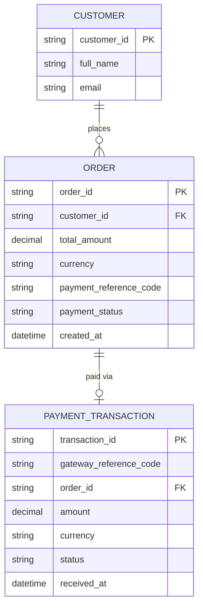
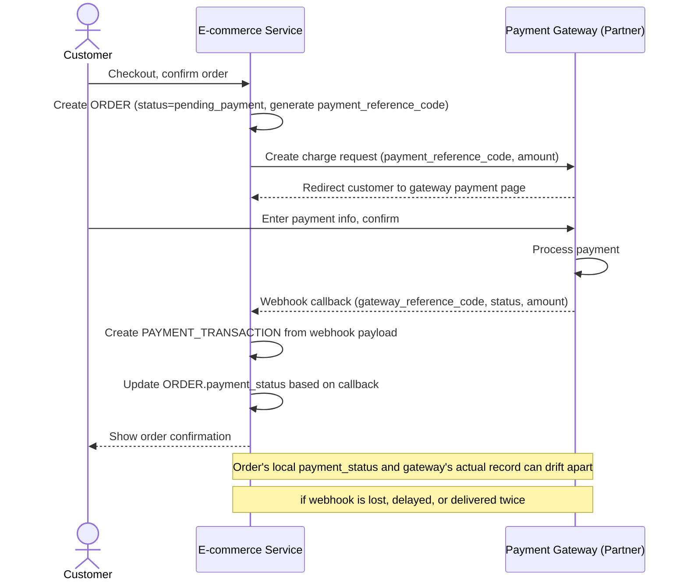
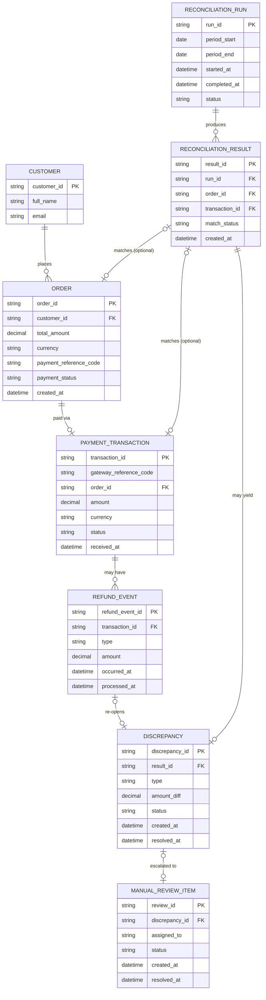
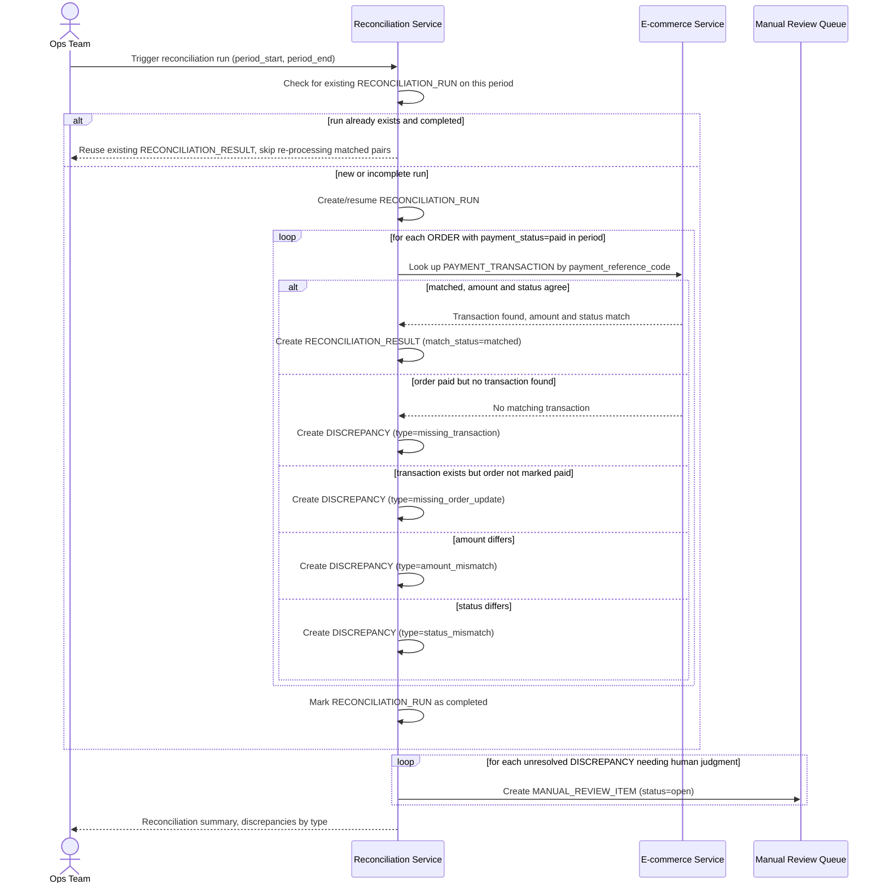
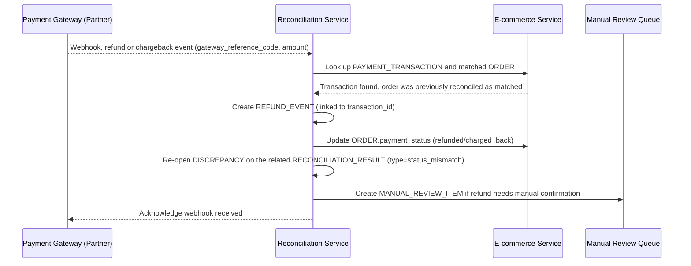
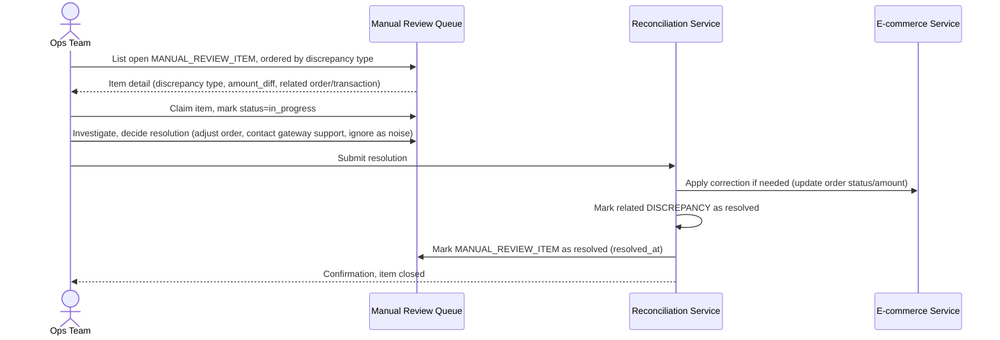

# E-commerce đối soát giao dịch giữa cổng thanh toán và hệ thống đơn hàng

**Hệ thống:** Một sàn e-commerce nhận thanh toán qua cổng thanh toán bên thứ ba (ví dụ Stripe/VNPay) cho các đơn hàng.

**Vai trò của flow:** Đối soát định kỳ giữa danh sách giao dịch từ cổng thanh toán và trạng thái đơn hàng trong hệ thống nội bộ để phát hiện sai lệch (đơn báo đã thanh toán nhưng cổng không ghi nhận, hoặc ngược lại).

**Yêu cầu cụ thể:**
- Mỗi giao dịch từ cổng thanh toán phải được khớp (match) với đúng một đơn hàng nội bộ dựa trên mã tham chiếu duy nhất, phát hiện được các trường hợp không khớp (giao dịch không có đơn tương ứng, hoặc đơn báo đã trả tiền nhưng không tìm thấy giao dịch).
- Xử lý đúng các giao dịch bị hoàn tiền (refund) hoặc bị đảo (chargeback) xảy ra sau khi đơn hàng đã đối soát thành công trước đó — phải cập nhật lại trạng thái đối soát tương ứng, không để đơn hàng hiển thị "đã đối soát khớp" khi thực tế tiền đã được hoàn.
- Báo cáo đối soát phải phân loại rõ các loại sai lệch (thiếu giao dịch, thừa giao dịch, sai số tiền, sai trạng thái) để đội vận hành xử lý đúng quy trình cho từng loại, không gộp chung một danh sách "lỗi".
- Job đối soát phải chạy được lại nhiều lần trên cùng một khoảng thời gian dữ liệu mà không tạo ra báo cáo trùng lặp hoặc đánh dấu sai lệch nhiều lần cho cùng một giao dịch đã được xử lý.
- Các sai lệch không tự giải quyết được (cần con người can thiệp) phải được đưa vào hàng đợi xử lý thủ công có theo dõi trạng thái, đảm bảo không có sai lệch nào bị bỏ quên không xử lý.

---

# ERD — Base (trước khi có đối soát cổng thanh toán)

Đây là **base**: mô hình dữ liệu suy luận cho sàn e-commerce *trước khi* có flow đối soát. Đề bài giả định hệ thống đã có đơn hàng, đã tích hợp cổng thanh toán bên thứ ba và đã lưu lại các giao dịch cổng trả về (qua webhook) gắn với mã tham chiếu — nếu không có sẵn `ORDER` mang `payment_reference_code` và `PAYMENT_TRANSACTION` ghi nhận giao dịch cổng thì "khớp giao dịch cổng với đơn hàng" sẽ không có nghĩa. ERD chỉ dựng phần lõi phục vụ thanh toán đơn hàng, không suy diễn thêm các module không liên quan (khuyến mãi, vận chuyển...).

---

# Sequence Diagram — Base: Checkout Payment

Đây là **base**, flow "thanh toán khi checkout" — tiền đề bắt buộc cho đối soát: chính flow này tạo ra `ORDER` với `payment_reference_code` và `PAYMENT_TRANSACTION` từ webhook của cổng thanh toán, hai dữ liệu mà job đối soát sau này phải khớp với nhau.

---

# ERD — Enhance (sau khi có đối soát cổng thanh toán)

Đây là **enhance**: ERD base cộng với các entity phục vụ đúng 5 yêu cầu của đề bài — chạy job đối soát khớp theo mã tham chiếu, phân loại rõ 4 loại sai lệch, xử lý refund/chargeback phát sinh sau khi đã khớp, đảm bảo job chạy lại (re-run) không tạo trùng lặp, và hàng đợi xử lý thủ công có theo dõi trạng thái cho sai lệch không tự giải quyết được. So với base, `ORDER` và `PAYMENT_TRANSACTION` không đổi cấu trúc, chỉ được tham chiếu thêm bởi các entity đối soát mới.

---

# Sequence Diagram — Enhance: Periodic Reconciliation

Đây là **enhance**, flow chính hoàn toàn mới mà đề bài yêu cầu: đối soát định kỳ giữa `ORDER` và `PAYMENT_TRANSACTION`. Flow thể hiện việc khớp theo mã tham chiếu duy nhất, phân loại 4 loại sai lệch (thiếu giao dịch, thừa giao dịch, sai số tiền, sai trạng thái), và tính idempotent khi chạy lại nhiều lần trên cùng khoảng thời gian — tất cả chưa tồn tại ở base.

---

# Sequence Diagram — Enhance: Handle Post-Reconciliation Refund/Chargeback

Đây là **enhance**, flow mới xử lý refund/chargeback xảy ra *sau khi* một đơn hàng đã đối soát khớp thành công (xem [4-enhance-periodic-reconciliation-sqd.md](#4-enhance-periodic-reconciliation-sqd)). Flow này đảm bảo yêu cầu "không để đơn hàng hiển thị đã đối soát khớp khi thực tế tiền đã được hoàn" — bằng cách mở lại DISCREPANCY cho RECONCILIATION_RESULT liên quan thay vì để trạng thái matched cũ đứng yên.

---

# Sequence Diagram — Enhance: Manual Review Queue

Đây là **enhance**, flow mới cho đội vận hành xử lý các `MANUAL_REVIEW_ITEM` phát sinh từ đối soát ([4-enhance-periodic-reconciliation-sqd.md](#4-enhance-periodic-reconciliation-sqd), [5-enhance-handle-post-reconciliation-refund-sqd.md](#5-enhance-handle-post-reconciliation-refund-sqd)). Flow này đảm bảo yêu cầu "không có sai lệch nào bị bỏ quên" bằng cách theo dõi trạng thái xử lý tường minh cho từng sai lệch cần con người can thiệp.

