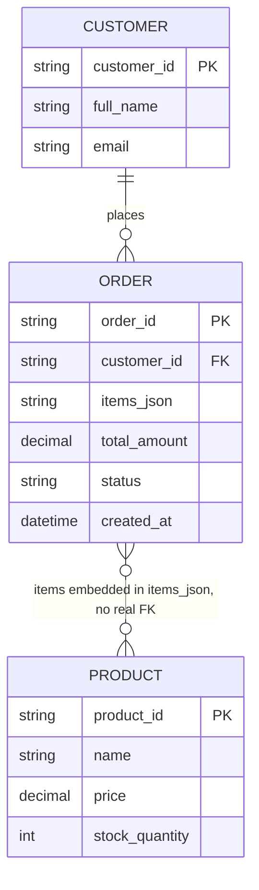
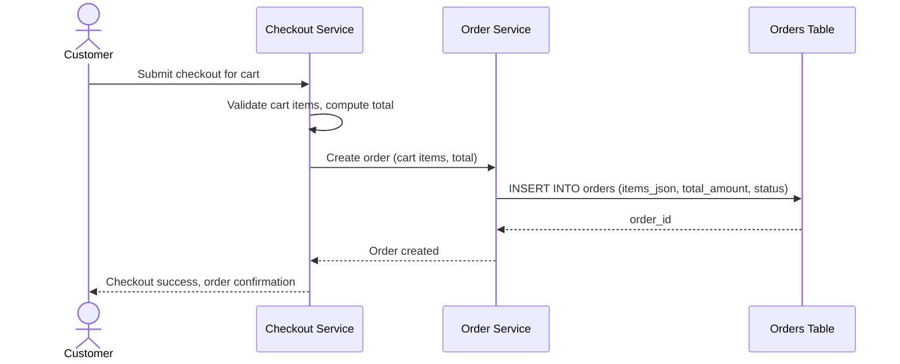
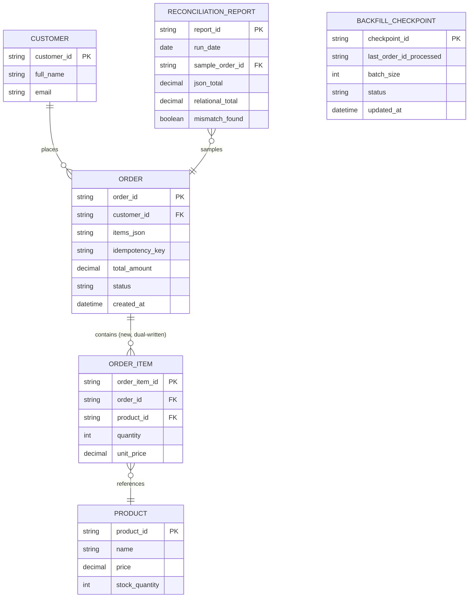
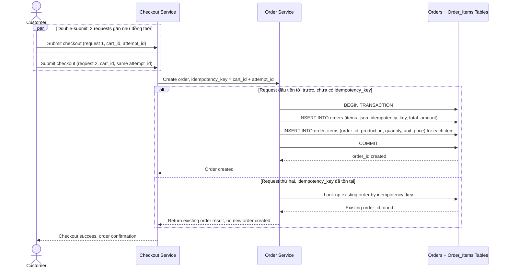
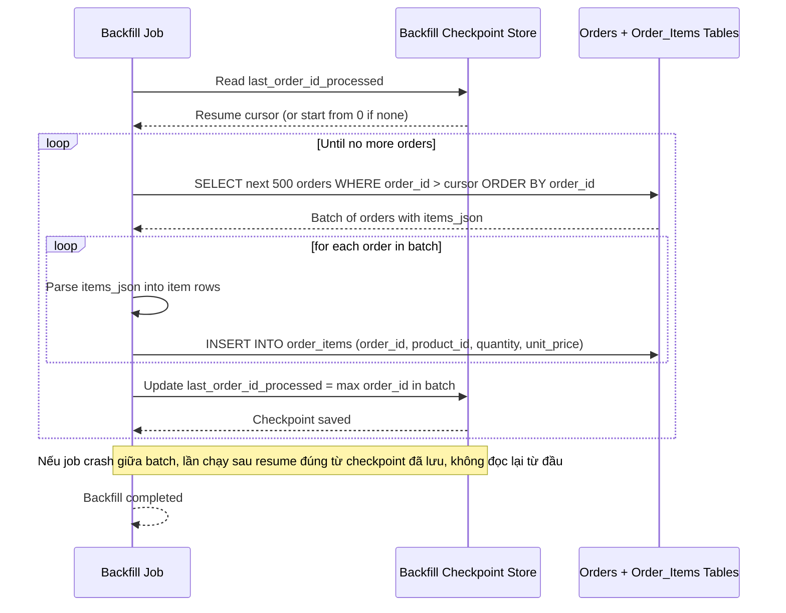
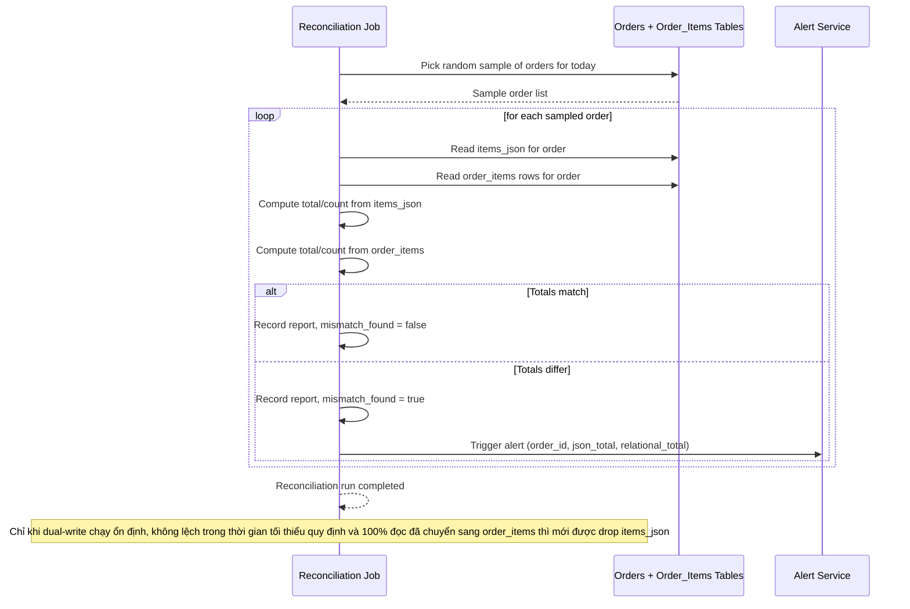

# Tách bảng `orders` thành `orders` + `order_items` không downtime (e-commerce)

**Hệ thống:** Một sàn e-commerce có bảng `orders` cũ lưu items dưới dạng JSON trong 1 cột, cần tách sang bảng quan hệ `order_items` để hỗ trợ báo cáo/join hiệu quả hơn.

**Vai trò của flow:** Trong lúc traffic đặt hàng vẫn chạy 24/7, flow phải đảm bảo mọi order mới tạo được ghi cả vào cột JSON cũ và bảng `order_items` mới, đồng thời có job backfill order cũ, mà không làm gián đoạn checkout.

**Yêu cầu cụ thể:**
- Yêu cầu transaction tạo order dual-write phải wrap trong 1 transaction DB duy nhất (ghi `orders` + insert `order_items`) để không có trường hợp order được tạo nhưng thiếu order_items do crash giữa chừng.
- Mô tả cụ thể tình huống 2 request checkout đồng thời cho cùng 1 cart (double-submit do user bấm 2 lần) trong giai đoạn dual-write: yêu cầu idempotency key theo `cart_id` + `checkout_attempt_id` để chỉ 1 trong 2 request tạo order thành công, request kia phải nhận lại kết quả của request đầu (không tạo order trùng ở cả bảng cũ và mới).
- Job backfill order lịch sử phải chạy bằng cursor theo `order_id` tăng dần theo batch nhỏ (ví dụ 500 order/lần), có checkpoint để resume nếu job bị crash giữa chừng, không đọc lại từ đầu.
- Định nghĩa cơ chế kiểm tra tính nhất quán (reconciliation job) so sánh số lượng/tổng tiền giữa cột JSON cũ và bảng `order_items` mới cho một mẫu order ngẫu nhiên mỗi ngày, cảnh báo nếu phát hiện lệch.
- Quy định rõ điều kiện để an toàn drop cột JSON cũ: phải chạy dual-write ổn định (không lệch dữ liệu) trong một khoảng thời gian tối thiểu, và đã chuyển 100% luồng đọc sang bảng mới.

---

# ERD — Base (trước khi tách order_items)

Đây là **base**: mô hình dữ liệu suy luận cho sàn e-commerce *trước khi* tách bảng. Đề bài giả định đã tồn tại bảng `orders` lưu danh sách sản phẩm của đơn hàng dưới dạng JSON trong 1 cột — nếu không có sẵn `orders` với cột JSON đó thì yêu cầu "tách sang bảng order_items" sẽ không có nghĩa. ERD chỉ dựng phần lõi phục vụ tạo đơn hàng, không suy diễn thêm các module không liên quan (khuyến mãi, vận chuyển, thanh toán...).

---

# Sequence Diagram — Base: Checkout Create Order

Đây là **base**, flow "tạo đơn hàng lúc checkout" — tiền đề bắt buộc cho việc tách bảng: chính flow này đang ghi toàn bộ danh sách item vào cột `items_json` của bảng `orders`, là nguồn dữ liệu duy nhất cần được dual-write sang bảng `order_items` mới ở enhance.

---

# ERD — Enhance (sau khi tách order_items)

Đây là **enhance**: ERD base cộng với các entity phục vụ đúng yêu cầu của đề bài — dual-write `order_items` quan hệ song song với `items_json` cũ, checkpoint cho job backfill, và báo cáo đối soát. So với base, `ORDER` giữ nguyên cột `items_json` (chưa drop, vẫn đang dual-write) và có thêm `idempotency_key` để chống double-submit; quan hệ `ORDER` — `PRODUCT` giờ đi qua `ORDER_ITEM` thật sự là FK thay vì chỉ nằm lỏng lẻo trong JSON.

---

# Sequence Diagram — Enhance: Checkout Create Order

Đây là **enhance**, flow "tạo đơn hàng lúc checkout" đã tồn tại ở base ([2-base-checkout-create-order-sqd.md](#2-base-checkout-create-order-sqd)) nay thay đổi lớn: ghi `orders` (items_json) và `order_items` phải nằm trong cùng 1 transaction DB, và phải chống double-submit bằng idempotency key theo `cart_id` + `checkout_attempt_id` khi user bấm checkout 2 lần gần như đồng thời.

---

# Sequence Diagram — Enhance: Backfill Historical Orders

Đây là **enhance**, flow hoàn toàn mới: job backfill đọc các order lịch sử (tạo trước khi có dual-write) theo cursor `order_id` tăng dần, batch nhỏ 500 order/lần, có checkpoint để resume nếu crash giữa chừng thay vì đọc lại từ đầu.

---

# Sequence Diagram — Enhance: Reconciliation Check

Đây là **enhance**, flow hoàn toàn mới: job đối soát hằng ngày so sánh số lượng/tổng tiền giữa cột `items_json` cũ và bảng `order_items` mới cho một mẫu order ngẫu nhiên, cảnh báo nếu lệch — điều kiện bắt buộc trước khi được phép drop cột JSON cũ.

