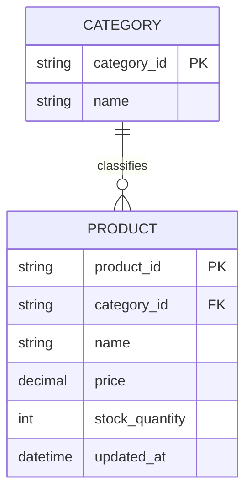
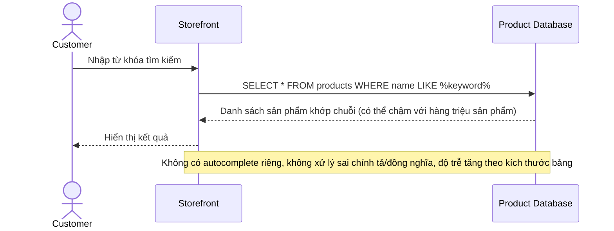
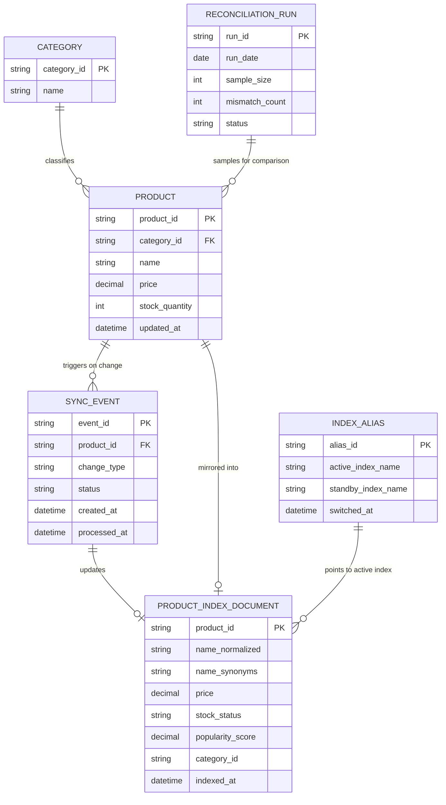
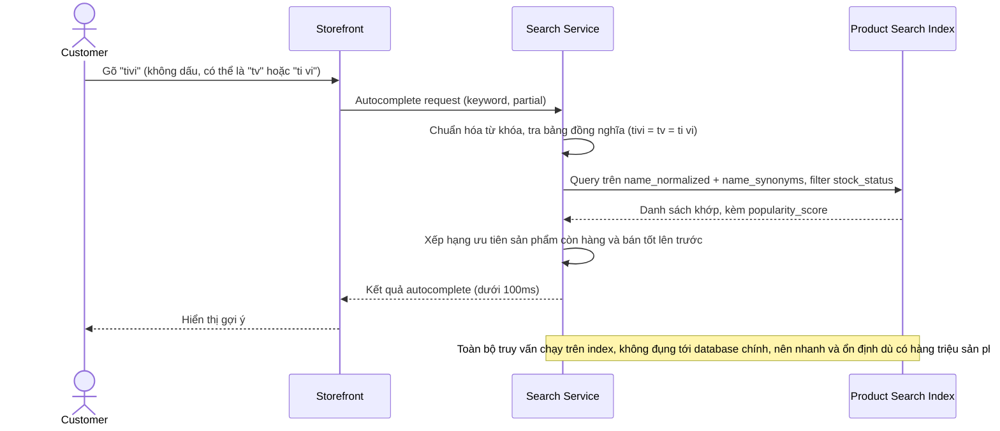
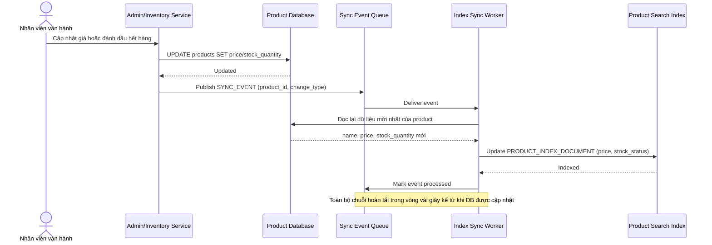
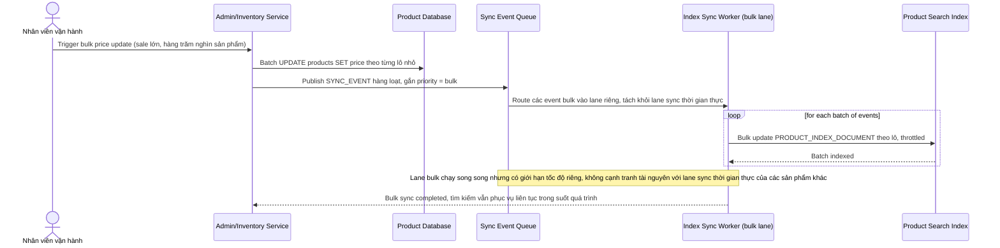
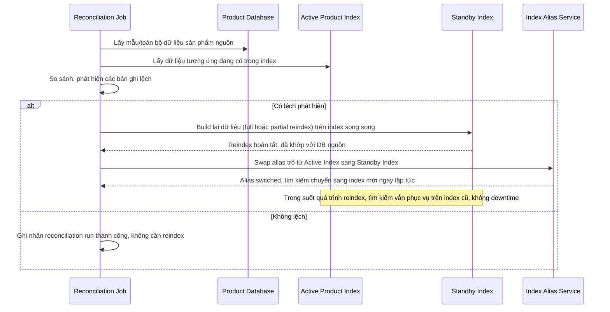

# E-commerce tìm kiếm và gợi ý sản phẩm

**Hệ thống:** Một sàn e-commerce với hàng triệu sản phẩm, cần thanh tìm kiếm với autocomplete và kết quả tìm kiếm chính xác theo tên/thuộc tính sản phẩm.

**Vai trò của flow:** Đồng bộ dữ liệu sản phẩm (tên, giá, tồn kho, danh mục) từ database chính vào search index, và phục vụ autocomplete/tìm kiếm với độ trễ thấp.

**Yêu cầu cụ thể:**
- Khi sản phẩm thay đổi giá hoặc hết hàng, search index phải được cập nhật trong vòng vài giây, tránh hiển thị giá cũ hoặc cho phép tìm thấy sản phẩm đã hết hàng mà không có cảnh báo rõ ràng.
- Autocomplete phải trả kết quả trong thời gian rất ngắn (dưới 100ms) và ưu tiên gợi ý sản phẩm đang bán tốt/còn hàng lên trước, không chỉ khớp chuỗi ký tự đơn thuần.
- Index phải xử lý được lỗi chính tả và từ đồng nghĩa phổ biến (ví dụ "tivi"/"tv", dấu tiếng Việt có/không dấu) để không bỏ lỡ kết quả đúng khi người dùng gõ sai/thiếu dấu.
- Khi có cập nhật hàng loạt (bulk update giá dịp sale lớn ảnh hưởng hàng trăm nghìn sản phẩm), pipeline đồng bộ vào index không được làm chậm hoặc gây downtime cho tìm kiếm đang phục vụ người dùng thật.
- Có cơ chế phát hiện và tự phục hồi khi index bị lệch so với database nguồn (ví dụ do lỗi đồng bộ), thông qua job đối soát định kỳ chạy full reindex một phần hoặc toàn phần mà không ảnh hưởng tìm kiếm đang chạy (dùng index song song rồi swap).

---

# ERD — Base (trước khi có search index)

Đây là **base**: mô hình dữ liệu suy luận cho sàn e-commerce *trước khi* có pipeline đồng bộ vào search index riêng. Đề bài giả định đã có `PRODUCT` với tên/giá/tồn kho/danh mục lưu trong database chính — nếu không có sẵn dữ liệu sản phẩm này thì yêu cầu "đồng bộ vào search index" sẽ không có nghĩa. Tìm kiếm ở base được suy luận là chạy trực tiếp trên database chính (query LIKE/filter cơ bản), chưa có autocomplete hay xử lý lỗi chính tả/đồng nghĩa.

---

# Sequence Diagram — Base: Search Product

Đây là **base**, flow "tìm kiếm sản phẩm" chạy trực tiếp trên database chính — tiền đề cho thấy hạn chế mà enhance phải giải quyết: query trực tiếp trên hàng triệu sản phẩm chậm, không có autocomplete, không xử lý lỗi chính tả/đồng nghĩa, và không tự phản ánh ngay khi giá/tồn kho đổi.

---

# ERD — Enhance (sau khi có search index)

Đây là **enhance**: ERD base cộng với `PRODUCT_INDEX_DOCUMENT` (tài liệu index phục vụ autocomplete/tìm kiếm, có các trường chuẩn hóa cho lỗi chính tả/đồng nghĩa/dấu tiếng Việt), `SYNC_EVENT` ghi nhận thay đổi cần đồng bộ, `INDEX_ALIAS` để swap giữa 2 index song song khi reindex, và `RECONCILIATION_RUN` đối soát định kỳ. So với base, `PRODUCT` không đổi cấu trúc nhưng mọi thay đổi giờ phát sinh `SYNC_EVENT` để đẩy vào index gần thời gian thực thay vì chỉ tồn tại trong DB chính.

---

# Sequence Diagram — Enhance: Search Product

Đây là **enhance**, flow "tìm kiếm sản phẩm" đã tồn tại ở base ([2-base-search-product-sqd.md](#2-base-search-product-sqd)) nay thay đổi hoàn toàn: query chuyển sang chạy trên `PRODUCT_INDEX_DOCUMENT` thay vì DB chính, autocomplete trả kết quả dưới 100ms, ưu tiên sản phẩm còn hàng/bán tốt, và xử lý được lỗi chính tả/đồng nghĩa/dấu tiếng Việt.

---

# Sequence Diagram — Enhance: Sync Product to Index

Đây là **enhance**, flow hoàn toàn mới: khi sản phẩm đổi giá hoặc hết hàng trong database chính, thay đổi phải được phản ánh vào search index trong vòng vài giây, tránh hiển thị giá cũ hoặc để khách tìm thấy sản phẩm đã hết hàng mà không có cảnh báo.

---

# Sequence Diagram — Enhance: Bulk Update Sync

Đây là **enhance**, flow hoàn toàn mới: khi có cập nhật giá hàng loạt dịp sale lớn ảnh hưởng hàng trăm nghìn sản phẩm, pipeline đồng bộ index phải xử lý mà không làm chậm hoặc downtime cho tìm kiếm đang phục vụ người dùng thật.

---

# Sequence Diagram — Enhance: Reindex Reconciliation

Đây là **enhance**, flow hoàn toàn mới: job đối soát định kỳ phát hiện index bị lệch so với database nguồn (do lỗi đồng bộ), tự phục hồi bằng full/partial reindex sang index song song rồi swap alias, không ảnh hưởng tìm kiếm đang chạy.

