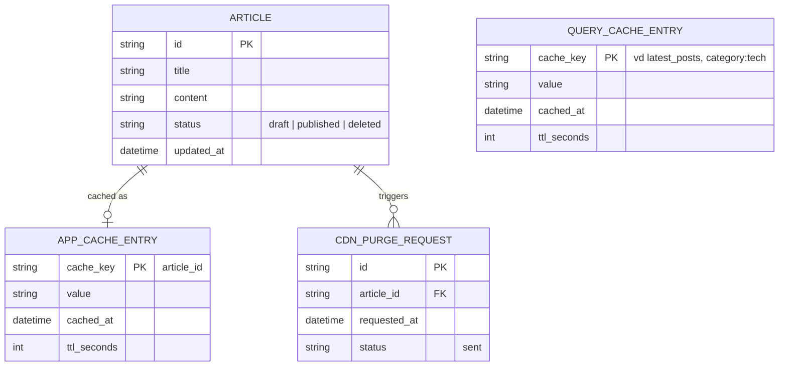
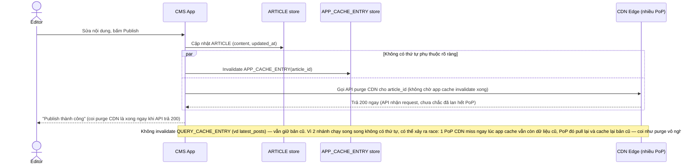
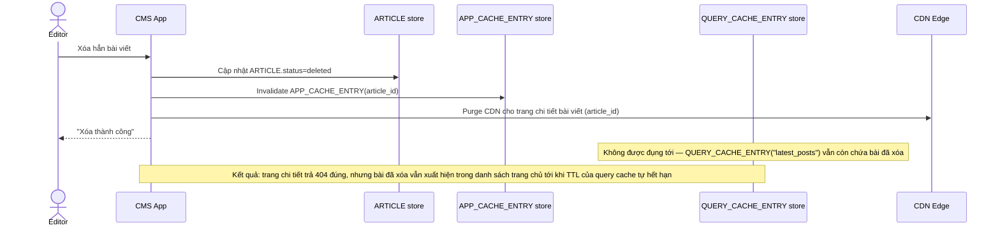
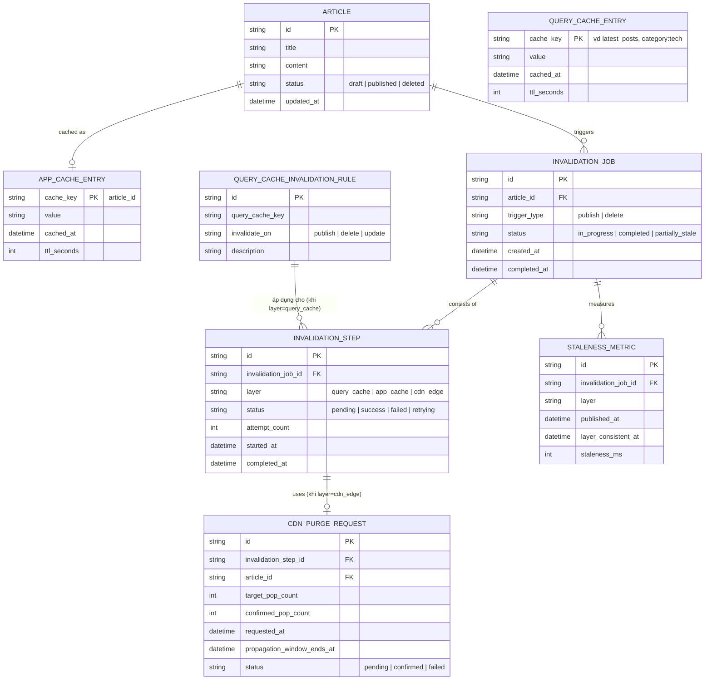
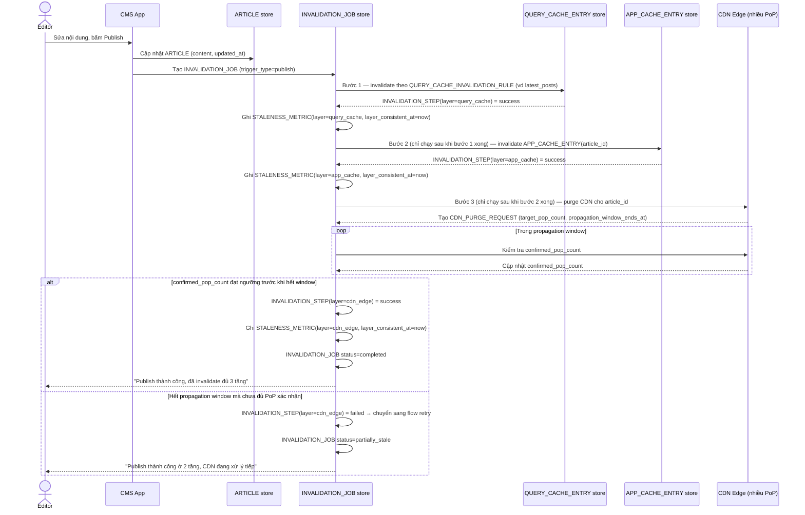
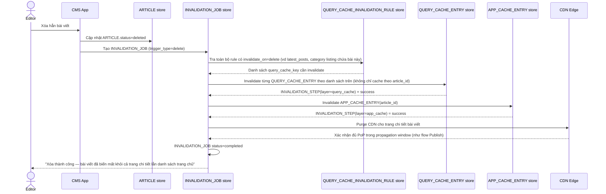
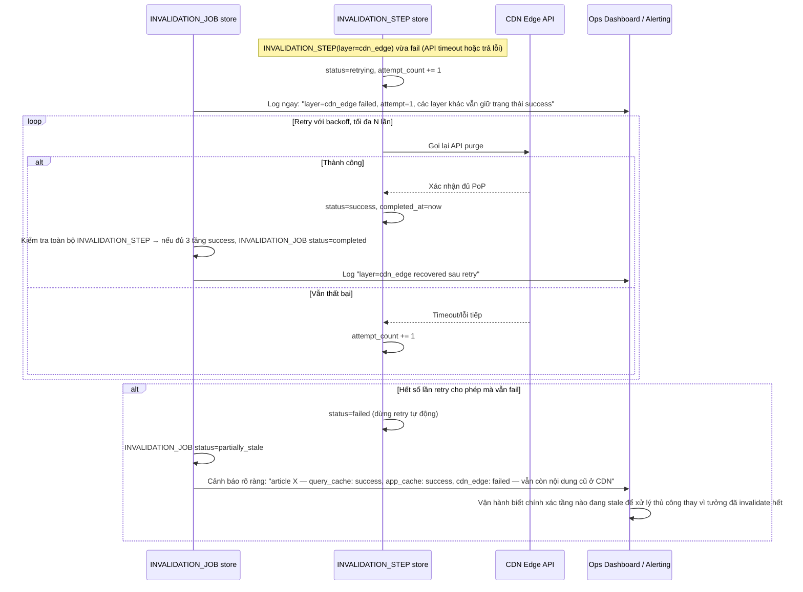

# Cache nhiều tầng cho CMS/blog

**Hệ thống:** Hệ thống CMS/blog phục vụ bài viết qua nhiều tầng cache chồng lên nhau: CDN edge cache (gần user), cache tầng ứng dụng (application/object cache), và cache kết quả query DB (query cache) — mỗi tầng có TTL và cơ chế invalidate riêng.

**Vai trò của flow:** Đảm bảo khi 1 bài viết được sửa/xóa/publish, việc invalidate phải lan đúng và đủ qua toàn bộ các tầng cache, không chỉ dừng ở tầng gần nhất (application cache) mà bỏ sót CDN edge hoặc query cache khiến người đọc vẫn thấy nội dung cũ dù tầng app đã đúng.

**Yêu cầu cụ thể:**
- Khi biên tập viên sửa nội dung bài viết và publish lại, invalidation phải được gửi tới cả 3 tầng theo đúng thứ tự phụ thuộc (query cache trước, application cache sau, rồi purge CDN edge) — nếu purge CDN trước mà tầng dưới chưa cập nhật, request tiếp theo tới edge sẽ pull lại đúng nội dung cũ từ application cache và cache lại nó ở edge, coi như invalidate CDN vô nghĩa.
- Purge CDN edge cache thường không đồng bộ ngay lập tức trên toàn bộ điểm PoP (point of presence) toàn cầu — phải chấp nhận và công bố rõ "khoảng lan truyền" (propagation window) thực tế, đồng thời có cơ chế xác nhận purge đã tới đủ số PoP quan trọng trước khi coi invalidation hoàn tất.
- Với bài viết bị xóa hẳn (không chỉ sửa), phải đảm bảo tầng query cache (thường cache theo query như "danh sách bài mới nhất") cũng được invalidate, không chỉ cache theo ID bài viết đơn lẻ — nếu bỏ sót, bài đã xóa vẫn xuất hiện trong danh sách trang chủ dù trang chi tiết đã trả 404 đúng.
- Xử lý trường hợp một tầng cache invalidate thất bại (ví dụ API purge CDN timeout hoặc trả lỗi) — phải có retry với theo dõi trạng thái, và log rõ tầng nào invalidate thành công/thất bại để vận hành biết còn tầng nào đang phục vụ nội dung cũ, tránh tình trạng "tưởng đã invalidate hết" nhưng thực ra một tầng vẫn stale.
- Đo lường: với mỗi lần publish/sửa bài, track được "end-to-end staleness" — thời gian từ lúc publish tới lúc cả 3 tầng đều phản ánh đúng nội dung mới, phân theo từng tầng để biết tầng nào đang là nút thắt cổ chai của độ trễ invalidate.

---

# Base ERD — CMS đa tầng cache trước khi có orchestration invalidation

Đây là **base**: mô hình dữ liệu suy luận từ ngữ cảnh đề bài, thể hiện trạng thái hệ thống **trước khi** có cơ chế điều phối invalidation xuyên 3 tầng. Đề bài mô tả hệ thống đã có sẵn 3 tầng cache (CDN edge, application cache, query cache) — nên base cần đủ: bài viết, cache tầng ứng dụng theo article_id, cache tầng query (theo danh sách như "latest_posts"), và 1 request purge CDN thô sơ (fire-and-forget, không xác nhận PoP). Chưa có entity nào phục vụ điều phối thứ tự/retry/đo staleness — những thứ đó là phần enhance.

---

# Base sequence — Publish article (invalidation chưa đúng thứ tự)

Đây là **base**, flow "Biên tập viên sửa và publish lại bài viết" ở trạng thái hiện tại — chỉ invalidate application cache đúng, còn CDN thì bắn đi không chờ xác nhận và không theo thứ tự phụ thuộc. Flow này liên quan mật thiết tới enhance vì yêu cầu thứ 1 và 2 của đề bài chính là sửa lại đúng vấn đề thứ tự và xác nhận purge ở đây.

---

# Base sequence — Delete article (bỏ sót query cache)

Đây là **base**, flow "Xóa hẳn bài viết" ở trạng thái hiện tại — chỉ invalidate cache theo article_id, không đụng tới các query cache theo danh sách. Flow này liên quan mật thiết tới enhance vì yêu cầu thứ 3 của đề bài chính là sửa đúng lỗ hổng này.

---

# Enhance ERD — sau khi có orchestration invalidation đa tầng

Đây là ERD **sau khi** enhance được áp dụng lên base. So với base, có 4 nhóm entity mới, ứng trực tiếp với 5 yêu cầu trong đề bài:

- `INVALIDATION_JOB` + `INVALIDATION_STEP` (mới) — điều phối invalidation theo đúng thứ tự (query cache → app cache → CDN), mỗi bước theo dõi trạng thái/retry riêng thay vì bắn song song như base.
- `CDN_PURGE_REQUEST` thêm `target_pop_count`/`confirmed_pop_count`/`propagation_window_ends_at` — chỉ coi purge hoàn tất khi đủ số PoP quan trọng xác nhận, không còn coi API trả 200 là xong ngay.
- `QUERY_CACHE_INVALIDATION_RULE` (mới) — khai báo rõ query cache nào (vd "latest_posts") phải bị invalidate khi có publish/delete, để không bỏ sót như base.
- `STALENESS_METRIC` (mới) — đo end-to-end staleness từ lúc publish tới lúc từng tầng phản ánh đúng nội dung mới.

---

# Enhance sequence — Publish article (đúng thứ tự, có xác nhận CDN, đo staleness)

Đây là **enhance**, cùng flow "Publish article" đã có ở base nhưng nay thay đổi theo yêu cầu 1, 2 và 5 của đề bài: 3 tầng được invalidate theo đúng thứ tự phụ thuộc (query cache → app cache → CDN), CDN chỉ coi là xong khi đủ số PoP xác nhận trong propagation window, và mỗi tầng được đo staleness riêng.

---

# Enhance sequence — Delete article (invalidate cả query cache dạng danh sách)

Đây là **enhance**, cùng flow "Delete article" đã có ở base nhưng nay thay đổi theo yêu cầu thứ 3 của đề bài: dùng `QUERY_CACHE_INVALIDATION_RULE` để xác định và invalidate đúng các query cache dạng danh sách (không chỉ cache theo article_id), đi theo cùng thứ tự query cache → app cache → CDN như flow publish.

---

# Enhance sequence — Invalidation failure & retry

Đây là **enhance**, flow hoàn toàn mới, phát sinh từ enhance — chưa tồn tại ở base (ở base, purge CDN fire-and-forget, không ai biết nó có thất bại hay không). Đáp ứng yêu cầu thứ 4 của đề bài: khi 1 tầng invalidate thất bại (vd API purge CDN timeout), phải retry có theo dõi trạng thái và log rõ tầng nào thành công/thất bại.

