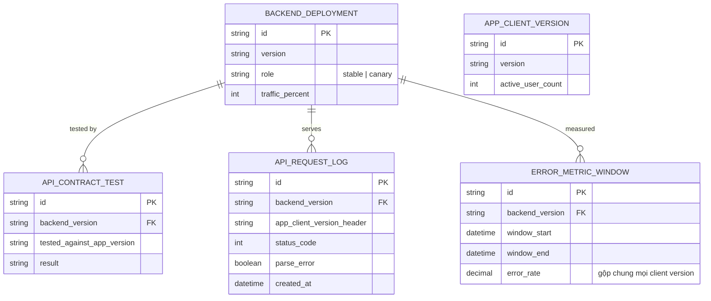
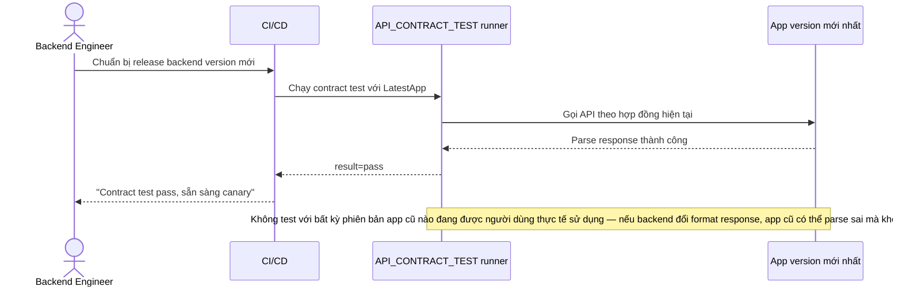
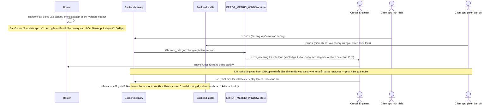
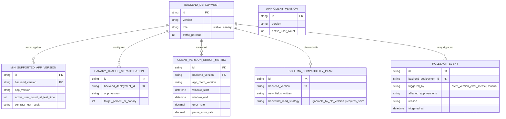
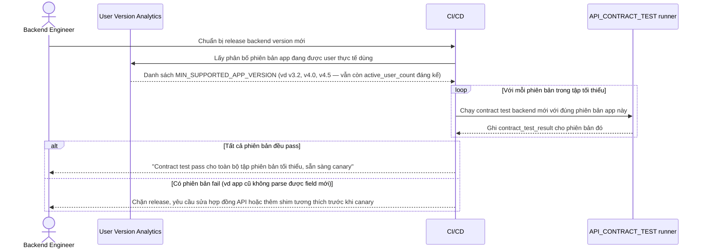
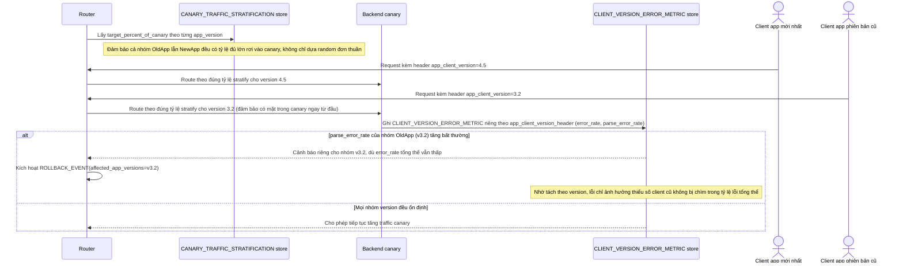
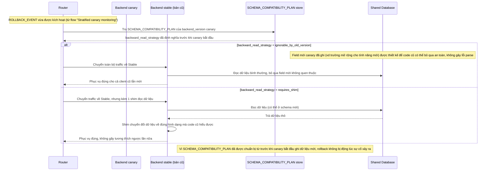

# Canary rollout cho backend mobile phải serving song song nhiều phiên bản app cũ

**Hệ thống:** Một backend phục vụ ứng dụng mobile, trong đó người dùng không update app đồng loạt — tại một thời điểm, backend phải phục vụ đồng thời nhiều phiên bản app khác nhau đang cài trên máy người dùng, có thể chênh nhau nhiều tháng phát hành.

**Vai trò của flow:** Canary deployment ở đây không chỉ kiểm tra phiên bản backend mới có lỗi hay không, mà còn phải đảm bảo phiên bản mới không phá vỡ hợp đồng API mà các phiên bản app cũ đang phụ thuộc, vì không thể ép người dùng update app ngay lập tức.

**Yêu cầu cụ thể:**
- Trước khi canary, phải xác định rõ tập các phiên bản app cũ tối thiểu còn cần hỗ trợ (dựa trên số liệu người dùng thực tế đang dùng phiên bản nào) và test hợp đồng API mới với từng phiên bản đó, không chỉ test với app mới nhất.
- Traffic canary phải được phân chia sao cho bao gồm cả request từ app phiên bản cũ lẫn mới, không chỉ dồn canary vào nhóm user đã update app mới nhất — nếu không, lỗi tương thích ngược chỉ lộ ra sau khi đã mở rộng traffic lên cao.
- Xử lý trường hợp phiên bản backend mới đổi định dạng response (thêm field bắt buộc, đổi kiểu dữ liệu) khiến app cũ không parse được — phải phát hiện qua tỷ lệ crash/lỗi parse tăng bất thường ở nhóm client cũ trong lúc canary, tách biệt với lỗi kỹ thuật chung của backend.
- Đảm bảo cơ chế theo dõi lỗi trong canary phân tách được theo phiên bản app gọi tới (thông qua header version của client), để biết chính xác lỗi phát sinh ở nhóm client nào thay vì gộp chung tỷ lệ lỗi toàn bộ traffic, tránh bỏ sót lỗi chỉ ảnh hưởng một nhóm phiên bản cũ thiểu số.
- Định nghĩa chiến lược rollback không đơn giản là "quay lại code cũ" nếu phiên bản mới đã bắt đầu ghi dữ liệu theo schema mới (ví dụ trường mở rộng cho tính năng mới) — dữ liệu đó vẫn phải đọc được bởi phiên bản cũ đang phục vụ các client legacy sau khi rollback, tránh gãy tương thích ngược thêm lần nữa.

---

# Base ERD — Canary backend mobile trước khi nhận diện đa phiên bản app

Đây là **base**: mô hình dữ liệu suy luận từ ngữ cảnh đề bài, thể hiện trạng thái hệ thống **trước khi** canary nhận diện đa phiên bản app client. Đề bài nói backend đã phục vụ nhiều phiên bản app cũ và có sẵn khái niệm canary — nên base cần đủ: phiên bản app client, backend deployment (đã có role stable/canary), test hợp đồng API (chỉ test với app mới nhất), và log request (có ghi app_client_version_header nhưng chưa dùng để tách metric). Chưa có entity nào phục vụ stratify traffic theo version/metric tách theo version/kế hoạch rollback tương thích ngược — những thứ đó là phần enhance.

---

# Base sequence — Pre-release contract test (chỉ test app mới nhất)

Đây là **base**, flow "Test hợp đồng API trước khi canary" ở trạng thái hiện tại — chỉ test với phiên bản app mới nhất. Flow này liên quan mật thiết tới enhance vì yêu cầu thứ 1 của đề bài chính là sửa đúng lỗ hổng này.

---

# Base sequence — Canary rollout & rollback (chưa nhận diện version app)

Đây là **base**, flow "Canary rollout" ở trạng thái hiện tại — traffic canary chọn ngẫu nhiên không phân biệt phiên bản app, metric lỗi gộp chung, rollback chỉ đơn giản là revert code. Flow này liên quan mật thiết tới enhance vì yêu cầu 2, 3, 4 và 5 của đề bài đều nhằm sửa đúng các lỗ hổng ở đây.

---

# Enhance ERD — sau khi canary nhận diện đa phiên bản app

Đây là ERD **sau khi** enhance được áp dụng lên base. So với base, có 4 nhóm entity mới, ứng trực tiếp với 5 yêu cầu trong đề bài:

- `MIN_SUPPORTED_APP_VERSION` (mới) — xác định rõ tập phiên bản app tối thiểu cần hỗ trợ dựa trên số liệu user thực tế, dùng làm căn cứ test hợp đồng thay vì chỉ test app mới nhất.
- `CANARY_TRAFFIC_STRATIFICATION` (mới) — đảm bảo traffic canary có đủ tỷ lệ app cũ lẫn mới, không dồn ngẫu nhiên như base.
- `CLIENT_VERSION_ERROR_METRIC` (mới) — tách error/parse-error rate theo từng phiên bản app, thay vì gộp chung.
- `SCHEMA_COMPATIBILITY_PLAN` + `ROLLBACK_EVENT` (mới) — rollback có kế hoạch đảm bảo dữ liệu ghi theo schema mới vẫn đọc được bởi code cũ.

---

# Enhance sequence — Pre-release contract test (test đủ tập phiên bản tối thiểu)

Đây là **enhance**, cùng flow "Pre-release contract test" đã có ở base nhưng nay thay đổi theo yêu cầu thứ 1 của đề bài: xác định tập phiên bản app tối thiểu cần hỗ trợ dựa trên số liệu user thực tế, và test hợp đồng API với từng phiên bản đó.

---

# Enhance sequence — Stratified canary traffic & per-version monitoring

Đây là **enhance**, cùng flow "Canary rollout" đã có ở base nhưng nay thay đổi theo yêu cầu 2, 3 và 4 của đề bài: traffic canary được stratify để bao gồm cả app cũ lẫn mới, và metric lỗi tách riêng theo `app_client_version_header` để phát hiện lỗi parse chỉ ảnh hưởng nhóm client cũ.

---

# Enhance sequence — Backward-compatible rollback

Đây là **enhance**, cùng flow "Rollback" đã có ở base nhưng nay thay đổi hoàn toàn theo yêu cầu thứ 5 của đề bài: nếu canary đã ghi dữ liệu theo schema mới, rollback phải đảm bảo phiên bản cũ (đang phục vụ client legacy) vẫn đọc được dữ liệu đó, không chỉ đơn giản revert code.

