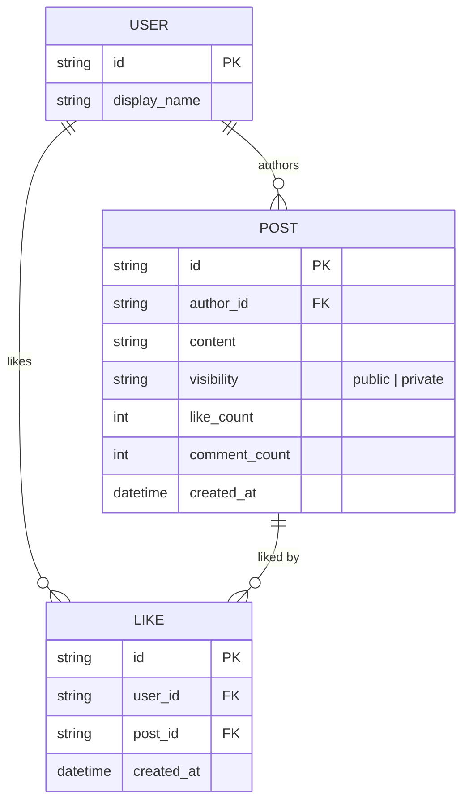
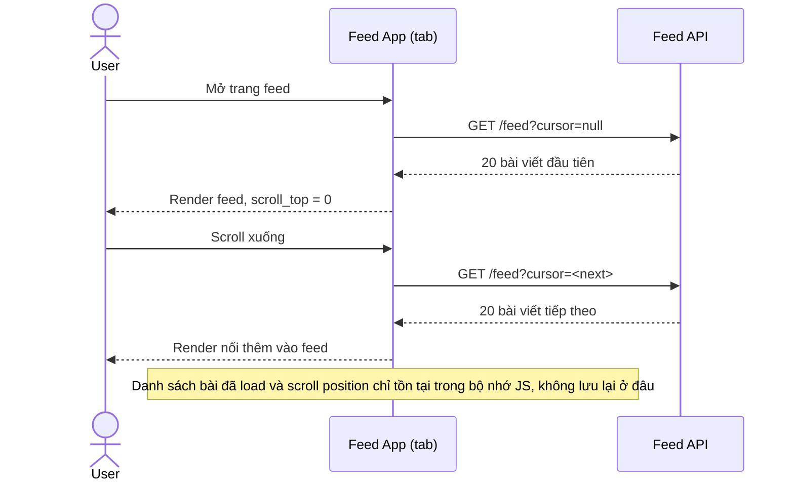
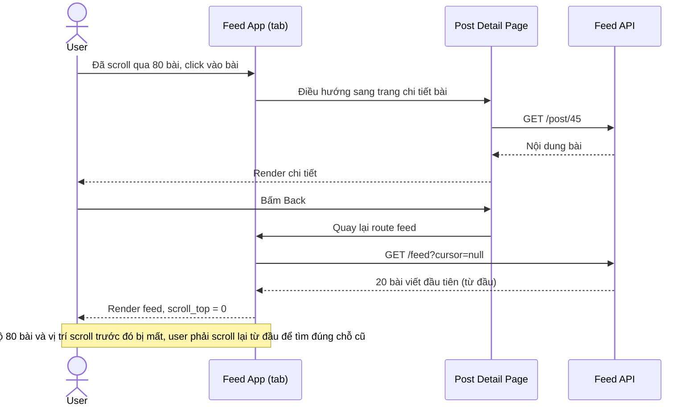
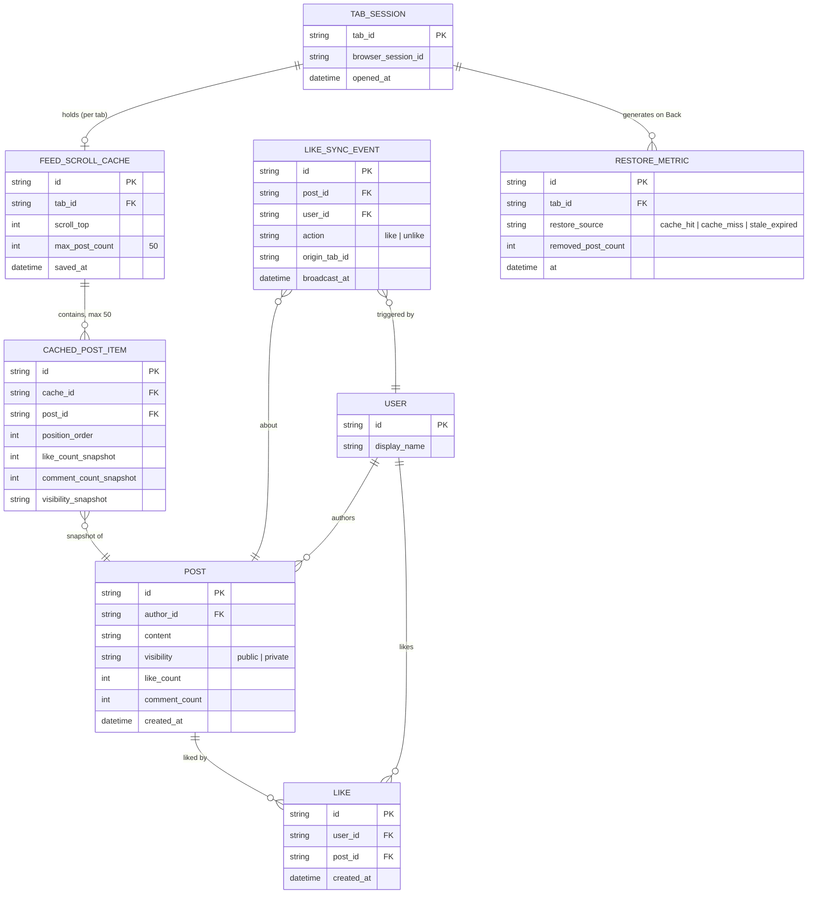
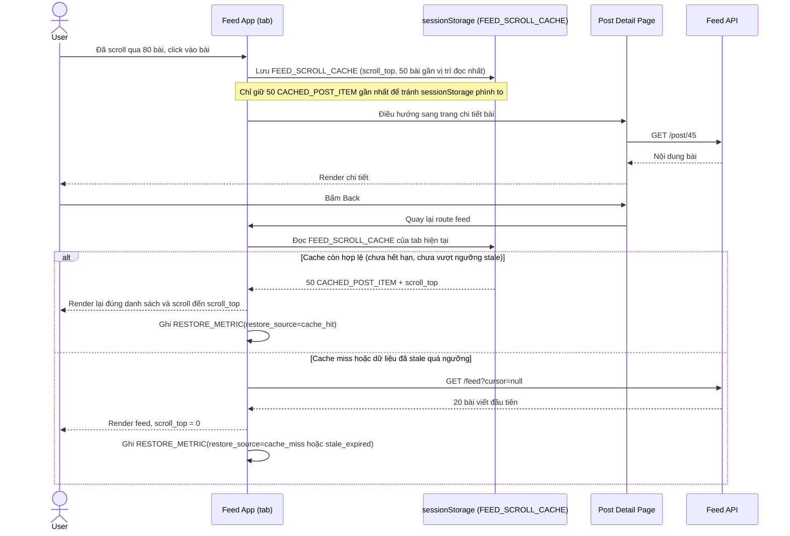
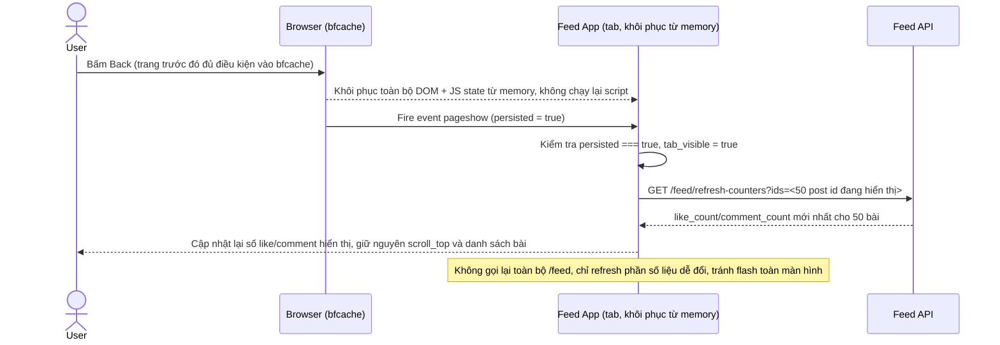
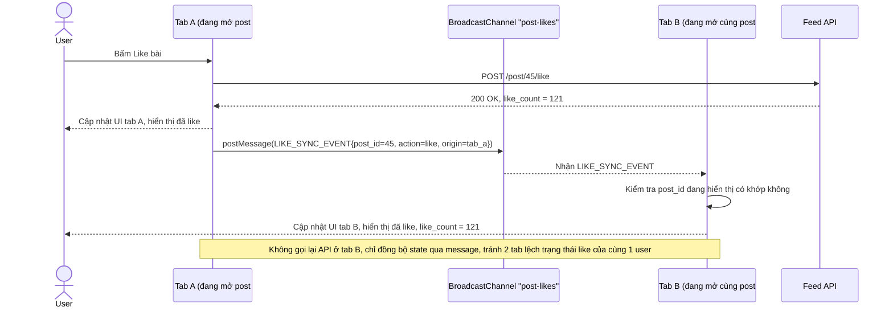
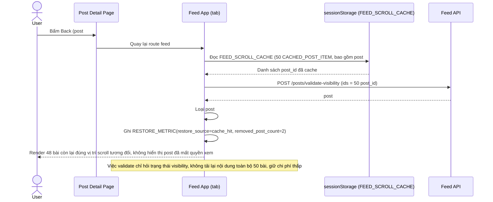

# Khôi phục scroll feed và đồng bộ trạng thái đa tab cho mạng xã hội

**Hệ thống:** Mạng xã hội có feed dạng infinite scroll; khi user click vào 1 bài viết rồi bấm Back, cần khôi phục đúng vị trí scroll và danh sách bài đã load, đồng thời đồng bộ trạng thái đọc/like giữa nhiều tab cùng mở.

**Vai trò của flow:** Giữ trải nghiệm mượt (không phải load lại từ đầu feed khi quay lại) mà vẫn đảm bảo dữ liệu hiển thị không quá cũ so với hành động đã thực hiện ở tab khác.

**Yêu cầu cụ thể:**
- Lưu danh sách post đã load + vị trí scroll vào sessionStorage (theo tab, theo session) khi rời trang; khi quay lại bằng Back, khôi phục đúng danh sách và scroll position — nhưng phải giới hạn kích thước lưu (ví dụ chỉ giữ 50 post gần nhất) để tránh sessionStorage phình to khi user scroll rất sâu.
- Trình duyệt có bfcache (back/forward cache) khôi phục toàn bộ trang từ memory kể cả JS state mà không chạy lại code — phải xử lý đúng sự kiện `pageshow`/`persisted` để refresh những phần dữ liệu có thể đã đổi (số like, comment mới) thay vì hiển thị y nguyên trạng thái cũ đóng băng từ lúc rời trang.
- Khi user like/unlike một post ở tab A, cần đồng bộ trạng thái đó sang tab B đang mở cùng post đó (qua BroadcastChannel hoặc `storage` event) để tránh hiển thị lệch trạng thái like giữa 2 tab của cùng 1 user.
- Nếu post trong feed đã cache bị tác giả xóa hoặc chuyển private trong lúc user đang ở trang khác, khi quay lại từ cache phải phát hiện và loại bỏ post đó khỏi danh sách khôi phục thay vì hiển thị nội dung đã không còn quyền xem.
- Đo lường: tỷ lệ lần quay lại (Back) khôi phục thành công từ cache (không phải load lại từ API), so với số lần phải fallback load mới do cache miss/hết hạn/dữ liệu đã stale quá ngưỡng cho phép.

---

# Base ERD — Mạng xã hội feed infinite scroll trước khi có khôi phục scroll/đồng bộ đa tab

Đây là **base**: mô hình dữ liệu suy luận từ ngữ cảnh đề bài, mô tả trạng thái hệ thống **trước khi** áp enhance. Đề bài nói tới feed infinite scroll, bài viết, like/comment, và trạng thái đọc — nên base chỉ cần đủ User, Post, Like để feed hoạt động bình thường ở phía server. Chưa có bất kỳ entity/cấu trúc nào phía client (sessionStorage, cache theo tab, đồng bộ đa tab) — toàn bộ phần đó là enhance.

---

# Base sequence — Load feed infinite scroll

Đây là **base**, flow "Tải feed dạng infinite scroll" ở trạng thái hiện tại — mỗi lần cần thêm bài viết, client luôn gọi API lấy trang tiếp theo, không lưu lại danh sách đã load ở đâu cả. Flow này là tiền đề cho enhance vì yêu cầu 1 của đề bài chính là bắt đầu lưu lại đúng những gì flow này đã tải.

---

# Base sequence — Xem chi tiết bài viết rồi bấm Back

Đây là **base**, flow "Click vào 1 bài viết rồi bấm Back" ở trạng thái hiện tại — khi quay lại, trang feed bị tải lại hoàn toàn từ đầu, mất scroll position và phải gọi lại API cho toàn bộ bài đã xem trước đó. Flow này chính là vấn đề mà yêu cầu 1 của đề bài muốn giải quyết.

---

# Enhance ERD — sau khi có cache scroll theo tab và đồng bộ trạng thái đa tab

Đây là ERD **sau khi** enhance được áp dụng lên base. So với base (chỉ có USER/POST/LIKE ở server), phần enhance thêm 4 entity hoàn toàn mới ở phía client, ứng trực tiếp với các yêu cầu trong đề bài:

- `TAB_SESSION` — 1 bản ghi cho mỗi tab đang mở, gắn với sessionStorage riêng của tab đó.
- `FEED_SCROLL_CACHE` (mới) — snapshot scroll position + danh sách bài đã load, lưu trong sessionStorage, giới hạn `max_post_count` (ví dụ 50) — đáp ứng yêu cầu 1.
- `CACHED_POST_ITEM` (mới) — từng bài trong cache, kèm snapshot like/comment count tại thời điểm lưu, để phát hiện dữ liệu đã stale khi bfcache khôi phục — đáp ứng yêu cầu 2.
- `LIKE_SYNC_EVENT` (mới) — sự kiện phát qua BroadcastChannel/`storage` khi like/unlike, để tab khác cùng post đồng bộ theo — đáp ứng yêu cầu 3.
- `RESTORE_METRIC` (mới) — ghi nhận mỗi lần Back là cache-hit hay fallback (cache miss/stale/post bị gỡ), phục vụ đo lường ở yêu cầu 5; trường `removed_post_count` phục vụ yêu cầu 4.

---

# Enhance sequence — Xem chi tiết bài viết rồi bấm Back (khôi phục từ cache)

Đây là **enhance** của flow đã có ở base (`3-base-view-post-and-back-sqd.md`). So với base, trước khi rời trang feed, App lưu `FEED_SCROLL_CACHE` + tối đa 50 `CACHED_POST_ITEM` gần vị trí scroll nhất vào sessionStorage, khi Back sẽ đọc lại cache thay vì gọi API từ đầu, và ghi nhận `RESTORE_METRIC` để đo tỷ lệ cache-hit — đáp ứng yêu cầu 1 và yêu cầu 5 (đo lường) của đề bài.

---

# Enhance sequence — Khôi phục từ bfcache và refresh dữ liệu stale

Đây là **enhance**, flow hoàn toàn mới phát sinh từ enhance — chưa tồn tại ở base vì base chưa từng quan tâm tới bfcache. Khi trình duyệt khôi phục trang từ bfcache (không chạy lại JS), App phải lắng nghe sự kiện `pageshow` với `event.persisted === true` để chủ động refresh những phần dữ liệu dễ đổi (like/comment count) thay vì hiển thị y nguyên trạng thái đóng băng — đáp ứng yêu cầu 2 của đề bài.

---

# Enhance sequence — Đồng bộ like/unlike giữa 2 tab

Đây là **enhance**, flow hoàn toàn mới phát sinh từ enhance — ở base mỗi tab like/unlike độc lập, không tab nào biết tab kia vừa đổi trạng thái. Enhance dùng BroadcastChannel (fallback bằng `storage` event) để phát `LIKE_SYNC_EVENT` ngay khi 1 tab like/unlike, các tab khác đang mở cùng post cập nhật UI theo — đáp ứng yêu cầu 3 của đề bài.

---

# Enhance sequence — Phát hiện post đã bị xóa/chuyển private khi khôi phục từ cache

Đây là **enhance**, mở rộng thêm cho flow khôi phục ở `5-enhance-view-post-and-back-sqd.md` — trường hợp riêng khi 1 trong 50 post nằm trong `FEED_SCROLL_CACHE` đã bị tác giả xóa hoặc chuyển private trong lúc user đang ở trang khác. Trước khi render lại từ cache, App phải xác thực lại các post_id còn hiệu lực và loại bỏ post không còn quyền xem — đáp ứng yêu cầu 4 của đề bài.

