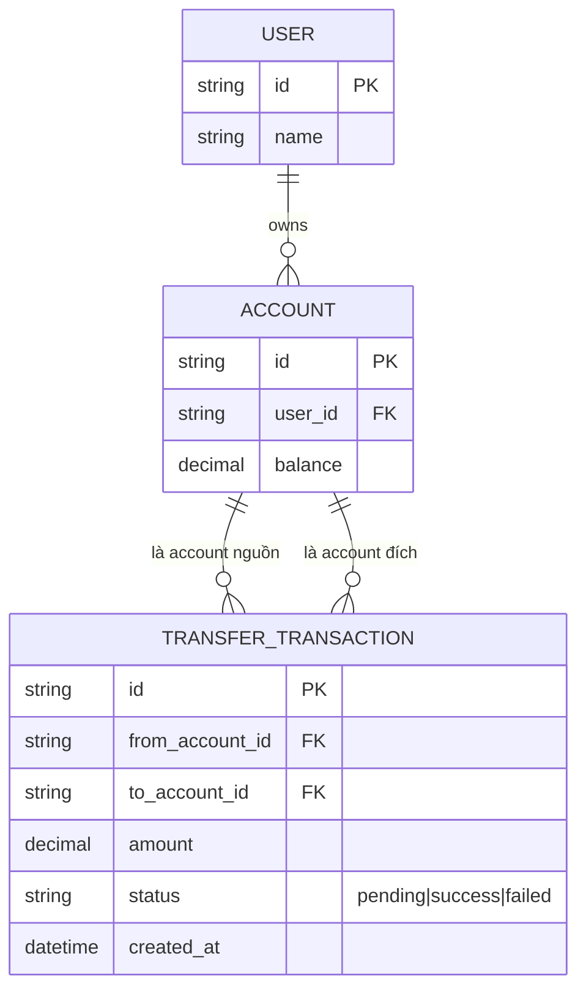
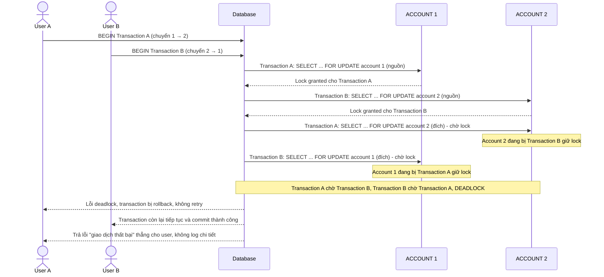
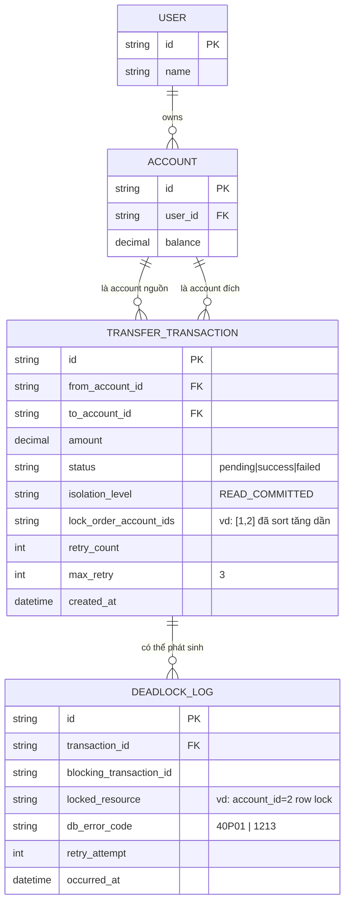
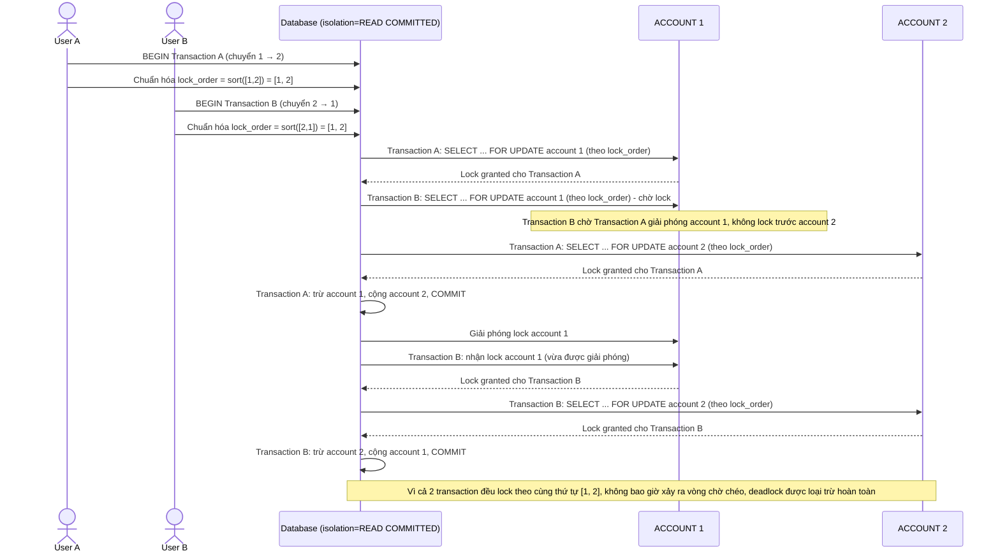
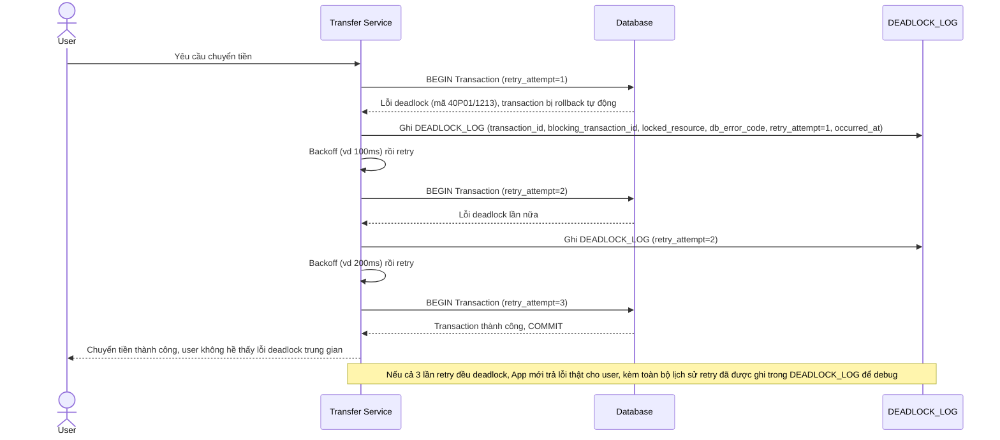
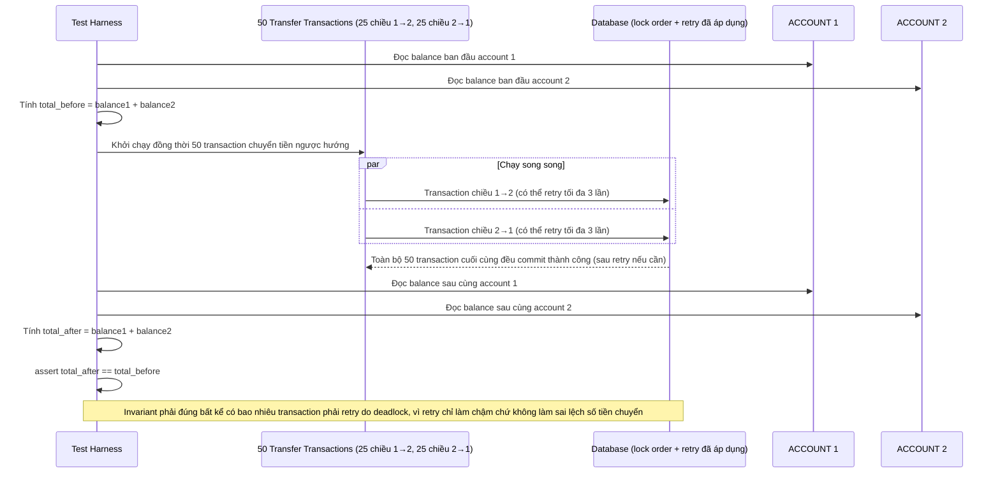

# Chuyển tiền nội bộ giữa các tài khoản ngân hàng số

**Hệ thống:** Một app ngân hàng số cho phép user chuyển tiền giữa các tài khoản của chính họ và tài khoản người khác trong cùng hệ thống.

**Vai trò của flow:** Transaction cập nhật số dư của 2 tài khoản (trừ bên gửi, cộng bên nhận) phải lock đúng thứ tự để tránh deadlock khi nhiều lệnh chuyển tiền ngược hướng nhau chạy song song.

**Yêu cầu cụ thể:**
- Mô tả cụ thể kịch bản: transaction A chuyển từ account 1 → account 2, transaction B chuyển từ account 2 → account 1 chạy đồng thời; nếu mỗi transaction lock theo thứ tự "tài khoản nguồn trước, tài khoản đích sau" thì sẽ deadlock — yêu cầu code phải lock theo thứ tự cố định (ví dụ theo account_id tăng dần) để loại trừ deadlock này.
- Chọn isolation level `READ COMMITTED` hoặc cao hơn cho transaction cập nhật số dư, giải thích vì sao `REPEATABLE READ` mặc định của một số DB (MySQL/InnoDB) có thể gây phạm vi lock rộng hơn cần thiết và tăng khả năng deadlock trên các dòng không liên quan.
- Khi DB trả lỗi deadlock (ví dụ mã lỗi 40P01 ở Postgres, 1213 ở MySQL), transaction bị rollback phải được retry tự động tối đa 3 lần với backoff, không được để lỗi văng lên user như một giao dịch thất bại vĩnh viễn.
- Đảm bảo tổng số dư hai tài khoản trước và sau giao dịch không đổi (invariant) dù có retry hay không — viết test giả lập 50 giao dịch ngược hướng chạy song song và assert invariant này.
- Ghi log đầy đủ thông tin deadlock (transaction nào, lock gì, thời điểm) để phục vụ debug, không chỉ log "transaction failed".

---

# Base ERD — Chuyển tiền nội bộ chưa có cơ chế chống deadlock

Đây là **base**: trạng thái hệ thống ngân hàng số *trước khi* áp dụng thứ tự lock cố định, retry và logging deadlock. Suy luận từ đề bài, base đã có `USER` sở hữu nhiều `ACCOUNT`, và mỗi lệnh chuyển tiền tạo 1 `TRANSFER_TRANSACTION` tham chiếu tới account nguồn và account đích. Base chưa có bất kỳ cơ chế nào để tránh deadlock khi 2 giao dịch ngược hướng chạy song song, cũng chưa ghi log chi tiết khi transaction bị lỗi.

---

# Base sequence — Transfer money (lock theo thứ tự nguồn trước, đích sau, dẫn tới deadlock)

Đây là **base**, flow chuyển tiền ở trạng thái hiện tại: mỗi transaction lock account nguồn trước rồi mới lock account đích, theo đúng thứ tự tham số truyền vào chứ không chuẩn hóa. Đây chính là kịch bản gây deadlock kinh điển nêu ở yêu cầu 1 của đề bài, khi transaction A chuyển 1 → 2 và transaction B chuyển 2 → 1 chạy đồng thời.

---

# Enhance ERD — Thêm thứ tự lock cố định, retry và deadlock logging

Đây là ERD **sau khi** enhance được áp dụng lên base. So với base, `TRANSFER_TRANSACTION` thêm các trường theo dõi isolation level và số lần retry, và có thêm entity mới `DEADLOCK_LOG` để ghi chi tiết mỗi lần deadlock xảy ra, ứng trực tiếp với các yêu cầu:

- `TRANSFER_TRANSACTION.isolation_level` và `lock_order_account_ids` — đáp ứng yêu cầu 1 (lock theo account_id tăng dần) và yêu cầu 2 (chọn READ COMMITTED tường minh thay vì mặc định REPEATABLE READ).
- `TRANSFER_TRANSACTION.retry_count`/`max_retry` — đáp ứng yêu cầu 3 (retry tự động tối đa 3 lần khi gặp lỗi deadlock).
- `DEADLOCK_LOG` (mới) — đáp ứng yêu cầu 5 (log đầy đủ transaction nào, lock gì, thời điểm), dữ liệu này cũng phục vụ test invariant ở yêu cầu 4.

---

# Enhance sequence — Transfer money (lock theo account_id tăng dần, loại trừ deadlock)

Đây là **enhance** của flow `transfer-money` đã có ở base. So với base (lock theo thứ tự nguồn trước - đích sau gây deadlock), nay cả transaction A và B đều chuẩn hóa thứ tự lock theo `account_id` tăng dần trước khi lock, bất kể chiều chuyển tiền, đồng thời dùng isolation level `READ COMMITTED` tường minh. Đáp ứng yêu cầu 1 và 2 của đề bài.

---

# Enhance sequence — Retry tự động và log chi tiết khi vẫn xảy ra deadlock

Đây là **enhance**, flow mới bổ sung cho trường hợp deadlock vẫn xảy ra dù đã chuẩn hóa thứ tự lock (ví dụ do các transaction khác cạnh tranh lock ngoài dự kiến, hoặc index lock phụ). Đáp ứng yêu cầu 3 (retry tự động tối đa 3 lần với backoff, không để lỗi văng lên user) và yêu cầu 5 (ghi log đầy đủ transaction nào, lock gì, thời điểm) của đề bài.

---

# Enhance sequence — Test giả lập 50 giao dịch ngược hướng, assert invariant tổng số dư

Đây là **enhance**, flow mới mô tả kịch bản test tự động hoá. Đáp ứng yêu cầu 4 của đề bài: viết test giả lập 50 giao dịch chuyển tiền ngược hướng chạy song song giữa 2 account, rồi assert rằng tổng số dư 2 account trước và sau không đổi, dù có transaction phải retry hay không.

