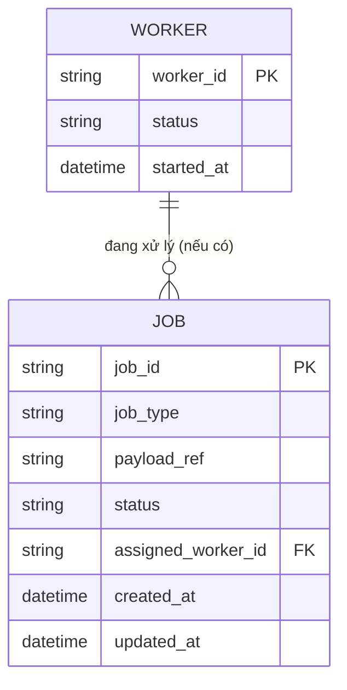
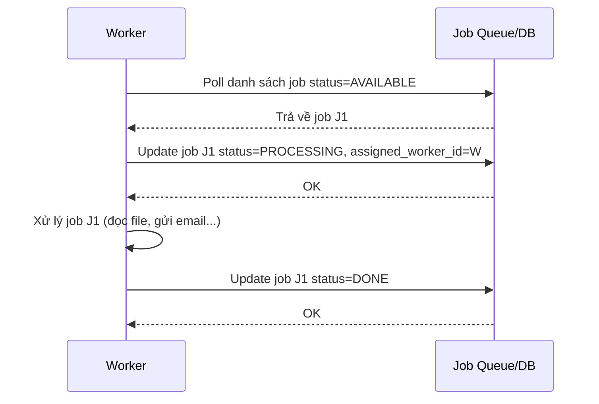
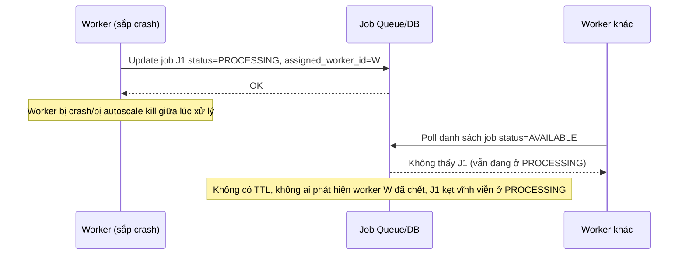
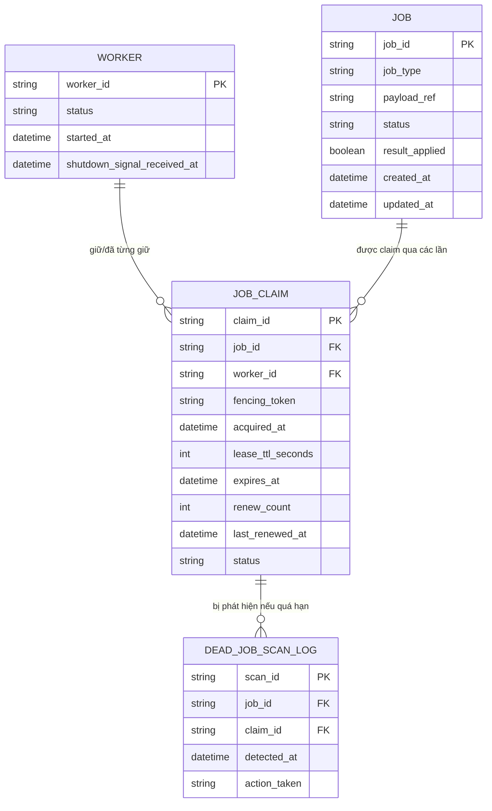
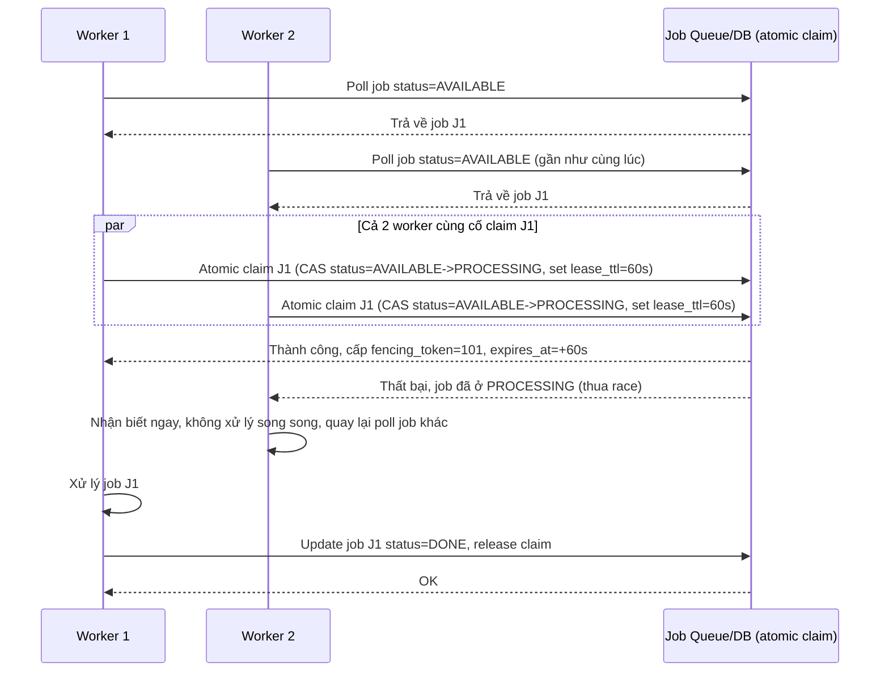
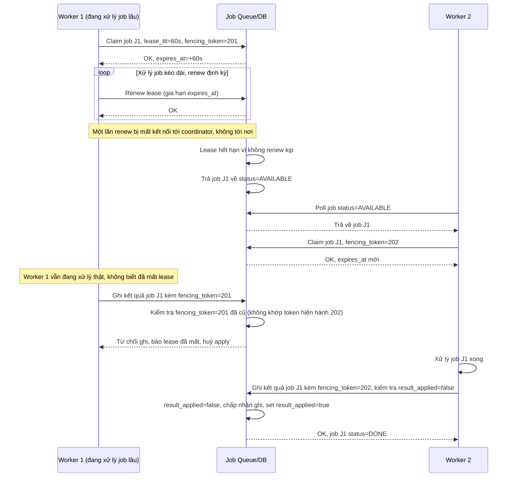
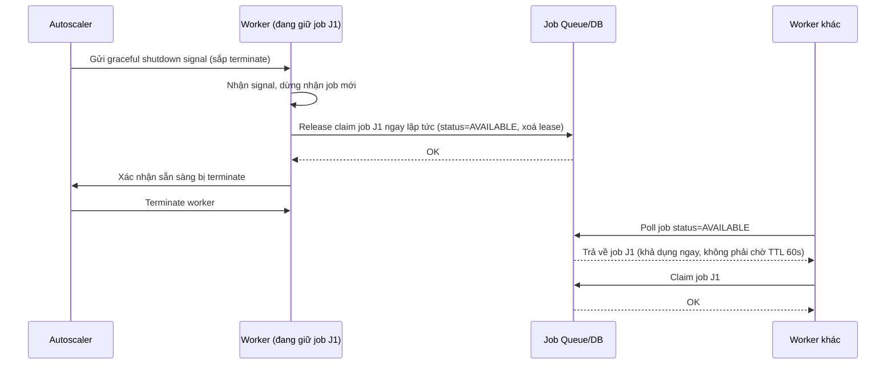
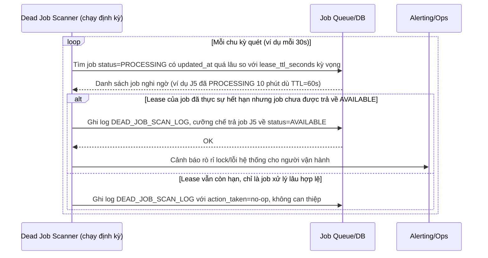

# Phân việc cho worker pool xử lý hàng đợi công việc lớn

**Hệ thống:** Nhiều worker instance chạy song song để xử lý hàng loạt job từ một hàng đợi công việc lớn (ví dụ xử lý file, gửi batch email), cần chia việc sao cho không trùng lặp và không bỏ sót.

**Vai trò của flow:** Distributed lock/leader election theo từng job (hoặc theo phân vùng job) đảm bảo mỗi job chỉ được đúng một worker nhận và xử lý tại một thời điểm, đồng thời không bỏ sót job khi worker chết giữa chừng.

**Yêu cầu cụ thể:**
- Worker phải "claim" một job bằng lock/lease có TTL trước khi bắt đầu xử lý; nếu worker chết giữa chừng (crash, bị kill do autoscale down) mà không release lock, TTL hết hạn phải tự đưa job đó về trạng thái "khả dụng" để worker khác nhận lại — không để job kẹt vĩnh viễn ở trạng thái "đang xử lý" bởi worker đã chết.
- Hai worker cùng lúc thấy job "chưa ai nhận" và cùng cố gắng claim (race condition khi liệt kê job và acquire lock không atomic với nhau) phải được giải quyết sao cho chỉ đúng một worker thắng, worker thua phải nhận biết ngay để không tiếp tục xử lý song song, tránh xử lý trùng và ghi kết quả hai lần.
- Nếu job cần thời gian xử lý lâu hơn TTL ước tính ban đầu (ví dụ file lớn bất thường), worker đang xử lý phải renew lease định kỳ; nếu renew thất bại (mất kết nối coordinator) trong khi job vẫn đang chạy thật, cần cơ chế idempotent hoặc kiểm tra trạng thái trước khi apply kết quả để chịu được việc worker khác nhận lại job đó khi lock hết hạn.
- Khi một worker bị autoscale terminate có báo trước (graceful shutdown signal), phải chủ động release lock/trả lại job đang giữ ngay lập tức thay vì chờ TTL hết hạn, để giảm độ trễ job bị "treo" chờ timeout tự nhiên.
- Cần cơ chế định kỳ quét các job ở trạng thái "đang xử lý" quá lâu so với TTL kỳ vọng (dead job detection) để phát hiện sớm rò rỉ lock hoặc lỗi hệ thống, tránh dựa hoàn toàn vào TTL tự nhiên mà không có giám sát chủ động.

---

# ERD - Base (trước khi có distributed lock/lease cho job)

Đây là trạng thái **base**: có một hàng đợi công việc lớn (`JOB`) và nhiều `WORKER` chạy song song để xử lý, nhưng việc "ai nhận job nào" chỉ dựa vào cập nhật trạng thái đơn giản, chưa có lock/lease với TTL, chưa có cơ chế phát hiện worker chết. Đây là nền tối thiểu để enhance thêm cơ chế claim bằng lock có TTL, atomic claim, renew, graceful shutdown và dead job detection.

---

# Sequence Diagram - Base: claim-and-process-job

Đây là flow **base**: worker định kỳ poll hàng đợi, thấy job đang ở trạng thái "AVAILABLE" thì tự cập nhật thẳng thành "PROCESSING" rồi xử lý, không qua bất kỳ lock/lease nào. Flow này là nền để so sánh với enhance, nơi bước "claim" sẽ được thay bằng thao tác atomic có TTL để tránh 2 worker cùng nhận 1 job.

---

# Sequence Diagram - Base: worker-crash-job-stuck

Đây là flow **base** minh hoạ vấn đề chính mà đề bài cần giải quyết: khi worker đang xử lý job mà crash (hoặc bị autoscale kill) giữa chừng, job vẫn nằm ở trạng thái "PROCESSING" mãi mãi vì không có TTL/lease nào theo dõi, không worker nào khác dám nhận lại, job bị kẹt vĩnh viễn. Đây là lý do enhance cần TTL tự động trả job về "AVAILABLE" và cơ chế dead job detection.

---

# ERD - Enhance (claim bằng lock/lease có TTL cho job)

Đây là trạng thái **enhance**: giữ nguyên `JOB`, `WORKER` từ base (JOB bỏ field `assigned_worker_id` trực tiếp, thay bằng quan hệ tới `JOB_CLAIM`), thêm mới:
- `JOB_CLAIM`: đại diện cho lock/lease theo từng job, có `fencing_token`, `lease_ttl_seconds`, `expires_at` để tự động hết hạn khi worker chết mà không release - đáp ứng yêu cầu 1; có `status` (HELD/RELEASED/EXPIRED) để phân biệt worker thắng/thua khi race - đáp ứng yêu cầu 2; có `renew_count`/`last_renewed_at` để theo dõi renew định kỳ - đáp ứng yêu cầu 3.
- `JOB` thêm field `result_applied` (idempotency marker) để kiểm tra trước khi ghi kết quả, tránh áp dụng 2 lần khi có worker khác nhận lại job - đáp ứng yêu cầu 3.
- `WORKER` thêm field `shutdown_signal_received_at` để thể hiện graceful shutdown chủ động release job - đáp ứng yêu cầu 4.
- `DEAD_JOB_SCAN_LOG`: bản ghi mỗi lần cơ chế quét định kỳ phát hiện job "đang xử lý" quá lâu so với TTL kỳ vọng - đáp ứng yêu cầu 5.

---

# Sequence Diagram - Enhance: claim-and-process-job

Đây là flow **enhance** của `claim-and-process-job` (so với base ở file `2-base-claim-and-process-job-sqd.md`): 2 worker cùng thấy job "AVAILABLE" và cùng cố acquire lock/lease gần như đồng thời (race condition khi liệt kê job không atomic với acquire), nhưng thao tác claim thực tế là 1 lệnh atomic (compare-and-swap trên trạng thái job hoặc acquire trên coordinator) nên chỉ đúng 1 worker thắng và có TTL ngay từ lúc claim. Đáp ứng yêu cầu 1 (claim bằng lock/lease có TTL) và yêu cầu 2 (race condition chỉ 1 worker thắng, worker thua nhận biết ngay).

---

# Sequence Diagram - Enhance: lease-renew-and-idempotent-apply

Đây là flow **enhance mới**: job cần xử lý lâu hơn TTL ước tính (file lớn bất thường), worker phải renew lease định kỳ; lần renew giữa chừng thất bại do mất kết nối coordinator, lease hết hạn, worker khác nhận lại job trong khi worker cũ vẫn đang xử lý thật. Khi cả 2 cùng cố ghi kết quả, cơ chế kiểm tra idempotent (dựa trên `result_applied`/fencing_token) đảm bảo kết quả chỉ được áp dụng đúng 1 lần. Đáp ứng yêu cầu 3.

---

# Sequence Diagram - Enhance: graceful-shutdown-release

Đây là flow **enhance mới**: khi worker nhận tín hiệu terminate có báo trước từ autoscale (graceful shutdown signal, ví dụ SIGTERM), worker chủ động release ngay lock/job đang giữ thay vì để coordinator chờ tới khi TTL hết hạn, giúp job khả dụng lại nhanh hơn nhiều so với chờ timeout tự nhiên. Đáp ứng yêu cầu 4.

---

# Sequence Diagram - Enhance: dead-job-scan

Đây là flow **enhance mới**: một tiến trình quét định kỳ (dead job scanner) chủ động rà soát các job đang ở trạng thái "PROCESSING" quá lâu so với TTL kỳ vọng, thay vì chỉ dựa hoàn toàn vào cơ chế TTL tự nhiên - dùng để phát hiện sớm rò rỉ lock hoặc lỗi hệ thống (ví dụ TTL không tự expire được do bug, clock skew). Đáp ứng yêu cầu 5.

