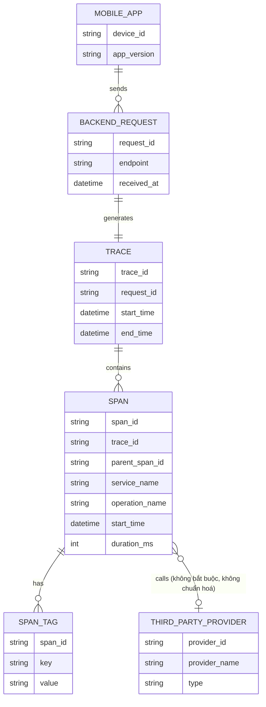
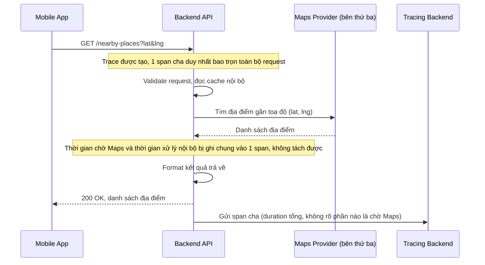
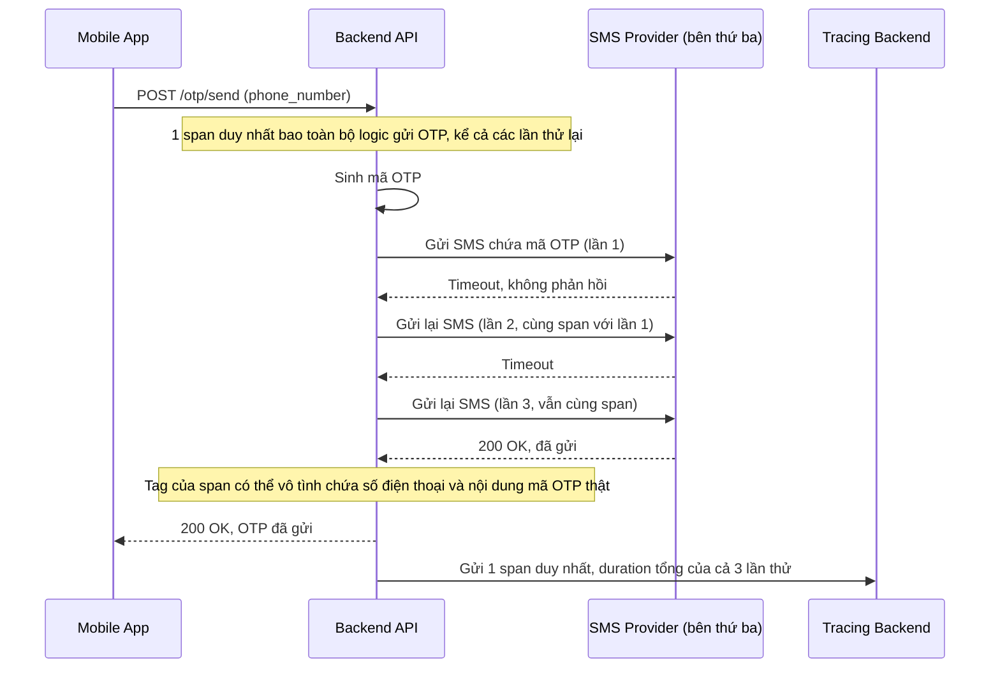
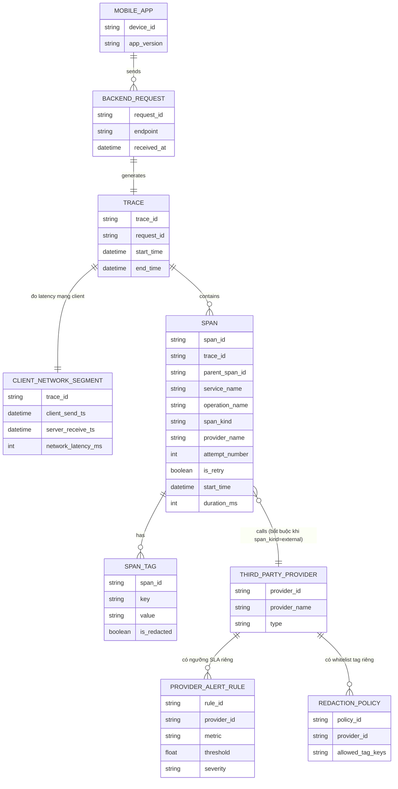
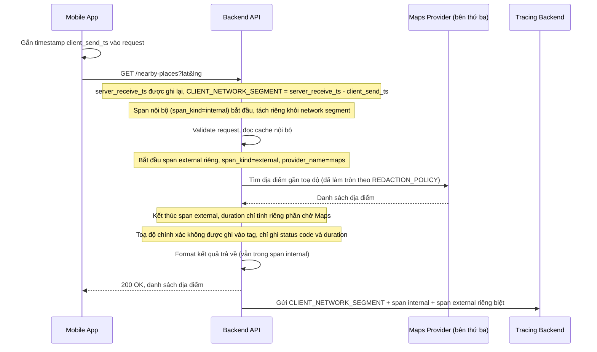
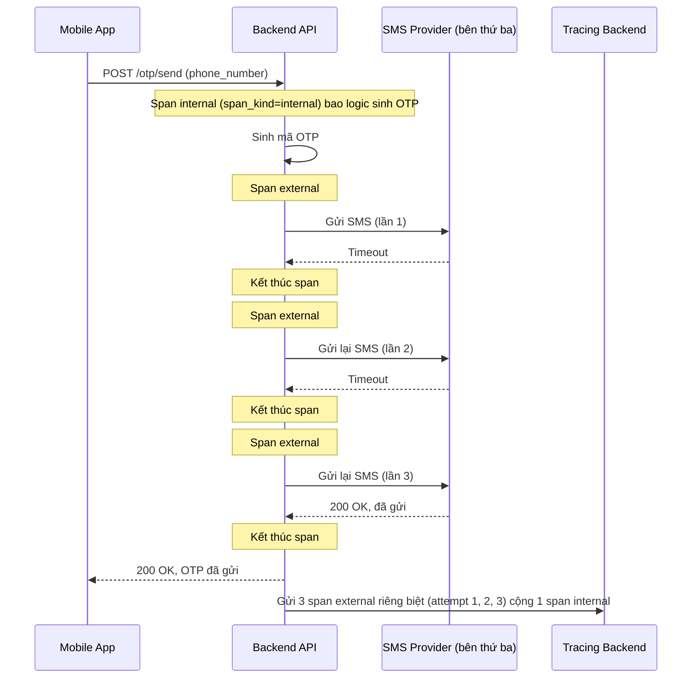
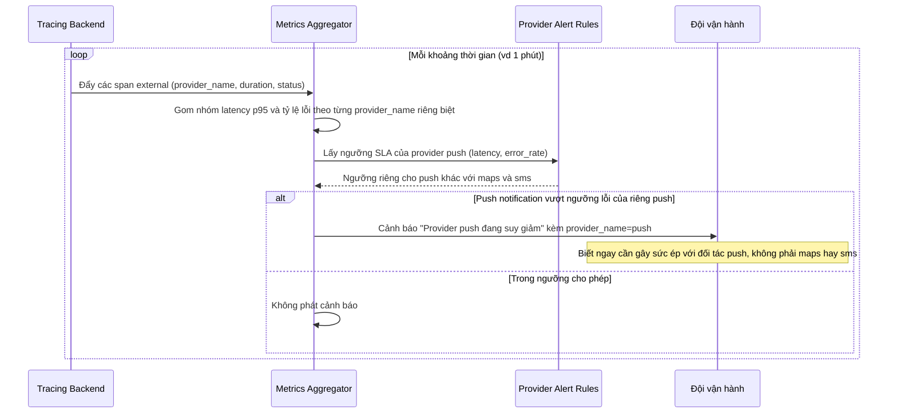

# Trace lời gọi từ mobile app xuyên qua backend tới các dịch vụ bên thứ ba

**Hệ thống:** Một ứng dụng mobile gọi vào backend, và với một số tính năng, backend phải gọi tiếp ra các dịch vụ bên thứ ba (bản đồ/định vị, gửi SMS xác thực, đẩy push notification) trước khi trả kết quả về cho app.

**Vai trò của flow:** Tracing phải phân biệt rõ ràng thời gian chờ các dịch vụ bên thứ ba (ngoài tầm kiểm soát của đội kỹ thuật) với thời gian backend tự xử lý nội bộ, để khi app "cảm giác chậm", đội vận hành biết nên gây sức ép với đối tác thứ ba hay tối ưu code nội bộ.

**Yêu cầu cụ thể:**
- Mỗi lời gọi ra dịch vụ bên thứ ba phải được bọc trong một span riêng, gắn tag rõ ràng là external call kèm tên nhà cung cấp, tách biệt hoàn toàn khỏi span xử lý logic nội bộ, để khi tổng hợp latency trung bình của một API, có thể bóc tách được phần "chờ bên ngoài" ra khỏi phần "backend tự xử lý".
- Vì kết nối từ mobile app tới backend qua mạng di động không ổn định, phải phân biệt được độ trễ do chính mạng di động của client (trước khi request tới được backend) với độ trễ phát sinh trong nội bộ hệ thống backend — tránh gộp chung khiến số liệu latency nội bộ bị nhiễu bởi yếu tố phía client hoàn toàn không kiểm soát được.
- Xử lý trường hợp một dịch vụ bên thứ ba (ví dụ SMS) timeout hoặc trả lỗi và backend có cơ chế retry — mỗi lần retry phải tạo span riêng biệt kèm số thứ tự lần thử, để phân biệt được "một cuộc gọi chậm" với "ba lần gọi cộng dồn lại thành chậm", vốn cần xử lý khác nhau về mặt vận hành.
- Thiết kế cảnh báo riêng theo từng nhà cung cấp bên thứ ba (SLA latency/tỷ lệ lỗi riêng cho bản đồ, SMS, push notification) để phát hiện khi một đối tác cụ thể đang suy giảm chất lượng dịch vụ, thay vì chỉ có một cảnh báo chung chung "API chậm" gộp tất cả nguyên nhân lại.
- Đảm bảo dữ liệu trace không vô tình ghi lại nội dung nhạy cảm được gửi qua các dịch vụ bên thứ ba (ví dụ nội dung tin nhắn SMS chứa mã OTP, tọa độ vị trí chính xác của người dùng) vào tag/log của span — chỉ ghi metadata cần thiết cho việc debug hiệu năng (thời gian, trạng thái, mã lỗi), không ghi nội dung payload thật.

---

# ERD - Base: Tracing cơ bản trước khi tách bạch external call

Đây là trạng thái **base**, trước khi áp đề bài. Hệ thống đã có tracing phân tán cơ bản (mỗi request từ mobile app sinh 1 trace, trace chứa nhiều span), nhưng span chưa có cấu trúc chuẩn hoá để phân biệt "gọi ra bên thứ ba" với "xử lý nội bộ", chưa ghi nhận số lần retry, chưa tách latency mạng di động của client, và tag của span là key-value tự do không kiểm soát nội dung nhạy cảm. Đây là nền tảng tối thiểu để đề bài (tách span external, gắn tag provider, retry span, alert riêng theo provider, chống rò rỉ PII) "có ý nghĩa" khi so sánh.

Lưu ý: `SPAN` ở base không có field `span_kind` (internal/external), không có `attempt_number` cho retry, và `SPAN_TAG` là key-value tự do, không có whitelist hay quy tắc chống ghi nội dung nhạy cảm — đây chính là những khoảng trống mà enhance sẽ lấp.

---

# Sequence - Base: Tra cứu địa điểm gần đây (gọi Maps provider)

Đây là flow **base**: mobile app gọi backend để lấy danh sách địa điểm gần vị trí hiện tại, backend gọi ra dịch vụ bản đồ bên thứ ba. Toàn bộ thời gian (mạng di động, xử lý nội bộ, gọi Maps) bị gộp vào cùng một khối span cha, không tách biệt được phần nào là "chờ Maps" và phần nào là backend tự xử lý. Flow này là tiền đề cho yêu cầu 1 và 2 của đề bài (tách span external có tag provider, và tách latency mạng di động của client).

---

# Sequence - Base: Gửi SMS OTP xác thực (có retry nhưng không tách span)

Đây là flow **base**: backend đã có sẵn cơ chế retry khi gọi dịch vụ SMS bên thứ ba bị timeout hoặc lỗi, nhưng toàn bộ các lần thử được ghi chồng vào cùng một span, không phân biệt được "một cuộc gọi chậm" với "nhiều lần gọi cộng dồn". Đây là tiền đề cho yêu cầu 3 (mỗi lần retry là 1 span riêng kèm số thứ tự) và yêu cầu 5 (không ghi nội dung OTP thật vào tag) của đề bài.

---

# ERD - Enhance: Span chuẩn hoá cho external call, client network, retry, alert theo provider

Đây là trạng thái **enhance**, sau khi áp toàn bộ đề bài lên base. So với base, các thay đổi chính:

- `SPAN` có thêm `span_kind` (`internal`/`external`), `attempt_number` (số thứ tự lần retry) và `is_retry` — đáp ứng **yêu cầu 1** (tách span external) và **yêu cầu 3** (mỗi lần retry là 1 span riêng).
- Thêm entity `CLIENT_NETWORK_SEGMENT` gắn với `TRACE`, ghi `client_send_ts`/`server_receive_ts` để tính riêng latency mạng di động trước khi tới backend — đáp ứng **yêu cầu 2**.
- `SPAN` liên kết bắt buộc (không còn optional) tới `THIRD_PARTY_PROVIDER` khi `span_kind = external`, và có field `provider_name` ngay trên span để dễ tổng hợp.
- Thêm entity `PROVIDER_ALERT_RULE` (ngưỡng SLA latency/tỷ lệ lỗi riêng theo từng provider) — đáp ứng **yêu cầu 4**.
- Thêm entity `REDACTION_POLICY` quy định whitelist các tag key được phép ghi cho từng loại span/provider, thay cho `SPAN_TAG` tự do ở base — đáp ứng **yêu cầu 5** (không ghi nội dung OTP/toạ độ thật).

---

# Sequence - Enhance: Tra cứu địa điểm gần đây (tách client network + external span)

Đây là flow **enhance** của `nearby-places-lookup` (so với base). Khác biệt so với base: span cha được tách thành 1 đoạn network latency riêng của mobile app (client_send_ts vs server_receive_ts), và lời gọi Maps được bọc trong 1 span riêng gắn `span_kind=external`, `provider_name=maps`, tách hoàn toàn khỏi span xử lý nội bộ. Toạ độ chính xác của người dùng không được ghi thẳng vào tag mà chỉ ghi ở dạng đã làm tròn/ẩn danh theo `REDACTION_POLICY`. Đáp ứng **yêu cầu 1, 2 và 5** của đề bài.

---

# Sequence - Enhance: Gửi SMS OTP (mỗi lần retry 1 span, không ghi nội dung OTP)

Đây là flow **enhance** của `send-otp-sms` (so với base). Khác biệt so với base: mỗi lần gọi SMS provider (kể cả các lần retry) được bọc trong 1 span external riêng, gắn `attempt_number` tăng dần và `is_retry=true` từ lần thứ 2 trở đi, để phân biệt rõ "1 cuộc gọi chậm" với "3 lần gọi cộng dồn". Tag của span chỉ ghi metadata debug (status, duration, error_code), không ghi số điện thoại hay nội dung mã OTP thật. Đáp ứng **yêu cầu 1, 3 và 5** của đề bài.

---

# Sequence - Enhance: Phát hiện suy giảm chất lượng theo từng provider

Đây là flow **enhance hoàn toàn mới**, không tồn tại ở base (base chỉ có 1 cảnh báo chung "API chậm" gộp mọi nguyên nhân). Flow này mô tả hệ thống giám sát tổng hợp các span external theo `provider_name`, so với `PROVIDER_ALERT_RULE` riêng của từng provider (bản đồ, SMS, push notification), để phát hiện đúng provider nào đang suy giảm thay vì báo chung chung. Đáp ứng **yêu cầu 4** của đề bài.

