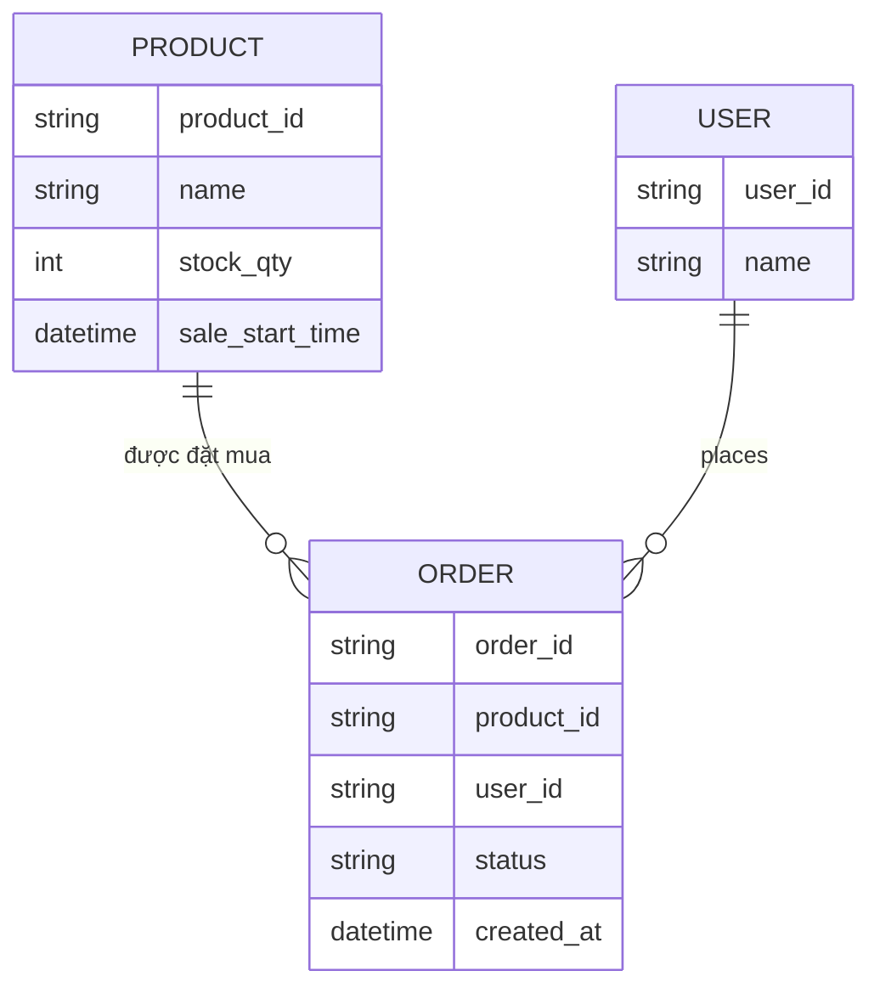
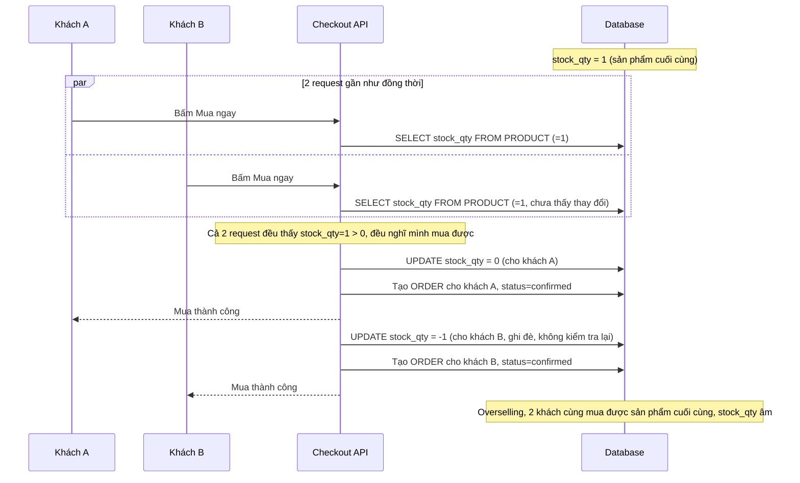
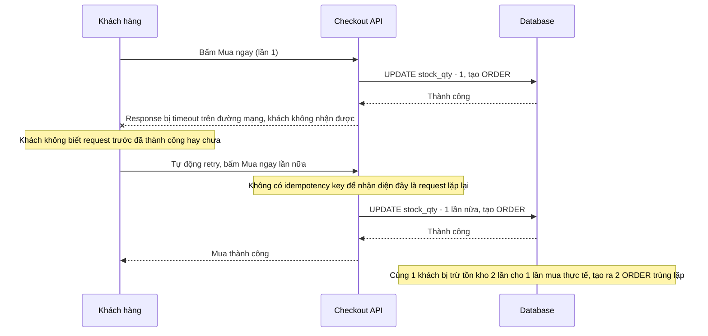
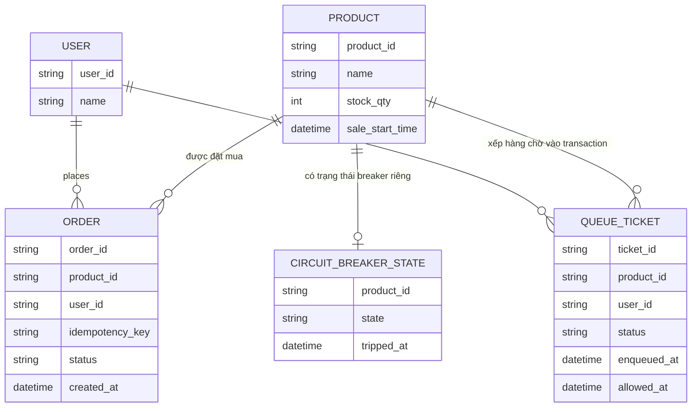
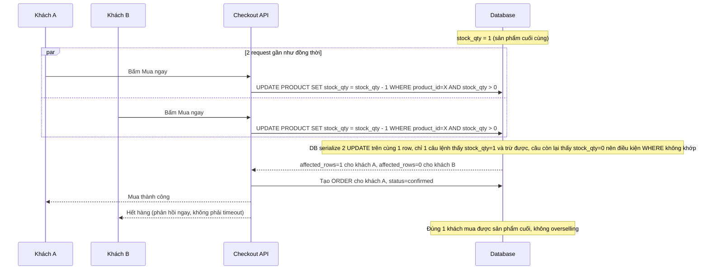
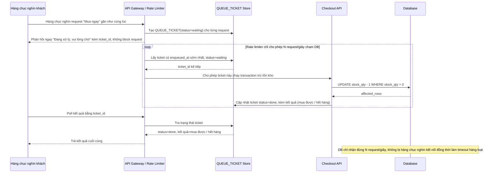
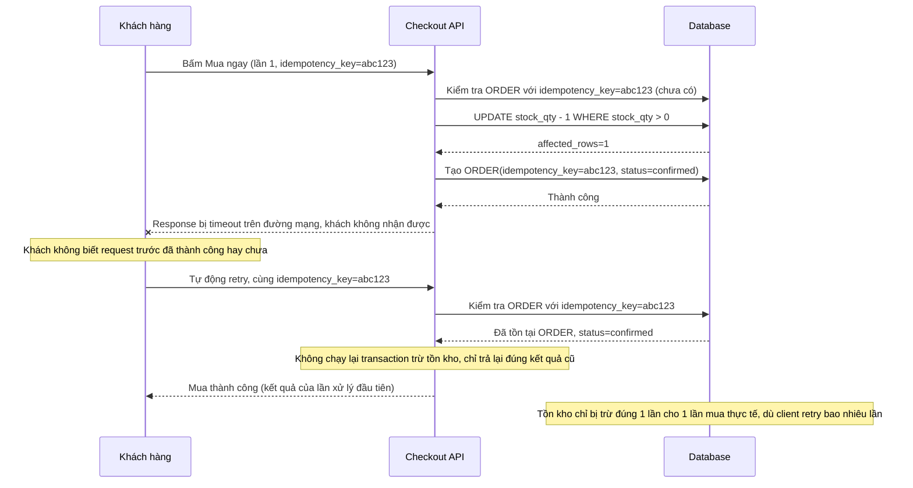
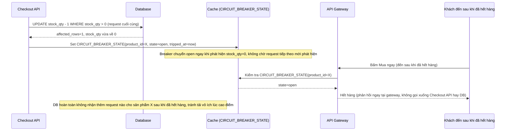

# Flash sale số lượng giới hạn trên sàn e-commerce (100 sản phẩm, hàng chục nghìn người chờ)

**Hệ thống:** Một sàn e-commerce tổ chức flash sale: đúng 12:00:00 mở bán 100 sản phẩm giá sốc, dự kiến hàng chục nghìn người cùng bấm "Mua ngay" trong vài giây đầu.

**Vai trò của flow:** Flow checkout phải đảm bảo đúng 100 người mua được (không hơn không kém), xử lý đúng khi hàng chục nghìn request cùng cạnh tranh vào đúng thời điểm mở bán, không để hệ thống sập hoặc bán vượt tồn kho (overselling).

**Yêu cầu cụ thể:**
- Không cho phép dùng `SELECT tồn_kho rồi kiểm tra > 0 rồi UPDATE trừ` ở tầng application (race condition kinh điển: nhiều request đọc thấy tồn kho > 0 cùng lúc rồi đều trừ) — yêu cầu dùng update nguyên tử kiểu `UPDATE stock SET qty = qty - 1 WHERE qty > 0` và kiểm tra số dòng bị ảnh hưởng (affected rows) để biết có mua được hay không.
- Thiết kế hàng đợi (queue) hoặc rate-limiter ở tầng trước DB để giảm áp lực: chỉ cho một số lượng request giới hạn/giây chạm vào transaction trừ tồn kho, các request còn lại nhận phản hồi "đang xử lý, vui lòng chờ" thay vì để tất cả cùng đấm vào DB gây timeout hàng loạt.
- Mô tả cụ thể: 2 request đến gần như đồng thời tại thời điểm tồn kho còn đúng 1 sản phẩm — hệ thống phải đảm bảo chỉ 1 request được xác nhận mua, request kia nhận lỗi "hết hàng" trong thời gian ngắn (không phải timeout), viết test giả lập 1000 request đồng thời cho 100 sản phẩm và assert đúng 100 request thành công.
- Idempotency: nếu client retry do timeout mạng (không rõ request trước có xử lý thành công hay không), request retry với cùng idempotency key không được trừ tồn kho lần 2 — phải trả lại đúng kết quả của lần xử lý đầu.
- Có cơ chế "circuit breaker"/giảm tải khi tồn kho đã về 0: các request đến sau phải được chặn ngay từ tầng cache/API gateway, không để lọt xuống DB gây tải vô ích.

---

# ERD - Base: Checkout kiểm tra tồn kho kiểu đọc-rồi-ghi

Đây là trạng thái **base**, trước khi áp đề bài. Sàn e-commerce đã có sản phẩm với số lượng tồn kho, khách bấm "Mua ngay" thì backend đọc `stock_qty`, kiểm tra `> 0` ở tầng application rồi mới `UPDATE` trừ đi 1 — đây chính là pattern race-condition kinh điển mà đề bài yêu cầu loại bỏ. Không có hàng đợi/rate-limiter trước DB, không có idempotency key, không có circuit breaker khi hết hàng. Đây là nền tảng để đề bài (atomic update, queue/rate-limiter, idempotency, circuit breaker) có ý nghĩa khi so sánh.

Lưu ý: không có field `idempotency_key` trên `ORDER`, không có entity nào đại diện cho hàng đợi/rate-limiter trước khi chạm DB, và không có trạng thái circuit breaker khi `stock_qty` về 0 — đây chính là các khoảng trống mà enhance sẽ lấp.

---

# Sequence - Base: Mua ngay (đọc tồn kho rồi trừ, race condition)

Đây là flow **base**: hàng chục nghìn request cùng "Mua ngay" đổ thẳng xuống DB, mỗi request đọc `stock_qty`, kiểm tra `> 0` ở tầng application rồi mới `UPDATE` trừ đi 1. Khi tồn kho còn đúng 1 sản phẩm, 2 request đến gần như đồng thời đều đọc thấy `stock_qty=1 > 0`, cả 2 đều được xác nhận mua, dẫn tới overselling. Đây là tiền đề cho yêu cầu 1, 2 và 3 của đề bài.

---

# Sequence - Base: Retry sau timeout mạng (trừ tồn kho lần 2)

Đây là flow **base**: client bấm "Mua ngay", mạng chập chờn khiến response bị timeout dù request đã xử lý thành công ở backend, client không biết nên tự động retry với cùng thao tác. Vì không có idempotency key, backend coi request retry là 1 giao dịch mới hoàn toàn và trừ tồn kho lần nữa cho cùng 1 khách. Đây là tiền đề cho yêu cầu 4 của đề bài.

---

# ERD - Enhance: Atomic update, hàng đợi trước DB, idempotency key, circuit breaker

Đây là trạng thái **enhance**, sau khi áp toàn bộ đề bài lên base. So với base, các thay đổi chính:

- Bỏ hoàn toàn pattern đọc-rồi-ghi: `PRODUCT.stock_qty` chỉ được trừ bằng `UPDATE ... SET qty = qty - 1 WHERE qty > 0`, dựa vào affected rows để biết có mua được hay không — đáp ứng **yêu cầu 1 và 3**.
- Thêm entity `QUEUE_TICKET` — mọi request phải qua hàng đợi/rate-limiter trước khi được phép chạm vào transaction trừ tồn kho, request vượt hạn mức nhận trạng thái `waiting` thay vì đấm thẳng vào DB — đáp ứng **yêu cầu 2**.
- `ORDER` có thêm `idempotency_key` (unique theo `user_id` + key), cho phép trả lại đúng kết quả của lần xử lý đầu khi client retry — đáp ứng **yêu cầu 4**.
- Thêm entity `CIRCUIT_BREAKER_STATE` theo từng `product_id` — khi `stock_qty` về 0, breaker chuyển `open`, chặn request ngay ở tầng cache/gateway, không cho lọt xuống DB — đáp ứng **yêu cầu 5**.

---

# Sequence - Enhance: Mua ngay (atomic update, kiểm tra affected rows)

Đây là flow **enhance** của `buy-now-checkout` (so với base). Khác biệt so với base: không còn bước `SELECT` riêng để kiểm tra tồn kho, thay vào đó chạy thẳng `UPDATE stock_qty = stock_qty - 1 WHERE stock_qty > 0` và kiểm tra số dòng bị ảnh hưởng (affected rows) để biết có mua được hay không — DB tự đảm bảo tính atomic ở mức row-lock, nên khi tồn kho còn đúng 1, trong 2 request đến gần như đồng thời chỉ đúng 1 request có `affected_rows=1`. Đáp ứng **yêu cầu 1 và 3** của đề bài.

---

# Sequence - Enhance: Hàng đợi/rate-limiter chặn trước khi chạm DB

Đây là flow **enhance hoàn toàn mới**, mô tả lớp hàng đợi/rate-limiter đặt trước transaction trừ tồn kho. Khi hàng chục nghìn request cùng đổ vào lúc 12:00:00, chỉ 1 số lượng giới hạn/giây được cho phép chạm vào DB, các request còn lại nhận ngay phản hồi "đang xử lý, vui lòng chờ" thay vì để tất cả cùng đấm vào DB gây timeout hàng loạt. Đáp ứng **yêu cầu 2** của đề bài.

---

# Sequence - Enhance: Retry sau timeout mạng (idempotent, không trừ tồn kho lần 2)

Đây là flow **enhance** của `retry-after-timeout` (so với base). Khác biệt so với base: client gửi kèm `idempotency_key` cố định cho lần bấm mua đó (kể cả khi retry), backend kiểm tra key này đã tồn tại `ORDER` hay chưa trước khi chạy transaction trừ tồn kho — nếu đã tồn tại, trả thẳng lại kết quả của lần xử lý đầu tiên, không chạy lại transaction. Đáp ứng **yêu cầu 4** của đề bài.

---

# Sequence - Enhance: Circuit breaker chặn request khi đã hết hàng

Đây là flow **enhance hoàn toàn mới**, mô tả cơ chế circuit breaker/giảm tải khi tồn kho đã về 0. Khi request cuối cùng trừ tồn kho về 0 (hoặc thất bại vì `affected_rows=0`), hệ thống lập tức bật cờ "hết hàng" ở tầng cache/API gateway, mọi request đến sau bị chặn ngay tại đó, không để lọt xuống DB gây tải vô ích. Đáp ứng **yêu cầu 5** của đề bài.

