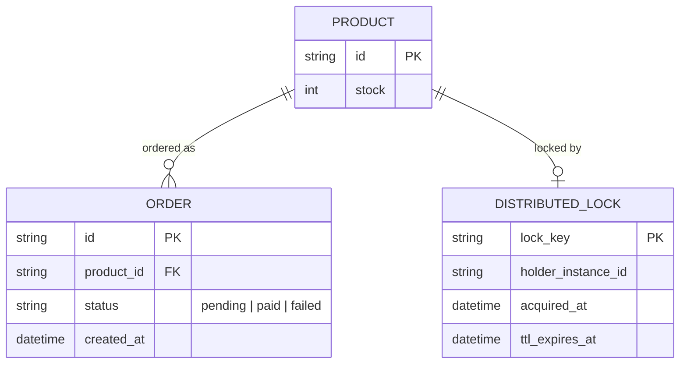
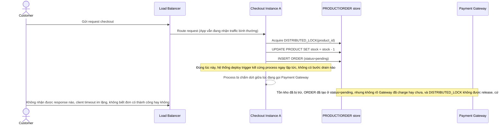
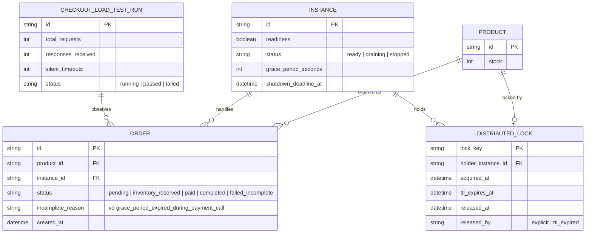
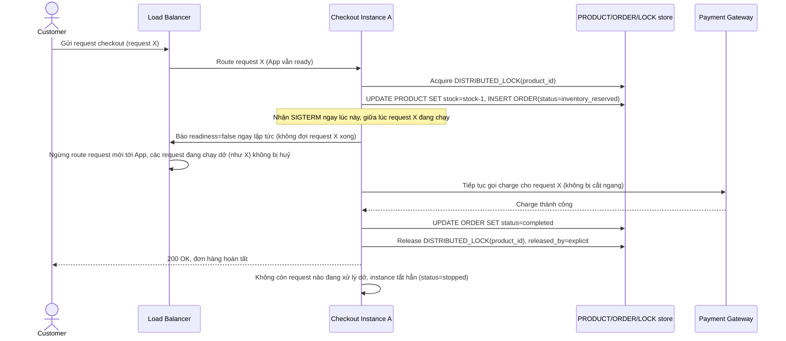
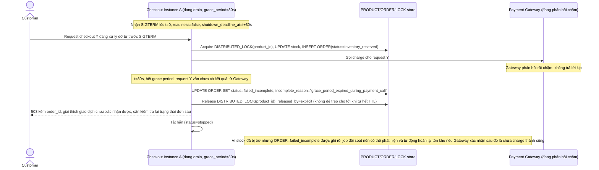
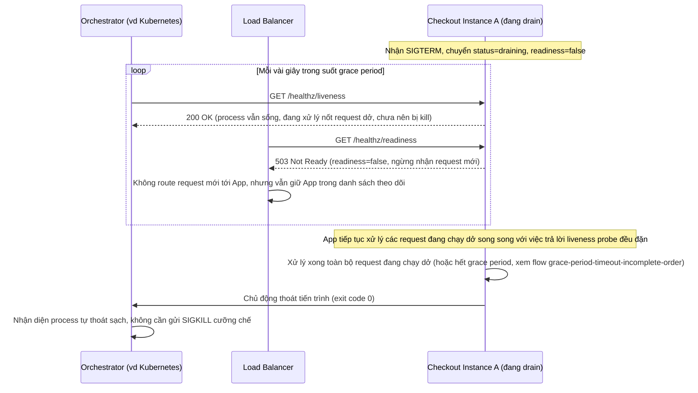
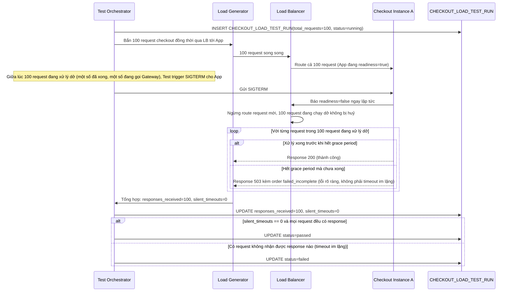

# Checkout service của sàn e-commerce trong lúc deploy

**Hệ thống:** Một service xử lý checkout (tạo order, trừ tồn kho, gọi cổng thanh toán) cho sàn e-commerce, được deploy nhiều lần mỗi ngày.

**Vai trò của flow:** Khi rolling deploy loại bỏ instance cũ, instance đó phải hoàn tất các giao dịch checkout đang xử lý trước khi tắt, không được cắt ngang giữa lúc đang trừ tồn kho hoặc gọi cổng thanh toán.

**Yêu cầu cụ thể:**
- Khi nhận SIGTERM, instance phải ngay lập tức báo readiness = false (để load balancer ngừng gửi request mới) nhưng vẫn tiếp tục xử lý các request đang chạy cho tới khi xong hoặc hết grace period.
- Định nghĩa rõ grace period tối đa (ví dụ 30 giây) — nếu một giao dịch checkout chưa xong khi hết grace period, phải có chiến lược rõ ràng (log lại state, không để order ở trạng thái "nửa vời" — ví dụ đã trừ tồn kho nhưng chưa tạo order) thay vì kill cứng.
- Xử lý trường hợp instance đang giữ một distributed lock (ví dụ lock tồn kho sản phẩm) khi bị shutdown — phải release lock hoặc để lock tự hết TTL, không được để lock treo vĩnh viễn làm nghẽn các checkout khác.
- Đảm bảo trong lúc drain, instance không nhận thêm request mới (health check đã báo not-ready) nhưng vẫn phải trả lời được health check probe để không bị hạ tầng kill ngay lập tức trước khi drain xong.
- Viết test mô phỏng gửi 100 request checkout đồng thời rồi trigger shutdown giữa chừng, verify không có request nào bị mất kết nối nửa đường (mỗi request phải nhận được response, kể cả response lỗi rõ ràng, không bao giờ là timeout im lặng).

---

# Base ERD — Checkout service trước khi có graceful shutdown

Đây là **base**: mô hình dữ liệu suy luận từ ngữ cảnh đề bài, thể hiện trạng thái hệ thống **trước khi** instance biết xử lý shutdown an toàn. Đề bài nói checkout tạo order, trừ tồn kho, gọi cổng thanh toán, và có nhắc tới việc instance có thể đang giữ distributed lock tồn kho — nên base cần đủ: sản phẩm/tồn kho, đơn hàng, distributed lock dùng khi trừ tồn kho. Chưa có khái niệm readiness/draining, chưa có grace period, chưa có chiến lược xử lý đơn nửa vời, chưa có kịch bản test toàn trình — tất cả là phần enhance.

---

# Base sequence — Checkout (kill cứng khi deploy, lock treo, đơn nửa vời)

Đây là **base**, flow "Checkout: trừ tồn kho, tạo order, gọi cổng thanh toán" ở trạng thái hiện tại — deploy đơn giản kill cứng instance ngay khi có bản mới, không có bước báo readiness=false, không có grace period, không có xử lý khi đang giữ lock. Flow này liên quan mật thiết tới enhance vì toàn bộ 5 yêu cầu của đề bài đều nhằm sửa đúng khoảng hở này.

---

# Enhance ERD — Thêm readiness/draining, chiến lược đơn nửa vời, kịch bản test toàn trình

Đây là **enhance**, mô hình dữ liệu sau khi áp toàn bộ đề bài lên base. So với base, các thay đổi:
- Entity mới `INSTANCE` — đại diện 1 instance của checkout service, có `readiness`, `status` (ready/draining/stopped), `grace_period_seconds`, `shutdown_deadline_at` — đáp ứng yêu cầu 1, 2 và 4 (báo readiness=false ngay, nhưng vẫn trả lời health check probe trong lúc drain).
- `ORDER` có thêm trạng thái `inventory_reserved` và `failed_incomplete` cùng cột `incomplete_reason` — đáp ứng yêu cầu 2 (khi hết grace period mà giao dịch chưa xong, ghi lại state rõ ràng thay vì để đơn "nửa vời" không rõ nguyên nhân).
- `DISTRIBUTED_LOCK` có thêm cột `released_at` và `released_by` — đáp ứng yêu cầu 3 (đảm bảo lock được release hoặc tự hết TTL, không treo vĩnh viễn).
- Entity mới `CHECKOUT_LOAD_TEST_RUN` — ghi nhận kết quả bài test toàn trình gửi 100 request đồng thời rồi trigger shutdown giữa chừng — đáp ứng yêu cầu 5.

---

# Enhance sequence — Checkout (readiness=false ngay lập tức, hoàn tất giao dịch đang chạy, release lock)

Đây là **enhance** của flow `checkout` đã có ở base, đáp ứng **yêu cầu 1 và yêu cầu 3** của đề bài. So với base: khi nhận SIGTERM, instance báo `readiness=false` ngay lập tức để load balancer ngừng gửi request mới, nhưng vẫn tiếp tục xử lý request đang chạy cho tới khi xong; sau khi giao dịch hoàn tất, `DISTRIBUTED_LOCK` được release tường minh thay vì để treo.

---

# Enhance sequence — Hết grace period giữa lúc giao dịch chưa xong, ghi state rõ ràng thay vì kill cứng

Đây là flow **enhance** hoàn toàn mới so với base, đáp ứng **yêu cầu 2 và phần còn lại của yêu cầu 3** của đề bài: định nghĩa grace period tối đa (30 giây) — nếu giao dịch checkout chưa xong khi hết grace period, hệ thống ghi lại state rõ ràng (`failed_incomplete` kèm lý do) thay vì kill cứng để lại đơn nửa vời, đồng thời đảm bảo `DISTRIBUTED_LOCK` được release tường minh trước khi tắt hẳn.

---

# Enhance sequence — Health check probe vẫn được trả lời trong lúc drain

Đây là flow **enhance** hoàn toàn mới so với base, đáp ứng **yêu cầu 4** của đề bài: trong lúc drain, instance không nhận thêm request mới (health check báo not-ready) nhưng vẫn phải trả lời được health check probe, để hạ tầng (Kubernetes/orchestrator) không kill instance ngay lập tức trước khi drain xong.

---

# Enhance sequence — Test toàn trình 100 request đồng thời rồi trigger shutdown giữa chừng

Đây là flow **enhance** hoàn toàn mới so với base, đáp ứng **yêu cầu 5** của đề bài: gửi 100 request checkout đồng thời rồi trigger shutdown giữa chừng, verify không có request nào bị mất kết nối nửa đường — mỗi request phải nhận được response (kể cả response lỗi rõ ràng như 503/failed_incomplete), không bao giờ là timeout im lặng.

