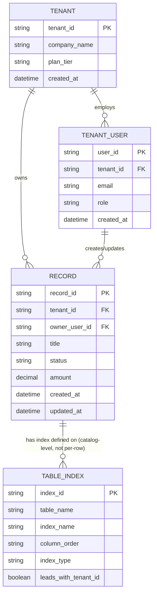
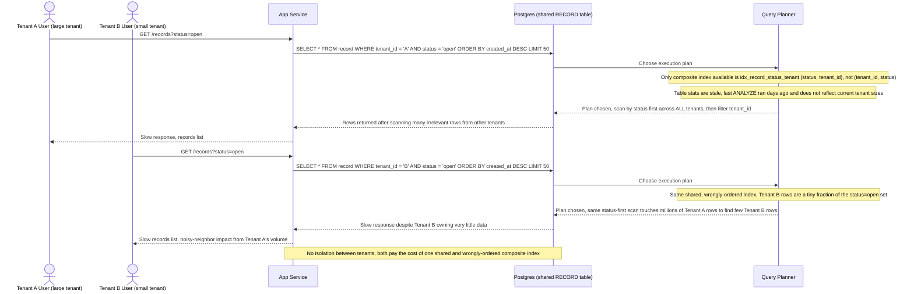
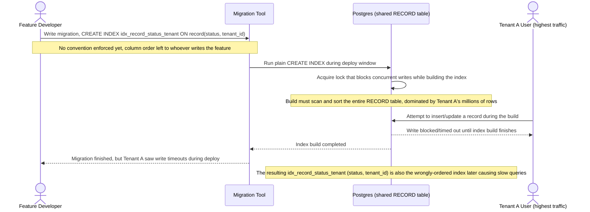
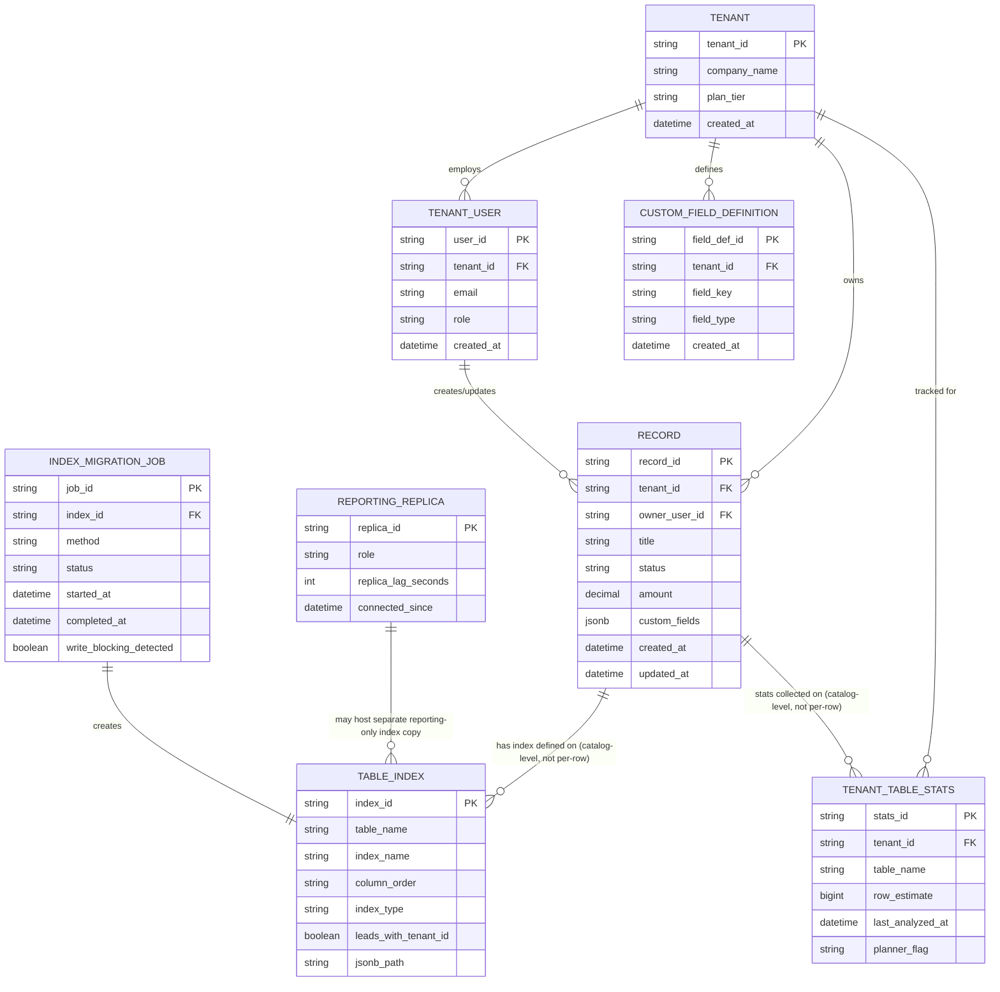
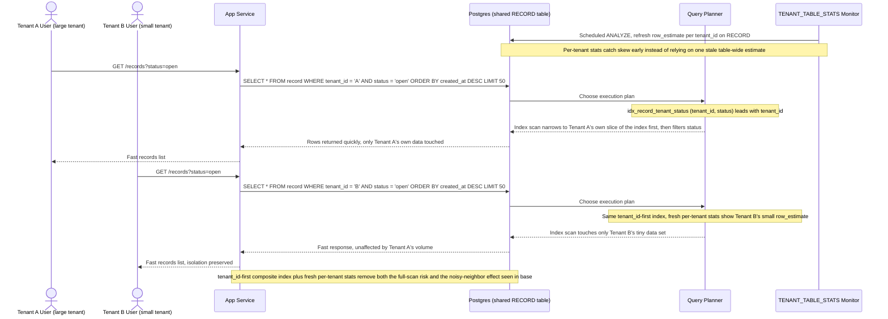
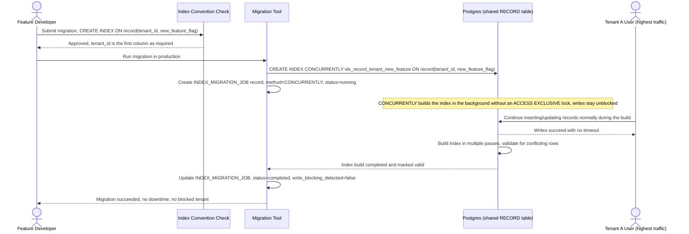
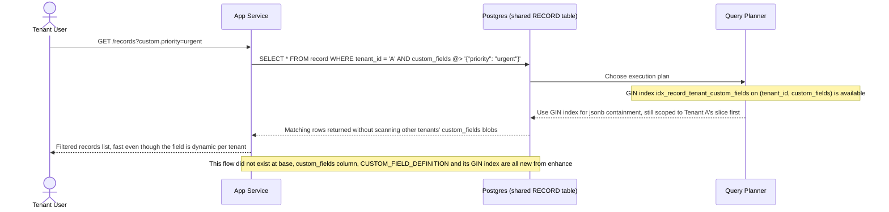
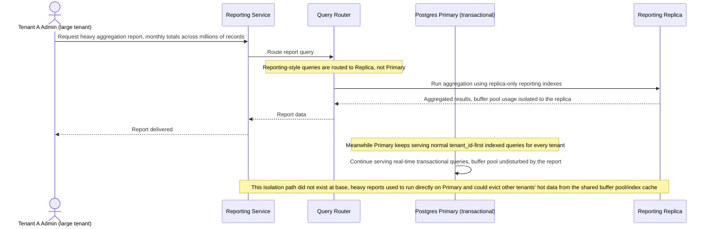

# SaaS B2B tối ưu index cho truy vấn đa tenant dùng chung bảng

**Hệ thống:** SaaS B2B multi-tenant dùng shared schema — nhiều công ty khách hàng (tenant) lưu dữ liệu chung trong cùng một bộ bảng, phân biệt bằng cột `tenant_id`, với quy mô dữ liệu lệch rất lớn giữa các tenant (tenant lớn hàng triệu dòng, tenant nhỏ chỉ vài trăm dòng).

**Vai trò của flow:** Đảm bảo mỗi tenant tra cứu dữ liệu của riêng mình luôn nhanh và cách ly đúng, bất kể tenant khác đang có khối lượng dữ liệu hoặc truy vấn lớn tới đâu (tránh noisy-neighbor ảnh hưởng lẫn nhau qua tầng index/cache dùng chung).

**Yêu cầu cụ thể:**
- Mọi composite index trên các bảng dùng chung đều phải đặt `tenant_id` làm cột đầu tiên để mỗi truy vấn luôn lọc được theo tenant trước — nếu một tính năng mới quên tuân thủ quy tắc này, query sẽ rơi vào full table scan chậm dần và có nguy cơ vô tình đọc chéo dữ liệu tenant khác do lỗi logic đi kèm.
- Do độ lệch dữ liệu lớn giữa các tenant, query planner có thể chọn plan khác nhau cho cùng một câu query tùy vào cardinality của tenant đang chạy (tenant nhỏ có thể bị ép dùng index kém hiệu quả, tenant lớn có thể bị planner chọn nhầm sang full scan) — cần theo dõi thống kê (ANALYZE) và xử lý rõ trường hợp planner chọn sai plan.
- Một số tenant cần lưu field tùy biến riêng (custom fields) qua cột JSONB dùng chung cho mọi tenant — B-tree thường không index hiệu quả cho các field động này, cần đánh giá dùng GIN index hoặc expression index cho từng loại field hay truy vấn phổ biến.
- Khi một tenant lớn chạy report/aggregation nặng, nó có thể chiếm phần lớn buffer pool/index cache dùng chung, khiến các tenant nhỏ khác bị chậm theo dù không liên quan tới truy vấn đó — cần cân nhắc tách index/replica riêng cho luồng reporting nặng khỏi luồng giao dịch thời gian thực.
- Thêm index mới cho một tính năng phải chạy migration online (kiểu CREATE INDEX CONCURRENTLY) trên bảng chứa dữ liệu của toàn bộ tenant cùng lúc — cần đảm bảo quá trình build index không khoá ghi và không làm gián đoạn tenant nào, kể cả tenant đang có traffic cao nhất tại thời điểm migrate.

---

# ERD — Base (trước khi chuẩn hoá index đa tenant)

Đây là **base**: mô hình dữ liệu suy luận cho hệ thống SaaS B2B multi-tenant dùng shared schema *trước khi* áp các quy tắc tối ưu index của đề bài. Đề bài giả định đã tồn tại `TENANT`, `TENANT_USER` và một bảng dữ liệu nghiệp vụ dùng chung `RECORD` (đại diện cho loại bảng "shared table" bất kỳ — invoice, lead, ticket... — có cột `tenant_id`, quy mô lệch lớn giữa các tenant) — nếu không có các entity này thì việc "tối ưu index cho truy vấn đa tenant" sẽ không có nghĩa. ERD còn đưa `TABLE_INDEX` vào như metadata catalog (kiểu `pg_indexes`) để thể hiện đúng vấn đề gốc: ở base, thứ tự cột trong composite index KHÔNG được chuẩn hoá nhất quán — cột `leads_with_tenant_id` có giá trị hỗn hợp tuỳ theo index được tạo bởi tính năng nào, dẫn tới rủi ro full table scan nêu trong đề bài.

---

# Sequence Diagram — Base: Tenant Query Records

Đây là **base**, flow "tenant truy vấn danh sách dữ liệu của mình" trên bảng `RECORD` dùng chung. Flow này được chọn vì nó chính là nạn nhân trực tiếp của 2 vấn đề đầu tiên trong đề bài: composite index không đặt `tenant_id` đầu tiên (một tính năng cũ tạo `idx_record_status_tenant (status, tenant_id)` sai thứ tự) và độ lệch dữ liệu lớn giữa các tenant khiến planner chọn plan tệ. Diagram cho thấy cả tenant lớn lẫn tenant nhỏ đều bị ảnh hưởng, kể cả khi chỉ một bên có nhiều dữ liệu.

---

# Sequence Diagram — Base: Add Index Migration

Đây là **base**, flow "thêm index mới cho một tính năng" theo cách làm cũ. Flow này được chọn để làm tiền đề đối chiếu trực tiếp với yêu cầu cuối của đề bài (migration online, không khoá ghi) — ở base, chưa có quy ước bắt buộc dùng `CREATE INDEX CONCURRENTLY` lẫn quy ước bắt buộc `tenant_id` phải là cột đầu, nên migration này vừa khoá bảng vừa vô tình tạo ra chính cái index sai thứ tự đã gây chậm ở flow truy vấn.

---

# ERD — Enhance (sau khi chuẩn hoá index đa tenant)

Đây là **enhance**: ERD base cộng thêm các entity/cột phục vụ đúng 5 yêu cầu của đề bài. So với base, `TABLE_INDEX` được bổ sung cột `jsonb_path` và quy ước `leads_with_tenant_id` nay luôn là true cho mọi composite index (yêu cầu 1); `TENANT_TABLE_STATS` là entity mới theo dõi thống kê ANALYZE theo từng tenant để xử lý độ lệch cardinality (yêu cầu 2); `RECORD` có thêm cột `custom_fields JSONB` cùng entity `CUSTOM_FIELD_DEFINITION` cho phép tenant tự khai báo field động (yêu cầu 3); `REPORTING_REPLICA` tách index/luồng report nặng khỏi luồng giao dịch (yêu cầu 4); `INDEX_MIGRATION_JOB` ghi nhận việc build index luôn chạy online, không khoá ghi (yêu cầu 5).

---

# Sequence Diagram — Enhance: Tenant Query Records

Đây là **enhance** của flow đã có ở base ("tenant truy vấn danh sách dữ liệu của mình"). So với base, flow này thay đổi ở 2 điểm: composite index nay là `idx_record_tenant_status (tenant_id, status)` — `tenant_id` luôn đứng đầu (yêu cầu 1) — và thống kê `TENANT_TABLE_STATS` được refresh định kỳ theo từng tenant để planner không còn bị đánh lừa bởi độ lệch cardinality (yêu cầu 2). Kết quả là cả tenant lớn lẫn tenant nhỏ đều chỉ chạm vào đúng dữ liệu của mình.

---

# Sequence Diagram — Enhance: Add Index Migration

Đây là **enhance** của flow đã có ở base ("thêm index mới cho một tính năng"). So với base, flow này thay đổi ở 2 điểm: có bước review bắt buộc kiểm tra `tenant_id` là cột đầu tiên trước khi cho migrate (yêu cầu 1), và migration luôn chạy bằng `CREATE INDEX CONCURRENTLY`, được `INDEX_MIGRATION_JOB` theo dõi để đảm bảo không khoá ghi kể cả với tenant có traffic cao nhất (yêu cầu 5) — trái ngược hoàn toàn với base, nơi migration dùng `CREATE INDEX` thường và khoá bảng suốt quá trình build.

---

# Sequence Diagram — Enhance: Filter Custom Fields

Đây là **enhance**, flow hoàn toàn mới chưa tồn tại ở base: tenant lọc dữ liệu theo custom field lưu trong cột `custom_fields JSONB` dùng chung. Flow này được chọn vì thể hiện trực tiếp yêu cầu 3 của đề bài — B-tree không hiệu quả cho field động này, nên cần GIN index (kết hợp `tenant_id` để không quét chéo dữ liệu tenant khác trong cùng cột JSONB dùng chung).

---

# Sequence Diagram — Enhance: Run Heavy Report

Đây là **enhance**, flow hoàn toàn mới chưa tồn tại ở base: một tenant lớn chạy report/aggregation nặng trên `REPORTING_REPLICA` thay vì trên bảng transactional chính. Flow này được chọn vì thể hiện trực tiếp yêu cầu 4 của đề bài — tách index/replica riêng cho luồng reporting nặng, để tenant nhỏ khác không bị chậm theo do buffer pool/index cache dùng chung bị tenant lớn chiếm dụng.

