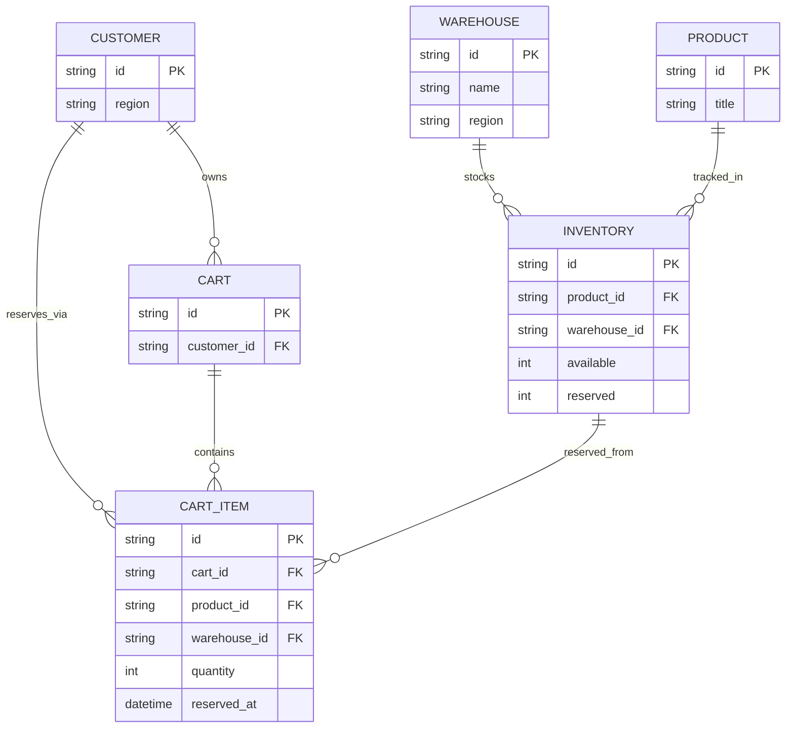
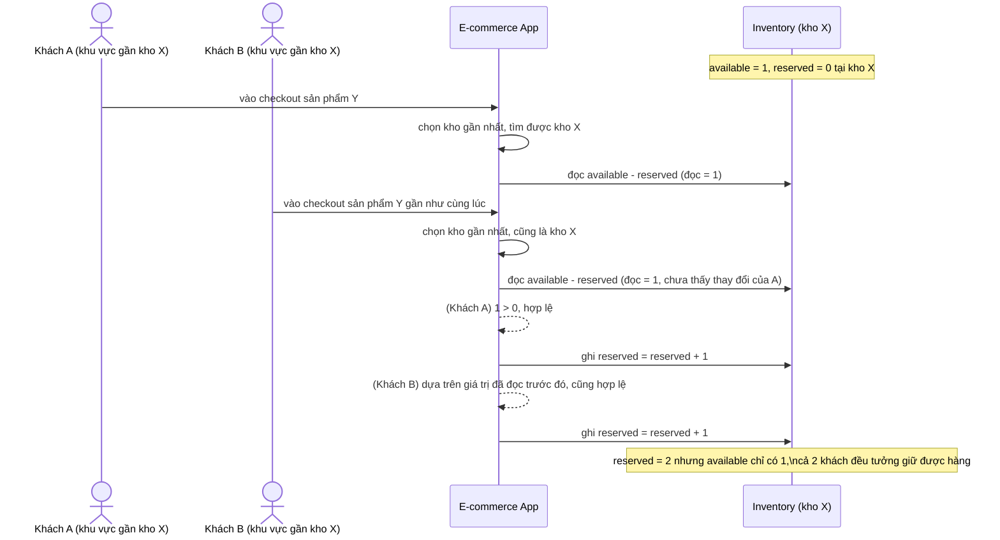
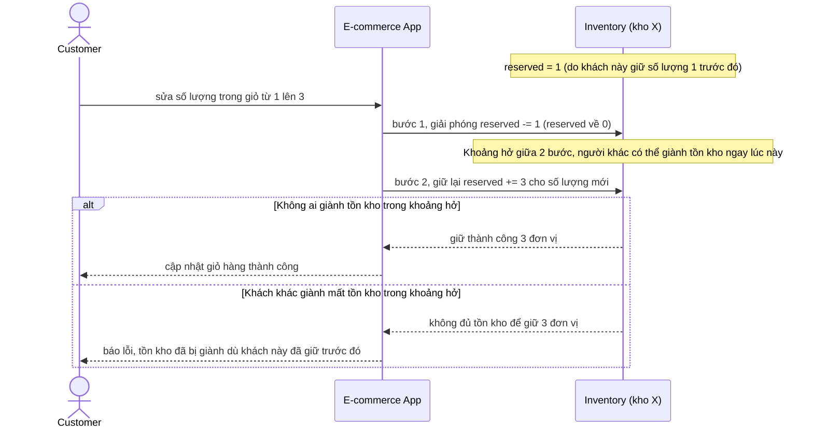
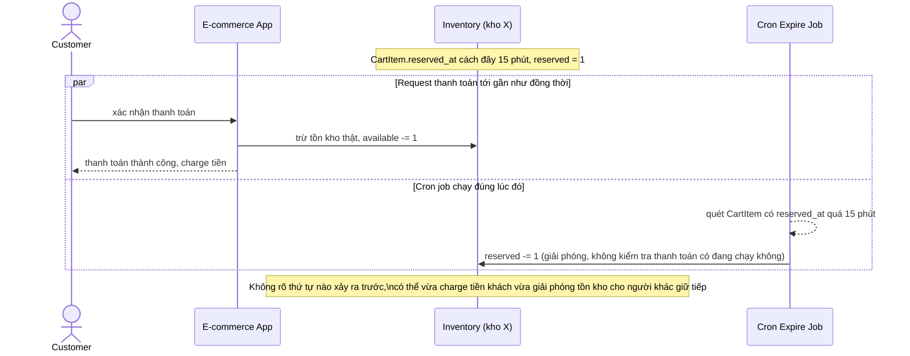
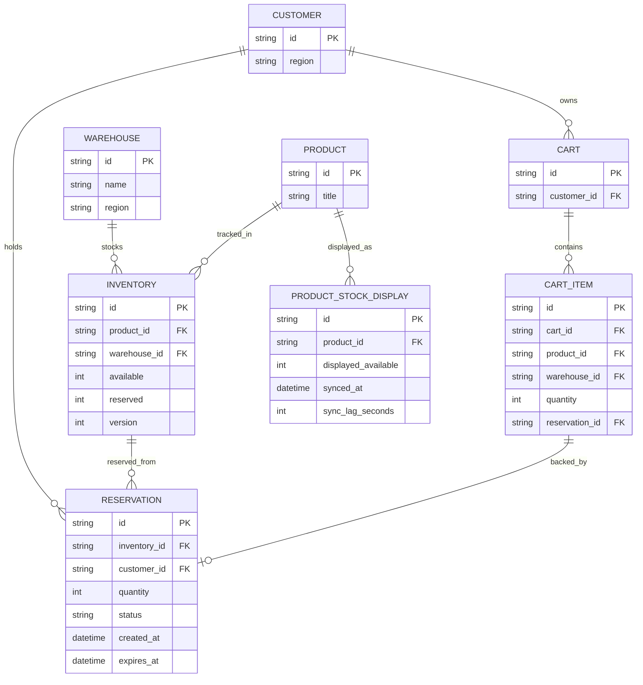
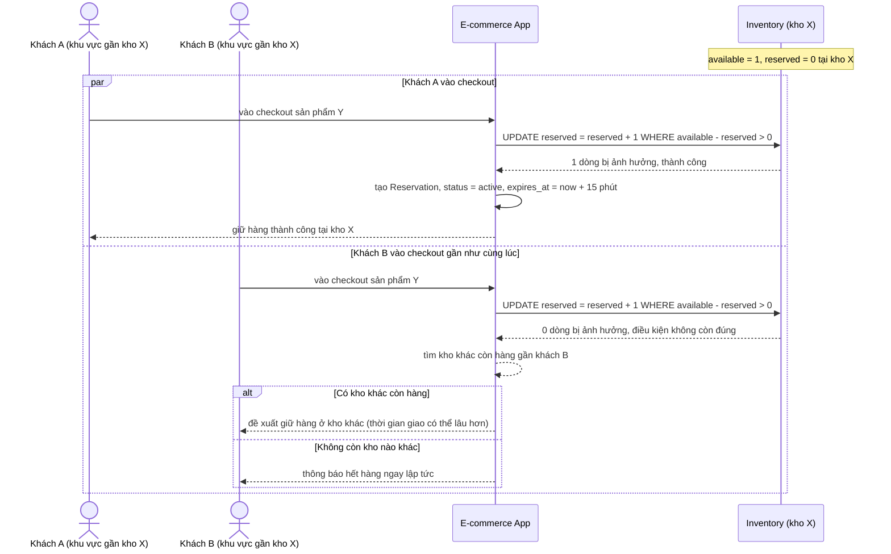
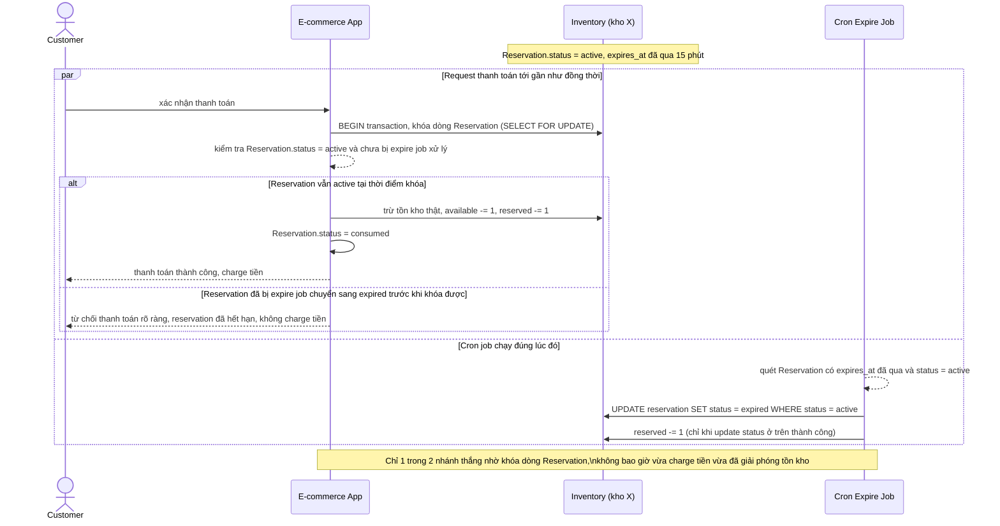
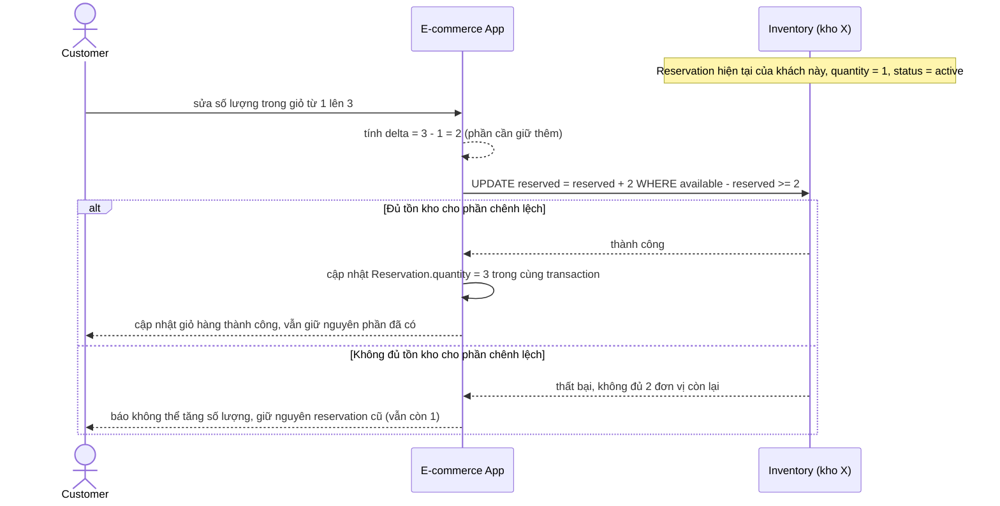
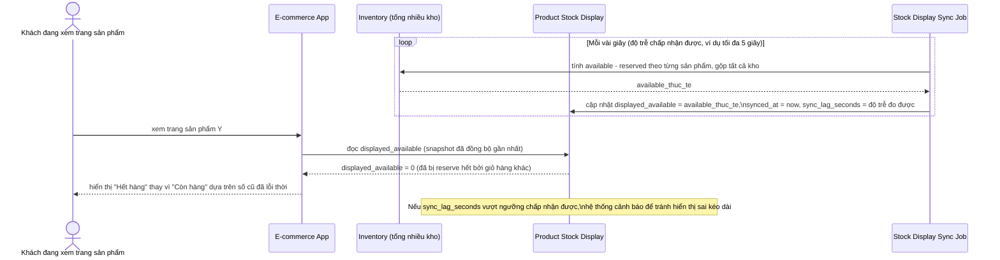

# Giữ tồn kho khi thêm vào giỏ hàng trên sàn e-commerce nhiều kho

**Hệ thống:** Một sàn e-commerce có tồn kho phân bổ ở nhiều kho khác nhau theo khu vực, khách hàng thêm sản phẩm vào giỏ và tồn kho được "soft reserve" trong 15 phút khi vào bước checkout.

**Vai trò của flow:** Flow reservation phải chọn đúng kho gần khách để giữ hàng, trừ tồn kho tạm thời (không phải trừ thật) khi vào checkout, và giải phóng đúng nếu khách rời trang mà không thanh toán.

**Yêu cầu cụ thể:**
- Khi 2 khách ở 2 khu vực khác nhau cùng checkout sản phẩm chỉ còn 1 đơn vị tồn kho ở kho gần cả hai, dùng update nguyên tử `UPDATE inventory SET reserved = reserved + 1 WHERE available - reserved > 0` (không phải đọc số dư trước rồi update sau) để chỉ 1 trong 2 giữ được hàng, người thua nhận thông báo ngay và được đề xuất kho khác (nếu có) hoặc thông báo hết hàng.
- Reservation phải có TTL và bảng lưu trạng thái riêng (không chỉ tăng/giảm số nguyên trong cột `reserved`), để có thể truy ngược "ai đang giữ, giữ bao lâu, khi nào hết hạn" phục vụ debug và hiển thị đúng cho khách.
- Mô tả cụ thể race giữa job giải phóng reservation hết hạn và request thanh toán đến gần đồng thời: transaction thanh toán phải kiểm tra reservation vẫn còn hiệu lực (chưa bị job expire xóa) ngay trước khi trừ tồn kho thật, nếu đã bị expire phải từ chối thanh toán rõ ràng và không charge tiền.
- Khi khách sửa số lượng trong giỏ hàng (tăng từ 1 lên 3) trong lúc đang giữ reservation, phải tính lại đúng phần chênh lệch cần giữ thêm một cách atomic, không phải hủy reservation cũ rồi tạo mới (dễ mất tồn kho đã giữ trong khoảng thời gian giữa 2 bước).
- Có cơ chế đồng bộ giữa tồn kho "hiển thị công khai trên trang sản phẩm" và tồn kho "khả dụng thực" (available - reserved), quy định độ trễ chấp nhận được và tránh hiển thị "còn hàng" khi thực chất đã được reserve hết bởi các giỏ hàng khác.

---

# ERD - Base (trước khi có reservation atomic nhiều kho)

Đây là **base**: mô hình dữ liệu của sàn e-commerce nhiều kho, nơi tồn kho đã có khái niệm "soft reserve 15 phút" nhưng được cài đặt đơn giản - `reserved` chỉ là một cột số nguyên tăng/giảm trực tiếp trên `Inventory`, không có bảng reservation riêng để truy ngược ai đang giữ, giữ từ khi nào, hết hạn lúc nào. `CartItem` chỉ lưu `reserved_at` để một cron job dựa vào đó blind-decrement `reserved` sau 15 phút.

---

# Sequence - Base - Flow "checkout-reserve"

Đây là **base**: khách vào bước checkout, hệ thống chọn kho gần nhất rồi giữ tồn kho bằng cách đọc số dư trước, kiểm tra, rồi ghi sau (2 bước tách rời, không atomic). Flow này được chọn vì nó chính là nguyên nhân của race mà yêu cầu 1 mô tả: 2 khách ở 2 khu vực khác nhau cùng checkout sản phẩm chỉ còn 1 đơn vị ở kho gần cả hai.

---

# Sequence - Base - Flow "update-cart-quantity"

Đây là **base**: khi khách sửa số lượng trong giỏ hàng lúc đang giữ reservation, hệ thống hủy phần đã giữ rồi giữ lại từ đầu theo số lượng mới - 2 bước tách rời. Flow này được chọn vì đây chính là cách làm mà yêu cầu 4 chỉ ra là có vấn đề: giữa lúc hủy và giữ lại, tồn kho đã giữ có thể bị người khác giành mất.

---

# Sequence - Base - Flow "expire-reservation"

Đây là **base**: cron job giải phóng reservation hết hạn bằng cách blind-decrement cột `reserved`, dựa trên `reserved_at` của `CartItem`, không kiểm tra gì thêm. Flow này được chọn vì nó là tiền đề cho yêu cầu 3 - khi job này chạy gần như đồng thời với request thanh toán, không có cơ chế nào đảm bảo thứ tự đúng, có thể vừa charge tiền vừa đã giải phóng tồn kho cho người khác.

---

# ERD - Enhance (reservation atomic + bảng trạng thái riêng)

Đây là **enhance**: mô hình dữ liệu sau khi tách reservation ra khỏi cột `reserved` đơn thuần. So với base, các thay đổi là:

- `RESERVATION` (mới, thay cho việc chỉ tăng/giảm `Inventory.reserved`): mỗi lần giữ hàng là 1 dòng riêng với `status` (`active` / `expired` / `consumed`), `created_at`, `expires_at` - truy ngược được ai đang giữ, giữ bao lâu, hết hạn lúc nào (yêu cầu 2), và cho phép transaction thanh toán kiểm tra `status = active` ngay trước khi trừ tồn kho thật (yêu cầu 3).
- `INVENTORY` có thêm `version` để hỗ trợ update nguyên tử `available - reserved > 0` (yêu cầu 1) và điều chỉnh phần chênh lệch khi khách sửa số lượng mà không cần hủy/tạo lại (yêu cầu 4).
- `CART_ITEM` giờ tham chiếu tới `RESERVATION` qua `reservation_id` thay vì tự lưu `reserved_at`.
- `PRODUCT_STOCK_DISPLAY` (mới): snapshot tồn kho hiển thị công khai trên trang sản phẩm, đồng bộ định kỳ từ `available - reserved` thật, có `sync_lag_seconds` để biết độ trễ hiện tại - tránh hiển thị "còn hàng" khi thực chất đã được reserve hết (yêu cầu 5).

---

# Sequence - Enhance - Flow "checkout-reserve"

Đây là **enhance**, cùng flow `checkout-reserve` như ở base nhưng thay đọc-rồi-ghi bằng update nguyên tử `UPDATE inventory SET reserved = reserved + 1 WHERE available - reserved > 0`, đáp ứng yêu cầu 1: chỉ 1 trong 2 khách giữ được hàng, người thua nhận thông báo ngay và được đề xuất kho khác hoặc báo hết hàng. Mỗi lần giữ thành công đều tạo 1 dòng `Reservation` có TTL riêng, đáp ứng yêu cầu 2.

---

# Sequence - Enhance - Flow "expire-reservation"

Đây là **enhance**, cùng flow `expire-reservation` như ở base nhưng thay blind-decrement bằng kiểm tra trạng thái tường minh trên bảng `Reservation`, đáp ứng yêu cầu 3: transaction thanh toán phải kiểm tra reservation vẫn còn `status = active` ngay trước khi trừ tồn kho thật, nếu đã bị job expire chuyển sang `expired` thì từ chối thanh toán rõ ràng và không charge tiền - thay vì tình trạng mơ hồ như ở base.

---

# Sequence - Enhance - Flow "update-cart-quantity"

Đây là **enhance**, cùng flow `update-cart-quantity` như ở base nhưng thay hủy-rồi-giữ-lại bằng 1 update nguyên tử tính đúng phần chênh lệch, đáp ứng yêu cầu 4: khi khách sửa số lượng từ 1 lên 3, hệ thống chỉ cần giữ thêm phần chênh lệch (2 đơn vị) trong cùng 1 thao tác, không có khoảng hở nào để người khác giành mất tồn kho đã giữ.

---

# Sequence - Enhance - Flow "stock-display-sync"

Đây là **enhance**, flow hoàn toàn mới so với base, đáp ứng yêu cầu 5: đồng bộ giữa tồn kho hiển thị công khai trên trang sản phẩm và tồn kho khả dụng thực (`available - reserved`), quy định độ trễ chấp nhận được và tránh hiển thị "còn hàng" khi thực chất đã được reserve hết bởi các giỏ hàng khác.

