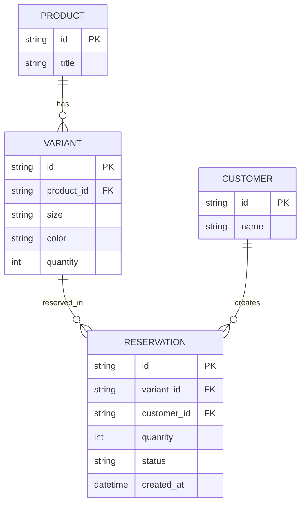
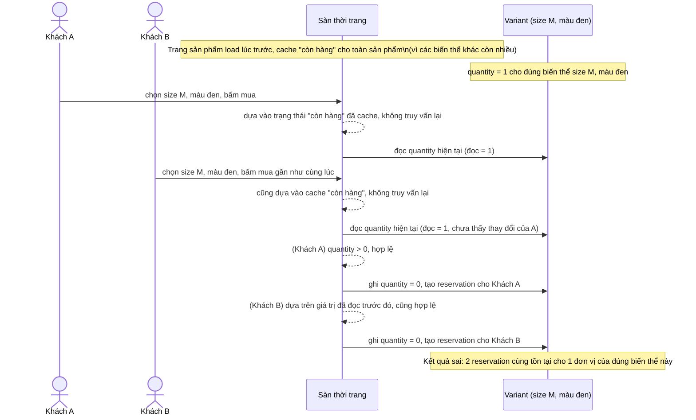
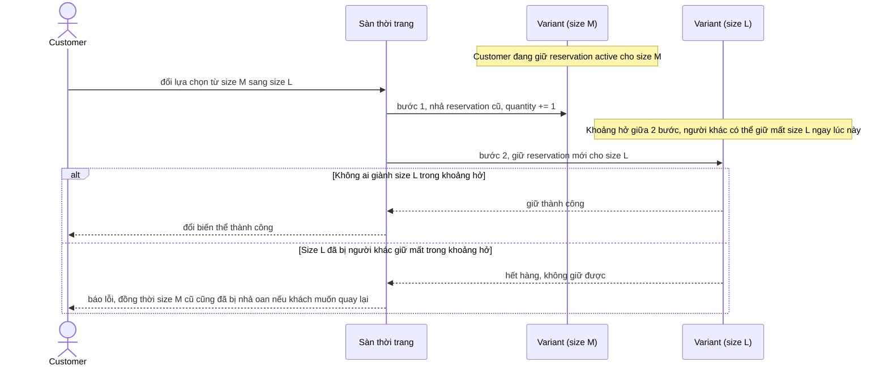
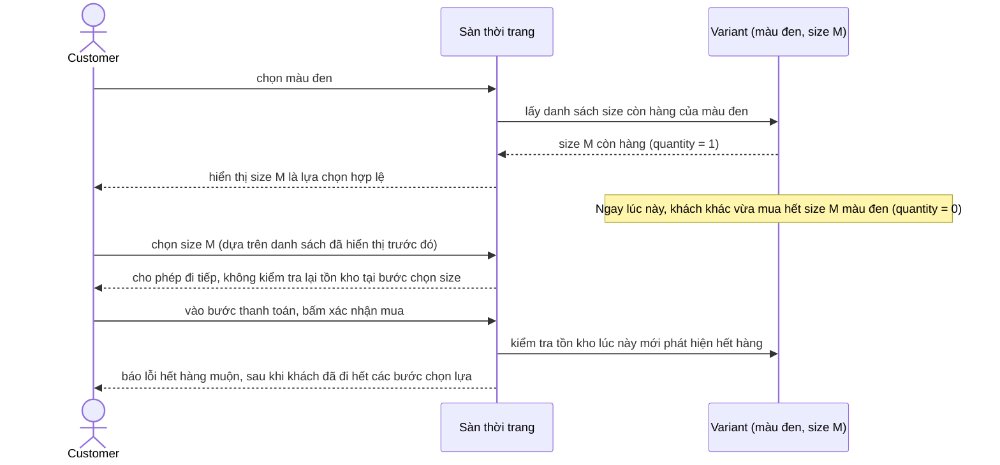
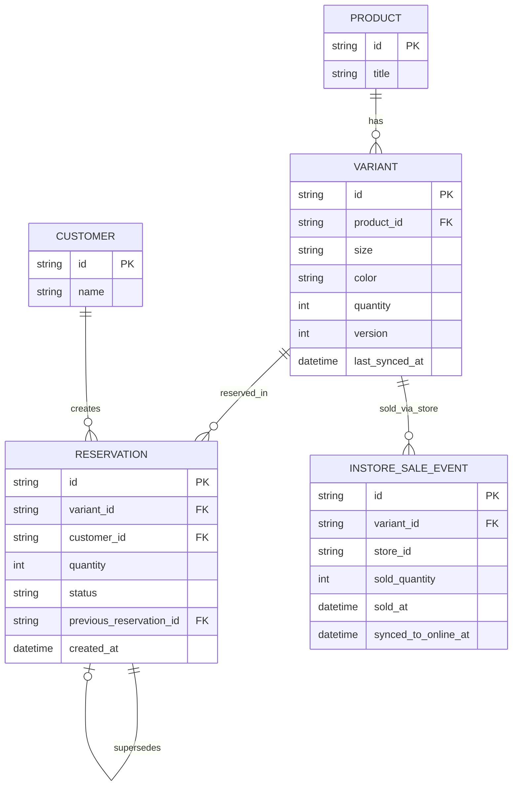
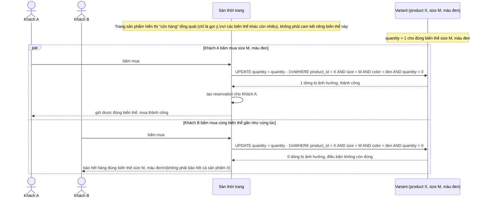
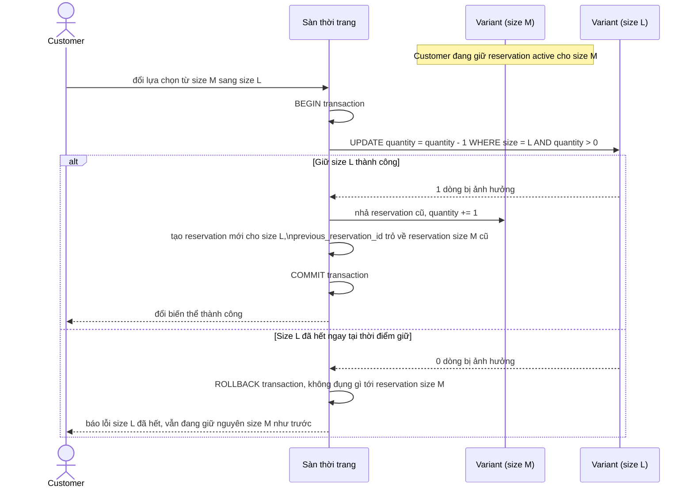
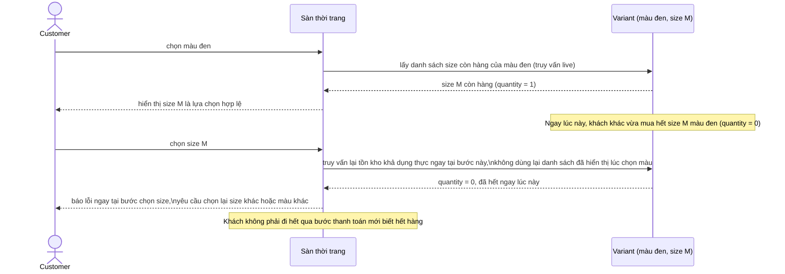
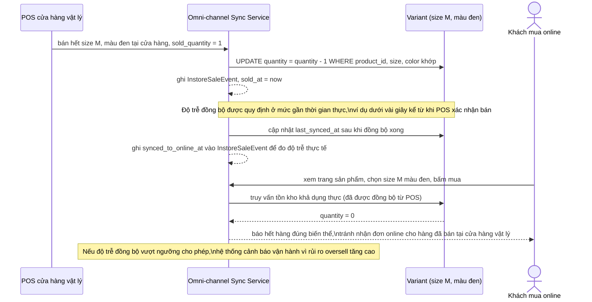

# Đặt trước tồn kho theo biến thể size/màu khi tồn kho tổng vẫn hiển thị "còn hàng"

**Hệ thống:** Một sàn thời trang, mỗi sản phẩm có nhiều biến thể (size S/M/L, nhiều màu sắc), mỗi biến thể có tồn kho riêng, trong khi trang sản phẩm chỉ hiển thị trạng thái "còn hàng" tổng hợp từ toàn bộ các biến thể.

**Vai trò của flow:** Flow reservation phải trừ đúng tồn kho ở cấp biến thể cụ thể mà khách chọn, xử lý đúng khi biến thể đó vừa hết ngay tại thời điểm khách bấm mua dù trang sản phẩm khách đang xem vẫn hiển thị "còn hàng".

**Yêu cầu cụ thể:**
- Mô tả cụ thể: sản phẩm áo có biến thể "size M, màu đen" chỉ còn đúng 1 đơn vị, 2 khách đang xem cùng trang sản phẩm (trang vẫn hiển thị "còn hàng" vì các biến thể khác còn nhiều) cùng chọn đúng size M màu đen và bấm mua gần như đồng thời — yêu cầu update nguyên tử theo khóa tổ hợp (product_id, size, color) chứ không phải theo product_id chung, để chỉ 1 khách giữ được đơn vị cuối, khách còn lại nhận báo hết đúng biến thể đó (không phải thông báo hết cả sản phẩm gây hiểu nhầm).
- Khi khách đổi biến thể trong lúc đang giữ reservation (ví dụ đổi từ size M sang size L ngay trên trang chi tiết trước khi vào bước thanh toán), thao tác đổi phải là 1 bước atomic gồm nhả reservation biến thể cũ và giữ reservation biến thể mới, không để khoảng hở giữa 2 thao tác khiến biến thể mới bị người khác giữ mất, hoặc biến thể cũ vẫn bị giữ dư thừa không cần thiết nếu bước giữ biến thể mới thất bại.
- Quy định rõ trạng thái "còn hàng" hiển thị tổng trên trang sản phẩm chỉ là gợi ý tổng quan (tổng các biến thể còn lớn hơn 0), không phải cam kết biến thể cụ thể còn hàng; tại bước khách chọn biến thể và bấm mua, hệ thống phải luôn truy vấn lại tồn kho khả dụng thực của đúng biến thể đó tại thời điểm request, không dựa vào trạng thái đã cache lúc khách load trang.
- Với sản phẩm có các biến thể phụ thuộc lẫn nhau khi hiển thị (ví dụ chọn màu trước rồi mới hiện các size còn hàng của màu đó), mô tả cụ thể race khi tồn kho biến thể thay đổi ngay trong lúc khách đang thao tác chọn tuần tự (màu rồi size) — giao diện và backend phải xử lý được trường hợp option vừa hiển thị "còn hàng" khi khách chọn màu nhưng đã hết ngay khi khách chọn xong size, trả lỗi rõ ràng ngay tại bước đó thay vì để khách đi hết qua bước thanh toán rồi mới báo lỗi.
- Nếu có kênh bán tại cửa hàng vật lý dùng chung tồn kho biến thể với kênh online (omni-channel), quy định cơ chế và độ trễ đồng bộ khi 1 biến thể vừa được bán hết tại cửa hàng vật lý, đảm bảo tồn kho online của đúng biến thể đó được cập nhật kịp thời để tránh nhận đơn online cho hàng thực tế đã không còn.

---

# ERD - Base (trước khi xử lý reservation đúng cấp biến thể)

Đây là **base**: mô hình dữ liệu tối thiểu của một sàn thời trang, mỗi sản phẩm có nhiều biến thể (size, màu), mỗi biến thể có tồn kho riêng. Chỉ giữ `Product`, `Variant`, `Customer`, `Reservation` - đủ để thấy vấn đề gốc: `Variant.quantity` là một cột đơn giản không có khóa nguyên tử theo tổ hợp size/màu, và không có gì phân biệt trạng thái "còn hàng" hiển thị tổng với tồn kho khả dụng thực của từng biến thể.

---

# Sequence - Base - Flow "purchase-variant"

Đây là **base**: khách bấm mua một biến thể cụ thể, hệ thống dùng lại trạng thái "còn hàng" đã cache từ lúc load trang sản phẩm và cập nhật tồn kho theo kiểu đọc trước - ghi sau, không khóa đúng theo tổ hợp biến thể. Flow này được chọn vì nó là tiền đề cho yêu cầu 1 (race giữa 2 khách chọn cùng 1 biến thể) và yêu cầu 3 (tin vào dữ liệu cache thay vì truy vấn lại tồn kho thực).

---

# Sequence - Base - Flow "change-variant-selection"

Đây là **base**: khi khách đổi biến thể (ví dụ từ size M sang size L) trong lúc đang giữ reservation, hệ thống nhả reservation cũ rồi giữ reservation mới bằng 2 bước tách rời. Flow này được chọn vì đây là cách làm mà yêu cầu 2 chỉ ra là có vấn đề: khoảng hở giữa 2 bước có thể khiến biến thể mới bị người khác giữ mất, hoặc biến thể cũ bị giữ dư thừa nếu bước sau thất bại.

---

# Sequence - Base - Flow "select-variant-options"

Đây là **base**: giao diện chọn biến thể tuần tự (chọn màu trước, rồi mới hiện các size còn hàng của màu đó) dựa trên snapshot tồn kho lấy tại thời điểm chọn màu, không kiểm tra lại khi khách chọn xong size. Flow này được chọn vì nó là tiền đề cho yêu cầu 4 - tồn kho biến thể có thể đổi ngay trong lúc khách đang thao tác tuần tự, dẫn tới việc khách đi hết qua bước thanh toán rồi mới phát hiện hết hàng.

---

# ERD - Enhance (reservation atomic đúng cấp biến thể + đồng bộ omni-channel)

Đây là **enhance**: mô hình dữ liệu sau khi xử lý đúng reservation ở cấp biến thể. So với base, các thay đổi là:

- `VARIANT` có thêm `version` (dùng cho update nguyên tử khóa theo tổ hợp `product_id, size, color` - yêu cầu 1) và `last_synced_at` (mốc đồng bộ gần nhất từ kênh cửa hàng vật lý - yêu cầu 5).
- `RESERVATION` có thêm `previous_reservation_id` (tự tham chiếu, đánh dấu reservation này thay thế reservation biến thể cũ nào trong 1 thao tác đổi biến thể atomic - yêu cầu 2) và `status` mở rộng (`active` / `released` / `consumed`).
- `INSTORE_SALE_EVENT` (mới): mỗi lần 1 biến thể được bán tại cửa hàng vật lý, gồm `sold_at` và `synced_to_online_at` để đo độ trễ đồng bộ về tồn kho online của đúng biến thể đó (yêu cầu 5).

Yêu cầu 3 và 4 (luôn truy vấn lại tồn kho khả dụng thực tại thời điểm request, không dựa cache) không cần thêm entity mới - đây là thay đổi về hành vi đọc dữ liệu, thể hiện trong các sequence diagram bên dưới.

---

# Sequence - Enhance - Flow "purchase-variant"

Đây là **enhance**, cùng flow `purchase-variant` như ở base nhưng thay việc dùng cache và đọc-rồi-ghi bằng: (1) luôn truy vấn lại tồn kho khả dụng thực của đúng biến thể tại thời điểm bấm mua, không dựa vào trạng thái đã cache lúc load trang (yêu cầu 3), và (2) update nguyên tử khóa theo tổ hợp `(product_id, size, color)` chứ không phải theo product_id chung (yêu cầu 1). Khách thua chỉ nhận báo hết đúng biến thể đó, không phải báo hết cả sản phẩm.

---

# Sequence - Enhance - Flow "change-variant-selection"

Đây là **enhance**, cùng flow `change-variant-selection` như ở base nhưng gộp nhả reservation cũ và giữ reservation mới vào 1 transaction atomic, đáp ứng yêu cầu 2: không có khoảng hở nào giữa 2 thao tác, và nếu giữ biến thể mới thất bại thì biến thể cũ không bị nhả oan.

---

# Sequence - Enhance - Flow "select-variant-options"

Đây là **enhance**, cùng flow `select-variant-options` như ở base nhưng thêm bước kiểm tra lại tồn kho thực ngay tại thời điểm khách chọn xong lựa chọn phụ thuộc (size sau khi đã chọn màu), đáp ứng yêu cầu 4: nếu biến thể vừa hết ngay trong lúc khách thao tác tuần tự, lỗi được trả ngay tại bước đó thay vì để khách đi hết qua thanh toán rồi mới báo.

---

# Sequence - Enhance - Flow "instore-sale-sync"

Đây là **enhance**, flow hoàn toàn mới so với base, đáp ứng yêu cầu 5: khi kênh bán tại cửa hàng vật lý dùng chung tồn kho biến thể với kênh online, một biến thể vừa bán hết tại cửa hàng phải được đồng bộ kịp thời về tồn kho online của đúng biến thể đó, tránh nhận đơn online cho hàng thực tế đã không còn.

