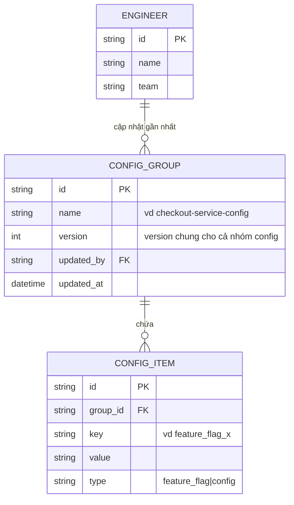
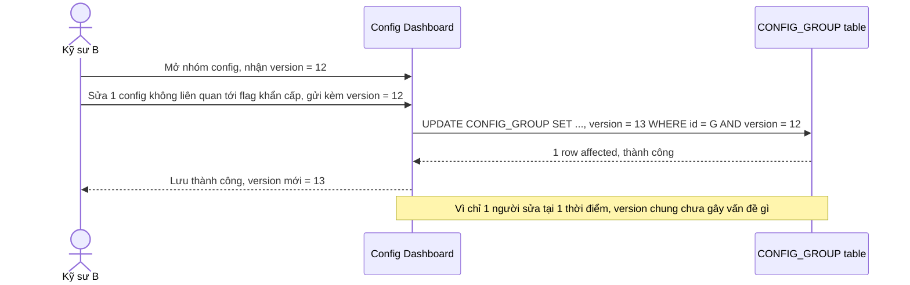
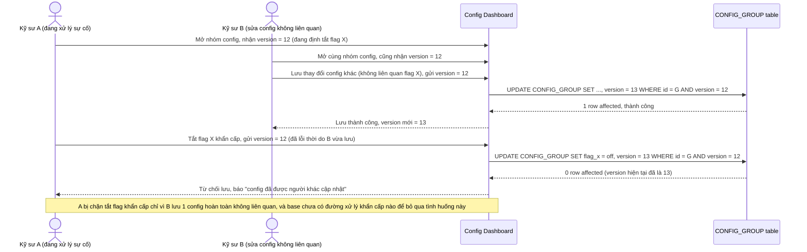
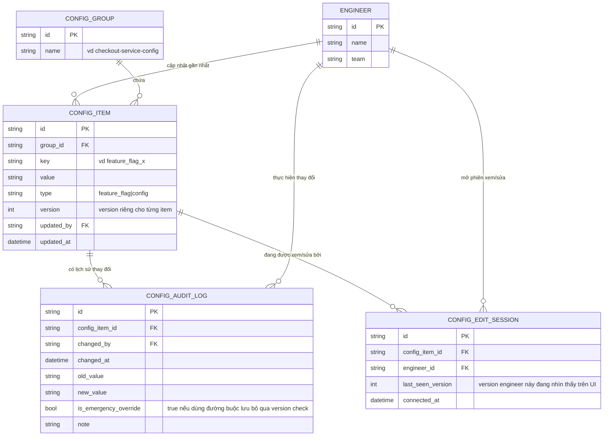
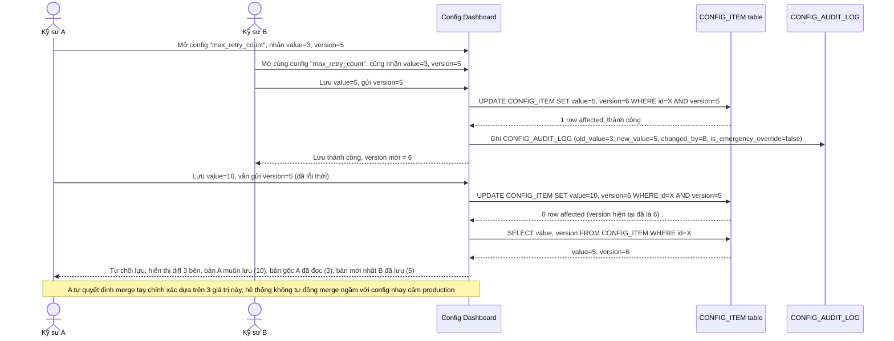
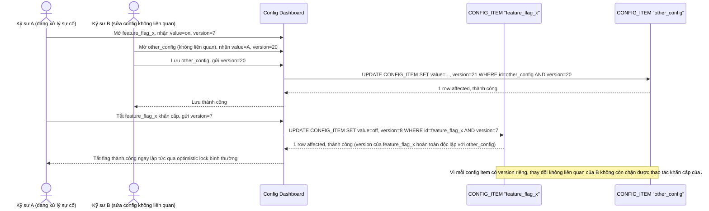
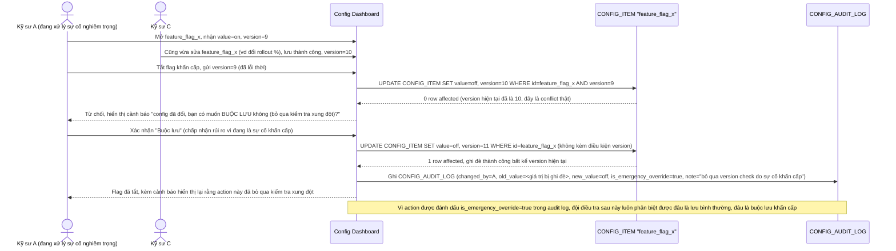
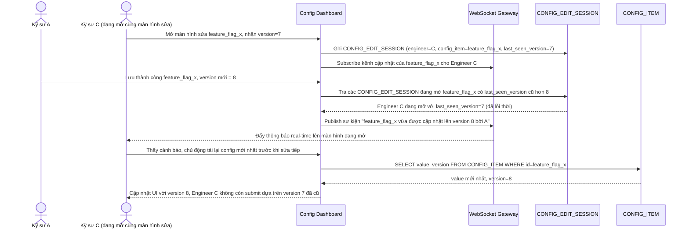
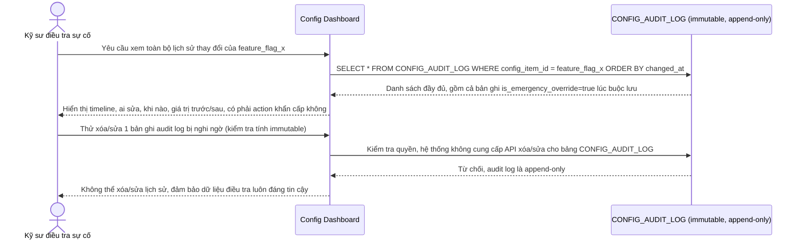

# Chỉnh sửa cấu hình hệ thống nội bộ (feature flag, config) bởi nhiều kỹ sư

**Hệ thống:** Một dashboard nội bộ cho kỹ sư quản lý feature flag/config runtime của hệ thống production, thay đổi có hiệu lực ngay khi lưu, nhiều kỹ sư ở các team khác nhau có quyền chỉnh sửa.

**Vai trò của flow:** Vì thay đổi config có tác động ngay tới production và tần suất nhiều kỹ sư cùng sửa 1 config trong cùng thời điểm là thấp nhưng hậu quả nếu ghi đè nhầm khá nghiêm trọng, flow nên dùng optimistic locking kết hợp với hiển thị rõ diff thay đổi trước khi cho phép lưu đè.

**Yêu cầu cụ thể:**
- Mỗi config có version, khi kỹ sư A lưu thay đổi dựa trên version cũ mà đã có kỹ sư B lưu thay đổi khác trước đó (version mới hơn), hệ thống phải từ chối lưu và hiển thị rõ diff giữa bản A đang muốn lưu, bản gốc A đã đọc, và bản mới nhất B đã lưu — để A tự quyết định merge tay chính xác, không tự động merge ngầm với config nhạy cảm ảnh hưởng production.
- Mô tả cụ thể: kỹ sư A đang tắt feature flag X (do phát hiện lỗi khẩn cấp), đúng lúc kỹ sư B đang sửa 1 config khác không liên quan trong cùng bộ config đó nhưng version chung bị tăng do B lưu trước — cần đánh giá xem có nên tách optimistic lock ở cấp độ từng flag/config riêng lẻ (để A không bị chặn bởi thay đổi không liên quan của B) thay vì version chung cho cả nhóm config, đặc biệt quan trọng cho action khẩn cấp như tắt flag khi có sự cố.
- Với action khẩn cấp (ví dụ "tắt flag ngay" trong sự cố production), nên có đường xử lý riêng ưu tiên ghi đè ngay không chờ optimistic lock thông thường (bỏ qua version check hoặc có nút "buộc lưu" rõ ràng có cảnh báo), vì trong tình huống khẩn cấp việc bị chặn bởi conflict version có thể gây chậm trễ nguy hiểm hơn rủi ro ghi đè nhầm — nhưng phải log rõ ràng và cảnh báo action này đã bỏ qua kiểm tra xung đột.
- Mọi thay đổi config (dù qua optimistic lock thông thường hay đường khẩn cấp) phải được ghi lịch sử đầy đủ và không thể xóa (audit log immutable): ai, khi nào, giá trị trước/sau, có phải action khẩn cấp không — để phục vụ điều tra sau sự cố nếu 1 thay đổi config gây ảnh hưởng không mong muốn.
- Có cơ chế thông báo real-time cho các kỹ sư khác đang mở màn hình chỉnh sửa cùng 1 config khi có ai đó vừa lưu thay đổi (qua WebSocket/polling), để giảm khả năng họ submit dựa trên version đã lỗi thời và phải xử lý conflict muộn hơn cần thiết.

---

# Base ERD — Config dashboard dùng optimistic lock ở cấp cả nhóm config

Đây là **base**: trạng thái dashboard config nội bộ *trước khi* tách optimistic lock theo từng flag/config riêng lẻ. Suy luận từ đề bài (yêu cầu 2 mô tả rõ "version chung bị tăng do B lưu trước" như cách làm hiện tại), base đã có `ENGINEER`, `CONFIG_GROUP` (1 bộ config runtime liên quan nhau, vd cùng 1 service), và các `CONFIG_ITEM` (từng flag/config riêng lẻ) nằm trong group đó — nhưng cột `version` để optimistic lock nằm ở cấp `CONFIG_GROUP` chung cho cả nhóm, chưa có version riêng từng item. Base cũng chưa có đường xử lý khẩn cấp, chưa có audit log immutable, và chưa có cơ chế thông báo real-time.

---

# Base sequence — Update config (optimistic lock ở cấp cả nhóm, thành công)

Đây là **base**, flow lưu thay đổi config hiện tại: optimistic lock áp dụng cho toàn bộ `CONFIG_GROUP`, chỉ 1 cột `version` chung cho mọi config/flag trong nhóm. Khi chỉ có 1 kỹ sư sửa tại 1 thời điểm, flow hoạt động bình thường — đây là tiền đề để so sánh với flow tiếp theo khi 2 kỹ sư sửa 2 config không liên quan trong cùng nhóm.

---

# Base sequence — Xung đột giả chặn cả thao tác khẩn cấp

Đây là **base**, mô tả đúng kịch bản nêu ở yêu cầu 2 của đề bài: kỹ sư A đang tắt feature flag X do phát hiện lỗi khẩn cấp, đúng lúc kỹ sư B đang sửa 1 config khác không liên quan trong cùng nhóm nhưng version chung bị tăng do B lưu trước. Vì optimistic lock ở cấp cả nhóm và base chưa có đường xử lý khẩn cấp, A bị chặn hoàn toàn — đây chính là vấn đề nghiêm trọng mà việc tách version theo từng item và thêm đường khẩn cấp (enhance) phải giải quyết.

---

# Enhance ERD — Version theo từng config item, đường khẩn cấp, audit log immutable, notify real-time

Đây là ERD **sau khi** enhance được áp dụng lên base. So với base (`version` chung ở `CONFIG_GROUP`), thay đổi và bổ sung:

- `version` chuyển xuống cấp `CONFIG_ITEM` (mỗi flag/config riêng lẻ có version riêng) — đáp ứng yêu cầu 1 (conflict theo đúng item) và yêu cầu 2 (A tắt flag X không còn bị chặn bởi thay đổi không liên quan của B).
- `CONFIG_ITEM` thêm `is_emergency_override`/liên kết tới log để phân biệt lần lưu nào đã bấm "buộc lưu" — đáp ứng yêu cầu 3.
- Entity mới `CONFIG_AUDIT_LOG` (immutable, append-only, không có API xóa/sửa) — ghi mọi thay đổi kể cả qua đường khẩn cấp, đáp ứng yêu cầu 4.
- Entity mới `CONFIG_EDIT_SESSION` — theo dõi kỹ sư nào đang mở màn hình sửa config nào, làm nền cho việc đẩy thông báo real-time qua WebSocket/polling, đáp ứng yêu cầu 5.

---

# Enhance sequence — Update config (conflict theo đúng item, hiển thị diff 3 bên)

Đây là **enhance** của flow `update-config` đã có ở base. So với base (chỉ báo chung chung "đã được cập nhật"), khi version của đúng `CONFIG_ITEM` đang sửa bị lệch, hệ thống phải hiển thị rõ diff giữa bản kỹ sư A đang muốn lưu, bản gốc A đã đọc, và bản mới nhất kỹ sư B đã lưu — đáp ứng đúng yêu cầu 1 của đề bài.

---

# Enhance sequence — Xung đột giả không còn xảy ra nhờ version theo từng item

Đây là **enhance** của flow `cross-flag-false-conflict-emergency` đã có ở base. So với base (A bị chặn tắt flag X chỉ vì B lưu 1 config không liên quan), giờ mỗi `CONFIG_ITEM` có version riêng nên B lưu config khác không hề ảnh hưởng tới version của flag X — A tắt được flag ngay qua optimistic lock bình thường, không cần tới đường khẩn cấp. Đáp ứng trực tiếp yêu cầu 2 của đề bài.

---

# Enhance sequence — Đường khẩn cấp "buộc lưu", bỏ qua version check

Đây là **enhance**, flow hoàn toàn mới đáp ứng yêu cầu 3 của đề bài: khi vẫn thực sự xảy ra conflict đúng ngay trên item cần tắt khẩn cấp (không chỉ là xung đột giả), kỹ sư có thể bấm "buộc lưu" để bỏ qua version check, ưu tiên tốc độ xử lý sự cố hơn rủi ro ghi đè nhầm — nhưng action này bắt buộc phải được log rõ ràng và cảnh báo.

---

# Enhance sequence — Thông báo real-time khi có người vừa lưu thay đổi

Đây là **enhance**, flow hoàn toàn mới đáp ứng yêu cầu 5 của đề bài: các kỹ sư khác đang mở màn hình chỉnh sửa cùng 1 config được thông báo real-time (qua WebSocket) ngay khi có ai đó vừa lưu thay đổi, giảm khả năng họ submit dựa trên version đã lỗi thời.

---

# Enhance sequence — Tra cứu audit log immutable để điều tra sự cố

Đây là **enhance**, flow hoàn toàn mới đáp ứng yêu cầu 4 của đề bài: mọi thay đổi config (dù qua optimistic lock thông thường hay đường khẩn cấp) đều được ghi vào `CONFIG_AUDIT_LOG` không thể xóa/sửa, phục vụ điều tra khi 1 thay đổi config gây ảnh hưởng không mong muốn.

