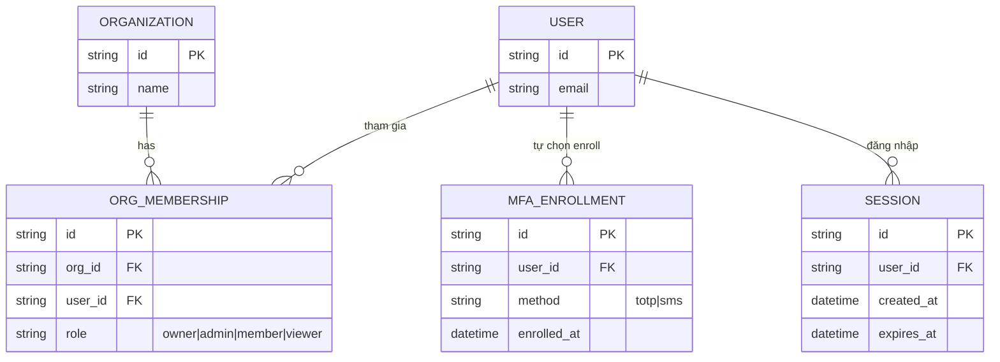
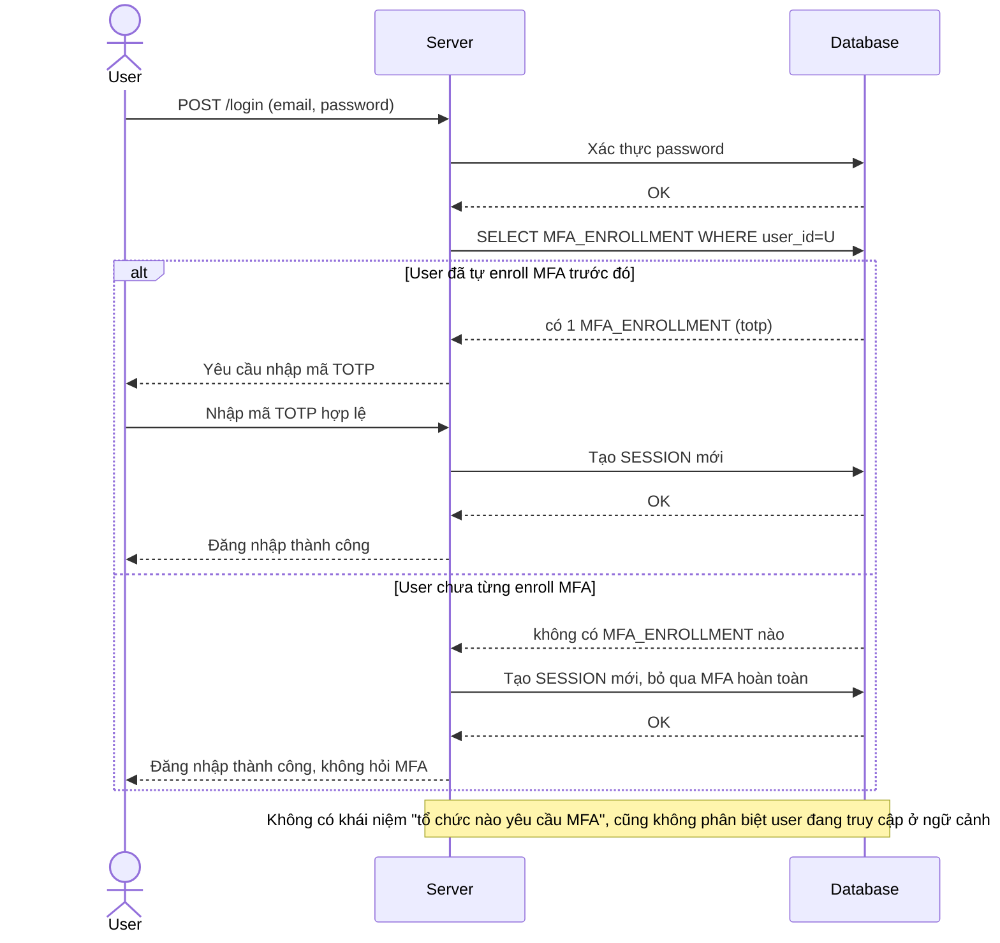
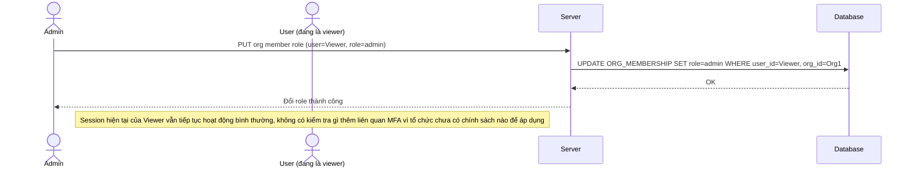
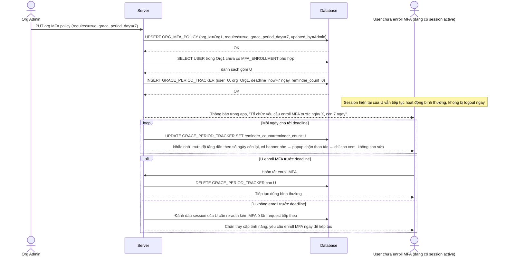
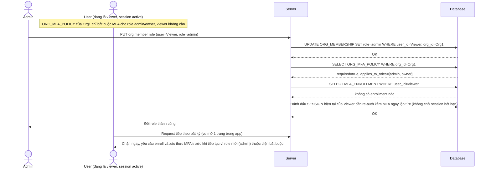
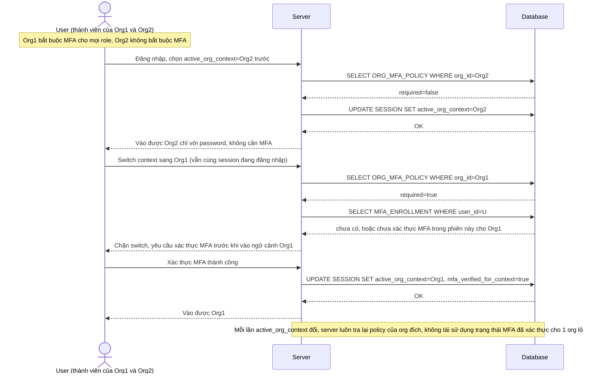
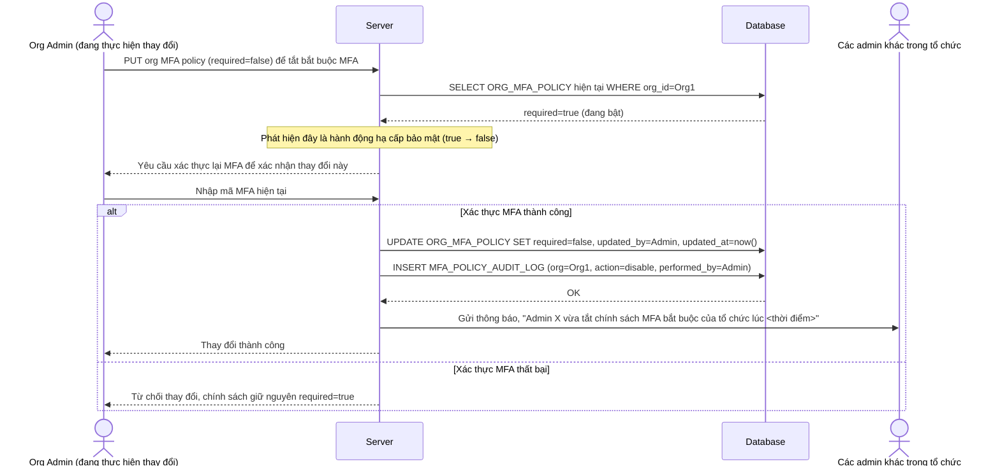
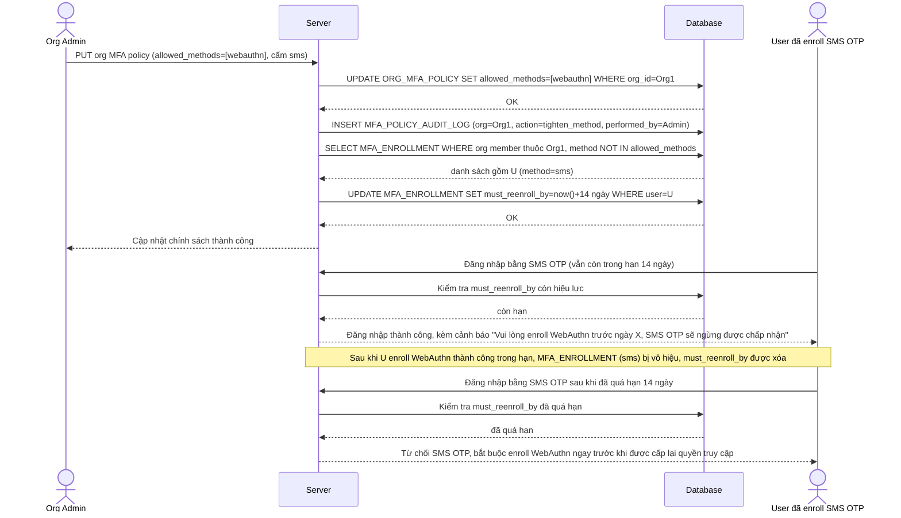

# SaaS B2B cho phép admin công ty tự cấu hình chính sách MFA bắt buộc theo tổ chức

**Hệ thống:** Một SaaS quản lý dự án/CRM bán cho nhiều công ty khách hàng (multi-tenant), mỗi công ty có admin riêng quản lý chính sách bảo mật cho nhân viên của họ.

**Vai trò của flow:** Cho phép org admin tự cấu hình chính sách MFA bắt buộc (bật/tắt, phương thức được phép, áp dụng cho nhóm role nào) riêng cho tổ chức của họ, độc lập với các tenant khác trên cùng nền tảng.

**Yêu cầu cụ thể:**
- Khi admin bật chính sách bắt buộc MFA cho toàn tổ chức, những user đang có session hoạt động nhưng chưa enroll MFA không thể bị ép logout tức thì vì sẽ gây gián đoạn hàng loạt, nhưng cũng không thể được dùng vô thời hạn mà không enroll — cần một grace period có giới hạn rõ ràng kèm nhắc nhở tăng dần.
- Chính sách MFA có thể cấu hình khác nhau theo role trong cùng tổ chức (ví dụ chỉ bắt buộc cho admin/owner, không bắt buộc cho viewer) — khi một user được đổi role giữa chừng (từ viewer lên admin), chính sách MFA mới phải áp dụng ngay, không chờ tới lần đăng nhập kế tiếp mới phát hiện ra là chưa đủ điều kiện.
- Vì một tài khoản email có thể tham gia nhiều tổ chức trên cùng nền tảng với chính sách MFA khác nhau, cần định nghĩa rõ MFA áp dụng theo ngữ cảnh org nào trong phiên làm việc, tránh tình huống user né được yêu cầu MFA của tổ chức chặt hơn bằng cách chuyển sang truy cập qua context của tổ chức khác lỏng hơn.
- Khi admin hạ cấp hoặc tắt chính sách MFA bắt buộc (ví dụ do đổi nhà cung cấp SSO), đây là hành động làm giảm bảo mật toàn tổ chức nên cần yêu cầu chính admin đó xác thực MFA để thực hiện thay đổi, đồng thời ghi log và thông báo cho các admin khác trong tổ chức biết.
- Khi tổ chức bắt buộc một phương thức MFA cụ thể chặt hơn (ví dụ chỉ cho WebAuthn, cấm SMS OTP), những user đã enroll SMS theo chính sách cũ phải được yêu cầu enroll lại phương thức mới trong một mốc thời gian rõ ràng, không bị mất quyền truy cập đột ngột ngay khi chính sách vừa thay đổi.

---

# Base ERD — SaaS multi-tenant chưa có chính sách MFA theo tổ chức

Đây là **base**: trạng thái SaaS quản lý dự án/CRM *trước khi* org admin có thể tự cấu hình chính sách MFA. Suy luận từ đề bài, base đã có `ORGANIZATION` (tenant), `USER` có thể tham gia nhiều tổ chức qua `ORG_MEMBERSHIP` (kèm `role`), và `SESSION` khi user đăng nhập. MFA ở base chỉ tồn tại dưới dạng tùy chọn cá nhân (`MFA_ENROLLMENT`, user tự bật nếu muốn), hoàn toàn không có khái niệm chính sách bắt buộc theo tổ chức hay theo role.

---

# Base sequence — Login (MFA chỉ là tùy chọn cá nhân, không có chính sách tổ chức)

Đây là **base**, flow đăng nhập hiện tại: hệ thống kiểm tra email/password, sau đó chỉ hỏi MFA nếu chính user đó đã tự nguyện enroll trước đây — không hề tra cứu chính sách của tổ chức mà user đang truy cập. Đây là tiền đề cho toàn bộ đề bài, vì org admin hiện chưa có cách nào ép MFA theo tổ chức của họ.

---

# Base sequence — Change member role (không có tác động MFA vì chưa có chính sách)

Đây là **base**, flow admin đổi role của 1 thành viên trong tổ chức. Ở base, việc đổi role chỉ ảnh hưởng tới quyền truy cập tính năng (permission), hoàn toàn không liên quan gì tới MFA vì tổ chức chưa có chính sách MFA theo role. Đây là tiền đề cho yêu cầu 2 của đề bài.

---

# Enhance ERD — Chính sách MFA theo tổ chức, theo role, theo ngữ cảnh session

Đây là ERD **sau khi** enhance được áp dụng lên base. So với base, thêm các entity/trường sau, ứng trực tiếp với từng yêu cầu:

- `ORG_MFA_POLICY` (mới) — đáp ứng yêu cầu 2 và 5 (cấu hình bắt buộc/tắt, phương thức được phép, áp dụng cho role nào, riêng theo từng `ORGANIZATION`).
- `GRACE_PERIOD_TRACKER` (mới) — đáp ứng yêu cầu 1 (grace period giới hạn kèm đếm số lần nhắc nhở tăng dần cho user chưa enroll khi policy vừa bật).
- `SESSION.active_org_context` — đáp ứng yêu cầu 3 (mỗi session gắn với 1 ngữ cảnh org cụ thể, MFA được áp theo đúng policy của org đang active, tránh né qua context org khác lỏng hơn).
- `MFA_POLICY_AUDIT_LOG` (mới) — đáp ứng yêu cầu 4 (ghi log và thông báo khi admin hạ cấp/tắt chính sách, hành động này tự nó cũng yêu cầu MFA).
- `MFA_ENROLLMENT.method` cần khớp `ORG_MFA_POLICY.allowed_methods`, thêm `must_reenroll_by` — đáp ứng yêu cầu 5 (user enroll SMS theo policy cũ phải enroll lại phương thức mới trong mốc thời gian rõ ràng).

```mermaid
erDiagram
    ORGANIZATION ||--o{ ORG_MEMBERSHIP : has
    ORGANIZATION ||--|| ORG_MFA_POLICY : "có chính sách MFA"
    ORGANIZATION ||--o{ MFA_POLICY_AUDIT_LOG : "ghi log thay đổi policy"
    USER ||--o{ ORG_MEMBERSHIP : "tham gia"
    USER ||--o{ MFA_ENROLLMENT : "enroll"
    USER ||--o{ SESSION : "đăng nhập"
    USER ||--o{ GRACE_PERIOD_TRACKER : "đang trong grace period"

    ORGANIZATION {
        string id PK
        string name
    }
    USER {
        string id PK
        string email
    }
    ORG_MEMBERSHIP {
        string id PK
        string org_id FK
        string user_id FK
        string role "owner|admin|member|viewer"
    }
    ORG_MFA_POLICY {
        string org_id PK
        boolean required
        string allowed_methods "vd: webauthn only, hoặc totp+sms"
        string applies_to_roles "vd: [admin, owner]"
        int grace_period_days
        string updated_by FK
        datetime updated_at
    }
    MFA_ENROLLMENT {
        string id PK
        string user_id FK
        string method "totp|sms|webauthn"
        datetime enrolled_at
        datetime must_reenroll_by "hạn enroll lại nếu method cũ không còn được policy mới cho phép"
    }
    GRACE_PERIOD_TRACKER {
        string id PK
        string user_id FK
        string org_id FK
        datetime deadline
        int reminder_count
        datetime last_reminded_at
    }
    MFA_POLICY_AUDIT_LOG {
        string id PK
        string org_id FK
        string action "enable|disable|downgrade|tighten_method"
        string performed_by FK
        datetime performed_at
    }
    SESSION {
        string id PK
        string user_id FK
        string active_org_context FK "org đang active trong phiên này"
        datetime created_at
        datetime expires_at
    }
```

---

# Enhance sequence — Enable org MFA policy (grace period có giới hạn + nhắc nhở tăng dần)

Đây là **enhance**, flow mới phát sinh từ đề bài — org admin bật chính sách MFA bắt buộc cho toàn tổ chức. Vì user đang có session hoạt động nhưng chưa enroll không thể bị ép logout tức thì (gây gián đoạn hàng loạt) nhưng cũng không thể dùng vô thời hạn, hệ thống tạo `GRACE_PERIOD_TRACKER` với hạn rõ ràng và nhắc nhở tăng dần. Đáp ứng yêu cầu 1 của đề bài.

---

# Enhance sequence — Change member role (chính sách MFA áp dụng ngay, không chờ login lại)

Đây là **enhance** của flow `change-member-role` đã có ở base. So với base (đổi role không ảnh hưởng gì tới MFA), nay khi role thay đổi, hệ thống lập tức tra cứu lại `ORG_MFA_POLICY.applies_to_roles` cho role mới và áp dụng ngay lên session đang hoạt động, không chờ tới lần đăng nhập kế tiếp mới phát hiện ra chưa đủ điều kiện. Đáp ứng yêu cầu 2 của đề bài.

---

# Enhance sequence — Switch org context (MFA áp theo đúng ngữ cảnh org đang active)

Đây là **enhance**, flow mới phát sinh từ đề bài — user có 1 email tham gia nhiều tổ chức với chính sách MFA khác nhau, chuyển ngữ cảnh làm việc giữa các tổ chức trong cùng phiên đăng nhập. Mỗi lần chuyển, hệ thống đánh giá lại MFA theo đúng `ORG_MFA_POLICY` của org đang được chọn, để user không thể né MFA chặt của 1 tổ chức bằng cách chuyển qua tổ chức khác lỏng hơn rồi vẫn thao tác trên dữ liệu nhạy cảm. Đáp ứng yêu cầu 3 của đề bài.

---

# Enhance sequence — Downgrade org MFA policy (tự yêu cầu MFA + log + thông báo admin khác)

Đây là **enhance**, flow mới phát sinh từ đề bài — org admin hạ cấp hoặc tắt chính sách MFA bắt buộc (vd đổi nhà cung cấp SSO). Vì đây là hành động làm giảm bảo mật toàn tổ chức, chính admin thực hiện phải tự xác thực MFA trước khi đổi được, đồng thời hệ thống ghi log và thông báo cho các admin khác trong tổ chức. Đáp ứng yêu cầu 4 của đề bài.

---

# Enhance sequence — Tighten MFA method policy (buộc enroll lại phương thức mới, có thời hạn)

Đây là **enhance**, flow mới phát sinh từ đề bài — org admin siết chính sách sang chỉ cho phép 1 phương thức MFA chặt hơn (vd chỉ WebAuthn, cấm SMS OTP). Những user đã enroll SMS theo chính sách cũ được cấp thời hạn rõ ràng để enroll lại, không bị mất quyền truy cập ngay khi chính sách vừa đổi. Đáp ứng yêu cầu 5 của đề bài.

