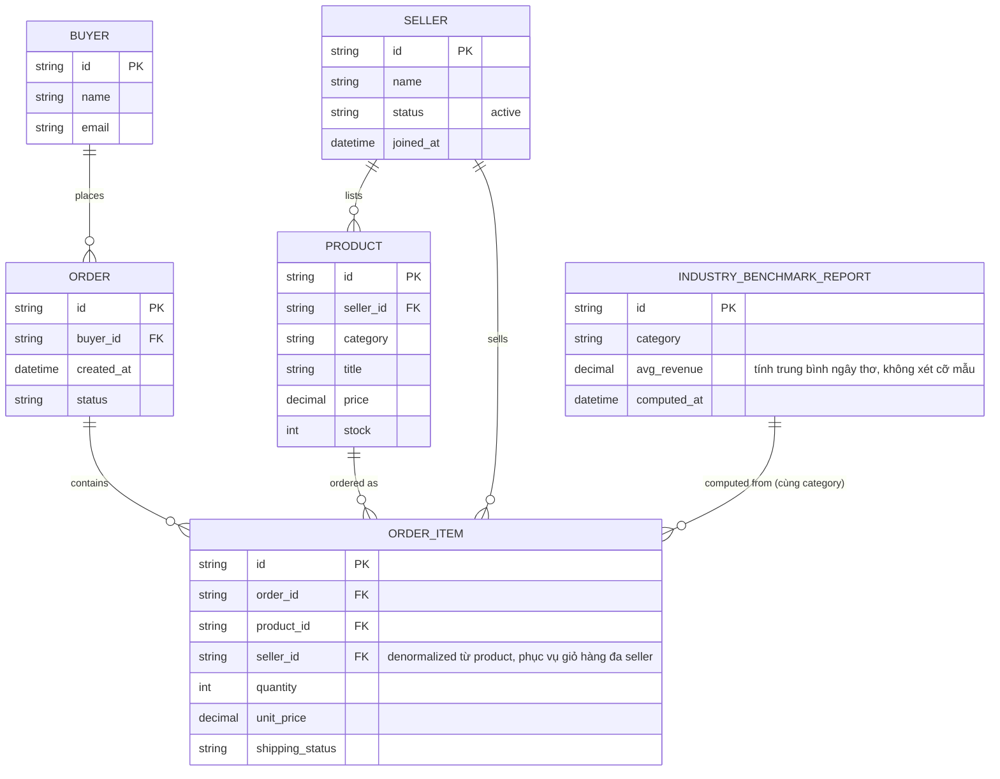
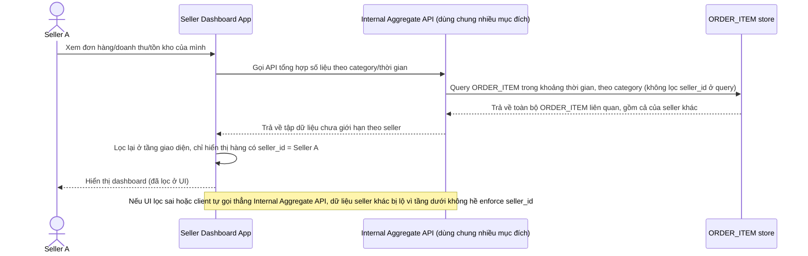
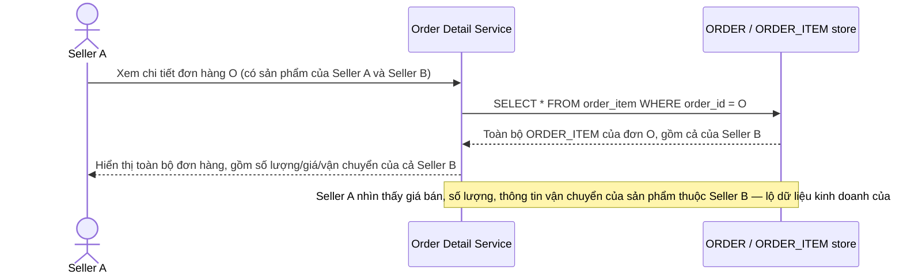
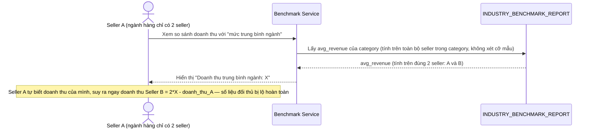
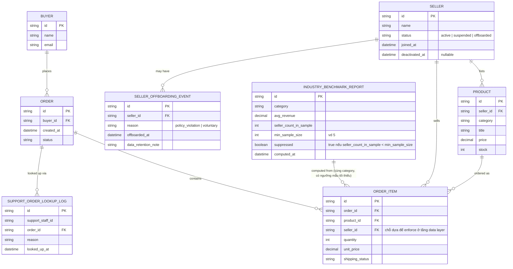
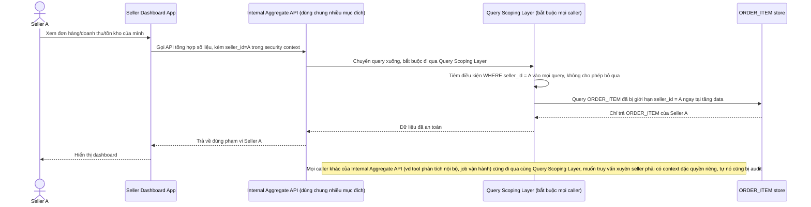
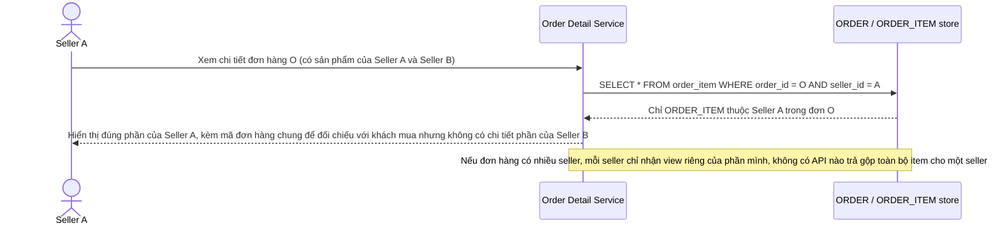
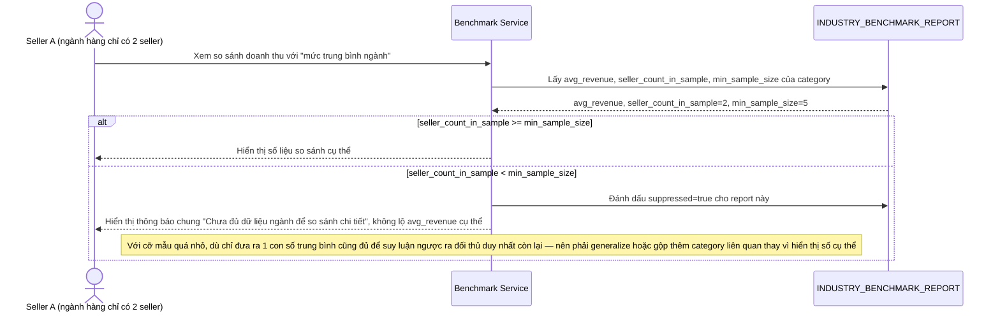
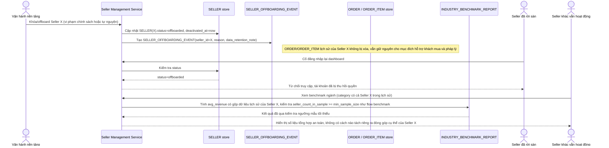
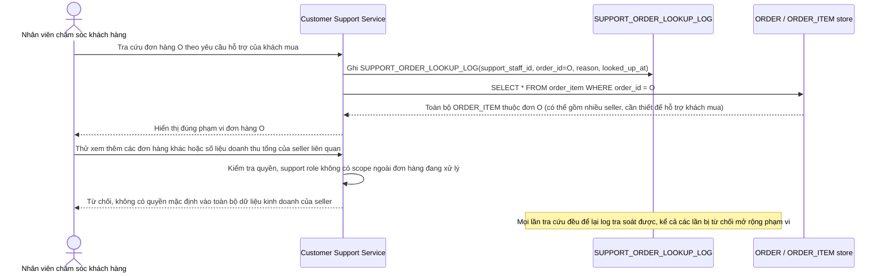

# Cách ly dữ liệu bán hàng giữa các seller trên marketplace dùng chung nền tảng

**Hệ thống:** Một marketplace cho phép nhiều người bán (seller) độc lập đăng sản phẩm và bán hàng trên cùng một nền tảng dùng chung hạ tầng, mỗi seller có dữ liệu đơn hàng, doanh thu, và thông tin khách hàng của riêng họ.

**Vai trò của flow:** Cách ly ở đây phải đảm bảo một seller không bao giờ nhìn thấy dữ liệu bán hàng/doanh thu của seller khác dù họ đang cùng thao tác trên chung một giao diện quản lý (dashboard người bán) và chung hạ tầng backend, khác với mô hình một công ty một tenant thông thường vì số lượng seller có thể lên tới hàng chục nghìn và liên tục có seller mới tham gia/rời đi.

**Yêu cầu cụ thể:**
- Mọi truy vấn liên quan tới đơn hàng, doanh thu, tồn kho trên dashboard người bán phải bị giới hạn đúng theo `seller_id` ở tầng thấp nhất (không dựa vào việc ẩn nút bấm trên giao diện), kể cả với các API nội bộ dùng chung để tính toán số liệu tổng hợp cho nhiều mục đích khác nhau của nền tảng.
- Xử lý đúng trường hợp một đơn hàng có sản phẩm từ nhiều seller khác nhau trong cùng một giỏ hàng của khách mua — mỗi seller chỉ được xem phần đơn hàng liên quan tới sản phẩm của mình (thông tin vận chuyển, số lượng, giá của phần họ bán), không được thấy toàn bộ chi tiết đơn hàng gộp bao gồm phần của seller khác.
- Đảm bảo các báo cáo/thống kê xếp hạng do nền tảng cung cấp cho seller (ví dụ so sánh hiệu suất bán hàng với "mức trung bình ngành") không bị suy luận ngược ra số liệu cụ thể của một seller đối thủ cụ thể — đặc biệt khi ngành hàng đó chỉ có rất ít seller tham gia khiến số liệu trung bình gần như lộ số liệu của một seller cụ thể.
- Xử lý trường hợp một seller ngừng hoạt động/bị khóa tài khoản (vi phạm chính sách hoặc tự nguyện rời sàn) — dữ liệu lịch sử đơn hàng liên quan tới khách mua vẫn cần được giữ cho mục đích hỗ trợ khách hàng và pháp lý, nhưng seller đã rời sàn không được tiếp tục truy cập vào dữ liệu đó, và các seller khác cũng không được vô tình thấy dữ liệu của seller đã rời sàn qua các báo cáo tổng hợp toàn nền tảng.
- Đảm bảo tính năng chăm sóc khách hàng của nền tảng (nhân viên marketplace hỗ trợ khách mua) khi cần tra cứu một đơn hàng cụ thể chỉ được xem đúng phạm vi dữ liệu liên quan tới đơn hàng đó, không được có quyền truy cập mặc định vào toàn bộ dữ liệu kinh doanh của seller liên quan, và mọi lần tra cứu phải được ghi log lại.

---

# Base ERD — Marketplace trước khi siết cách ly seller ở tầng dữ liệu

Đây là **base**: mô hình dữ liệu suy luận từ ngữ cảnh đề bài, thể hiện trạng thái hệ thống **trước khi** siết cách ly. Đề bài đối chiếu trực tiếp với việc hiện tại chỉ "ẩn nút bấm trên giao diện" — nên base được suy luận là một marketplace đã có đủ: seller, sản phẩm, đơn hàng có thể gộp nhiều seller trong cùng giỏ hàng (`ORDER_ITEM.seller_id` đã tồn tại vì đây là cấu trúc tự nhiên của giỏ hàng đa seller, không phải điều enhance mới thêm), và một báo cáo benchmark ngành đã có sẵn nhưng tính trung bình ngây thơ không xét cỡ mẫu. Base **chưa có** cơ chế enforce `seller_id` ở tầng data/query layer (chỉ dựa vào UI ẩn), **chưa có** ngưỡng mẫu tối thiểu cho benchmark, **chưa có** quy trình offboarding seller giữ lịch sử nhưng thu hồi quyền truy cập, và **chưa có** log tra cứu đơn hàng có phạm vi giới hạn cho nhân viên hỗ trợ — những phần này là enhance.

---

# Base sequence — Xem dashboard người bán (lọc ở tầng UI, không phải tầng data)

Đây là **base**, flow "Xem dashboard người bán" ở trạng thái hiện tại — API nội bộ dùng chung cho nhiều mục đích của nền tảng trả về dữ liệu chưa được giới hạn chặt theo `seller_id`, việc chỉ hiển thị đúng dữ liệu của seller đang đăng nhập được xử lý ở tầng giao diện. Flow này liên quan mật thiết tới enhance vì yêu cầu 1 của đề bài chính là chuyển việc giới hạn này xuống tầng thấp nhất thay vì dựa vào UI.

---

# Base sequence — Xem chi tiết đơn hàng đa seller (lộ toàn bộ đơn hàng)

Đây là **base**, flow "Xem chi tiết đơn hàng" ở trạng thái hiện tại — khi một đơn hàng có sản phẩm từ nhiều seller, seller nào mở đơn hàng cũng thấy toàn bộ chi tiết gộp, kể cả phần của seller khác. Flow này liên quan mật thiết tới enhance vì yêu cầu 2 của đề bài chính là sửa đúng lỗ hổng này.

---

# Base sequence — Xem benchmark ngành (trung bình ngây thơ, có thể suy luận ngược)

Đây là **base**, flow "Xem báo cáo so sánh hiệu suất với trung bình ngành" ở trạng thái hiện tại — tính trung bình doanh thu toàn bộ seller trong category mà không xét số lượng seller tham gia. Flow này liên quan mật thiết tới enhance vì yêu cầu 3 của đề bài chính là chặn kiểu suy luận ngược này.

---

# Enhance ERD — sau khi siết cách ly seller ở tầng dữ liệu

Đây là ERD **sau khi** enhance được áp dụng lên base. So với base, có 3 nhóm thay đổi/entity mới, ứng trực tiếp với yêu cầu 3, 4, 5 trong đề bài (yêu cầu 1 và 2 là thay đổi ở tầng enforcement/query logic trên đúng các entity đã có sẵn — `ORDER_ITEM.seller_id` vẫn là chỗ dựa để lọc, không cần entity mới):

- `SELLER` (sửa) — mở rộng `status` thêm `suspended | offboarded` và `deactivated_at`, phục vụ yêu cầu 4.
- `INDUSTRY_BENCHMARK_REPORT` (sửa) — thêm `seller_count_in_sample`, `min_sample_size`, `suppressed` để chặn suy luận ngược khi cỡ mẫu quá nhỏ (yêu cầu 3), đồng thời vẫn tính đúng khi có seller đã offboard (yêu cầu 4).
- `SELLER_OFFBOARDING_EVENT` (mới) — ghi nhận lý do và thời điểm seller rời sàn, phục vụ thu hồi quyền truy cập trong khi giữ lại dữ liệu lịch sử cho hỗ trợ khách hàng/pháp lý.
- `SUPPORT_ORDER_LOOKUP_LOG` (mới) — log mọi lần nhân viên chăm sóc khách hàng tra cứu một đơn hàng cụ thể, phục vụ yêu cầu 5.

---

# Enhance sequence — Xem dashboard người bán (enforce seller_id ở tầng data layer)

Đây là **enhance**, cùng flow "Xem dashboard người bán" đã có ở base nhưng nay thay đổi theo yêu cầu 1 của đề bài: `seller_id` được enforce ngay tại tầng data/query layer — kể cả Internal Aggregate API dùng chung cho nhiều mục đích khác của nền tảng — thay vì chỉ lọc ở UI như base.

---

# Enhance sequence — Xem chi tiết đơn hàng đa seller (chỉ thấy phần của mình)

Đây là **enhance**, cùng flow "Xem chi tiết đơn hàng" đã có ở base nhưng nay thay đổi theo yêu cầu 2 của đề bài: mỗi seller tham gia một đơn hàng chỉ xem được `ORDER_ITEM` (số lượng, giá, vận chuyển) thuộc về sản phẩm của chính mình, không thấy toàn bộ đơn hàng gộp như base.

---

# Enhance sequence — Xem benchmark ngành (chặn suy luận ngược khi cỡ mẫu nhỏ)

Đây là **enhance**, cùng flow "Xem báo cáo so sánh hiệu suất với trung bình ngành" đã có ở base nhưng nay thay đổi theo yêu cầu 3 của đề bài: trước khi trả số liệu so sánh cụ thể, hệ thống kiểm tra `seller_count_in_sample` so với `min_sample_size`, nếu ngành hàng quá ít seller thì không tiết lộ số liệu chi tiết để tránh suy luận ngược ra đối thủ cụ thể.

---

# Enhance sequence — Seller offboarding (thu hồi quyền, giữ lịch sử, không lộ qua báo cáo tổng hợp)

Đây là **enhance**, flow hoàn toàn mới, phát sinh từ enhance — base không có quy trình xử lý khi seller ngừng hoạt động, chỉ có `status = active` cố định. Đáp ứng yêu cầu 4 của đề bài: dữ liệu lịch sử đơn hàng vẫn giữ cho hỗ trợ khách hàng/pháp lý, seller đã rời sàn mất quyền truy cập, và các seller khác không vô tình thấy dữ liệu của seller đã rời qua báo cáo tổng hợp toàn nền tảng.

---

# Enhance sequence — Nhân viên chăm sóc khách hàng tra cứu đơn hàng (phạm vi giới hạn, có log)

Đây là **enhance**, flow hoàn toàn mới, phát sinh từ enhance — base không có flow riêng cho nhân viên chăm sóc khách hàng, ngụ ý trước đó không có ranh giới rõ giữa quyền hỗ trợ và toàn bộ dữ liệu kinh doanh seller. Đáp ứng yêu cầu 5 của đề bài: khi tra cứu một đơn hàng cụ thể để hỗ trợ khách mua, nhân viên chỉ thấy đúng phạm vi đơn hàng đó, không có quyền mặc định vào toàn bộ dữ liệu kinh doanh của seller liên quan, và mọi lần tra cứu đều được ghi log.

