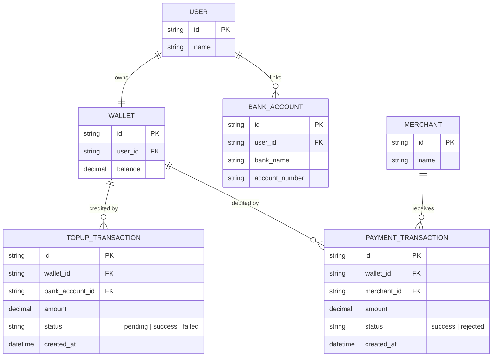
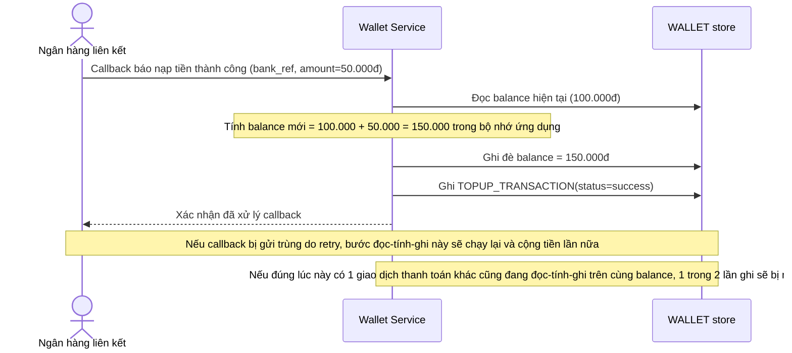
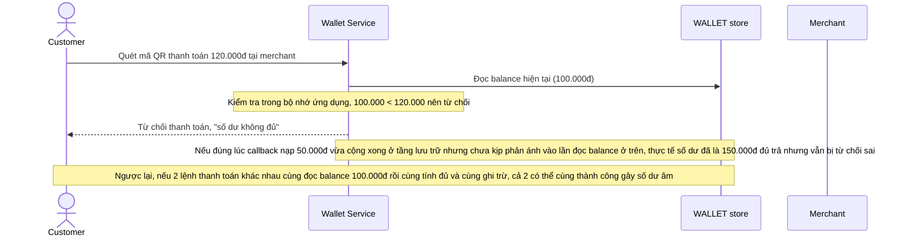
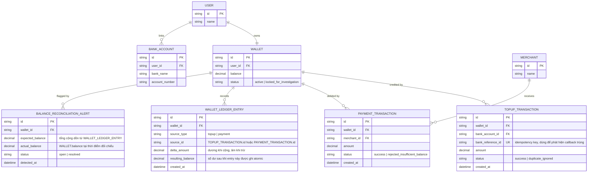
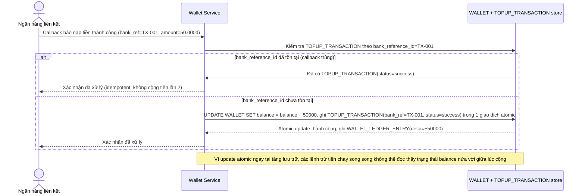
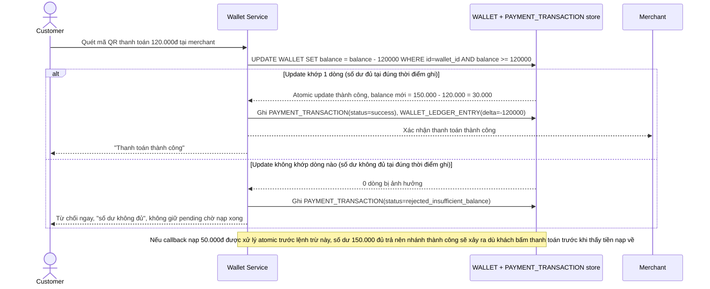
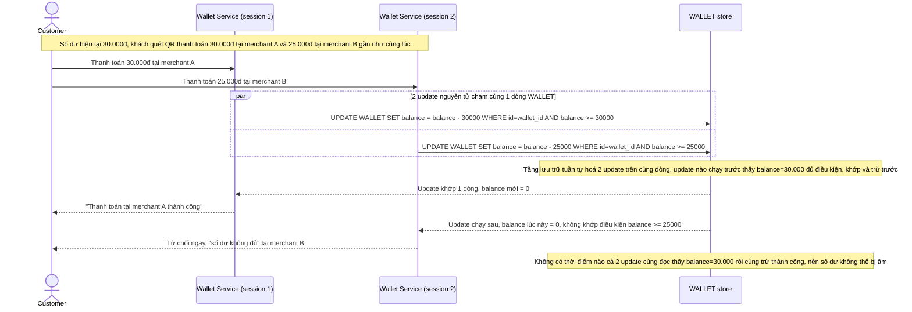
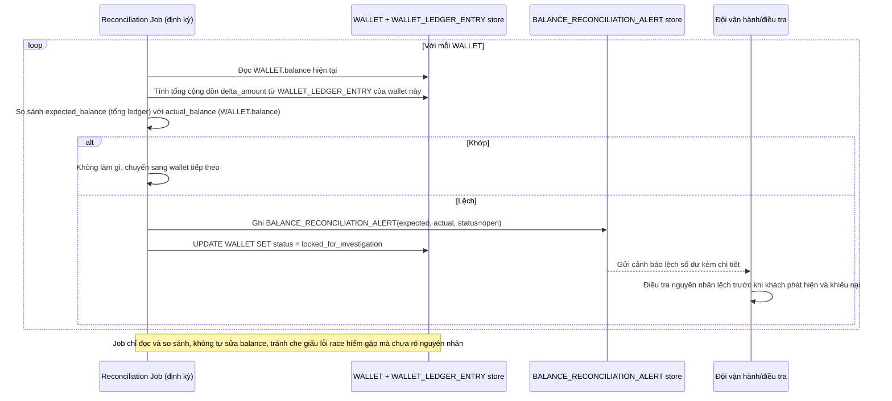

# Nạp tiền và thanh toán từ ví điện tử chạm cùng 1 số dư gần như đồng thời

**Hệ thống:** Một ví điện tử cho phép người dùng nạp tiền từ ngân hàng liên kết vào ví và dùng số dư ví để thanh toán tại nhiều điểm chấp nhận thanh toán khác nhau (trong app, tại các merchant đối tác).

**Vai trò của flow:** Flow phải đảm bảo số dư ví được cộng/trừ chính xác khi lệnh nạp tiền và lệnh thanh toán chạm vào cùng 1 số dư gần như đồng thời, không để số dư bị âm hoặc bị tính sai do 2 luồng cập nhật race nhau trên cùng 1 số dư.

**Yêu cầu cụ thể:**
- Mô tả cụ thể: khách có số dư 100.000đ, cùng lúc có 1 lệnh nạp tiền 50.000đ đang được xử lý (callback từ ngân hàng vừa báo thành công) và 1 lệnh thanh toán 120.000đ tại merchant đang được xử lý — nếu 2 luồng đều đọc số dư 100.000đ trước khi tính toán theo kiểu đọc-tính-ghi không atomic, lệnh thanh toán có thể bị từ chối sai (100.000 < 120.000 dù thực tế sau khi nạp là 150.000 đủ trả) hoặc tệ hơn cả 2 ghi đè lẫn nhau gây sai số dư cuối cùng; yêu cầu dùng update nguyên tử có điều kiện, trừ tiền chỉ khi số dư đủ tại đúng thời điểm ghi, không dựa vào số dư đã đọc trước đó.
- Quy định rõ hệ thống không cam kết thứ tự "nạp trước hay trừ trước" theo thời điểm người dùng bấm, mà theo thứ tự thực sự được xử lý atomic tại tầng lưu trữ — nếu lệnh thanh toán được xử lý trước khi tiền nạp kịp cộng vào và số dư tại thời điểm đó không đủ, phải từ chối thanh toán rõ ràng ngay, không giữ pending chờ nạp xong rồi tự động thử lại ngầm mà không thông báo cho khách.
- Mô tả cụ thể: khách thực hiện 2 lệnh thanh toán khác nhau gần như đồng thời từ 2 thiết bị/session (ví dụ quét mã QR ở 2 merchant liên tiếp trong vài giây) trong khi số dư chỉ đủ cho 1 trong 2 lệnh — yêu cầu update nguyên tử trừ số dư có điều kiện đủ số dư để chỉ 1 giao dịch thành công, giao dịch còn lại bị từ chối ngay với lý do rõ ràng "số dư không đủ", không để cả 2 cùng trừ thành công gây số dư âm.
- Callback nạp tiền từ ngân hàng đến trễ hoặc bị gửi trùng (do retry) đúng lúc ví đang có nhiều giao dịch trừ tiền khác diễn ra: xử lý idempotent theo mã giao dịch nạp tiền để không cộng tiền 2 lần khi callback đến trùng, đồng thời đảm bảo việc cộng tiền vẫn atomic với các giao dịch trừ tiền đang chạy song song, không để có khoảng hở giữa lúc callback bắt đầu xử lý và lúc số dư thực sự được cộng.
- Có job định kỳ đối chiếu tổng số dư ví của từng khách với tổng lịch sử giao dịch (nạp trừ hoàn) để phát hiện lệch do lỗi race hiếm gặp lọt qua các cơ chế atomic, cảnh báo và tạm khóa giao dịch của tài khoản bị lệch để điều tra trước khi khách phát hiện và khiếu nại.

---

# Base ERD — Ví điện tử trước khi có atomic update chống race trên số dư

Đây là **base**: mô hình dữ liệu suy luận từ ngữ cảnh đề bài, thể hiện trạng thái hệ thống **trước khi** áp cơ chế update nguyên tử có điều kiện. Đề bài nói tới ví liên kết ngân hàng để nạp tiền và dùng số dư để thanh toán tại nhiều merchant — nên base cần đủ: user, ví với 1 trường số dư đơn giản, tài khoản ngân hàng liên kết, lịch sử nạp và lịch sử thanh toán. Base **chưa có** idempotency key cho callback nạp tiền, chưa có ledger để đối chiếu, chưa có cơ chế khóa tài khoản khi lệch số dư — những thứ đó là phần enhance.

---

# Base sequence — Nạp tiền vào ví (đọc-tính-ghi không atomic)

Đây là **base**, flow "Nạp tiền từ ngân hàng liên kết" ở trạng thái hiện tại — service đọc số dư hiện tại, cộng thêm tiền nạp trong bộ nhớ rồi ghi đè lại, không kiểm tra idempotency theo mã giao dịch ngân hàng. Flow này liên quan mật thiết tới enhance vì đây chính là luồng tạo ra khoảng hở race khi callback nạp tiền chạm cùng lúc với giao dịch trừ tiền khác.

---

# Base sequence — Thanh toán bằng số dư ví (đọc-tính-ghi không atomic)

Đây là **base**, flow "Thanh toán tại merchant" ở trạng thái hiện tại — service đọc số dư, kiểm tra đủ hay không trong bộ nhớ ứng dụng, rồi mới trừ tiền và ghi lại, không dựa trên update nguyên tử tại tầng lưu trữ. Flow này liên quan mật thiết tới enhance vì đây chính là luồng có thể duyệt nhầm thanh toán sai hoặc gây số dư âm khi 2 giao dịch chạm cùng 1 số dư gần như đồng thời.

---

# Enhance ERD — Thêm idempotency, ledger đối chiếu và cảnh báo lệch số dư

Đây là **enhance**, mô hình dữ liệu sau khi áp cơ chế update nguyên tử có điều kiện lên base. So với base, `TOPUP_TRANSACTION` thêm `bank_reference_id` unique để idempotent theo mã giao dịch ngân hàng khi callback đến trùng, `WALLET` thêm `status` để có thể tạm khóa khi phát hiện lệch số dư. Thêm mới `WALLET_LEDGER_ENTRY` — ghi bất biến mọi lần cộng/trừ số dư, làm nguồn để job đối chiếu định kỳ tính tổng và so sánh với `WALLET.balance`; và `BALANCE_RECONCILIATION_ALERT` — ghi nhận lần lệch số dư phát hiện được, kèm trạng thái điều tra.

---

# Enhance sequence — Nạp tiền atomic + idempotent theo mã giao dịch ngân hàng

Đây là **enhance**, flow "Nạp tiền từ ngân hàng liên kết" sau khi áp update nguyên tử có điều kiện. So với base, flow này thay đổi ở 2 điểm: (1) kiểm tra `bank_reference_id` đã tồn tại trong `TOPUP_TRANSACTION` chưa trước khi cộng tiền, để callback trùng do retry không cộng 2 lần, (2) việc cộng số dư dùng update nguyên tử `balance = balance + amount` ngay tại tầng lưu trữ, không có khoảng hở giữa lúc callback bắt đầu xử lý và lúc số dư thực sự được cộng, nên các giao dịch trừ tiền chạy song song luôn thấy đúng 1 trong 2 trạng thái trước/sau, không thấy trạng thái lỡ dở.

---

# Enhance sequence — Thanh toán bằng update nguyên tử có điều kiện

Đây là **enhance**, flow "Thanh toán tại merchant" sau khi áp update nguyên tử có điều kiện. So với base, flow này không còn đọc balance rồi tính đủ/thiếu trong bộ nhớ ứng dụng nữa — việc trừ tiền và kiểm tra đủ số dư gộp làm 1 câu update nguyên tử duy nhất tại tầng lưu trữ (`balance = balance - amount WHERE balance >= amount`), nên callback nạp tiền chạm đúng lúc thanh toán vẫn cho kết quả đúng theo thứ tự thực sự xử lý tại tầng lưu trữ, không theo thời điểm khách bấm nút. Nếu tại đúng thời điểm ghi số dư không đủ, hệ thống từ chối ngay, không giữ pending chờ nạp xong rồi âm thầm thử lại.

---

# Enhance sequence — 2 lệnh thanh toán đồng thời chỉ 1 lệnh thành công

Đây là **enhance**, flow mới phát sinh từ enhance — khách quét mã QR thanh toán ở 2 merchant gần như đồng thời từ 2 thiết bị/session trong khi số dư chỉ đủ cho 1 trong 2 lệnh. Flow này minh hoạ trực tiếp tác dụng của update nguyên tử có điều kiện ở file `6-enhance-payment-sqd.md`: 2 update chạm cùng 1 dòng `WALLET` được tầng lưu trữ tuần tự hoá, chỉ update nào còn thấy đủ số dư mới khớp điều kiện và thành công.

---

# Enhance sequence — Job định kỳ đối chiếu số dư ví với lịch sử giao dịch

Đây là **enhance**, flow hoàn toàn mới phát sinh từ enhance — job định kỳ so sánh `WALLET.balance` với tổng cộng dồn từ `WALLET_LEDGER_ENTRY` (nạp, trừ, hoàn) của từng khách, nhằm bắt các trường hợp lệch hiếm gặp lọt qua cơ chế atomic (vd lỗi hạ tầng, bug nghiệp vụ khác), cảnh báo và tạm khóa giao dịch của tài khoản bị lệch trước khi khách phát hiện và khiếu nại.

