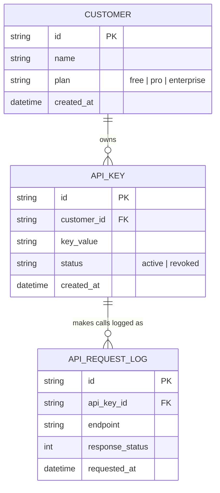
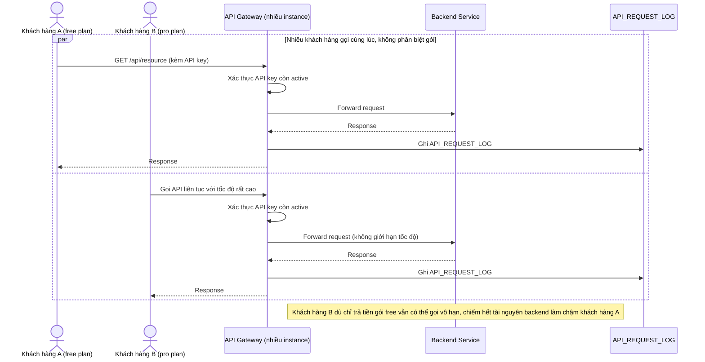
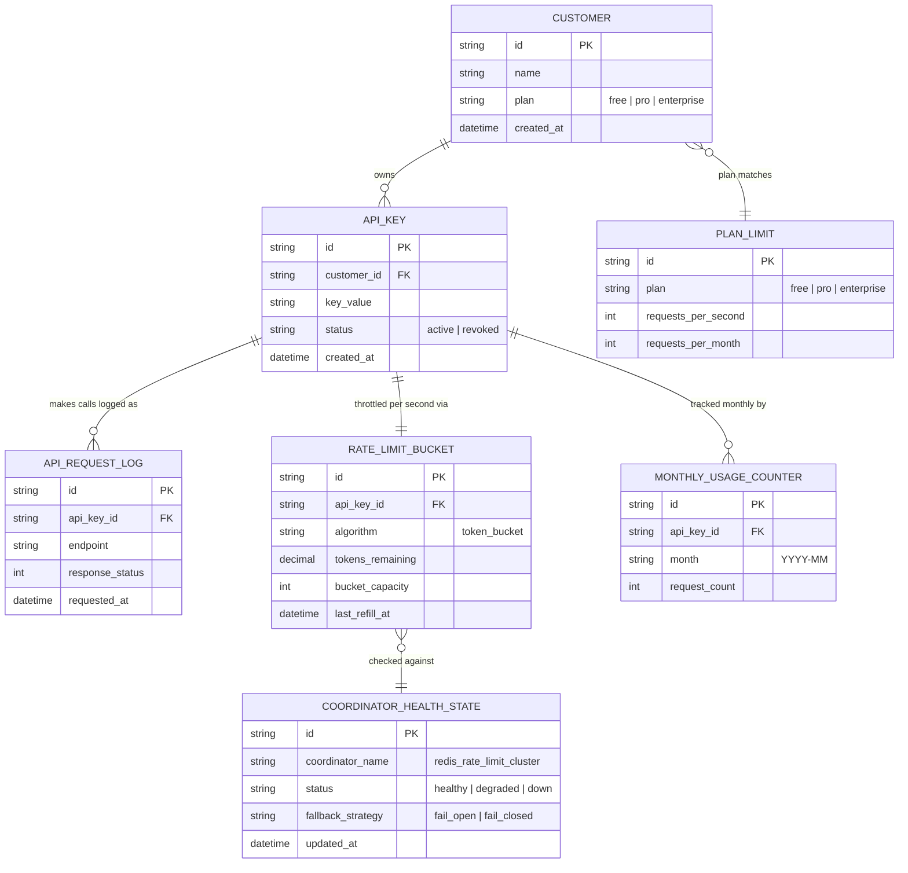
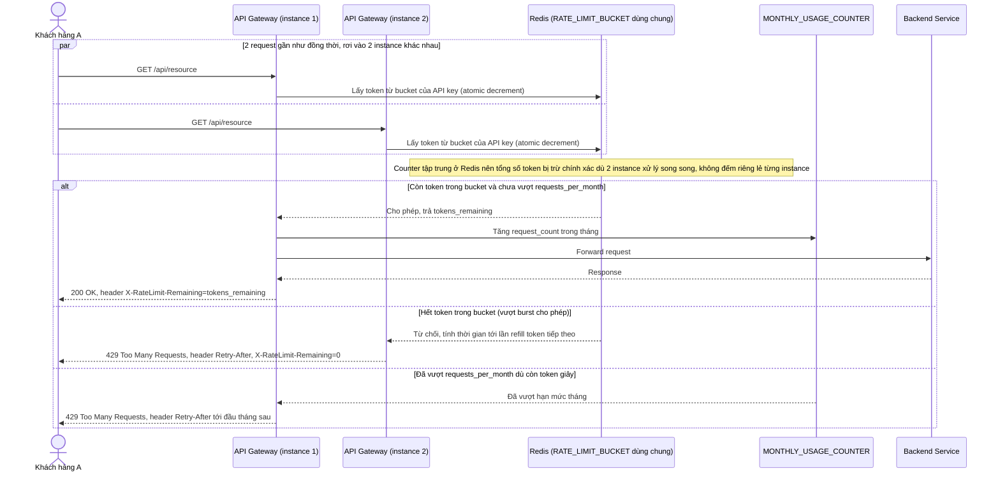
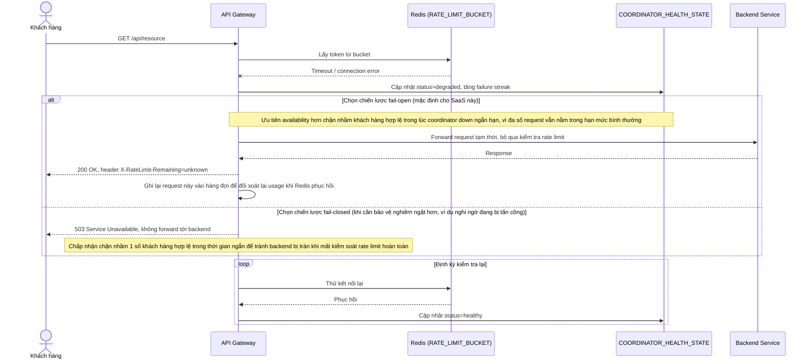
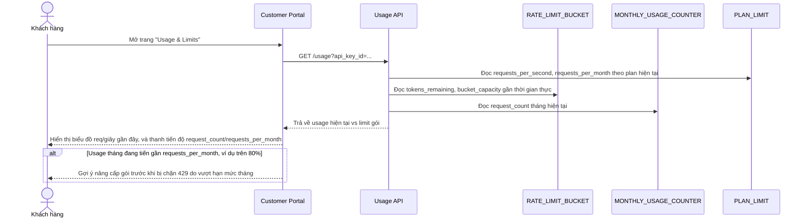

# API gateway public cho SaaS đa khách hàng (per-API-key rate limit)

**Hệ thống:** SaaS cung cấp public API cho khách hàng dùng qua API key, cần giới hạn số request theo từng gói dịch vụ (free/pro/enterprise).

**Vai trò của flow:** Rate limiting đảm bảo công bằng tài nguyên giữa các khách hàng, tránh một khách hàng dùng quá nhiều làm ảnh hưởng khách khác, đồng thời đúng với gói dịch vụ họ trả tiền.

**Yêu cầu cụ thể:**
- Mỗi API key có giới hạn request/giây và request/tháng riêng theo gói, và response khi vượt limit phải trả đúng chuẩn (HTTP 429 kèm header Retry-After, X-RateLimit-Remaining).
- Dùng thuật toán rate limit cụ thể (ví dụ token bucket hoặc sliding window log) để cho phép burst ngắn hợp lý mà không cho phép lạm dụng liên tục vượt giới hạn trung bình.
- Rate limit counter phải chính xác trong môi trường nhiều instance API gateway chạy song song (không được để mỗi instance tự đếm riêng dẫn tới tổng vượt xa giới hạn thực).
- Khi Redis/coordinator lưu counter bị chậm/down tạm thời, phải có chiến lược rõ ràng (fail-open cho phép qua tạm hay fail-closed chặn tạm) và giải thích lý do chọn theo bối cảnh SaaS đó.
- Có dashboard cho khách hàng tự xem usage hiện tại so với limit gói của họ, để họ tự chủ động nâng cấp gói trước khi bị chặn.

---

# Base ERD — API gateway forward request, log lại nhưng chưa giới hạn

Đây là **base**: mô hình dữ liệu suy luận từ ngữ cảnh đề bài, thể hiện trạng thái hệ thống **trước khi** có rate limit theo API key. Đề bài nói SaaS có khách hàng dùng API key theo gói dịch vụ (free/pro/enterprise) — nên base cần đủ: khách hàng, API key, và log các lần gọi API (phục vụ billing/analytics cơ bản), nhưng chưa có giới hạn/counter/thuật toán throttle nào, chưa có cấu hình theo gói, chưa có dashboard usage. Những entity đó là phần enhance.

---

# Base sequence — Gọi API (forward thẳng, không giới hạn)

Đây là **base**, flow "Gọi API" ở trạng thái hiện tại — gateway chỉ xác thực API key còn hiệu lực rồi forward thẳng tới backend, có log lại request nhưng không đối chiếu với bất kỳ giới hạn nào. Flow này liên quan mật thiết tới enhance vì toàn bộ vấn đề của đề bài (một khách hàng dùng quá nhiều ảnh hưởng khách khác, không đúng với gói đã trả tiền) đều bắt nguồn từ việc thiếu bước kiểm tra giới hạn ở đây.

---

# Enhance ERD — sau khi có rate limit per-API-key, phân tán, theo gói

Đây là ERD **sau khi** enhance được áp dụng lên base. So với base, có 4 nhóm entity mới, ứng trực tiếp với các yêu cầu trong đề bài:

- `PLAN_LIMIT` (mới) — giới hạn request/giây và request/tháng cụ thể theo từng gói.
- `RATE_LIMIT_BUCKET` (mới) — trạng thái token bucket theo từng API key, lưu tập trung (Redis) để chính xác dù nhiều instance gateway chạy song song.
- `MONTHLY_USAGE_COUNTER` (mới) — đếm riêng theo tháng, độc lập với bucket giây, phục vụ cả giới hạn tháng lẫn dashboard usage.
- `COORDINATOR_HEALTH_STATE` (mới) — trạng thái Redis/coordinator và chiến lược fail-open/fail-closed khi nó chậm/down.

---

# Enhance sequence — Gọi API (token bucket dùng chung qua Redis, đúng chuẩn 429)

Đây là **enhance** của flow "Gọi API" đã có ở base. So với base, gateway không còn forward thẳng — mọi instance gateway cùng đọc/ghi chung 1 `RATE_LIMIT_BUCKET` trong Redis theo thuật toán token bucket (cho phép burst ngắn hợp lý) và kiểm tra thêm `MONTHLY_USAGE_COUNTER`, trả đúng chuẩn HTTP 429 kèm `Retry-After`/`X-RateLimit-Remaining` khi vượt (đáp ứng yêu cầu 1, 2 và 3 của đề bài).

---

# Enhance sequence — Redis/coordinator chậm hoặc down, fail-open có kiểm soát

Đây là **enhance**, flow hoàn toàn mới, phát sinh từ enhance — chưa tồn tại ở base (base không phụ thuộc coordinator tập trung nên không có kịch bản nó down). Đáp ứng yêu cầu 4 của đề bài: khi Redis/coordinator lưu counter bị chậm/down tạm thời, phải có chiến lược rõ ràng thay vì hành vi không xác định.

---

# Enhance sequence — Dashboard khách hàng tự xem usage so với limit gói

Đây là **enhance**, flow hoàn toàn mới, phát sinh từ enhance — chưa tồn tại ở base (base không có nơi nào để khách hàng xem usage vì chưa có khái niệm limit). Đáp ứng yêu cầu 5 của đề bài: khách hàng tự xem usage hiện tại so với limit gói của họ, chủ động nâng cấp trước khi bị chặn.

