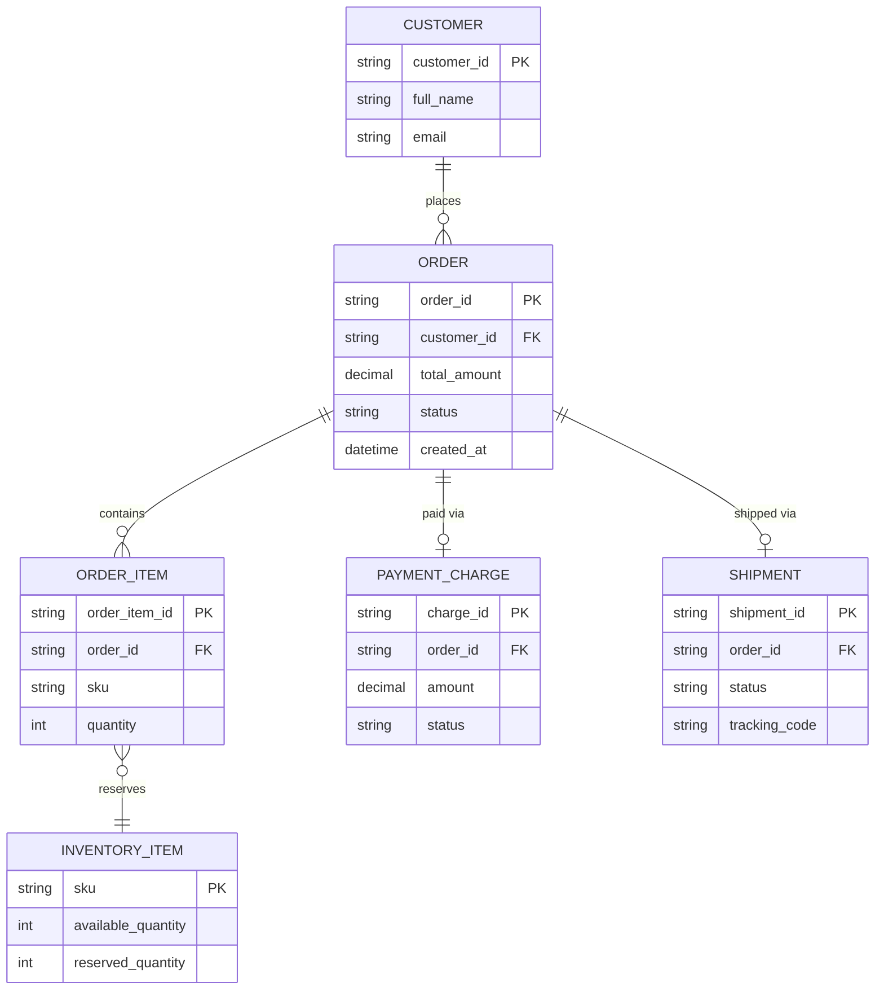
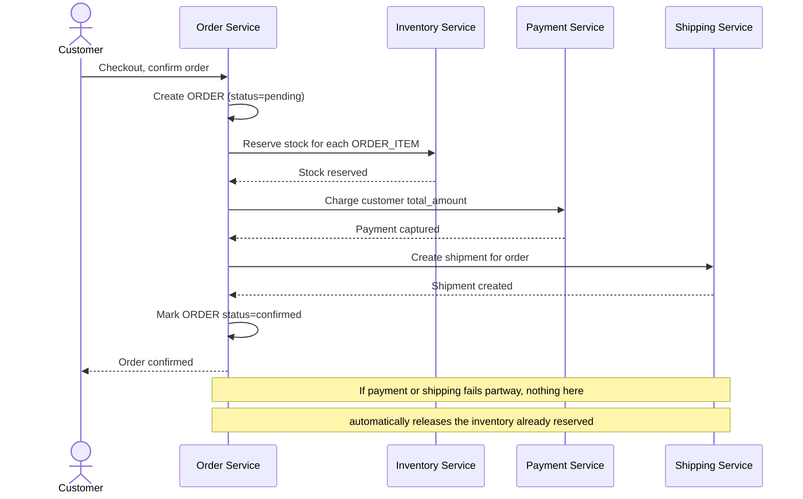
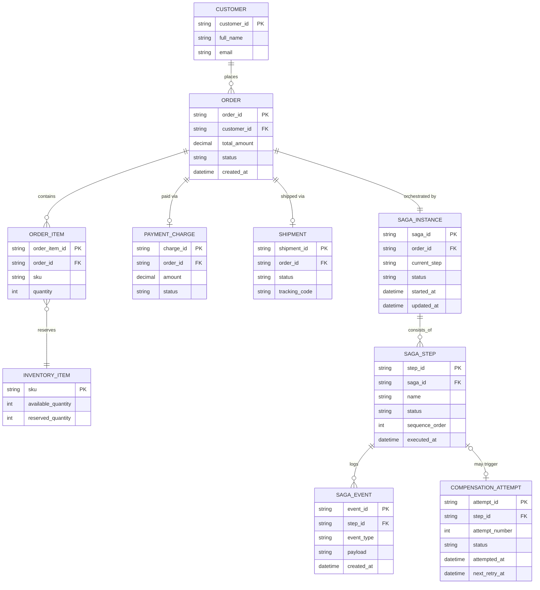
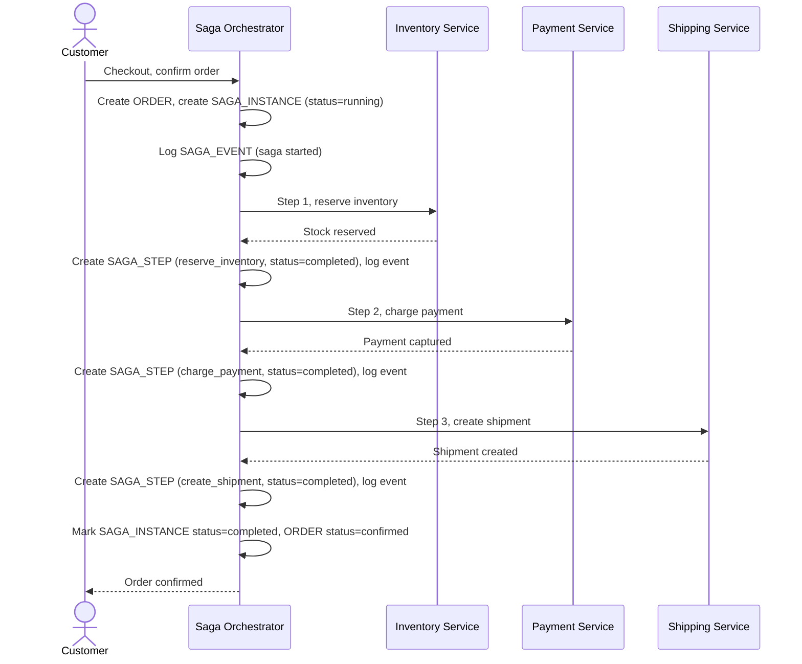
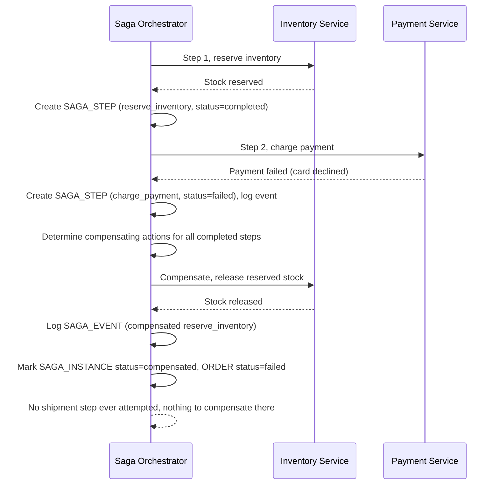
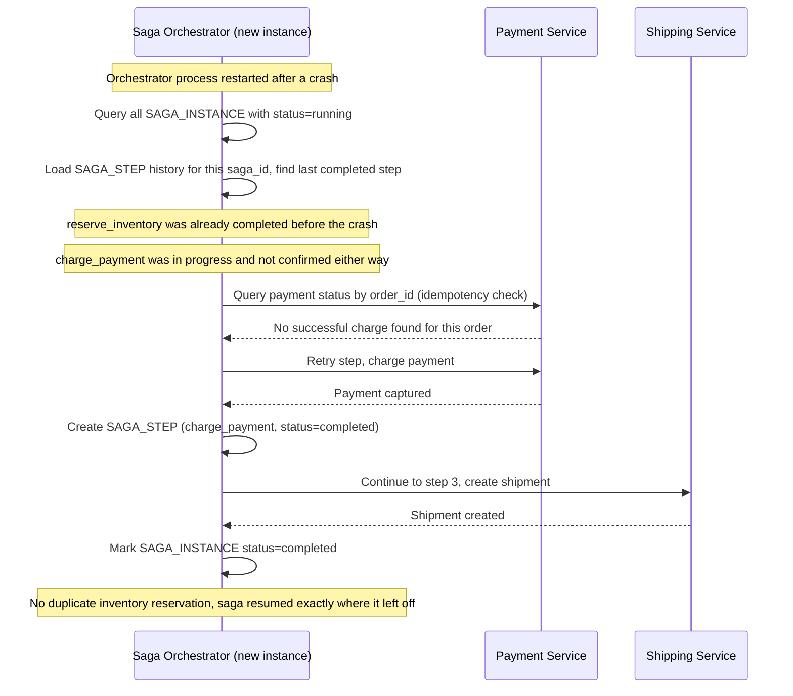
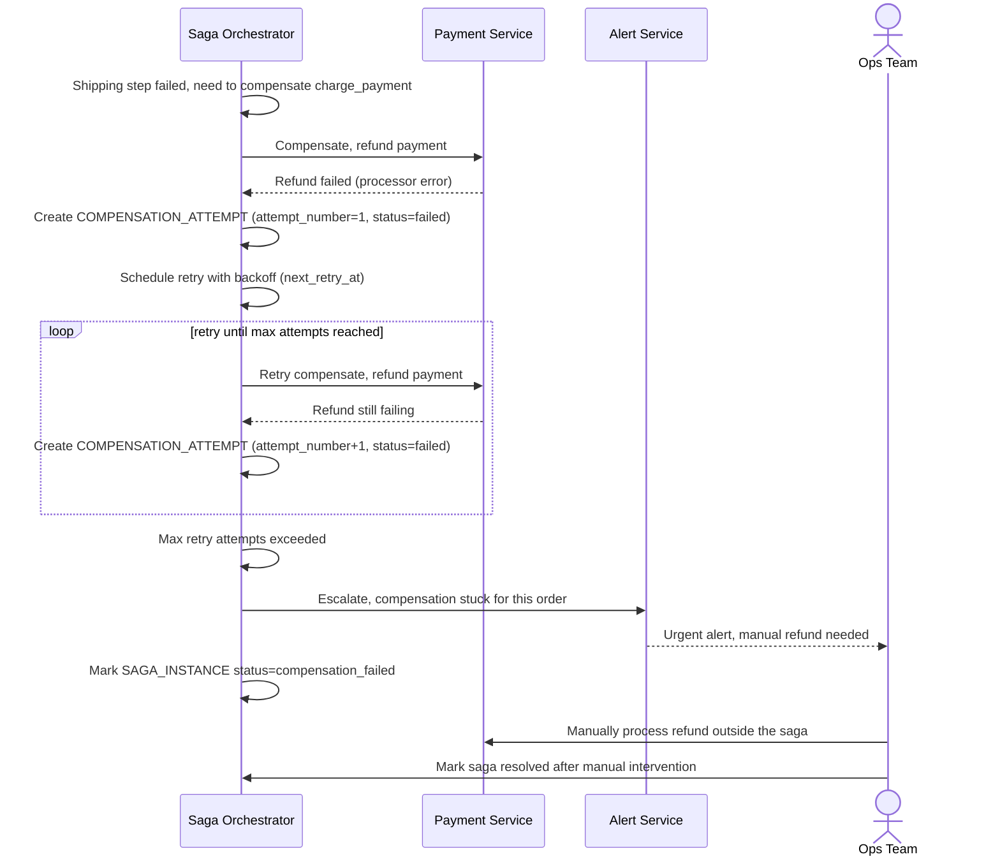

# Checkout e-commerce nhiều bước (payment + inventory + shipping)

**Hệ thống:** Trang e-commerce với luồng đặt hàng chạm tới 3 service riêng: Payment, Inventory, Shipping.

**Vai trò của flow:** Saga orchestration điều phối toàn bộ transaction nghiệp vụ xuyên service, và compensate (hủy ngược) khi một bước giữa đường thất bại.

**Yêu cầu cụ thể:**
- Định nghĩa rõ từng bước saga (reserve inventory → charge payment → create shipment) và compensating action tương ứng cho mỗi bước (release inventory, refund payment, cancel shipment).
- Nếu bước charge payment thất bại sau khi đã reserve inventory thành công, phải tự động gọi compensate để release inventory, và toàn bộ order chuyển trạng thái "failed" chứ không kẹt ở trạng thái lửng lơ.
- Saga state (đang ở bước nào, đã compensate bước nào) phải được persist, để nếu orchestrator service crash giữa saga, có thể resume đúng chỗ khi restart.
- Xử lý được trường hợp compensate cũng thất bại (ví dụ refund payment lỗi) — phải có retry với backoff và escalate sang xử lý thủ công/alert nếu vượt số lần retry.
- Toàn bộ event của saga (bắt đầu, mỗi step, compensate) phải được lưu dưới dạng event log để có thể replay/audit lại toàn bộ hành trình của một order.

---

# ERD — Base (trước khi có saga orchestration)

Đây là **base**: mô hình dữ liệu suy luận cho checkout e-commerce *trước khi* có saga điều phối. Đề bài giả định hệ thống đã có `ORDER`, đã tích hợp Inventory/Payment/Shipping như 3 service riêng biệt — nếu không có sẵn các entity này thì "saga điều phối transaction xuyên 3 service" sẽ không có nghĩa. ERD chỉ dựng phần lõi phục vụ checkout, không suy diễn thêm các module không liên quan (khuyến mãi, đánh giá sản phẩm...).

---

# Sequence Diagram — Base: Place Order

Đây là **base**, flow "đặt hàng" gọi tuần tự 3 service (Inventory, Payment, Shipping) — tiền đề cho saga: chính chuỗi bước reserve inventory → charge payment → create shipment ở đây là những gì saga sẽ điều phối lại. Ở base, flow gọi trực tiếp không qua orchestrator, không có compensate, không có persisted state, nên nếu một bước giữa chừng thất bại thì các bước trước đó không tự động được hoàn tác.

---

# ERD — Enhance (sau khi có saga orchestration)

Đây là **enhance**: ERD base cộng với các entity phục vụ đúng 5 yêu cầu của đề bài — định nghĩa từng bước saga và compensate tương ứng, persist saga state để resume khi crash, retry/escalate khi compensate thất bại, và event log để replay/audit. So với base, `ORDER` không đổi cấu trúc nhưng nay trạng thái của nó được dẫn dắt bởi `SAGA_INSTANCE` thay vì được set trực tiếp từ Order Service.

---

# Sequence Diagram — Enhance: Place Order (Happy Path)

Đây là **enhance**, flow "đặt hàng" đã có ở base ([2-base-place-order-sqd.md](#2-base-place-order-sqd)) nhưng nay thay đổi căn bản: một Saga Orchestrator điều phối từng bước thay vì Order Service gọi trực tiếp, mỗi bước được ghi thành `SAGA_STEP` với `SAGA_EVENT` tương ứng, phục vụ replay/audit sau này.

---

# Sequence Diagram — Enhance: Compensate Failed Checkout

Đây là **enhance**, flow mới xử lý trường hợp bước charge payment thất bại sau khi đã reserve inventory thành công. Flow này thể hiện yêu cầu "tự động gọi compensate để release inventory, order chuyển trạng thái failed chứ không kẹt lửng lơ" — điều mà base hoàn toàn không có.

---

# Sequence Diagram — Enhance: Resume Saga After Orchestrator Crash

Đây là **enhance**, flow mới xử lý trường hợp Saga Orchestrator crash giữa chừng một saga. Flow này thể hiện yêu cầu "saga state phải được persist để resume đúng chỗ khi restart" — dựa vào `SAGA_INSTANCE.current_step` đã lưu thay vì chạy lại toàn bộ saga từ đầu.

---

# Sequence Diagram — Enhance: Escalate Failed Compensation

Đây là **enhance**, flow mới xử lý trường hợp compensate cũng thất bại (ví dụ refund payment lỗi). Flow này thể hiện yêu cầu "retry với backoff, escalate sang xử lý thủ công/alert nếu vượt số lần retry" — trạng thái mà một saga đơn giản không xử lý được.

