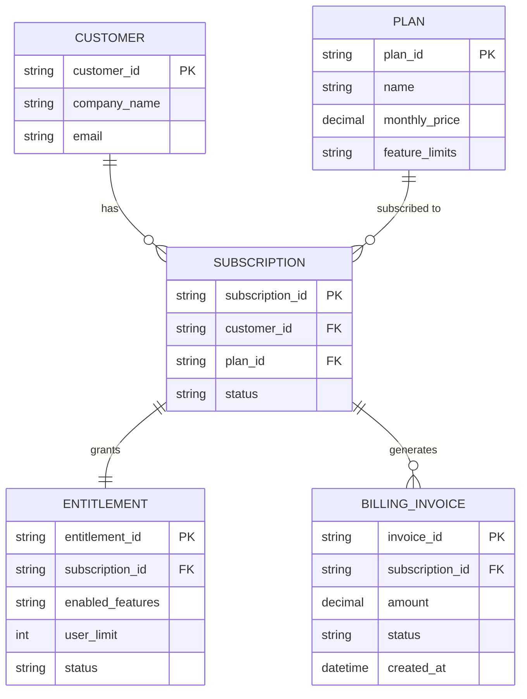
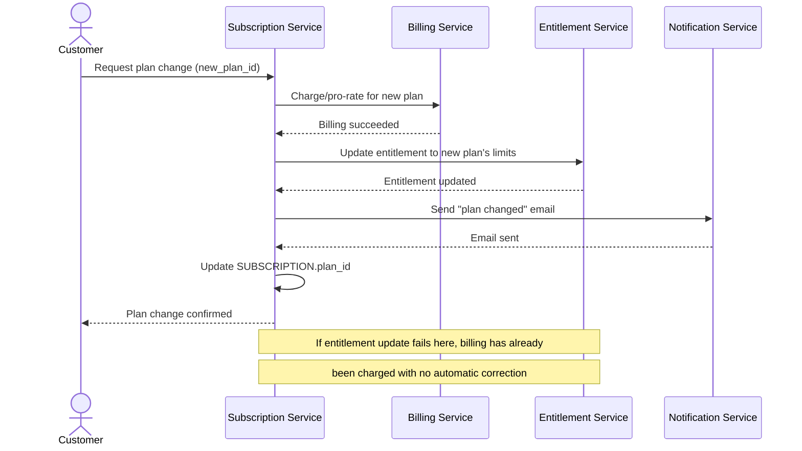
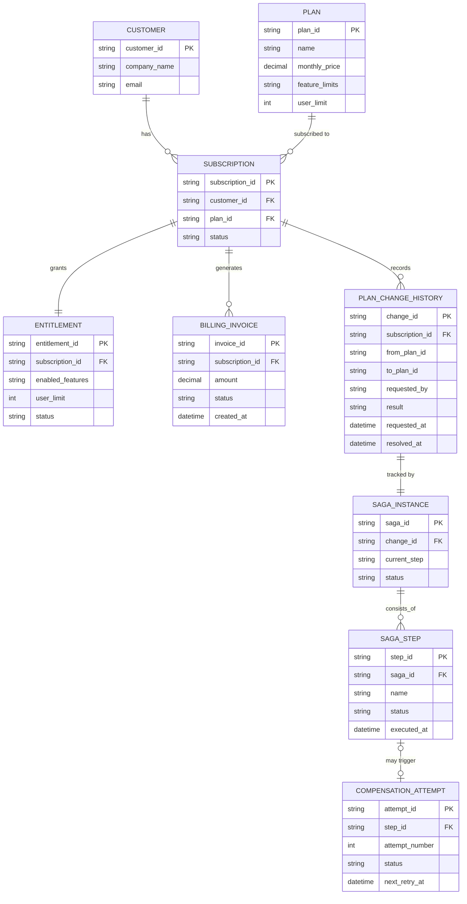
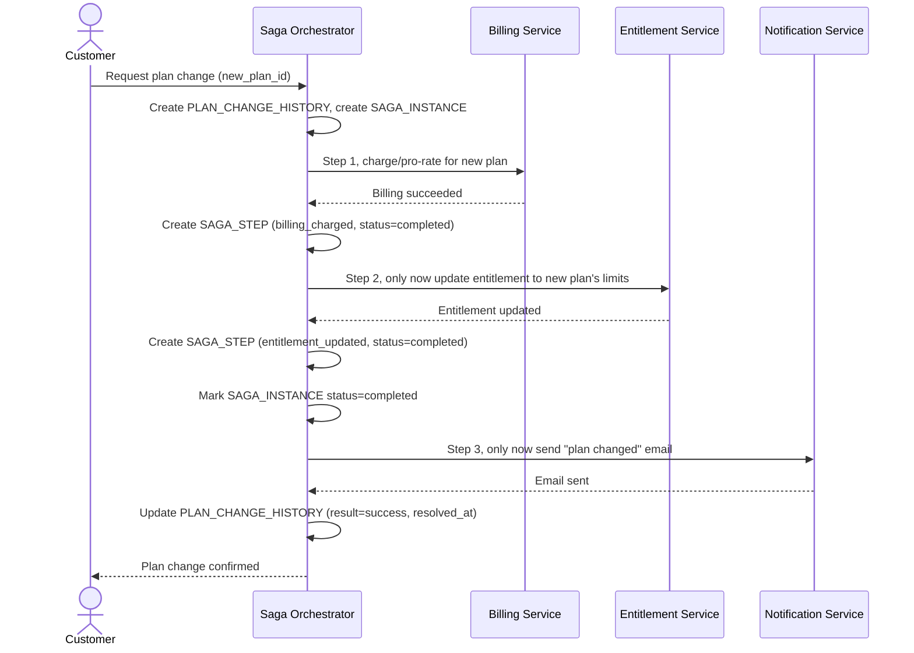
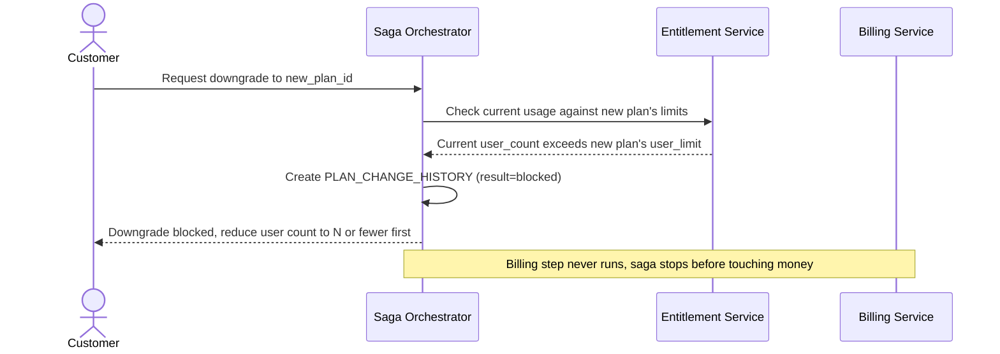
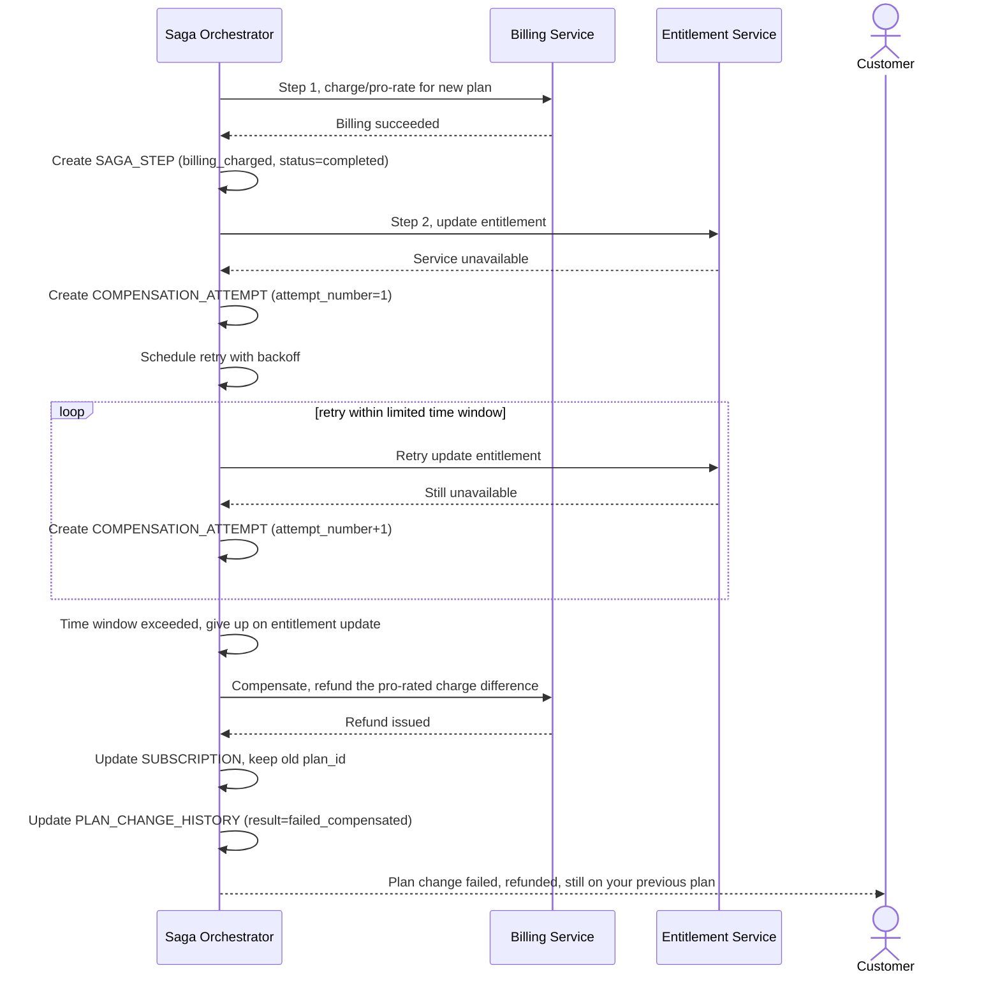

# Nâng/hạ cấp gói subscription xuyên nhiều service (billing + entitlement + notification)

**Hệ thống:** SaaS B2B cho phép khách hàng nâng cấp/hạ cấp plan, việc này phải đồng bộ giữa billing (tính tiền), entitlement (mở/khóa tính năng), và notification (báo khách).

**Vai trò của flow:** Saga đảm bảo billing và entitlement luôn khớp nhau — không có trường hợp khách bị charge tiền plan mới nhưng chưa được mở tính năng, hoặc ngược lại.

**Yêu cầu cụ thể:**
- Thứ tự saga: charge/pro-rate billing trước, chỉ mở entitlement sau khi billing xác nhận thành công; nếu billing thất bại, không chạm tới entitlement.
- Nếu entitlement service down đúng lúc cần cập nhật sau khi billing đã thành công, saga phải retry với backoff trong một khoảng thời gian giới hạn, và nếu vẫn thất bại phải compensate (hoàn tiền phần chênh lệch) và giữ plan cũ.
- Downgrade plan phải xử lý được trường hợp khách đang dùng tính năng vượt hạn mức plan mới (ví dụ vượt số user) — quyết định rõ: chặn downgrade hay downgrade kèm cảnh báo.
- Notification chỉ được gửi sau khi cả billing và entitlement đã ổn định (không gửi email "đã nâng cấp thành công" rồi sau đó saga phải rollback).
- Toàn bộ lịch sử thay đổi plan của một khách phải truy vấn lại được (ai đổi plan gì, khi nào, kết quả ra sao) để phục vụ hỗ trợ khách hàng.

---

# ERD — Base (trước khi có saga đổi gói)

Đây là **base**: mô hình dữ liệu suy luận cho SaaS B2B *trước khi* có saga điều phối đổi gói. Đề bài giả định hệ thống đã có billing, entitlement, và notification như 3 service riêng biệt, mỗi khách hàng có subscription và entitlement tương ứng gói hiện tại — nếu không có sẵn các entity này thì "saga đảm bảo billing và entitlement luôn khớp nhau" sẽ không có nghĩa. ERD chỉ dựng phần lõi phục vụ đổi gói, không suy diễn thêm các module không liên quan (support, usage analytics...).

---

# Sequence Diagram — Base: Change Plan

Đây là **base**, flow "đổi gói" gọi Billing và Entitlement riêng lẻ — tiền đề cho saga. Ở base, flow chưa đảm bảo thứ tự chặt chẽ hay khả năng compensate: nếu Entitlement Service lỗi sau khi Billing đã charge thành công, khách có thể bị tính tiền plan mới nhưng chưa được mở tính năng tương ứng.

---

# ERD — Enhance (sau khi có saga đổi gói)

Đây là **enhance**: ERD base cộng với các entity phục vụ đúng 5 yêu cầu của đề bài — thứ tự saga rõ ràng (billing trước, entitlement sau), retry/compensate khi entitlement down, kiểm tra hạn mức khi downgrade, notification chỉ gửi sau khi ổn định, và lịch sử đổi gói truy vấn được. So với base, `SUBSCRIPTION` nay được dẫn dắt bởi `SAGA_INSTANCE`, và có thêm `PLAN_CHANGE_HISTORY` ghi lại toàn bộ lượt đổi gói.

---

# Sequence Diagram — Enhance: Change Plan (Happy Path)

Đây là **enhance**, flow "đổi gói" đã có ở base ([2-base-change-plan-sqd.md](#2-base-change-plan-sqd)) nhưng nay thay đổi căn bản: thứ tự saga chặt chẽ (billing trước, entitlement chỉ mở sau khi billing xác nhận thành công), và notification chỉ gửi sau khi cả hai đã ổn định, thay vì gọi rời rạc như base.

---

# Sequence Diagram — Enhance: Downgrade With Limit Check

Đây là **enhance**, flow mới xử lý downgrade khi khách đang dùng tính năng vượt hạn mức plan mới (ví dụ vượt số user). Flow này thể hiện quyết định "chặn downgrade" khi vượt hạn mức, thay vì âm thầm cắt tính năng gây gián đoạn dịch vụ.

---

# Sequence Diagram — Enhance: Retry Entitlement Then Compensate

Đây là **enhance**, flow mới xử lý trường hợp Entitlement Service down đúng lúc cần cập nhật sau khi billing đã thành công. Flow này thể hiện yêu cầu retry với backoff trong khoảng thời gian giới hạn, và nếu vẫn thất bại thì compensate hoàn tiền phần chênh lệch, giữ nguyên plan cũ.

