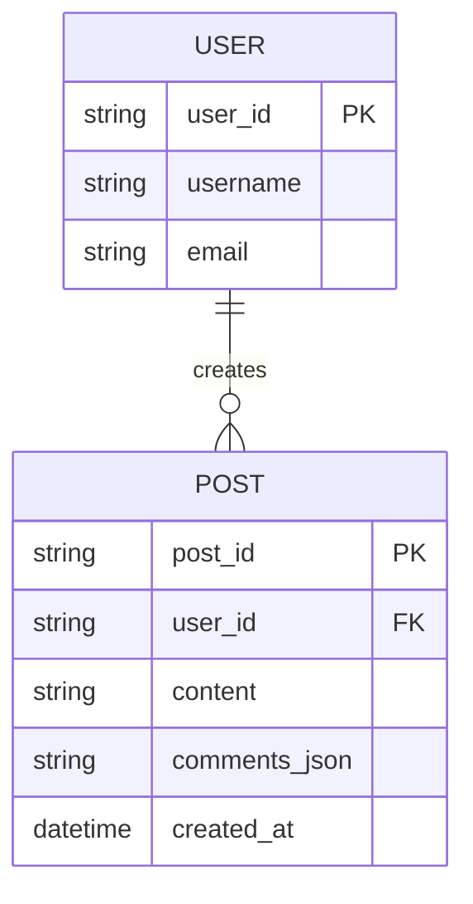
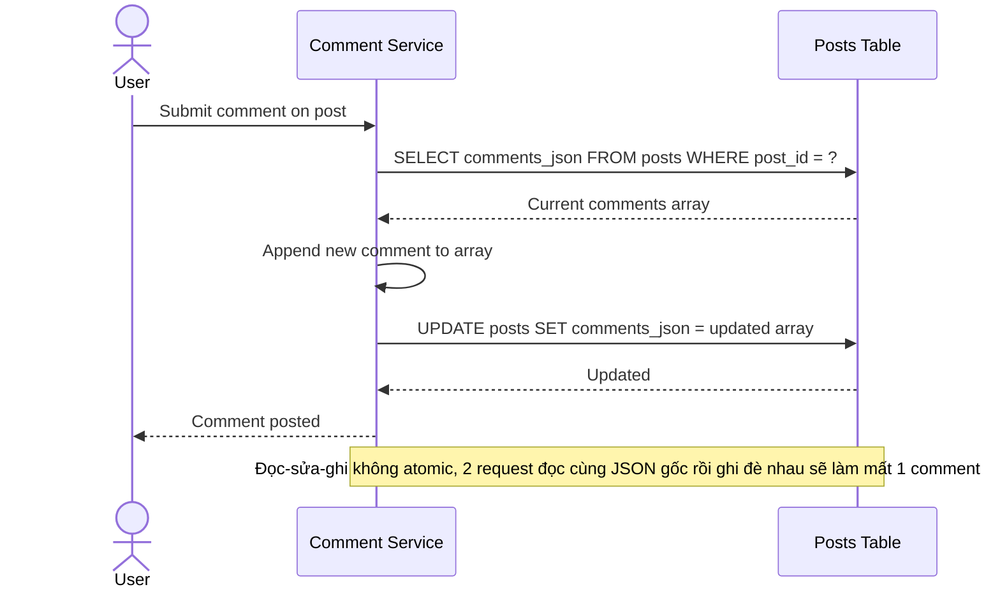
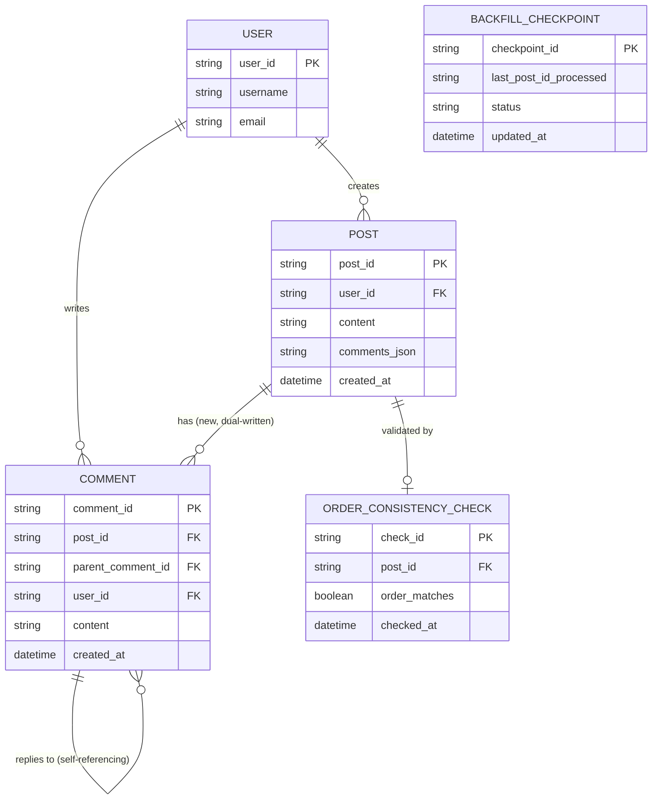
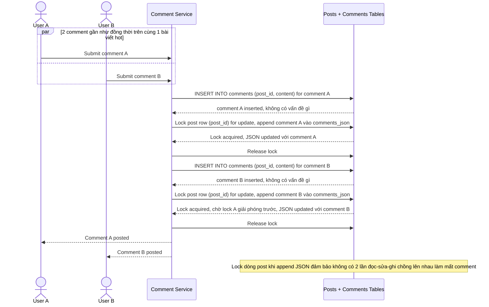
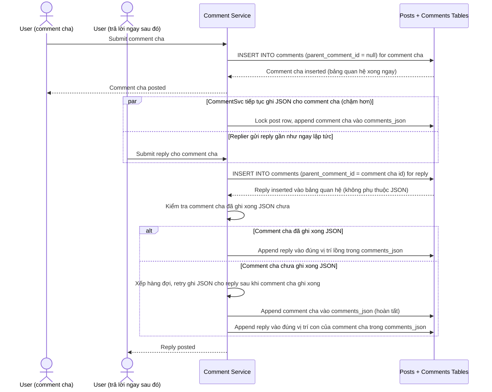
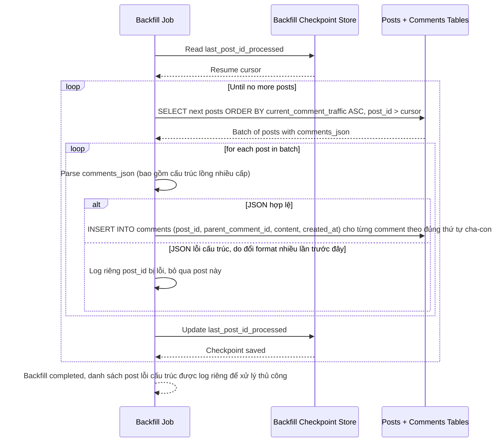

# Tách comment dạng nested JSON trong bảng posts sang bảng comment quan hệ riêng (mạng xã hội)

**Hệ thống:** Một mạng xã hội có bảng `posts` lưu comment dạng nested/JSON ngay trong 1 cột của bài viết, cần tách sang bảng `comments` quan hệ riêng để hỗ trợ tính năng mới (trả lời lồng nhiều cấp, like riêng từng comment, phân trang hiệu quả), trong khi traffic đăng bài/bình luận vẫn chạy liên tục 24/7.

**Vai trò của flow:** Flow dual-write phải đảm bảo mọi comment mới được ghi cả vào JSON cũ và bảng `comments` mới, có job backfill comment lịch sử, mà không làm rớt comment hay đổi thứ tự hiển thị trong lúc traffic bình luận vẫn cao liên tục.

**Yêu cầu cụ thể:**
- Mô tả cụ thể: 2 người dùng cùng bình luận vào 1 bài viết đang hot gần như đồng thời (chênh nhau vài trăm mili giây) trong giai đoạn dual-write — việc ghi vào cột JSON cũ (thường phải đọc JSON hiện tại, append, rồi ghi lại cả mảng) không được dùng kiểu đọc-sửa-ghi không atomic vì 2 request đọc cùng JSON gốc rồi ghi đè nhau sẽ làm mất 1 trong 2 comment; yêu cầu mô tả cụ thể cách xử lý (lock dòng post trong lúc append JSON, hoặc chuyển hẳn logic ghi JSON sang dạng append atomic ở tầng lưu trữ), trong khi bảng `comments` mới insert bình thường không gặp vấn đề này vì mỗi comment là 1 dòng riêng.
- Trong giai đoạn đọc vẫn lấy từ JSON cũ (nguồn sự thật) nhưng ghi đã chạy song song cả 2 nơi, phải đảm bảo thứ tự comment trong JSON và thứ tự theo timestamp trong bảng `comments` khớp nhau tuyệt đối; yêu cầu cơ chế kiểm tra để phát hiện lệch thứ tự (ví dụ do 1 trong 2 lần ghi bị chậm hơn lần kia dưới tải cao) trước khi cho phép chuyển đọc sang bảng mới.
- Mô tả cụ thể race với reply lồng nhiều cấp: 1 comment cha vừa được tạo và ngay lập tức có người trả lời comment đó (comment con) trước khi thao tác ghi JSON cho comment cha kịp hoàn tất ở phía JSON cũ (do append JSON có độ trễ cao hơn insert bảng quan hệ) — quy định rõ cách xử lý để comment con không bị ghi vào JSON cũ ở vị trí sai cấu trúc lồng, ví dụ chờ xác nhận comment cha đã ghi xong JSON trước khi cho phép reply được xử lý, hoặc retry ghi JSON theo đúng thứ tự cha rồi mới tới con.
- Job backfill comment lịch sử phải chạy theo batch ưu tiên các bài viết có traffic bình luận đang hoạt động thấp trước, có checkpoint để resume nếu crash giữa chừng, và phải bỏ qua/log riêng các bài viết có comment JSON bị lỗi cấu trúc (dữ liệu cũ có thể không đồng nhất do đã đổi format nhiều lần trước đây) thay vì làm crash toàn bộ job.
- Có job reconciliation so sánh số lượng comment và nội dung mẫu giữa JSON và bảng mới cho các bài viết có traffic cao mỗi ngày, và chỉ được drop cột JSON cũ sau khi 100% traffic đọc đã chuyển sang bảng mới và không phát hiện lệch trong khoảng thời gian tối thiểu quy định.

---

# ERD — Base (trước khi tách bảng comments)

Đây là **base**: mô hình dữ liệu suy luận cho mạng xã hội *trước khi* tách comment. Đề bài giả định đã có `USER` đăng `POST`, và comment được lưu nested/JSON ngay trong 1 cột của `POST` — nếu không có sẵn cột JSON đó thì yêu cầu "tách sang bảng comments quan hệ riêng" sẽ không có nghĩa. ERD chỉ dựng phần lõi phục vụ đăng bài/bình luận, không suy diễn thêm like/share/notification không liên quan.

---

# Sequence Diagram — Base: Create Comment

Đây là **base**, flow "bình luận vào bài viết" — tiền đề bắt buộc cho việc tách bảng: chính flow này đọc mảng JSON hiện tại, append comment mới, rồi ghi lại cả mảng vào cột `comments_json` của `POST` — cách đọc-sửa-ghi này là nguồn gốc rủi ro mất comment mà enhance phải xử lý.

---

# ERD — Enhance (sau khi tách bảng comments)

Đây là **enhance**: ERD base cộng với bảng `COMMENT` quan hệ, tự tham chiếu để hỗ trợ trả lời lồng nhiều cấp, checkpoint backfill theo bài viết, và báo cáo đối soát thứ tự/nội dung. So với base, `POST` giữ nguyên `comments_json` (chưa drop, vẫn dual-write) trong khi `COMMENT` là bảng hoàn toàn mới cho phép mỗi comment là 1 dòng riêng, có `parent_comment_id` tự tham chiếu để biểu diễn reply lồng cấp — điều JSON cũ không hỗ trợ tốt.

---

# Sequence Diagram — Enhance: Create Comment

Đây là **enhance**, flow "bình luận vào bài viết" đã tồn tại ở base ([2-base-create-comment-sqd.md](#2-base-create-comment-sqd)) nay thay đổi: bảng `COMMENT` insert bình thường không có vấn đề, nhưng ghi vào `comments_json` cũ phải lock dòng post trong lúc append để 2 comment gần như đồng thời trên 1 bài hot không ghi đè mất nhau.

---

# Sequence Diagram — Enhance: Create Reply Comment

Đây là **enhance**, flow hoàn toàn mới: bình luận trả lời 1 comment cha, cần chờ comment cha ghi xong JSON cũ trước khi cho phép xử lý reply, để không bị ghi vào `comments_json` sai vị trí cấu trúc lồng do append JSON có độ trễ cao hơn insert bảng `COMMENT`.

---

# Sequence Diagram — Enhance: Backfill Historical Comments

Đây là **enhance**, flow hoàn toàn mới: job backfill comment lịch sử từ `comments_json` sang bảng `COMMENT`, ưu tiên bài viết ít traffic bình luận trước, có checkpoint resume, và bỏ qua riêng các bài có JSON lỗi cấu trúc thay vì crash toàn bộ job.

