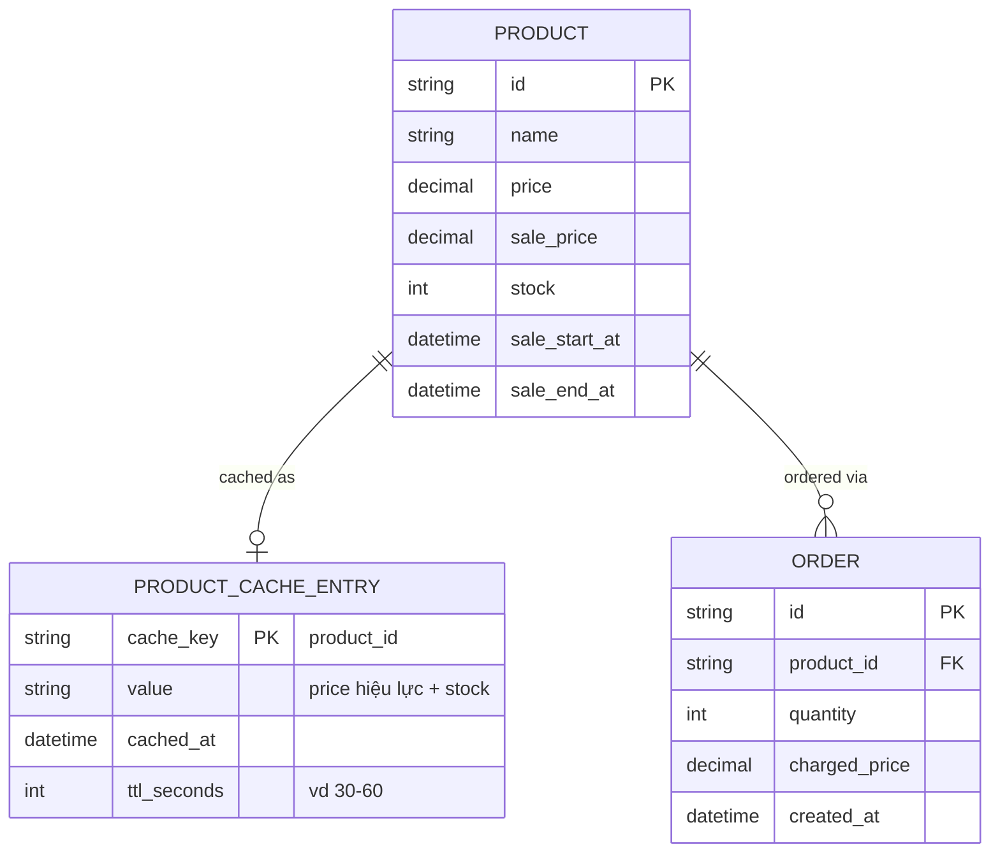
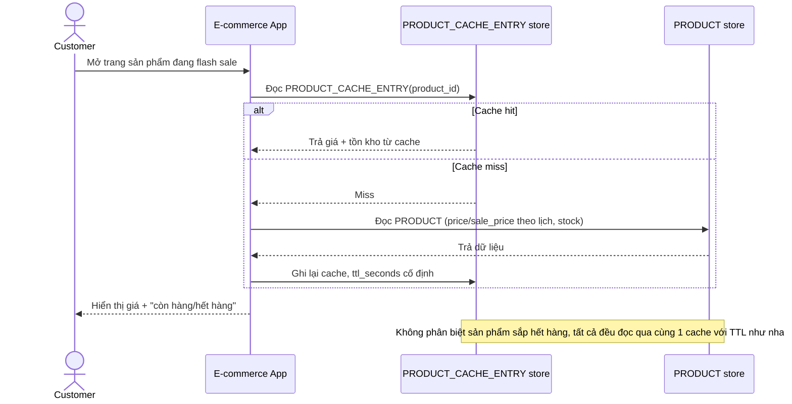
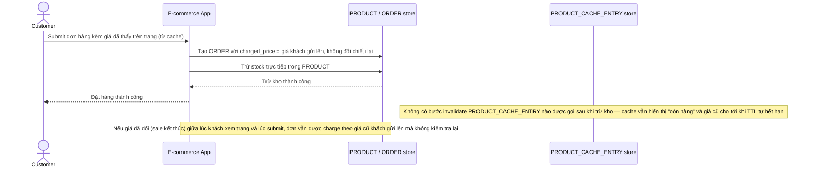
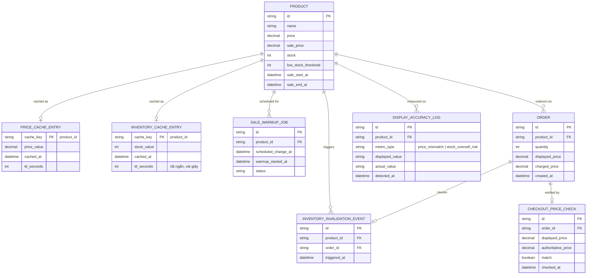
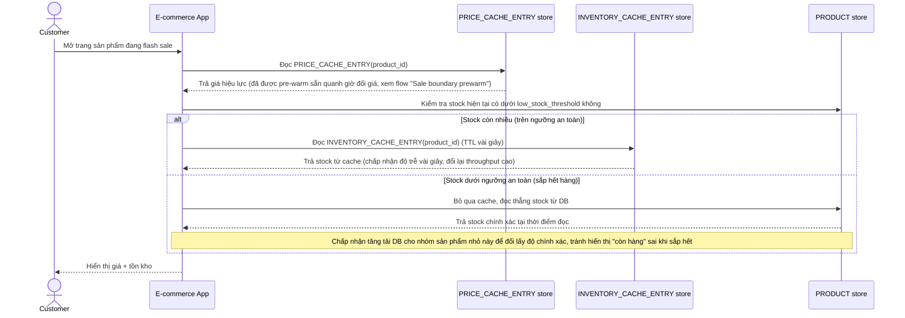
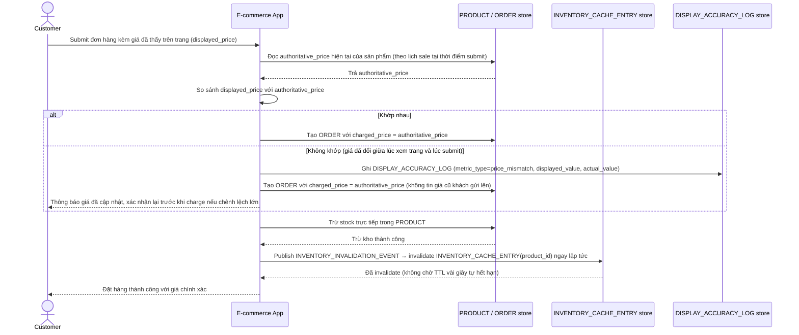
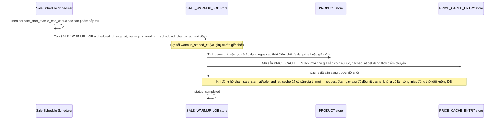

# Cache giá/tồn kho trong flash sale với tần suất thay đổi cực cao

**Hệ thống:** E-commerce trong giờ flash sale có giá và tồn kho thay đổi liên tục (giảm giá theo giờ, tồn kho giảm nhanh), cache phải theo kịp thay đổi mà vẫn chịu được tải đọc khổng lồ.

**Vai trò của flow:** Invalidate cache tồn kho/giá gần như real-time trong khi vẫn giữ được throughput đọc cao, khác với cache thông thường có thể chấp nhận độ trễ lớn hơn.

**Yêu cầu cụ thể:**
- Cache tồn kho phải có TTL rất ngắn (giây) kết hợp active invalidation khi có đơn hàng trừ kho, để giảm thiểu rủi ro hiển thị "còn hàng" sai trong lúc sản phẩm sắp hết.
- Với sản phẩm sắp hết hàng (dưới ngưỡng an toàn), phải chuyển sang đọc trực tiếp từ nguồn (bỏ qua cache) để đảm bảo chính xác, đánh đổi tăng tải DB cho nhóm sản phẩm nhỏ này để bù lại độ chính xác.
- Xử lý cache stampede khi giá flash sale bắt đầu/kết thúc đúng giờ (hàng loạt cache cùng invalidate đồng thời tại thời điểm giờ chốt) — cần pre-warm cache trước thời điểm đổi giá vài giây để tránh dội tải.
- Đảm bảo giá hiển thị cho user tại thời điểm checkout khớp với giá thực tế lúc submit đơn (double-check giá ở backend, không tin hoàn toàn giá đã cache hiển thị ở client).
- Đo lường: tỉ lệ hiển thị sai giá/tồn kho (nếu có) trong log thực tế của các lần flash sale trước, dùng làm baseline để cải thiện chiến lược invalidation.

---

# Base ERD — Cache flash sale trước khi tối ưu cho tần suất thay đổi cực cao

Đây là **base**: mô hình dữ liệu suy luận từ ngữ cảnh đề bài, thể hiện trạng thái hệ thống **trước khi** có các cơ chế đặc thù cho flash sale. Đề bài nói flash sale đã có lịch giảm giá theo giờ và giá/tồn kho hiển thị dựa vào cache — nên base cần đủ: sản phẩm (kèm lịch sale), 1 cache entry chung cho giá+tồn kho với TTL cố định, và đơn hàng. Chưa có entity nào phục vụ invalidation chủ động theo đơn hàng/bypass cache khi sắp hết hàng/pre-warm theo lịch/double-check giá — những thứ đó là phần enhance.

---

# Base sequence — View product page (TTL cố định, chưa tách stock riêng)

Đây là **base**, flow "Xem trang sản phẩm trong giờ flash sale" — dùng chung 1 cache entry cho cả giá lẫn tồn kho với TTL cố định, giống cache thông thường. Đây chính là điểm mà yêu cầu 1 và 2 của đề bài nhắm vào: tồn kho biến động quá nhanh so với TTL này.

---

# Base sequence — Checkout (tin cache, không invalidate khi trừ kho)

Đây là **base**, flow "Đặt hàng" ở trạng thái hiện tại — backend tin thẳng giá khách nhìn thấy lúc submit, và trừ kho xong không chủ động invalidate cache. Flow này liên quan mật thiết tới enhance vì yêu cầu 1 và 4 của đề bài chính là sửa đúng 2 lỗ hổng ở đây.

---

# Enhance ERD — sau khi tối ưu cache cho flash sale

Đây là ERD **sau khi** enhance được áp dụng lên base. So với base, có 5 thay đổi chính, ứng trực tiếp với 5 yêu cầu trong đề bài:

- Tách `PRICE_CACHE_ENTRY` và `INVENTORY_CACHE_ENTRY` riêng (thay vì gộp chung như base) — tồn kho cần TTL rất ngắn + invalidate chủ động, còn giá chủ yếu đổi theo lịch nên có thể pre-warm.
- `INVENTORY_INVALIDATION_EVENT` (mới) — phát sinh ngay khi có đơn hàng trừ kho.
- `PRODUCT` thêm `low_stock_threshold` — sản phẩm dưới ngưỡng này bỏ qua cache, đọc thẳng DB.
- `SALE_WARMUP_JOB` (mới) — pre-warm cache trước thời điểm đổi giá theo lịch vài giây, chống stampede.
- `CHECKOUT_PRICE_CHECK` (mới) — double-check giá ở backend trước khi charge.
- `DISPLAY_ACCURACY_LOG` (mới) — log các lần hiển thị sai giá/tồn kho để làm baseline đo lường.

---

# Enhance sequence — View product page (tách cache, bypass khi sắp hết hàng)

Đây là **enhance**, cùng flow "View product page" đã có ở base nhưng nay thay đổi theo yêu cầu 1 và 2 của đề bài: tồn kho đọc qua `INVENTORY_CACHE_ENTRY` với TTL rất ngắn (giây), và sản phẩm dưới `low_stock_threshold` bỏ qua cache hoàn toàn để đảm bảo chính xác.

---

# Enhance sequence — Checkout (invalidate chủ động + double-check giá)

Đây là **enhance**, cùng flow "Checkout" đã có ở base nhưng nay thay đổi theo yêu cầu 1, 4 và 5 của đề bài: trừ kho xong invalidate ngay `INVENTORY_CACHE_ENTRY` thay vì chờ TTL, và backend đối chiếu lại giá thực tế tại thời điểm submit thay vì tin thẳng giá client gửi lên.

---

# Enhance sequence — Sale boundary prewarm

Đây là **enhance**, flow hoàn toàn mới, phát sinh từ enhance — chưa tồn tại ở base. Đáp ứng yêu cầu thứ 3 của đề bài: pre-warm cache trước thời điểm giờ flash sale bắt đầu/kết thúc vài giây, tránh hàng loạt cache cùng miss đồng thời đúng lúc chốt giờ (cache stampede).

