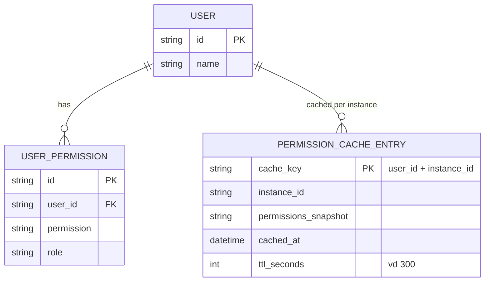
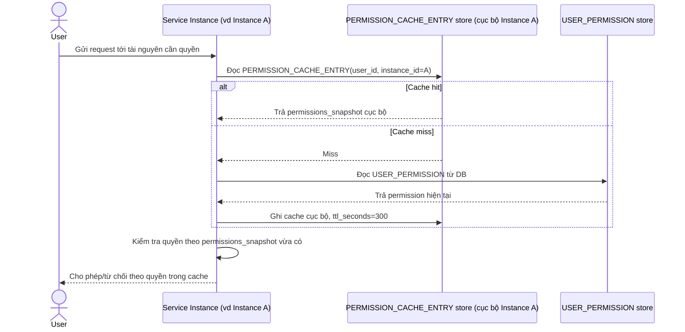
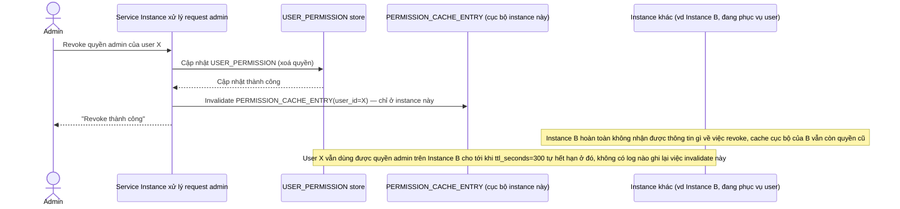
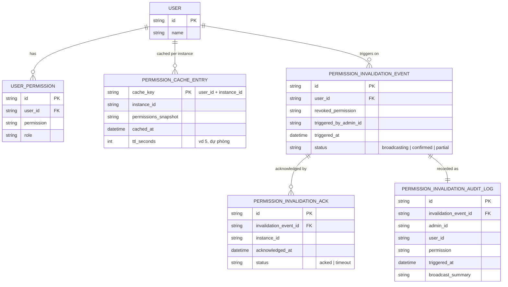
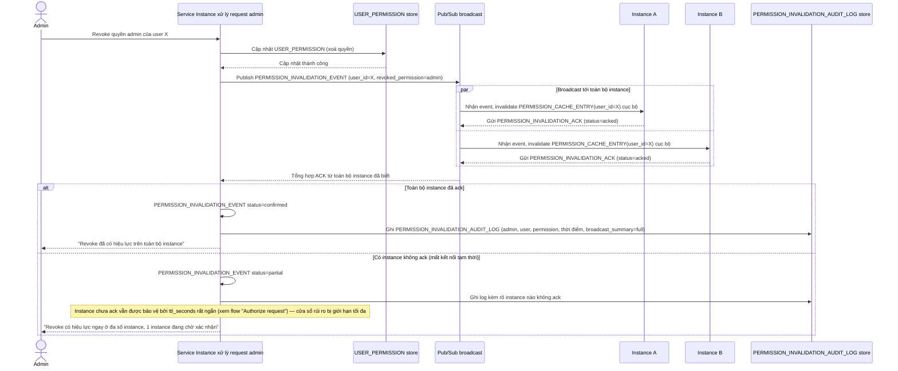
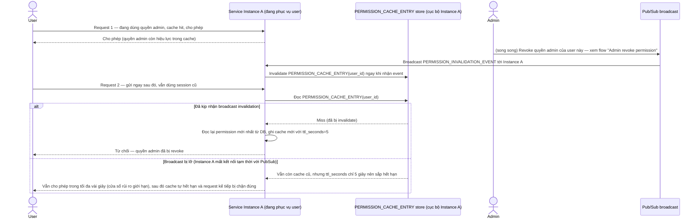

# Cache session/permission cho hệ thống phân quyền

**Hệ thống:** Một SaaS B2B cache thông tin quyền hạn (permission/role) của user để tránh query DB mỗi request, ảnh hưởng tới việc kiểm soát truy cập.

**Vai trò của flow:** Invalidate cache permission ngay khi quyền của user bị thay đổi (bị revoke quyền, đổi role), vì đây là dữ liệu bảo mật — cache cũ có thể dẫn tới lỗ hổng cho phép truy cập trái phép.

**Yêu cầu cụ thể:**
- Khi admin revoke quyền của một user, cache permission liên quan phải bị invalidate ngay lập tức và có xác nhận (không chấp nhận eventual consistency dạng "vài giây sau mới có hiệu lực" cho việc revoke quyền).
- Trong kiến trúc nhiều instance service cùng cache permission cục bộ, phải có cơ chế broadcast invalidation tới toàn bộ instance (ví dụ qua pub/sub) khi có thay đổi quyền, không chỉ invalidate ở một instance xử lý request đổi quyền.
- Nếu broadcast invalidation thất bại một phần (một instance không nhận được message do mất kết nối tạm thời), phải có cơ chế dự phòng (TTL rất ngắn cho cache permission, ví dụ vài giây) để giới hạn "cửa sổ rủi ro" tối đa.
- Có test case cụ thể: user đang có session hoạt động bị revoke quyền admin ngay khi đang dùng — request tiếp theo của họ (sau invalidation) phải bị chặn đúng theo quyền mới, không dùng permission cache cũ.
- Log đầy đủ mọi lần invalidate permission cache (ai, quyền gì, khi nào) để phục vụ audit an ninh khi cần điều tra truy cập trái phép.

---

# Base ERD — Cache permission trước khi có broadcast invalidation

Đây là **base**: mô hình dữ liệu suy luận từ ngữ cảnh đề bài, thể hiện trạng thái hệ thống **trước khi** có cơ chế broadcast invalidation xuyên instance. Đề bài nói kiến trúc nhiều instance cùng cache permission cục bộ — nên base cần đủ: user, role/permission gán cho user, và cache entry permission theo từng instance với TTL cố định. Chưa có entity nào phục vụ broadcast/xác nhận/audit log invalidation — những thứ đó là phần enhance.

---

# Base sequence — Authorize request

Đây là **base**, flow "Kiểm tra quyền cho mỗi request" — nền tảng cho enhance: mỗi instance tự cache permission cục bộ, không biết gì về thay đổi quyền xảy ra ở nơi khác cho tới khi TTL của chính nó hết hạn.

---

# Base sequence — Admin revoke permission (chỉ invalidate cục bộ)

Đây là **base**, flow "Admin revoke quyền của user" ở trạng thái hiện tại — chỉ invalidate cache ở đúng instance xử lý request revoke, các instance khác không hay biết gì. Flow này liên quan mật thiết tới enhance vì toàn bộ 5 yêu cầu của đề bài đều nhằm sửa đúng lỗ hổng bảo mật này.

---

# Enhance ERD — sau khi có broadcast invalidation xuyên instance

Đây là ERD **sau khi** enhance được áp dụng lên base. So với base, có 3 nhóm entity mới, ứng trực tiếp với 5 yêu cầu trong đề bài:

- `PERMISSION_INVALIDATION_EVENT` (mới) — phát broadcast ngay khi có revoke, thay vì chỉ invalidate cục bộ như base.
- `PERMISSION_INVALIDATION_ACK` (mới) — theo dõi từng instance đã xác nhận invalidate hay chưa, đảm bảo lan tới toàn bộ instance.
- `PERMISSION_CACHE_ENTRY` giảm `ttl_seconds` xuống rất ngắn (dự phòng cho trường hợp broadcast thất bại một phần).
- `PERMISSION_INVALIDATION_AUDIT_LOG` (mới) — log đầy đủ ai revoke, quyền gì, khi nào, phục vụ audit an ninh.

---

# Enhance sequence — Admin revoke permission (broadcast + ack + audit)

Đây là **enhance**, cùng flow "Admin revoke permission" đã có ở base nhưng nay thay đổi hoàn toàn theo yêu cầu 1, 2 và 5 của đề bài: broadcast invalidation tới toàn bộ instance qua pub/sub, chờ xác nhận trước khi coi revoke đã có hiệu lực đầy đủ, và log lại toàn bộ cho audit.

---

# Enhance sequence — Authorize request (test case: revoke giữa session đang hoạt động)

Đây là **enhance**, cùng flow "Authorize request" đã có ở base nhưng nay thay đổi theo yêu cầu 3 và 4 của đề bài: TTL dự phòng rất ngắn thay vì vài phút, và minh hoạ đúng test case bắt buộc — user đang có session hoạt động bị revoke quyền admin giữa chừng, request tiếp theo phải bị chặn đúng theo quyền mới.

