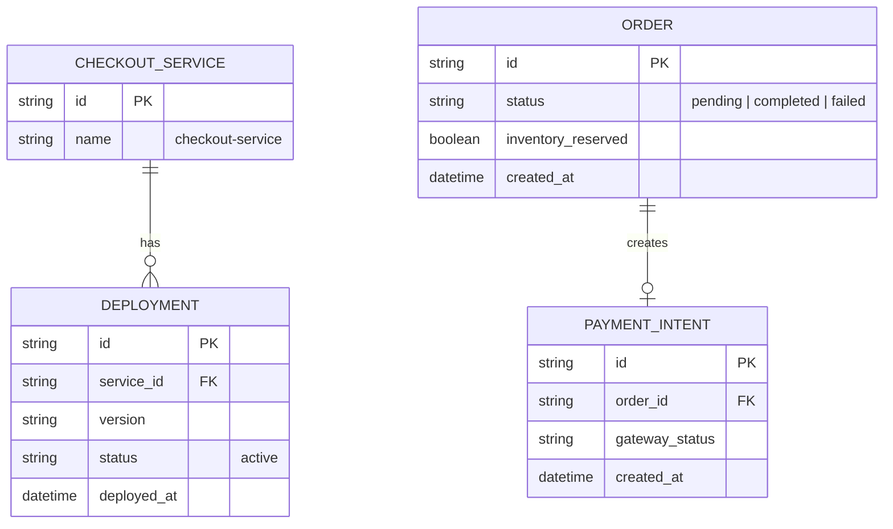
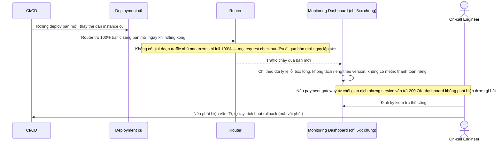
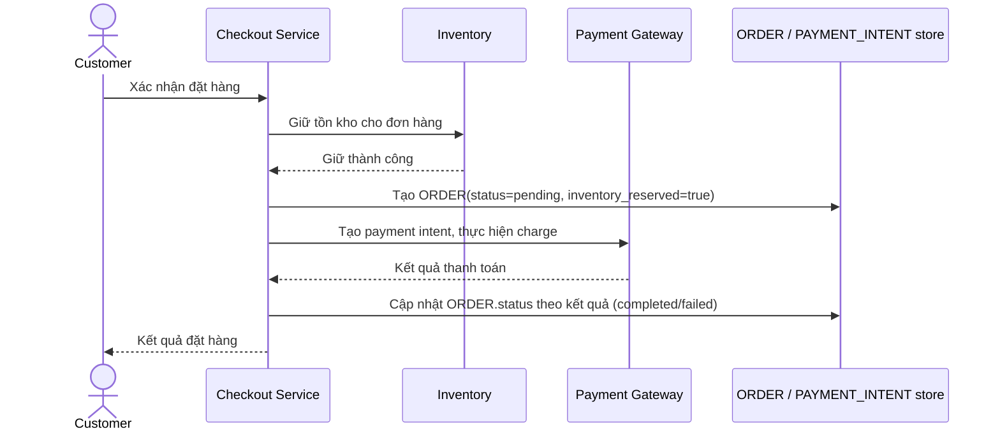
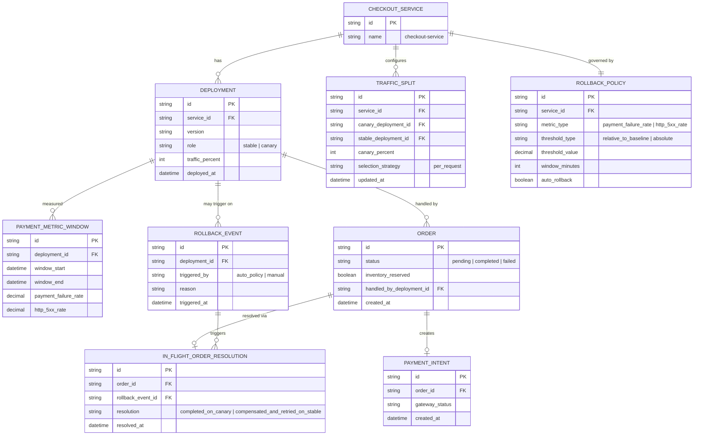
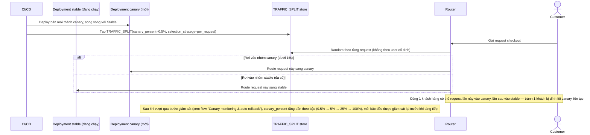
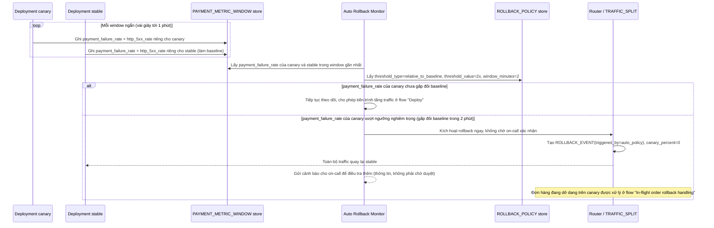
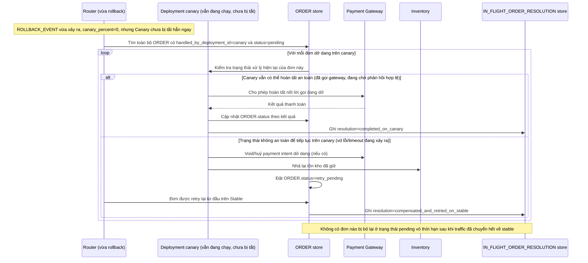

# Canary deployment cho luồng checkout của sàn e-commerce trong giờ cao điểm

**Hệ thống:** Một sàn e-commerce có luồng checkout tách riêng khỏi các dịch vụ khác (dashboard quản trị, catalog, tìm kiếm), xử lý trực tiếp thanh toán và ảnh hưởng doanh thu theo từng phút.

**Vai trò của flow:** Canary ở đây phải giới hạn phạm vi đúng vào service checkout, tăng tỷ lệ traffic rất thận trọng, và có khả năng phát hiện + rollback trong vài chục giây vì mỗi phút lỗi thanh toán đều mất tiền thật, khác hẳn với canary một dashboard nội bộ ít rủi ro.

**Yêu cầu cụ thể:**
- Giai đoạn canary đầu tiên chỉ nên nhận một tỷ lệ traffic rất nhỏ (ví dụ dưới 1%) và ưu tiên chọn ngẫu nhiên theo request chứ không theo user cố định, để một lỗi ở phiên bản mới không lặp lại nhiều lần trên cùng một khách hàng gây trải nghiệm tệ liên tục.
- Định nghĩa metric rollback riêng cho checkout khác với metric kỹ thuật thông thường — không chỉ tỷ lệ lỗi 5xx mà cả tỷ lệ giao dịch thanh toán thất bại/timeout ở cổng thanh toán, vì phiên bản mới có thể trả về 200 OK nhưng vẫn gọi sai tham số khiến cổng thanh toán từ chối giao dịch.
- Xử lý trường hợp một đơn hàng đã bắt đầu ở phiên bản canary (đã giữ tồn kho, đã tạo intent thanh toán) nhưng canary bị rollback giữa chừng do phát hiện lỗi — đơn hàng đó phải được hoàn tất hoặc hoàn tác một cách nhất quán, không để đơn ở trạng thái treo dở dang khi traffic chuyển hết về phiên bản cũ.
- Đảm bảo cơ chế giám sát tỷ lệ lỗi thanh toán phải tính riêng theo phiên bản (canary vs stable) theo thời gian gần thực (vài giây tới một phút), vì đợi tổng hợp báo cáo theo giờ là quá chậm để tránh thiệt hại doanh thu khi canary có lỗi.
- Thiết kế cơ chế rollback tự động không cần chờ người trực ca xác nhận thủ công đối với các ngưỡng lỗi nghiêm trọng đã định nghĩa trước (ví dụ tỷ lệ thanh toán thất bại tăng gấp đôi so với baseline trong 2 phút), vì tốc độ phản ứng ở đây quan trọng hơn quy trình phê duyệt nhiều bước.

---

# Base ERD — Checkout service trước khi có canary

Đây là **base**: mô hình dữ liệu suy luận từ ngữ cảnh đề bài, thể hiện trạng thái hệ thống **trước khi** có canary deployment. Đề bài nói checkout tách riêng khỏi các service khác, xử lý thanh toán và có đơn hàng gắn tồn kho + payment intent — nên base cần đủ: service, deployment (chỉ 1 target đang chạy), đơn hàng, và payment intent. Chưa có entity nào phục vụ traffic split/metric riêng theo version/rollback policy — những thứ đó là phần enhance.

---

# Base sequence — Deploy (rolling trực tiếp, chưa có canary)

Đây là **base**, flow "Deploy checkout service" ở trạng thái hiện tại — đẩy thẳng 100% traffic sang bản mới, chỉ giám sát lỗi 5xx chung, rollback thủ công. Flow này liên quan mật thiết tới enhance vì toàn bộ 5 yêu cầu của đề bài đều nhằm cải tổ lại đúng flow deploy này cho riêng checkout.

---

# Base sequence — Place order

Đây là **base**, flow "Đặt hàng/checkout" — nền tảng cho enhance: đơn hàng không gắn với version nào đã xử lý nó, nên khi có nhiều version chạy song song (canary), hệ thống chưa có cách xác định và xử lý nhất quán 1 đơn đang dở dang ở đúng version nào.

---

# Enhance ERD — sau khi có canary deployment cho checkout

Đây là ERD **sau khi** enhance được áp dụng lên base. So với base, có 5 thay đổi chính, ứng trực tiếp với 5 yêu cầu trong đề bài:

- `DEPLOYMENT` thêm `role` (stable/canary) và `traffic_percent`; `TRAFFIC_SPLIT` (mới) — chia traffic theo request, tăng dần từ tỷ lệ rất nhỏ, thay vì 100% ngay như base.
- `PAYMENT_METRIC_WINDOW` (mới) — đo riêng theo từng version, gần thời gian thực, gồm cả tỷ lệ thanh toán thất bại chứ không chỉ 5xx.
- `ROLLBACK_POLICY` + `ROLLBACK_EVENT` (mới) — tiêu chí rollback tự động cho ngưỡng nghiêm trọng, không chờ xác nhận thủ công.
- `ORDER` thêm `handled_by_deployment_id` — biết chính xác đơn nào đang dở dang ở canary khi rollback xảy ra.
- `IN_FLIGHT_ORDER_RESOLUTION` (mới) — xử lý nhất quán các đơn dở dang trên canary lúc rollback.

---

# Enhance sequence — Deploy (canary theo request, tăng dần)

Đây là **enhance**, cùng flow "Deploy" đã có ở base nhưng nay thay đổi hoàn toàn theo yêu cầu thứ 1 của đề bài: canary chỉ nhận dưới 1% traffic ban đầu, chọn ngẫu nhiên theo từng request chứ không cố định theo user, và chỉ tăng dần khi các bước trước đó ổn định.

---

# Enhance sequence — Canary monitoring & auto rollback

Đây là **enhance**, flow hoàn toàn mới, phát sinh từ enhance — chưa tồn tại ở base (base chỉ có dashboard 5xx chung, kiểm tra thủ công). Đáp ứng yêu cầu 2, 4 và 5 của đề bài: metric riêng cho thanh toán (không chỉ 5xx), đo theo từng version gần thời gian thực, và rollback tự động cho ngưỡng nghiêm trọng mà không chờ người trực ca.

---

# Enhance sequence — In-flight order rollback handling

Đây là **enhance**, flow hoàn toàn mới, phát sinh từ enhance — chưa tồn tại ở base (base không có khái niệm "đơn dở dang trên 1 version cụ thể"). Đáp ứng yêu cầu thứ 3 của đề bài: đơn hàng đã bắt đầu ở canary (đã giữ tồn kho, đã tạo payment intent) nhưng canary bị rollback giữa chừng phải được hoàn tất hoặc hoàn tác nhất quán, không để treo dở dang.

