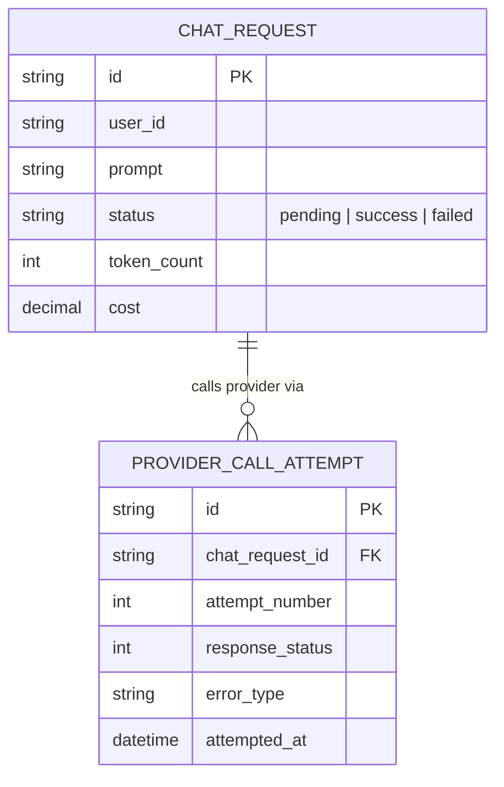
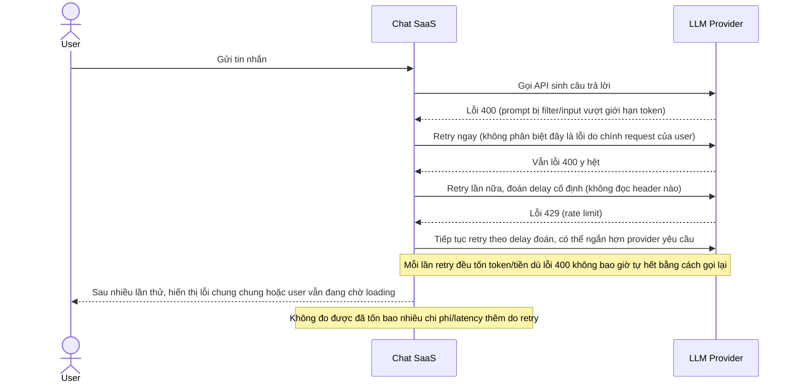
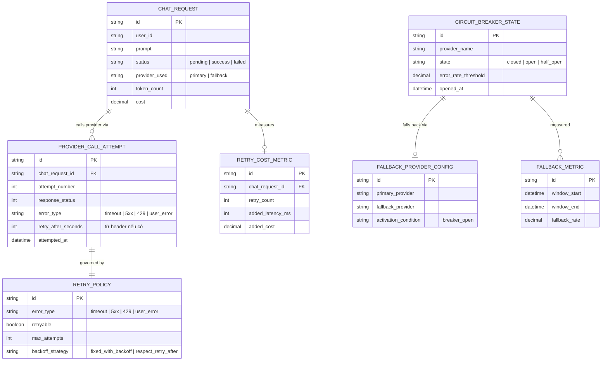
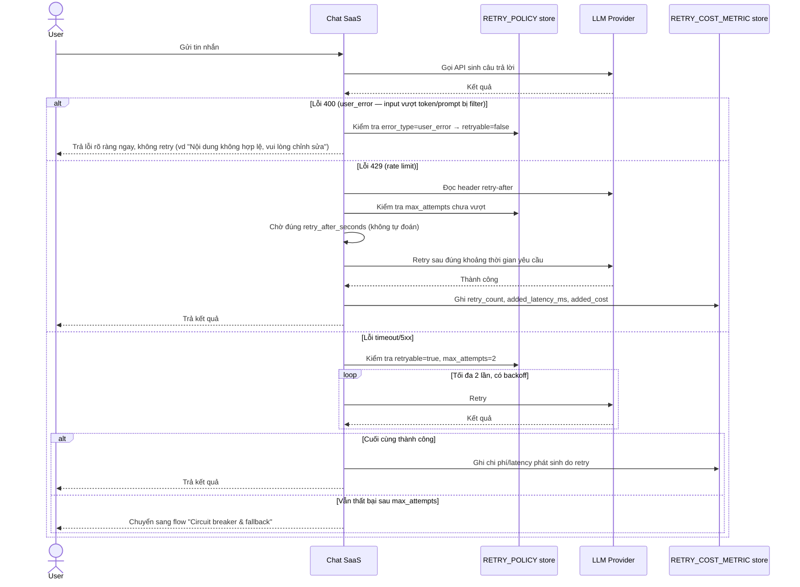
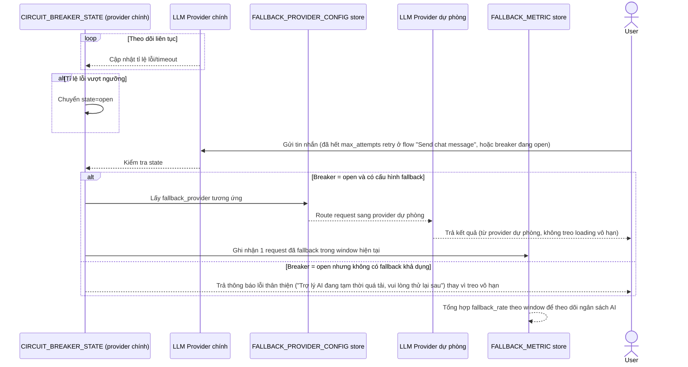

# SaaS gọi LLM/AI provider bên thứ ba cho tính năng chat AI

**Hệ thống:** Một SaaS có tính năng chat AI gọi API của nhà cung cấp mô hình ngôn ngữ bên ngoài để trả lời user.

**Vai trò của flow:** Circuit breaker + retry giúp xử lý khi provider AI bị rate limit, timeout, hoặc quá tải, tránh trải nghiệm user bị treo vô thời hạn hoặc gọi lại làm tốn quota/tiền không cần thiết.

**Yêu cầu cụ thể:**
- Retry chỉ thực hiện với lỗi timeout/5xx và tối đa số lần retry giới hạn (ví dụ 2 lần) với backoff, vì mỗi lần gọi provider AI có chi phí (tính theo token) — retry vô tội vạ gây tốn tiền.
- Khi provider trả lỗi 429 (rate limit), phải đọc header retry-after (nếu có) để backoff đúng thời gian được yêu cầu, không tự đoán.
- Circuit breaker mở khi tỉ lệ lỗi/timeout của provider vượt ngưỡng, và hệ thống phải có fallback rõ ràng khi breaker mở (ví dụ chuyển sang provider dự phòng thứ hai, hoặc trả thông báo lỗi thân thiện cho user thay vì treo loading vô hạn).
- Phải phân biệt và không retry với lỗi do chính request của user sai (ví dụ input vượt quá giới hạn token, prompt bị filter) — retry những lỗi này chỉ tốn thời gian mà không giải quyết được gì.
- Đo lường: latency thêm vào do retry (retry overhead), tỉ lệ request phải fallback sang provider dự phòng, và chi phí phát sinh do retry để đưa vào theo dõi ngân sách AI.

---

# Base ERD — Chat AI trước khi có circuit breaker + retry phân loại lỗi

Đây là **base**: mô hình dữ liệu suy luận từ ngữ cảnh đề bài, thể hiện trạng thái hệ thống **trước khi** có retry/circuit breaker thông minh. Đề bài nói SaaS gọi 1 provider AI bên ngoài, tính phí theo token — nên base cần đủ: request chat và các lần gọi provider, chưa phân loại lỗi. Chưa có entity nào phục vụ retry policy/breaker/fallback provider/đo chi phí retry — những thứ đó là phần enhance.

---

# Base sequence — Send chat message (retry mù, không phân biệt lỗi)

Đây là **base**, flow "Gửi tin nhắn chat AI" ở trạng thái hiện tại — retry mọi loại lỗi như nhau, đoán thời gian chờ, không giới hạn rõ số lần. Flow này liên quan mật thiết tới enhance vì toàn bộ 5 yêu cầu của đề bài đều nhằm sửa đúng các lỗ hổng ở đây.

---

# Enhance ERD — sau khi có retry phân loại lỗi + circuit breaker + fallback

Đây là ERD **sau khi** enhance được áp dụng lên base. So với base, có 4 nhóm entity mới, ứng trực tiếp với 5 yêu cầu trong đề bài:

- `RETRY_POLICY` (mới) — phân loại rõ lỗi nào được retry (timeout/5xx/429), lỗi nào không (user_error), giới hạn số lần và cách tính backoff (tôn trọng `retry-after` cho 429).
- `CIRCUIT_BREAKER_STATE` + `FALLBACK_PROVIDER_CONFIG` (mới) — mở breaker khi tỉ lệ lỗi vượt ngưỡng, chuyển sang provider dự phòng hoặc trả lỗi thân thiện.
- `RETRY_COST_METRIC` + `FALLBACK_METRIC` (mới) — đo latency/chi phí phát sinh do retry và tỉ lệ phải fallback.

---

# Enhance sequence — Send chat message (retry phân loại lỗi, tôn trọng retry-after)

Đây là **enhance**, cùng flow "Send chat message" đã có ở base nhưng nay thay đổi hoàn toàn theo yêu cầu 1, 2, 4 và 5 của đề bài: chỉ retry timeout/5xx với giới hạn số lần, tôn trọng header `retry-after` cho 429, tuyệt đối không retry lỗi do request của user, và đo chi phí/latency phát sinh do retry.

---

# Enhance sequence — Circuit breaker & fallback provider

Đây là **enhance**, flow hoàn toàn mới, phát sinh từ enhance — chưa tồn tại ở base (base không có breaker/fallback, chỉ retry vô hạn). Đáp ứng yêu cầu thứ 3 và phần còn lại của yêu cầu thứ 5 của đề bài: breaker mở khi tỉ lệ lỗi vượt ngưỡng, fallback rõ ràng sang provider dự phòng hoặc lỗi thân thiện, và đo tỉ lệ fallback.

