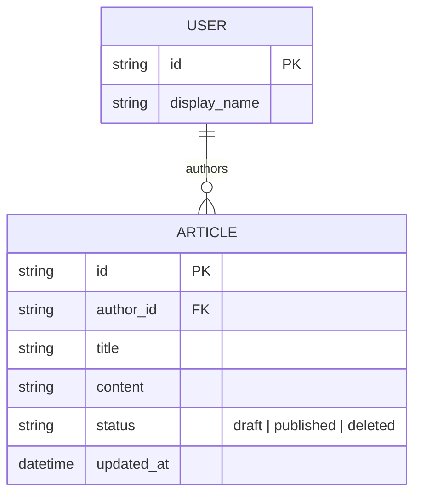
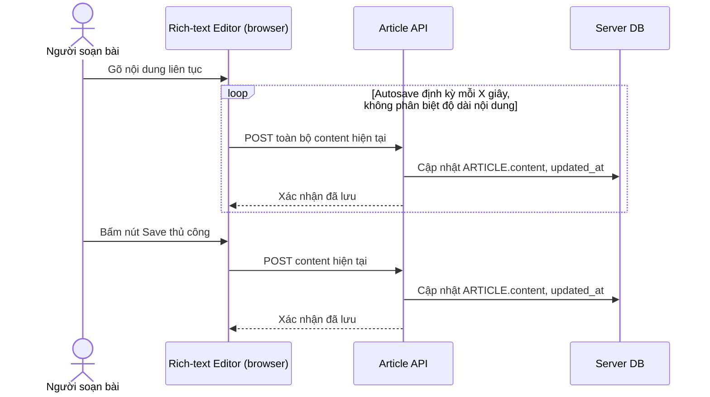
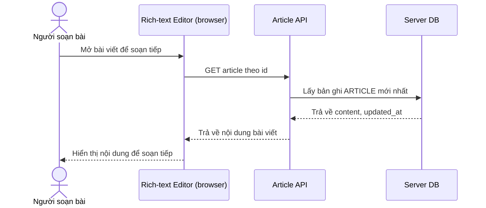
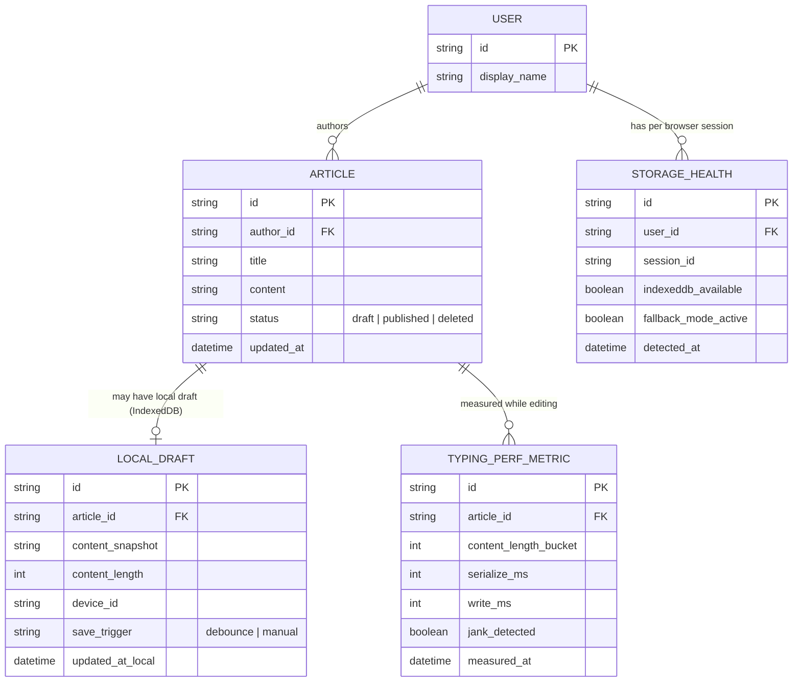
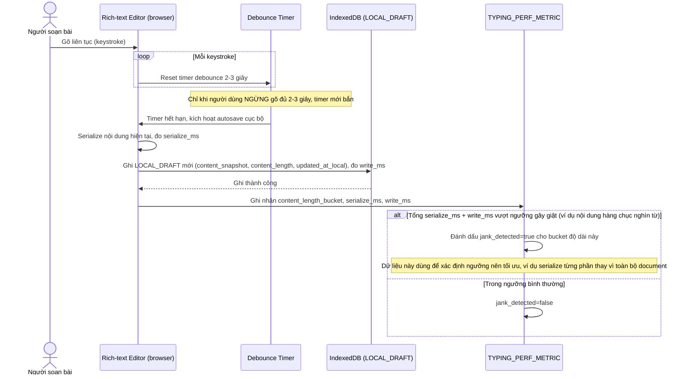
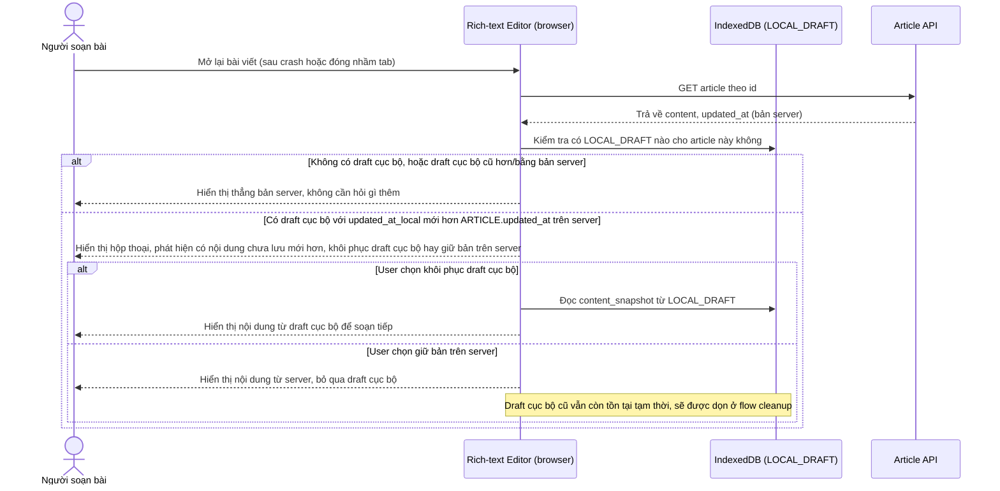
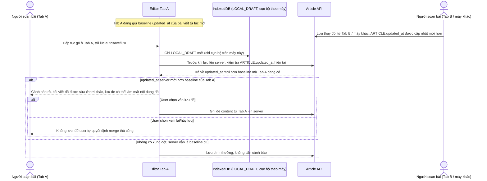
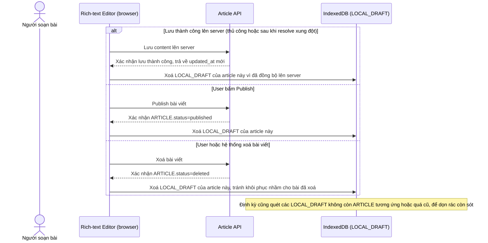
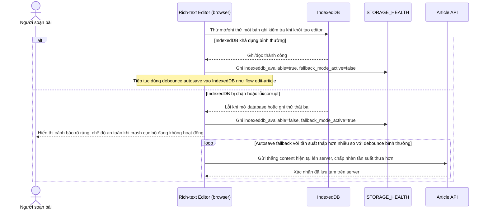

# Autosave draft chống mất nội dung bằng IndexedDB cho trình soạn thảo CMS

**Hệ thống:** Trình soạn thảo nội dung dạng rich-text (CMS viết bài, hoặc công cụ soạn tài liệu) cho phép soạn bài dài, cần autosave draft liên tục vào IndexedDB để không mất nội dung khi crash trình duyệt/mất điện, trước khi kịp lưu lên server.

**Vai trò của flow:** Đảm bảo "không bao giờ mất nội dung đang gõ" mà không làm chậm trải nghiệm gõ phím, và không tạo xung đột khi cùng lúc có bản draft cục bộ và bản đã lưu trên server.

**Yêu cầu cụ thể:**
- Autosave vào IndexedDB theo debounce (ví dụ mỗi 2-3 giây sau khi ngừng gõ) thay vì lưu mỗi keystroke, để không chặn main thread khi nội dung dài (hàng chục nghìn từ) — đo rõ ngưỡng độ dài nội dung mà việc serialize/ghi IndexedDB bắt đầu gây giật khi gõ.
- Khi mở lại app sau khi crash/đóng nhầm tab, phải phát hiện có draft chưa lưu trong IndexedDB mới hơn bản đã lưu trên server, và hỏi rõ user chọn khôi phục draft cục bộ hay giữ bản trên server — không tự động ghi đè một trong hai một cách ngầm định.
- Mở cùng 1 bài viết ở 2 tab/2 máy khác nhau: draft cục bộ trong IndexedDB chỉ có ý nghĩa cục bộ (không đồng bộ qua lại giữa các máy), nên khi server đã có bản mới hơn (do sửa từ máy/tab khác) phải cảnh báo rõ nguy cơ mất nội dung nếu cứ lưu đè, thay vì im lặng ghi đè draft cũ hơn.
- Dọn dẹp draft trong IndexedDB sau khi đã lưu thành công lên server hoặc bài viết đã publish/xóa, tránh tồn đọng draft rác vô thời hạn làm phình dung lượng IndexedDB và có thể vô tình khôi phục nhầm draft đã lỗi thời cho một bài viết đã bị xóa từ lâu.
- Xử lý khi IndexedDB bị lỗi/không khả dụng (một số trình duyệt chặn trong chế độ ẩn danh hoặc storage bị corrupt) — có fallback về autosave lên server với tần suất thấp hơn, và cảnh báo rõ cho user biết chế độ "an toàn khi crash cục bộ" đang không hoạt động.

---

# Base ERD — Trình soạn thảo CMS trước khi có autosave draft bằng IndexedDB

Đây là **base**: mô hình dữ liệu suy luận từ ngữ cảnh đề bài, mô tả trạng thái hệ thống **trước khi** có cơ chế autosave draft cục bộ. Đề bài nói tới trình soạn thảo rich-text lưu bài lên server, nên base chỉ cần User và Article ở phía server, lưu trực tiếp khi bấm Save hoặc autosave định kỳ thẳng lên server. Chưa có bất kỳ entity nào phía client (IndexedDB draft, đo hiệu năng gõ, trạng thái storage) — toàn bộ phần đó là enhance.

---

# Base sequence — Edit article (lưu thẳng lên server, chưa có autosave cục bộ)

Đây là **base**, flow soạn thảo bài viết ở trạng thái trước enhance. Người dùng gõ nội dung, việc lưu chỉ xảy ra khi bấm nút Save thủ công hoặc autosave định kỳ gọi thẳng API server, không có bước lưu tạm cục bộ nào. Flow này là nền để so sánh với flow cùng tên ở enhance, nơi autosave chuyển sang debounce ghi vào IndexedDB trước.

---

# Base sequence — Open article (chưa có kiểm tra draft cục bộ)

Đây là **base**, flow mở bài viết để soạn tiếp. Trình soạn thảo chỉ đơn giản tải bản mới nhất từ server và hiển thị, không có khái niệm draft cục bộ nên không có bước so sánh hay hỏi người dùng chọn phiên bản nào. Flow này là nền để so sánh với flow cùng tên ở enhance, nơi việc mở bài viết phải kiểm tra thêm draft trong IndexedDB.

---

# Enhance ERD — Autosave draft cục bộ bằng IndexedDB

Đây là ERD **sau khi** enhance được áp dụng lên base. So với base (chỉ có USER/ARTICLE ở server), phần enhance thêm 3 entity mới hoàn toàn ở phía client/observability, ứng trực tiếp với các yêu cầu trong đề bài:

- `LOCAL_DRAFT` (mới, lưu trong IndexedDB) — snapshot content debounce mỗi 2-3 giây, kèm `content_length` và `updated_at_local` để so sánh với `ARTICLE.updated_at` trên server — phục vụ yêu cầu 1, 2, 3.
- `TYPING_PERF_METRIC` (mới) — đo thời gian serialize + ghi IndexedDB theo từng khoảng độ dài nội dung, để xác định ngưỡng bắt đầu gây giật — phục vụ yêu cầu 1.
- `STORAGE_HEALTH` (mới) — trạng thái IndexedDB khả dụng hay không theo từng phiên trình duyệt, và có đang ở fallback mode hay không — phục vụ yêu cầu 5.

`LOCAL_DRAFT` có vòng đời gắn với 1 `ARTICLE`, bị xoá khi lưu server thành công hoặc bài viết publish/xoá (yêu cầu 4).

---

# Enhance sequence — Edit article (debounce autosave vào IndexedDB, đo ngưỡng gây giật)

Đây là **enhance**, cùng flow "edit-article" như ở base nhưng thay đổi hoàn toàn cơ chế autosave: thay vì gọi thẳng server định kỳ, mỗi lần ngừng gõ 2-3 giây mới serialize và ghi 1 bản draft vào IndexedDB (debounce), đồng thời đo thời gian serialize/ghi theo độ dài nội dung để xác định ngưỡng bắt đầu gây giật khi gõ. Đáp ứng yêu cầu 1 của đề bài.

---

# Enhance sequence — Open article (phát hiện draft cục bộ mới hơn bản server)

Đây là **enhance**, cùng flow "open-article" như ở base nhưng thêm bước kiểm tra draft trong IndexedDB trước khi hiển thị. Nếu phát hiện có draft cục bộ mới hơn bản đã lưu trên server (dấu hiệu của crash hoặc đóng nhầm tab trước đó), hệ thống phải hỏi rõ người dùng chọn khôi phục draft cục bộ hay giữ bản trên server, không tự động ghi đè ngầm định. Đáp ứng yêu cầu 2 của đề bài.

---

# Enhance sequence — Cảnh báo xung đột khi server đã có bản mới hơn từ tab/máy khác

Đây là **enhance**, flow hoàn toàn mới, xử lý tình huống mở cùng 1 bài viết ở 2 tab hoặc 2 máy khác nhau. Vì draft cục bộ trong IndexedDB chỉ có ý nghĩa cục bộ, không đồng bộ qua lại giữa các máy, nên trước khi lưu đè lên server hệ thống phải kiểm tra xem server đã bị sửa từ nơi khác mới hơn baseline mà tab hiện tại đang biết hay chưa, và cảnh báo rõ nguy cơ mất nội dung thay vì im lặng ghi đè. Đáp ứng yêu cầu 3 của đề bài.

---

# Enhance sequence — Dọn dẹp draft cục bộ sau khi lưu server hoặc publish/xoá bài

Đây là **enhance**, flow hoàn toàn mới, đảm bảo draft trong IndexedDB không tồn đọng vô thời hạn. Ngay sau khi lưu thành công lên server, hoặc khi bài viết được publish/xoá, draft cục bộ tương ứng phải được xoá để tránh phình dung lượng IndexedDB và tránh vô tình khôi phục nhầm draft lỗi thời cho một bài đã bị xoá từ lâu. Đáp ứng yêu cầu 4 của đề bài.

---

# Enhance sequence — Fallback khi IndexedDB lỗi/không khả dụng

Đây là **enhance**, flow hoàn toàn mới, xử lý trường hợp IndexedDB bị chặn (ví dụ chế độ ẩn danh của một số trình duyệt) hoặc storage bị corrupt. Hệ thống phải phát hiện tình trạng này, chuyển sang fallback autosave thẳng lên server với tần suất thấp hơn, và cảnh báo rõ cho người dùng biết chế độ "an toàn khi crash cục bộ" đang không hoạt động. Đáp ứng yêu cầu 5 của đề bài.

