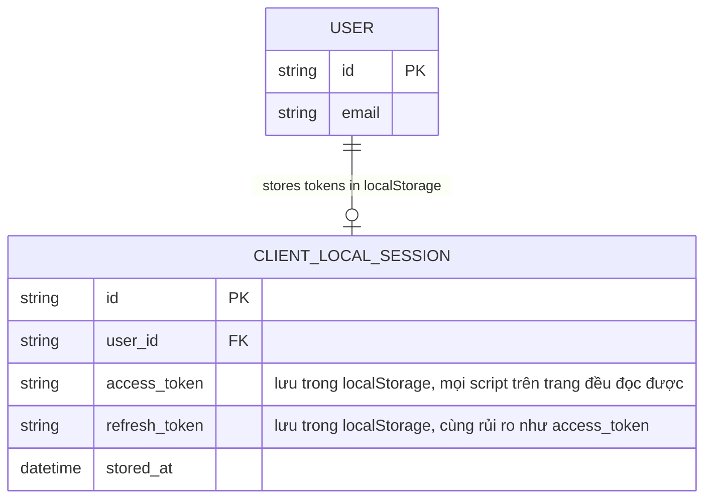
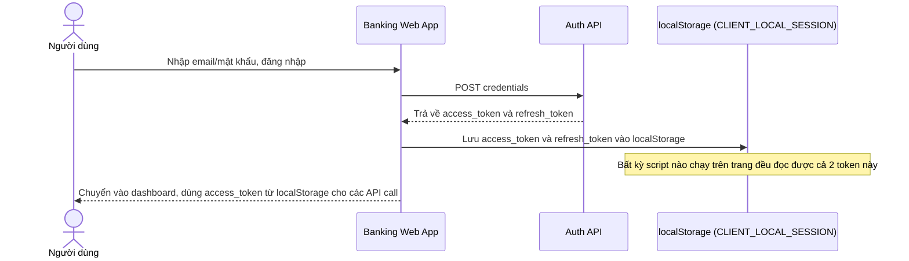
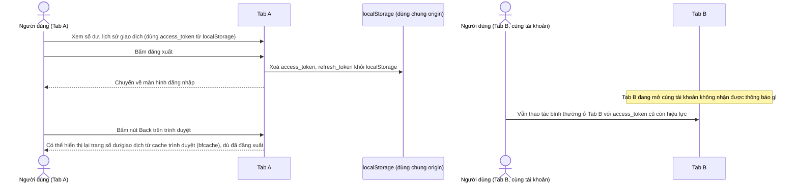
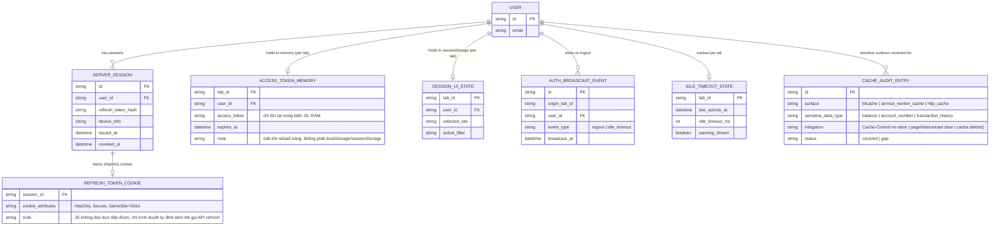
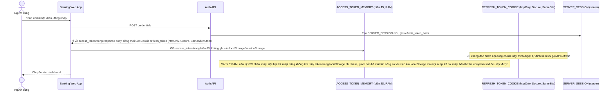
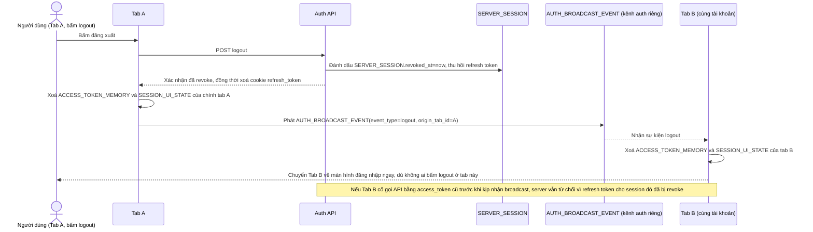
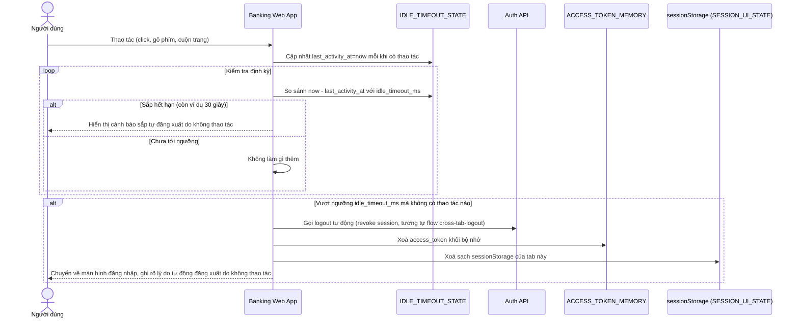
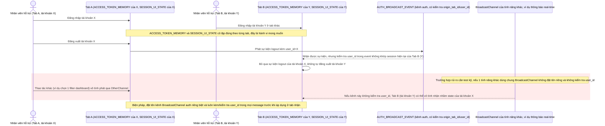
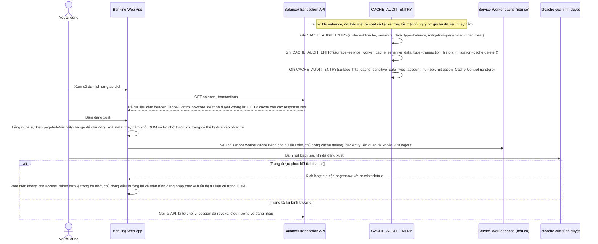

# Lưu token/session phía client cho ứng dụng ngân hàng số

**Hệ thống:** Ứng dụng ngân hàng số/fintech web lưu access token và dữ liệu phiên đăng nhập ở phía client, phải cân bằng giữa trải nghiệm (không bắt đăng nhập lại liên tục) và yêu cầu bảo mật nghiêm ngặt (không để token bị đánh cắp qua XSS, không rò rỉ khi dùng chung máy).

**Vai trò của flow:** Chọn đúng nơi lưu (memory/sessionStorage/httpOnly cookie) cho từng loại dữ liệu nhạy cảm, và xử lý đúng vòng đời khi đóng tab/đăng xuất/dùng chung máy.

**Yêu cầu cụ thể:**
- Access token ngắn hạn chỉ giữ trong memory (biến JS, không phải localStorage/sessionStorage) để giảm bề mặt tấn công XSS; refresh token dùng cookie httpOnly + Secure + SameSite do server set, JS không đọc trực tiếp được — nêu rõ vì sao localStorage bị loại cho trường hợp này (mọi script chạy trên trang, kể cả script bên thứ ba lỡ bị compromise, đều đọc được).
- Thông tin phi nhạy cảm (tab đang chọn, filter đang áp dụng trên dashboard) có thể lưu sessionStorage — nhưng phải tự xóa sạch mọi state khi logout, kể cả khi logout được trigger từ tab khác (đăng xuất ở 1 tab phải làm mất hiệu lực token ở toàn bộ tab đang mở, không chỉ tab bấm logout).
- Máy dùng chung (quầy giao dịch, máy tính công cộng): sessionStorage tự xóa khi đóng tab/trình duyệt là chưa đủ — cần thêm auto-logout theo thời gian không thao tác (idle timeout) và xóa rõ ràng toàn bộ cache/state khi timeout, không dựa hoàn toàn vào hành vi đóng tab của user.
- Khi vô tình mở 2 tab với 2 tài khoản khác nhau (nhân viên hỗ trợ dùng nhiều tài khoản test) — vì sessionStorage cô lập theo tab nên đây là hành vi đúng, nhưng phải test kỹ để đảm bảo không có state nào vô tình rò rỉ qua cơ chế khác (ví dụ BroadcastChannel dùng chung cho tính năng khác vô tình đồng bộ nhầm session giữa 2 tab khác tài khoản).
- Audit: liệt kê rõ mọi nơi dữ liệu nhạy cảm (số dư, số tài khoản, lịch sử giao dịch) có thể vô tình bị cache lại (browser back/forward cache - bfcache, hoặc cache của service worker nếu có) sau khi logout, và đảm bảo dùng `Cache-Control: no-store` hoặc unload handler để không xem lại được dữ liệu cũ bằng nút Back sau khi đã đăng xuất.

---

# Base ERD — Lưu token phía client trước khi siết bảo mật

Đây là **base**: mô hình dữ liệu suy luận từ ngữ cảnh đề bài, mô tả trạng thái hệ thống **trước khi** áp các yêu cầu bảo mật nghiêm ngặt. Đề bài ngầm định hệ thống ngân hàng số hiện đã có đăng nhập và lưu token phía client theo cách đơn giản/naive: cả access token lẫn refresh token đều được lưu chung vào localStorage sau khi đăng nhập, không phân loại theo mức độ nhạy cảm, không có idle timeout, không có đồng bộ đăng xuất giữa các tab, chưa xử lý bfcache. Đây chính là những vấn đề mà enhance sẽ giải quyết.

---

# Base sequence — Login (cả 2 token đều lưu localStorage)

Đây là **base**, flow đăng nhập ở trạng thái trước enhance. Sau khi xác thực, server trả về cả access token lẫn refresh token, và client lưu cả 2 vào localStorage để dùng cho các lần gọi API sau. Đây chính là điểm mà enhance sẽ thay đổi triệt để: bất kỳ đoạn script nào chạy trên trang, kể cả script bên thứ ba lỡ bị compromise, cũng đọc được các token này.

---

# Base sequence — Logout (chỉ xoá tab hiện tại, không có audit cache)

Đây là **base**, flow đăng xuất ở trạng thái trước enhance. Logout chỉ xoá localStorage của đúng tab đang bấm, các tab khác đang mở với cùng tài khoản vẫn còn access_token hợp lệ trong localStorage của chúng (localStorage dùng chung theo origin nhưng flow logout ở base không chủ động thông báo cho tab khác). Ngoài ra không có xử lý gì cho cache-control hay bfcache, nên bấm Back sau khi logout có thể thấy lại trang có dữ liệu nhạy cảm từ bộ nhớ cache trình duyệt.

---

# Enhance ERD — Phân loại nơi lưu theo mức độ nhạy cảm

Đây là ERD **sau khi** enhance được áp dụng lên base. So với base (mọi thứ dồn vào `CLIENT_LOCAL_SESSION` trong localStorage), enhance tách dữ liệu ra nhiều nơi lưu khác nhau theo đúng mức độ nhạy cảm, và thêm cơ chế điều phối vòng đời. Một số entity dưới đây **không phải bảng DB thật** mà là cấu trúc sống trong bộ nhớ trình duyệt/cookie — được mô hình hoá dạng ERD để thấy rõ dữ liệu nào nằm ở đâu:

- `ACCESS_TOKEN_MEMORY` (mới, chỉ tồn tại trong biến JS ở RAM) — không phải localStorage/sessionStorage, mất khi reload trang, giảm bề mặt tấn công XSS vì script không tồn tại nào đọc được sau khi trang tải lại — yêu cầu 1.
- `REFRESH_TOKEN_COOKIE` (mới, cookie httpOnly + Secure + SameSite do server set) — JS không đọc trực tiếp được, khác hẳn base lưu refresh_token vào localStorage mà mọi script kể cả script bên thứ ba compromised đều đọc được — yêu cầu 1.
- `SERVER_SESSION` (mới, bảng thật trên server) — cho phép server thu hồi refresh token tập trung, làm nền cho việc đăng xuất có hiệu lực ở mọi tab/thiết bị — yêu cầu 2.
- `SESSION_UI_STATE` (mới, sessionStorage, cô lập theo tab) — dữ liệu phi nhạy cảm như tab đang chọn, filter dashboard — yêu cầu 2, 4.
- `AUTH_BROADCAST_EVENT` (mới, kênh BroadcastChannel riêng cho auth, đặt tên tách biệt khỏi kênh của tính năng khác) — phát sự kiện logout tới mọi tab cùng origin — yêu cầu 2, 4.
- `IDLE_TIMEOUT_STATE` (mới, bộ nhớ JS theo tab) — theo dõi thời gian không thao tác để tự động đăng xuất trên máy dùng chung — yêu cầu 3.
- `CACHE_AUDIT_ENTRY` (mới, bảng ghi nhận nội bộ dùng cho audit bảo mật) — liệt kê nơi dữ liệu nhạy cảm có thể vô tình bị cache lại (bfcache, service worker cache) và biện pháp chặn — yêu cầu 5.

---

# Enhance sequence — Login (access token chỉ ở memory, refresh token là cookie httpOnly)

Đây là **enhance**, cùng flow "login" như ở base nhưng thay đổi triệt để nơi lưu 2 loại token. Access token ngắn hạn chỉ giữ trong biến JS ở bộ nhớ (không phải localStorage/sessionStorage) để giảm bề mặt tấn công XSS. Refresh token không còn do JS lưu, mà server set thẳng vào cookie httpOnly + Secure + SameSite, JS không đọc trực tiếp được. Đáp ứng yêu cầu 1 của đề bài.

---

# Enhance sequence — Logout đồng bộ mọi tab đang mở

Đây là **enhance**, cùng flow "logout" như ở base nhưng thay đổi ở chỗ: đăng xuất ở 1 tab phải làm mất hiệu lực token ở toàn bộ tab đang mở, không chỉ tab bấm logout, và dữ liệu phi nhạy cảm trong sessionStorage cũng phải được xoá sạch ở mọi tab. Đáp ứng yêu cầu 2 của đề bài.

---

# Enhance sequence — Auto-logout theo idle timeout cho máy dùng chung

Đây là **enhance**, flow hoàn toàn mới, dành cho máy dùng chung (quầy giao dịch, máy tính công cộng). sessionStorage tự xoá khi đóng tab là chưa đủ vì nhân viên sau có thể dùng lại tab đang mở sẵn; hệ thống cần chủ động đếm thời gian không thao tác và tự đăng xuất, xoá rõ ràng toàn bộ cache/state, không phụ thuộc vào việc user có đóng tab hay không. Đáp ứng yêu cầu 3 của đề bài.

---

# Enhance sequence — Kiểm tra cô lập giữa 2 tab dùng 2 tài khoản khác nhau

Đây là **enhance**, flow hoàn toàn mới, mô tả kịch bản kiểm thử khi nhân viên hỗ trợ vô tình mở 2 tab với 2 tài khoản khác nhau để test. Vì sessionStorage và biến bộ nhớ JS cô lập theo từng tab nên đây là hành vi đúng, nhưng phải kiểm tra kỹ để đảm bảo không có state nào rò rỉ qua cơ chế dùng chung khác, ví dụ kênh BroadcastChannel của một tính năng không liên quan tới auth. Đáp ứng yêu cầu 4 của đề bài.

---

# Enhance sequence — Audit cache nhạy cảm và chặn xem lại bằng nút Back sau logout

Đây là **enhance**, cùng ý tưởng flow "logout" ở base nhưng bổ sung phần audit và chặn rò rỉ qua các lớp cache của trình duyệt. Sau khi logout, hệ thống phải đảm bảo không nơi nào (bfcache, service worker cache, HTTP cache) còn giữ lại dữ liệu nhạy cảm như số dư, số tài khoản, lịch sử giao dịch để có thể xem lại bằng nút Back. Đáp ứng yêu cầu 5 của đề bài.

