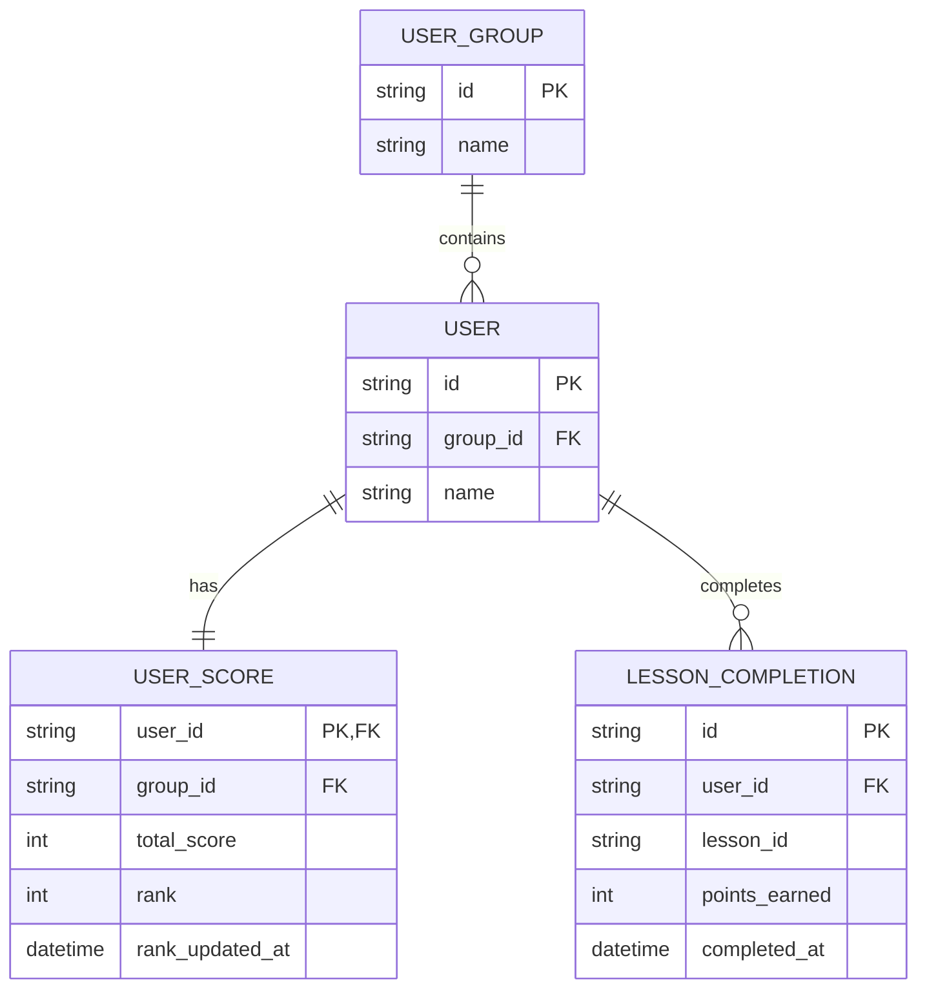
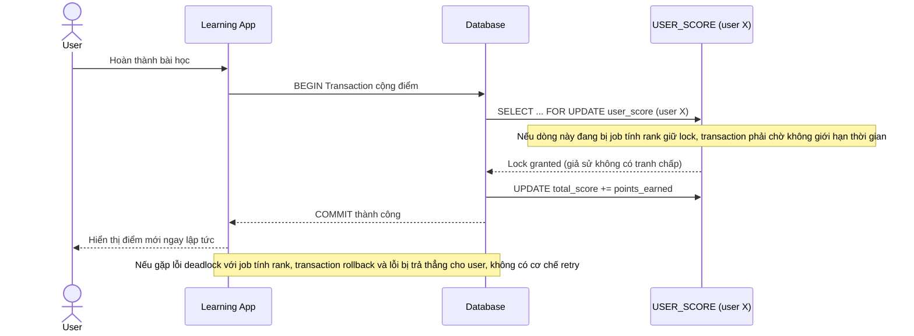
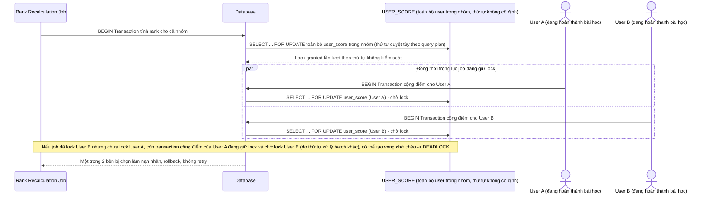
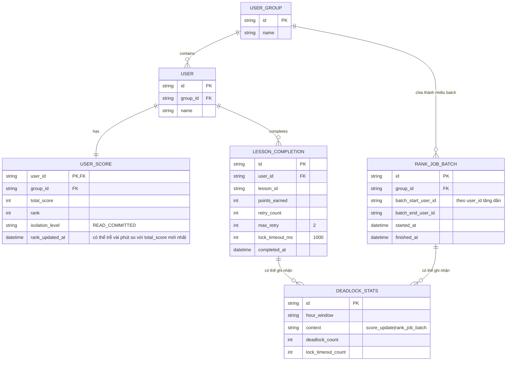
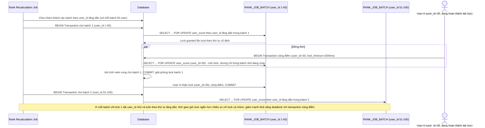
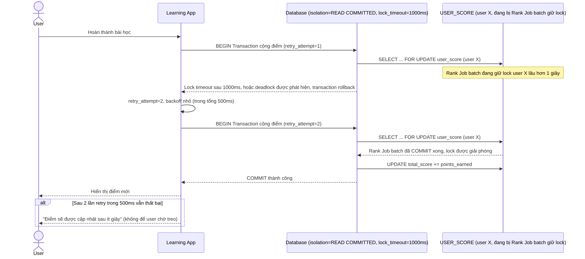
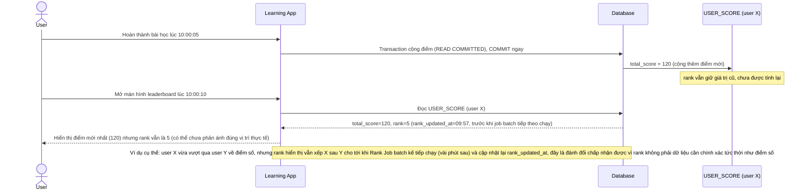
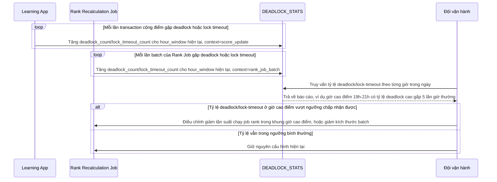

# Cập nhật điểm số và thứ hạng leaderboard trong game/app học tập

**Hệ thống:** Một app học tập gamification, nơi hoàn thành bài học cập nhật điểm user và một job nền tính lại thứ hạng leaderboard theo nhóm/lớp mỗi vài phút.

**Vai trò của flow:** Transaction cộng điểm khi user hoàn thành bài học và job tính lại rank (đọc/update nhiều user trong 1 nhóm) cạnh tranh lock trên bảng `user_score`, cần tránh deadlock giữa update đơn lẻ tần suất cao và job batch định kỳ.

**Yêu cầu cụ thể:**
- Yêu cầu job tính rank phải lock theo thứ tự user_id tăng dần trong từng nhóm, và xử lý theo từng nhóm nhỏ (không lock toàn bảng `user_score` một lần) để giảm collision với các transaction cộng điểm đang chạy real-time.
- Chỉ ra rủi ro cụ thể: nếu 2 user trong cùng nhóm cùng hoàn thành bài học đúng lúc job rank đang chạy, cả 2 transaction cộng điểm và transaction job đều có thể chờ nhau — yêu cầu retry tự động cho transaction cộng điểm (ưu tiên UX real-time của user) khi gặp deadlock, tối đa 2 lần trong 500ms.
- Chọn isolation level `READ COMMITTED` cho transaction cộng điểm để có UX nhanh, nhưng job tính rank cần đảm bảo tính nhất quán tương đối (không bắt buộc real-time chính xác tuyệt đối) — giải thích trade-off này bằng ví dụ cụ thể.
- Thiết kế cơ chế "lock timeout" ngắn (ví dụ 1 giây) cho transaction cộng điểm, để nếu job rank đang giữ lock lâu, user vẫn nhận được phản hồi (có thể là "điểm sẽ cập nhật sau ít giây") thay vì trải nghiệm bị treo.
- Đo và log tỷ lệ deadlock/lock-timeout theo giờ cao điểm (khi nhiều user học cùng lúc) để xác định xem có cần điều chỉnh tần suất chạy job rank hay không.

---

# Base ERD — Điểm số và leaderboard chưa có cơ chế chống deadlock

Đây là **base**: trạng thái hệ thống app học tập gamification *trước khi* áp dụng thứ tự lock theo batch nhỏ, retry và lock timeout. Suy luận từ đề bài, base đã có `USER_GROUP` (nhóm/lớp), `USER` thuộc 1 nhóm, `USER_SCORE` lưu điểm và rank hiện tại của từng user, và `LESSON_COMPLETION` ghi nhận mỗi lần hoàn thành bài học (nguồn cộng điểm). Base chưa phân biệt cách job tính rank và transaction cộng điểm truy cập `USER_SCORE`, cả 2 đều thao tác trực tiếp không có chiến lược tránh tranh chấp.

---

# Base sequence — Complete lesson (cộng điểm, không retry, không timeout)

Đây là **base**, flow cộng điểm khi user hoàn thành bài học ở trạng thái hiện tại: transaction lock trực tiếp dòng `USER_SCORE` của user đó, không có retry khi gặp lỗi deadlock, không có lock timeout — nếu job tính rank đang giữ lock lâu, transaction này sẽ chờ vô thời hạn hoặc lỗi thẳng ra user. Flow này là tiền đề cho yêu cầu 2 và 4 của đề bài.

---

# Base sequence — Job tính lại rank (lock cả nhóm cùng lúc, không sort user_id)

Đây là **base**, flow job nền tính lại thứ hạng leaderboard ở trạng thái hiện tại: job đọc/update toàn bộ user trong 1 nhóm cùng lúc, không sort theo `user_id`, không chia batch nhỏ. Khi chạy song song với các transaction cộng điểm real-time, đây chính là nguồn gốc rủi ro deadlock nêu ở yêu cầu 1 của đề bài.

---

# Enhance ERD — Batch nhỏ theo user_id, retry, lock timeout và đo tỷ lệ deadlock

Đây là ERD **sau khi** enhance được áp dụng lên base. So với base, có thêm 2 entity mới và bổ sung trường theo dõi cấu hình vào các entity hiện có, ứng trực tiếp với các yêu cầu:

- `RANK_JOB_BATCH` (mới) — job tính rank chia nhóm thành nhiều batch nhỏ, mỗi batch lock user_id tăng dần, đáp ứng yêu cầu 1.
- `LESSON_COMPLETION` thêm `retry_count`, `max_retry`, `lock_timeout_ms` — đáp ứng yêu cầu 2 (retry tối đa 2 lần trong 500ms) và yêu cầu 4 (lock timeout 1 giây cho transaction cộng điểm).
- `USER_SCORE.isolation_level`/`rank_updated_at` (giữ nguyên nhưng nay phản ánh rank có thể hơi trễ) — minh họa trade-off ở yêu cầu 3 (READ COMMITTED, chấp nhận nhất quán tương đối).
- `DEADLOCK_STATS` (mới) — đo và log tỷ lệ deadlock/lock-timeout theo giờ, đáp ứng yêu cầu 5.

---

# Enhance sequence — Job tính lại rank (batch nhỏ, lock theo user_id tăng dần)

Đây là **enhance** của flow `recalculate-rank-job` đã có ở base. So với base (lock cả nhóm cùng lúc, thứ tự không kiểm soát), nay job chia nhóm thành nhiều `RANK_JOB_BATCH` nhỏ, mỗi batch chỉ lock 1 khoảng `user_id` liên tiếp theo thứ tự tăng dần, giảm đáng kể collision với các transaction cộng điểm real-time. Đáp ứng yêu cầu 1 của đề bài.

---

# Enhance sequence — Complete lesson (retry nhanh + lock timeout ngắn)

Đây là **enhance** của flow `complete-lesson` đã có ở base. So với base (không retry, không timeout, có thể chờ vô thời hạn nếu job rank đang giữ lock), nay transaction cộng điểm có `lock_timeout_ms=1000` và tự động retry tối đa 2 lần trong 500ms khi gặp deadlock, ưu tiên UX real-time của user. Đáp ứng yêu cầu 2 và 4 của đề bài.

---

# Enhance sequence — Xem leaderboard (chấp nhận rank trễ vài phút, đổi lấy UX nhanh)

Đây là **enhance**, flow mới minh họa trade-off giữa isolation level nhanh cho transaction cộng điểm và độ trễ chấp nhận được của rank. Đáp ứng yêu cầu 3 của đề bài: `READ COMMITTED` cho transaction cộng điểm giúp UX nhanh, nhưng rank hiển thị cho user có thể trễ tới khi job batch tiếp theo chạy xong, không cần chính xác tuyệt đối theo thời gian thực.

---

# Enhance sequence — Đo và log tỷ lệ deadlock/lock-timeout theo giờ cao điểm

Đây là **enhance**, flow hoàn toàn mới, chưa tồn tại ở base. Đáp ứng yêu cầu 5 của đề bài: đo và log tỷ lệ deadlock/lock-timeout theo giờ để xác định có cần điều chỉnh tần suất chạy job rank hay không.

