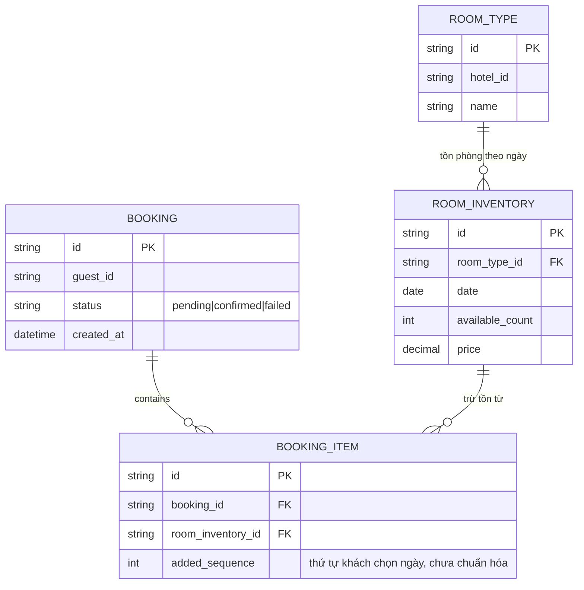
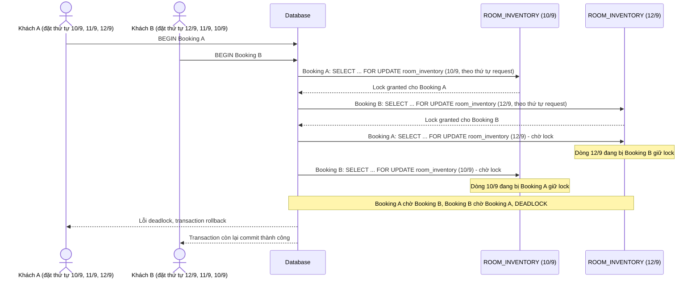
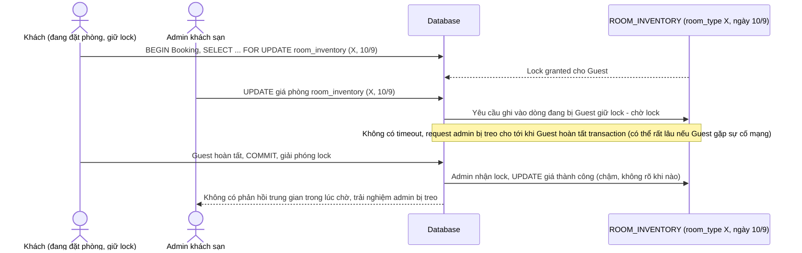
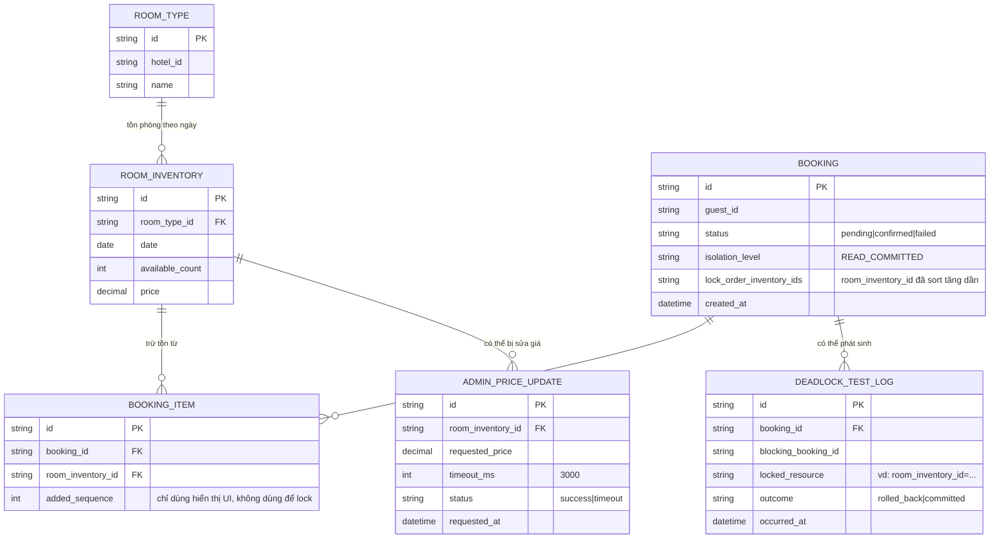
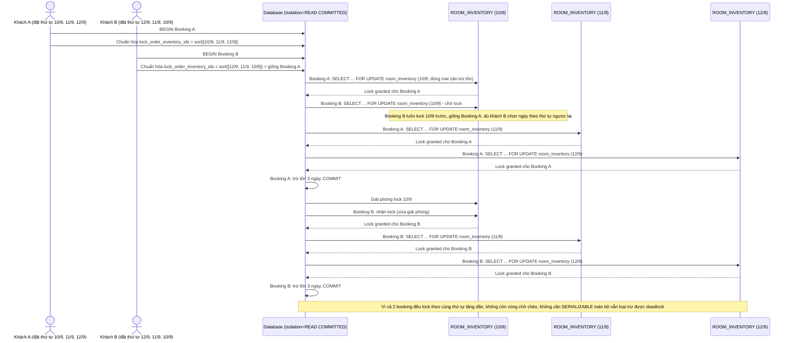
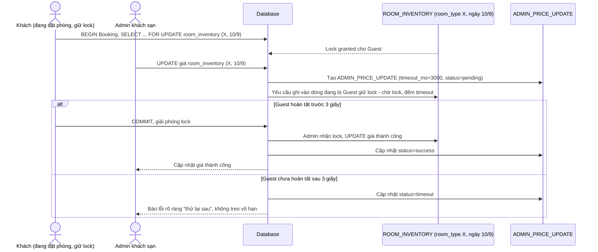
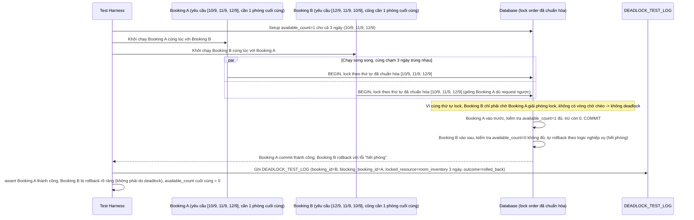

# Đặt phòng khách sạn với cập nhật giá và tồn phòng cùng lúc

**Hệ thống:** Một nền tảng đặt phòng khách sạn, admin khách sạn có thể cập nhật giá/số phòng trống trong khi khách đang đặt phòng.

**Vai trò của flow:** Transaction đặt phòng (trừ tồn phòng) và transaction admin cập nhật giá/tồn phòng cùng chạm vào bảng `room_inventory`, cần chọn isolation level và thứ tự lock hợp lý để không deadlock và không đọc dữ liệu giá sai (stale).

**Yêu cầu cụ thể:**
- Định nghĩa rõ transaction đặt phòng phải `SELECT ... FOR UPDATE` trên đúng các row (room_type, date) cần trừ tồn, không lock nguyên bảng.
- Nếu một request đặt phòng theo thứ tự ngày [10/9, 11/9, 12/9] và request khác đặt theo thứ tự [12/9, 11/9, 10/9] (đặt nhiều đêm cùng lúc), phải chuẩn hóa thứ tự lock theo khóa chính tăng dần trước khi lock để loại bỏ deadlock giữa 2 booking đa-ngày chồng lấn.
- So sánh và chọn isolation level: dùng `READ COMMITTED` + lock tường minh cho phần trừ tồn, tránh dùng `SERIALIZABLE` toàn bộ vì sẽ làm tăng abort rate không cần thiết ở phần đọc giá hiển thị cho khách đang xem trang.
- Khi admin sửa giá đúng lúc khách đang giữ lock trừ tồn cho phòng đó, request admin phải chờ hoặc bị timeout rõ ràng (không treo vô hạn) — quy định timeout cụ thể (ví dụ 3 giây) và hành vi khi timeout (báo lỗi "thử lại sau").
- Viết test dựng 2 transaction giả lập chồng lấn lock theo thứ tự ngược nhau, xác nhận hệ thống tự phát hiện/rollback một bên và request còn lại thành công.

---

# Base ERD — Đặt phòng và cập nhật giá chưa có chiến lược lock rõ ràng

Đây là **base**: trạng thái nền tảng đặt phòng khách sạn *trước khi* áp dụng `SELECT ... FOR UPDATE` tường minh, chuẩn hóa thứ tự lock và timeout cho admin. Suy luận từ đề bài, base đã có `ROOM_TYPE`, `ROOM_INVENTORY` (tồn phòng và giá theo từng `room_type` + `date`), `BOOKING` và `BOOKING_ITEM` (mỗi đêm khách đặt là 1 dòng, theo đúng thứ tự khách chọn ngày, chưa chuẩn hóa). Base chưa có ràng buộc nào về isolation level hay timeout khi admin và khách cùng chạm 1 dòng `ROOM_INVENTORY`.

---

# Base sequence — Book room (lock theo thứ tự ngày khách chọn, gây deadlock đặt đa-ngày chồng lấn)

Đây là **base**, flow đặt phòng ở trạng thái hiện tại: transaction lock các dòng `ROOM_INVENTORY` theo đúng thứ tự ngày mà request gửi lên (không sort lại). Đây chính là kịch bản deadlock nêu ở yêu cầu 2 của đề bài — 1 request đặt theo thứ tự [10/9, 11/9, 12/9], request khác đặt cùng room_type theo thứ tự [12/9, 11/9, 10/9].

---

# Base sequence — Admin update price (không timeout, có thể treo vô hạn hoặc đọc giá stale)

Đây là **base**, flow admin cập nhật giá/tồn phòng ở trạng thái hiện tại: khi khách đang giữ lock trừ tồn cho đúng phòng/ngày đó, request admin không có timeout rõ ràng nên có thể chờ vô hạn, hoặc nếu không lock tường minh thì đọc phải giá cũ (stale) rồi ghi đè sai. Đây là tiền đề cho yêu cầu 1 và 4 của đề bài.

---

# Enhance ERD — Chuẩn hóa thứ tự lock, isolation level tường minh và timeout cho admin

Đây là ERD **sau khi** enhance được áp dụng lên base. So với base, `BOOKING` thêm các trường kiểm soát isolation/thứ tự lock, và có thêm entity mới `ADMIN_PRICE_UPDATE` để quản lý timeout khi admin sửa giá, ứng trực tiếp với các yêu cầu:

- `BOOKING.lock_order_inventory_ids`, `isolation_level` — đáp ứng yêu cầu 1 (chỉ `SELECT ... FOR UPDATE` đúng row cần trừ tồn), yêu cầu 2 (chuẩn hóa thứ tự lock theo khóa chính tăng dần) và yêu cầu 3 (READ COMMITTED thay vì SERIALIZABLE toàn bộ).
- `ADMIN_PRICE_UPDATE` (mới) — ghi nhận `timeout_ms` và `status` khi admin sửa giá đúng lúc khách giữ lock, đáp ứng yêu cầu 4.
- `DEADLOCK_TEST_LOG` (mới) — phục vụ test giả lập 2 transaction chồng lấn ngược thứ tự, đáp ứng yêu cầu 5.

---

# Enhance sequence — Book room (chỉ FOR UPDATE đúng row, lock theo khóa chính tăng dần)

Đây là **enhance** của flow `book-room` đã có ở base. So với base (lock theo thứ tự request, gây deadlock), nay transaction chỉ `SELECT ... FOR UPDATE` đúng các row (room_type, date) cần trừ tồn — không lock nguyên bảng — và luôn sort `room_inventory_id` tăng dần trước khi lock, bất kể thứ tự khách chọn ngày. Đáp ứng yêu cầu 1, 2 và 3 của đề bài.

---

# Enhance sequence — Admin update price (timeout rõ ràng, không treo vô hạn)

Đây là **enhance** của flow `admin-update-price` đã có ở base. So với base (không timeout, có thể treo vô hạn), nay request admin có `timeout_ms=3000` khi chờ lock của khách đang trừ tồn cùng row, và trả lỗi rõ ràng "thử lại sau" khi timeout thay vì treo vô thời hạn. Đáp ứng yêu cầu 4 của đề bài.

---

# Enhance sequence — Test 2 booking chồng lấn lock theo thứ tự ngược nhau

Đây là **enhance**, flow mới mô tả kịch bản test tự động hoá. Đáp ứng yêu cầu 5 của đề bài: dựng 2 transaction giả lập chồng lấn lock theo thứ tự ngày ngược nhau, cùng tranh chấp phòng cuối cùng còn trống, xác nhận hệ thống tự phát hiện/rollback một bên (do hết phòng khi đến lượt, không phải do deadlock — deadlock đã bị loại trừ nhờ chuẩn hóa thứ tự lock) và request còn lại thành công.

