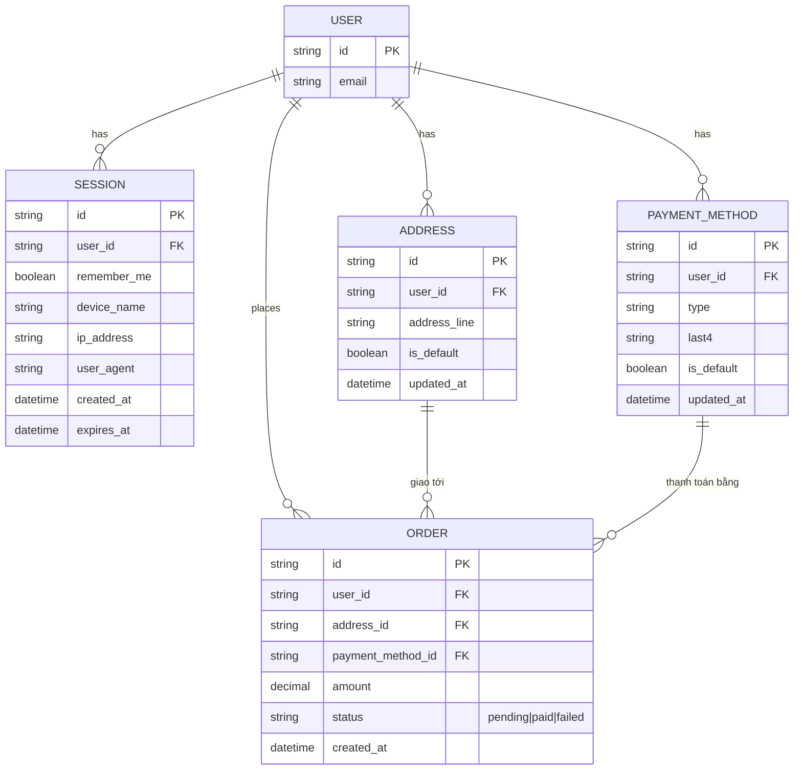
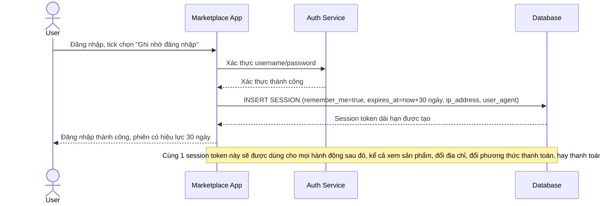
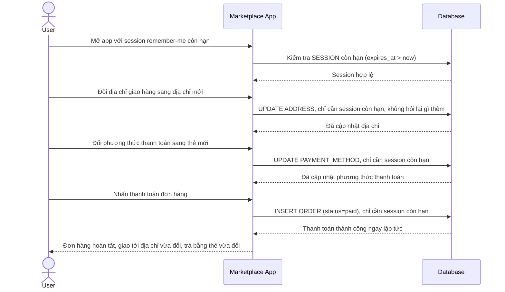
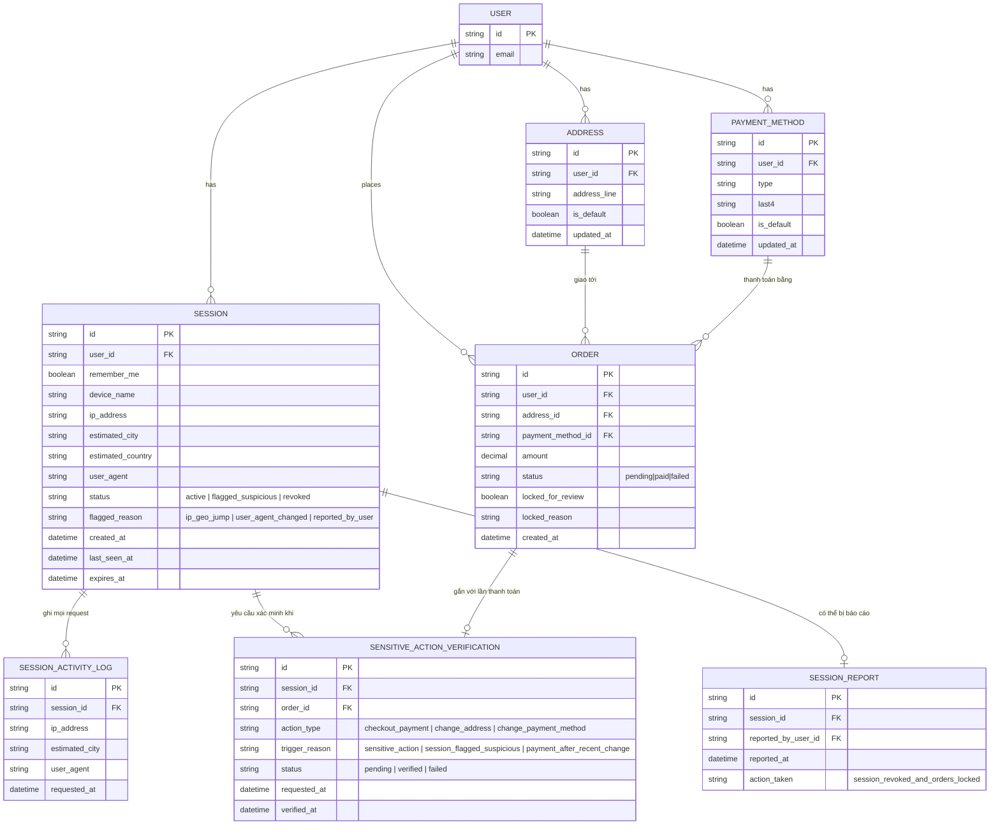
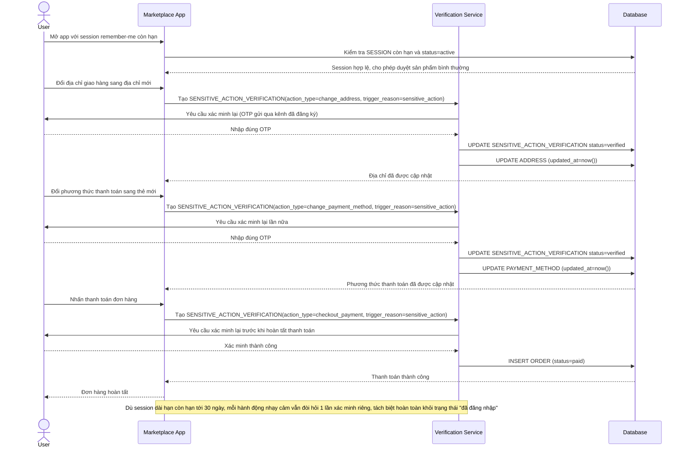
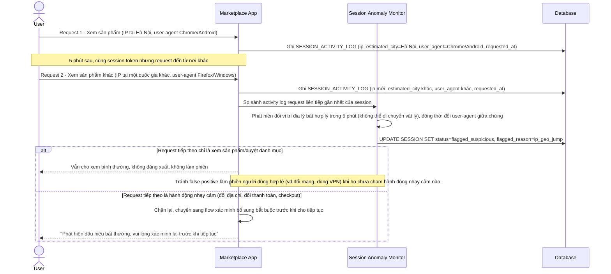
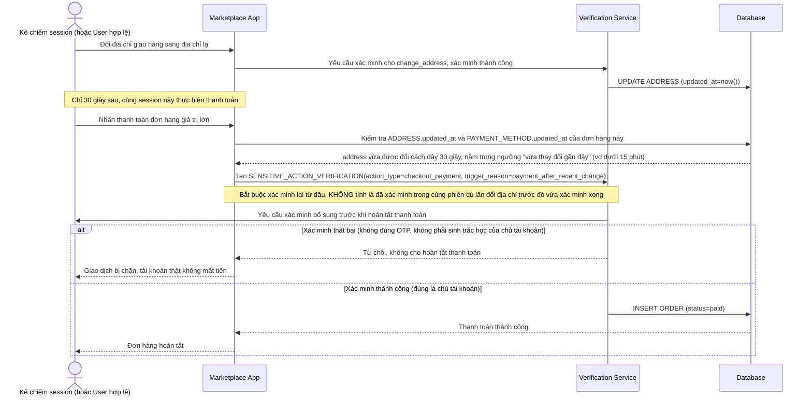
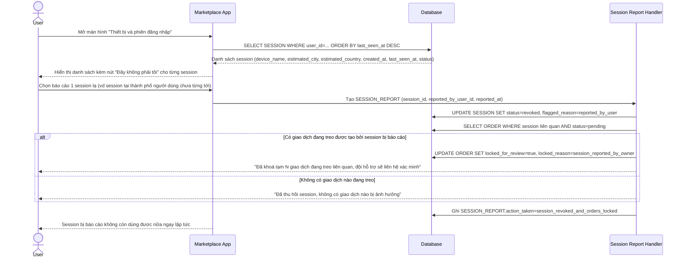

# Marketplace e-commerce phát hiện session bất thường và yêu cầu step-up

**Hệ thống:** Một sàn thương mại điện tử cho phép người dùng lưu thông tin thanh toán và địa chỉ để mua hàng nhanh.

**Vai trò của flow:** Quản lý session "remember me" thông thường cho trải nghiệm mua sắm hằng ngày, nhưng phát hiện được dấu hiệu session bị chiếm quyền (session hijacking) để yêu cầu xác thực bổ sung đúng lúc mà không làm phiền người dùng hợp lệ.

**Yêu cầu cụ thể:**
- Session "remember me" (giữ đăng nhập lâu dài) phải được phân tách với các hành động nhạy cảm (thanh toán, đổi địa chỉ giao hàng, đổi phương thức thanh toán) — những hành động này yêu cầu xác thực bổ sung dù session chính vẫn còn hạn.
- Hệ thống phải theo dõi tín hiệu bất thường trong phiên (thay đổi IP/vị trí địa lý giữa các request liên tiếp một cách bất hợp lý, thay đổi user-agent giữa chừng) để gắn cờ session nghi ngờ bị đánh cắp.
- Khi một session bị gắn cờ nghi ngờ, hệ thống phải yêu cầu xác thực lại trước khi cho tiếp tục các hành động nhạy cảm, đồng thời không tự động đăng xuất ngay lập tức nếu chỉ đang xem sản phẩm (tránh làm phiền người dùng hợp lệ vì false positive).
- Khi phát hiện thanh toán được thực hiện ngay sau một thay đổi thông tin nhạy cảm gần đây (ví dụ vừa đổi địa chỉ giao hàng/phương thức thanh toán), phải tự động yêu cầu xác thực lại trước khi cho hoàn tất giao dịch, để chặn kịch bản chiếm session rồi đổi địa chỉ nhận hàng.
- Cung cấp cho người dùng lịch sử các lần đăng nhập/session gần đây (thiết bị, vị trí ước lượng, thời gian) và cách báo cáo nếu phát hiện session không phải của họ, kèm hành động tự động khóa tạm giao dịch đang treo khi người dùng báo cáo bị chiếm session.

---

# Base ERD — Marketplace với session "remember me" nhưng chưa tách biệt hành động nhạy cảm

Đây là **base**: trạng thái hệ thống marketplace *trước khi* có theo dõi bất thường và step-up cho hành động nhạy cảm. Suy luận từ đề bài, base đã có `USER` với `SESSION` dạng "remember me" (đăng nhập 1 lần, giữ lâu dài), `ADDRESS` và `PAYMENT_METHOD` được lưu sẵn để mua nhanh, và `ORDER` khi thanh toán. Base coi session còn hạn là đủ điều kiện cho mọi hành động — kể cả đổi địa chỉ, đổi phương thức thanh toán, hay thanh toán — không có bước xác thực bổ sung nào, cũng chưa theo dõi tín hiệu bất thường trong phiên.

---

# Base sequence — Login remember me (session dài hạn, không phân biệt hành động sau này)

Đây là **base**, flow đăng nhập với tuỳ chọn "remember me" ở trạng thái hiện tại: sau khi xác thực, hệ thống cấp 1 session dài hạn (vd 30 ngày), session này được dùng cho mọi hành động sau đó mà không phân biệt mức độ nhạy cảm. Đây là nền để so sánh với yêu cầu 1 của đề bài (cần tách biệt session dài hạn khỏi các hành động nhạy cảm).

---

# Base sequence — Checkout (đổi địa chỉ, đổi phương thức thanh toán, thanh toán đều chỉ cần session còn hạn)

Đây là **base**, flow thanh toán ở trạng thái hiện tại: chỉ cần session "remember me" còn hạn là đủ để đổi địa chỉ giao hàng, đổi phương thức thanh toán, và hoàn tất thanh toán, không có bước xác thực bổ sung nào dù đây đều là hành động nhạy cảm. Sơ đồ minh hoạ đúng khoảng trống mà yêu cầu 1 và 4 của đề bài nhắm tới: nếu 1 session bị chiếm quyền, kẻ tấn công có thể đổi địa chỉ nhận hàng rồi thanh toán ngay mà không gặp trở ngại nào.

---

# Enhance ERD — Tách session dài hạn khỏi hành động nhạy cảm, phát hiện bất thường, step-up và báo cáo session

Đây là ERD **sau khi** enhance được áp dụng lên base. So với base, `SESSION` thêm các trường theo dõi rủi ro, và có 3 entity mới, ứng trực tiếp với các yêu cầu:

- `SENSITIVE_ACTION_VERIFICATION` (mới) — mọi hành động nhạy cảm (`checkout_payment`, `change_address`, `change_payment_method`) cần 1 bản ghi xác minh riêng dù `SESSION` còn hạn — đáp ứng yêu cầu 1.
- `SESSION_ACTIVITY_LOG` (mới) cùng `SESSION.status`/`flagged_reason` — ghi lại IP/geo/user-agent theo từng request để phát hiện thay đổi bất hợp lý giữa các request liên tiếp, gắn cờ session nghi ngờ nhưng không đăng xuất ngay nếu chỉ đang xem sản phẩm — đáp ứng yêu cầu 2 và 3.
- `SENSITIVE_ACTION_VERIFICATION.trigger_reason=payment_after_recent_change` cùng `ADDRESS.updated_at`/`PAYMENT_METHOD.updated_at` — phát hiện thanh toán diễn ra ngay sau khi vừa đổi thông tin nhạy cảm, buộc xác minh lại trước khi hoàn tất — đáp ứng yêu cầu 4.
- `SESSION_REPORT` (mới) cùng `ORDER.locked_for_review` — người dùng xem lịch sử session và báo cáo session lạ, hệ thống tự động khoá tạm các giao dịch đang treo của session đó — đáp ứng yêu cầu 5.

---

# Enhance sequence — Checkout (hành động nhạy cảm luôn cần xác minh bổ sung dù session còn hạn)

Đây là **enhance** của flow `checkout` đã có ở base. So với base (chỉ cần session còn hạn là đổi địa chỉ/phương thức thanh toán/thanh toán được ngay), nay mỗi hành động nhạy cảm đều tạo 1 `SENSITIVE_ACTION_VERIFICATION` riêng và bắt buộc xác minh lại (vd mã OTP, xác nhận sinh trắc học) trước khi được thực hiện, bất kể session chính vẫn còn hạn. Đáp ứng yêu cầu 1 của đề bài.

---

# Enhance sequence — Phát hiện bất thường trong phiên, gắn cờ nghi ngờ mà không đăng xuất ngay

Đây là **enhance**, flow hoàn toàn mới, chưa tồn tại ở base. Mỗi request đều được ghi vào `SESSION_ACTIVITY_LOG` để so sánh IP/vị trí địa lý và user-agent giữa các request liên tiếp, phát hiện dấu hiệu session bị chiếm quyền. Khi bị gắn cờ nghi ngờ, hệ thống chỉ chặn hành động nhạy cảm chứ không đăng xuất người dùng nếu họ chỉ đang xem sản phẩm. Đáp ứng yêu cầu 2 và 3 của đề bài.

---

# Enhance sequence — Tự động yêu cầu xác minh lại khi thanh toán ngay sau khi vừa đổi thông tin nhạy cảm

Đây là **enhance**, flow hoàn toàn mới, chưa tồn tại ở base. Ngay cả khi session không bị gắn cờ nghi ngờ và người dùng đã xác minh xong cho lần đổi địa chỉ/phương thức thanh toán trước đó, hệ thống vẫn tự động buộc xác minh lại thêm 1 lần nữa nếu thanh toán diễn ra ngay sau đó, để chặn kịch bản chiếm session rồi đổi địa chỉ nhận hàng rồi thanh toán liền. Đáp ứng yêu cầu 4 của đề bài.

---

# Enhance sequence — Xem lịch sử session, báo cáo session lạ, tự động khoá giao dịch treo

Đây là **enhance**, flow hoàn toàn mới, chưa tồn tại ở base. Người dùng xem được danh sách session gần đây (thiết bị, vị trí ước lượng, thời gian) và có thể báo cáo session không phải của mình, hệ thống sẽ tự động thu hồi session đó và khoá tạm các giao dịch đang treo liên quan. Đáp ứng yêu cầu 5 của đề bài.

