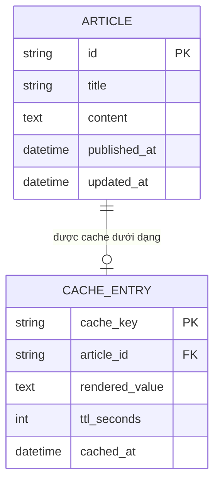
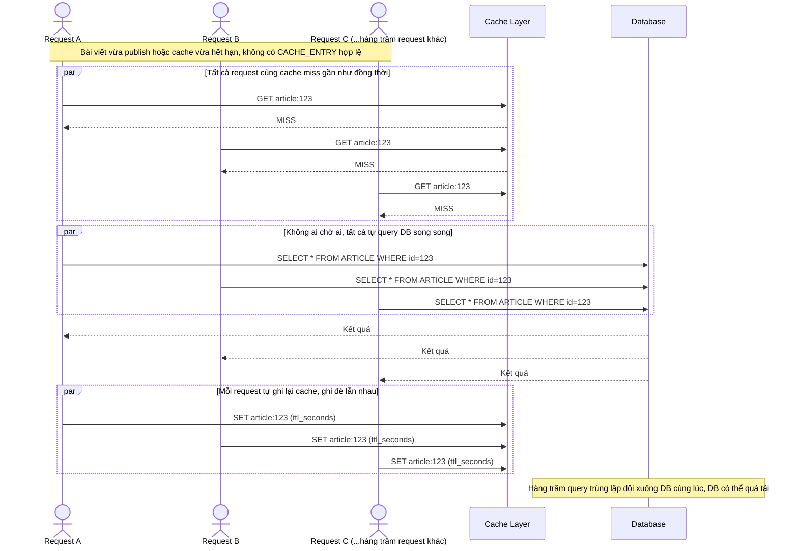
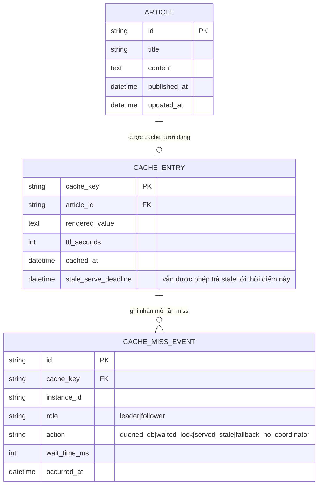
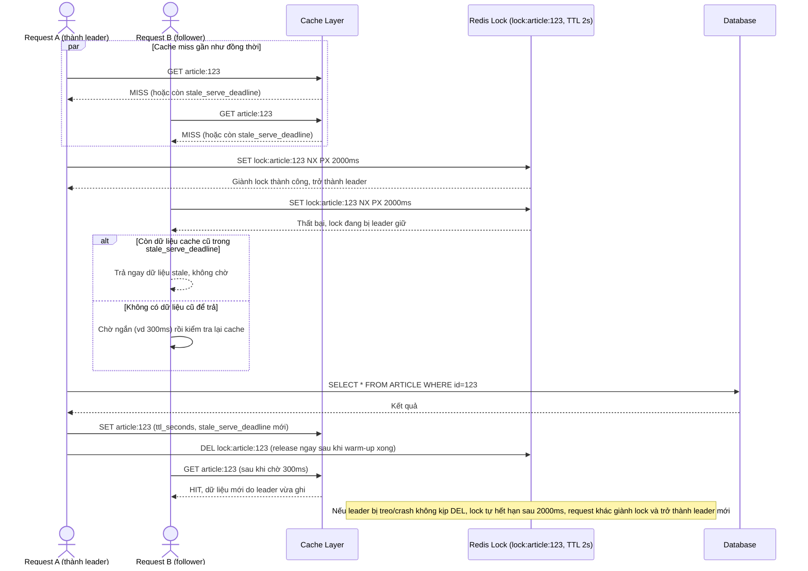
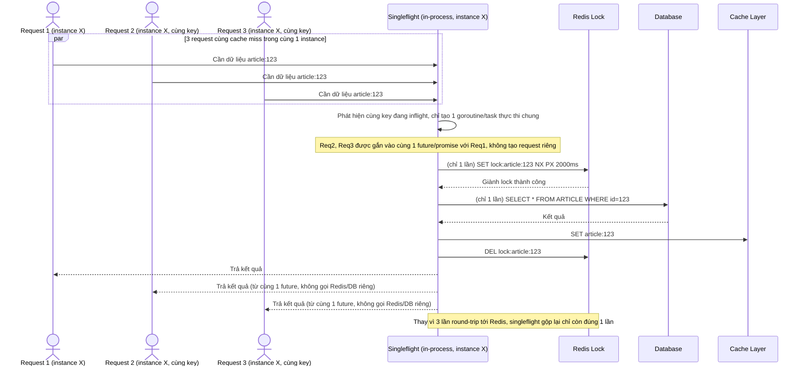
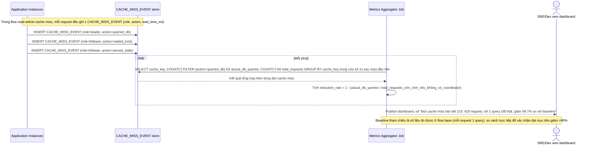
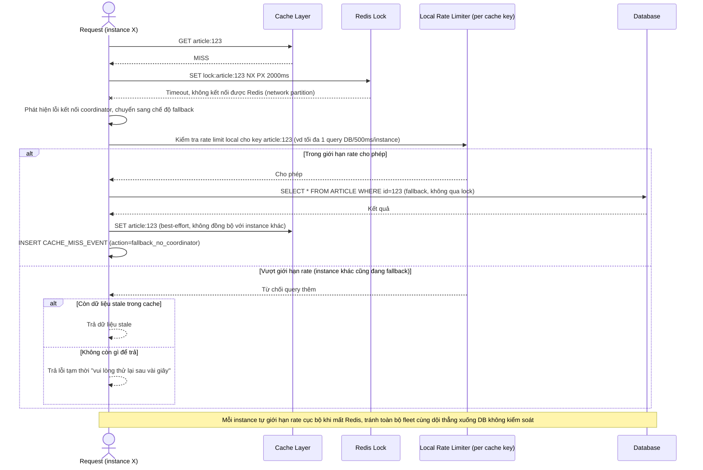

# Leader coordinator cho cache invalidation tránh thundering herd

**Hệ thống:** Hệ thống cache nhiều lớp cho một trang tin tức lớn, khi cache miss đồng loạt (ví dụ sau khi publish bài mới) hàng trăm request cùng dội xuống DB.

**Vai trò của flow:** Dùng leader election/distributed lock để chỉ một request/instance được phép đi warm-up cache/query DB, các request khác chờ hoặc dùng dữ liệu cũ.

**Yêu cầu cụ thể:**
- Chỉ request đầu tiên "giành" được lock cho một cache key mới được query DB và ghi lại cache; các request đến sau trong lúc lock còn giữ phải chờ ngắn (vài trăm ms) hoặc trả stale data nếu có, không tự query DB song song.
- Lock phải tự hết hạn nếu request giữ lock bị treo/crash, để tránh các request khác chờ vô hạn.
- Có cơ chế "single flight" nội bộ trong từng instance kết hợp với lock phân tán giữa các instance để giảm số round-trip tới coordinator.
- Đo lường: số lượng DB query giảm được so với baseline không có coordinator (mục tiêu giảm >90% query trùng lặp trong 1 giây đầu sau cache miss).
- Xử lý network partition giữa instance và Redis: instance phải có fallback (ví dụ tự query DB có giới hạn rate) khi không kết nối được coordinator, tránh outage toàn phần.

---

# Base ERD — Cache đơn giản, cache miss là mỗi request tự query DB

Đây là **base**: trạng thái hệ thống cache *trước khi* có leader coordinator chống thundering herd. Suy luận từ đề bài, base đã có `ARTICLE` là dữ liệu gốc trong DB, và một `CACHE_ENTRY` lưu bản render sẵn của article theo cache key (thường là `article:{id}`) với TTL cố định. Khi cache miss (hết hạn hoặc chưa có), base chưa có bất kỳ cơ chế điều phối nào — request nào cũng tự query DB rồi tự ghi lại cache, không ai chờ ai.

---

# Base sequence — Cache miss đồng loạt, mọi request tự query DB (thundering herd)

Đây là **base**, flow đọc bài viết hiện tại khi cache miss: mỗi request kiểm tra cache, không thấy hoặc thấy hết hạn thì tự đi query DB rồi tự ghi lại cache, không có điều phối giữa các request. Đây chính là kịch bản thundering herd nêu trong đề bài — sau khi publish bài mới hoặc cache hết hạn, hàng trăm request cùng cache miss và cùng dội xuống DB song song.

---

# Enhance ERD — Thêm ghi nhận sự kiện cache miss để đo lường hiệu quả coordinator

Đây là ERD **sau khi** enhance được áp dụng lên base. `ARTICLE` và `CACHE_ENTRY` giữ nguyên như base (bản thân distributed lock là 1 key ephemeral trên Redis dạng `lock:article:{id}` có TTL, không phải dữ liệu bền vững nên không xuất hiện như entity riêng). Điểm mới là entity `CACHE_MISS_EVENT`, ứng trực tiếp với các yêu cầu:

- `CACHE_MISS_EVENT.role` (leader/follower) và `action` (`queried_db`/`waited_lock`/`served_stale`) — phản ánh kết quả của cơ chế lock ở yêu cầu 1 (chỉ leader query DB, follower chờ hoặc dùng stale data).
- `CACHE_MISS_EVENT.action=fallback_no_coordinator` — phản ánh yêu cầu 5 (fallback khi mất kết nối tới Redis coordinator).
- Toàn bộ bảng `CACHE_MISS_EVENT` chính là nguồn dữ liệu để tính chỉ số ở yêu cầu 4 (đo % giảm số DB query trùng lặp so với baseline).
- `CACHE_ENTRY.stale_serve_deadline` — hỗ trợ việc follower vẫn trả được dữ liệu cũ (stale) trong lúc chờ leader warm-up xong, thay vì phải chờ trắng.

---

# Enhance sequence — Chỉ leader query DB, follower chờ ngắn hoặc trả stale data

Đây là **enhance** của flow `read-article-cache-miss` đã có ở base. So với base (mọi request tự query DB song song), enhance thêm distributed lock trên Redis theo từng cache key: chỉ request giành được lock (leader) mới query DB và warm-up cache, các request khác (follower) chờ ngắn hoặc trả ngay dữ liệu cũ nếu có. Đáp ứng yêu cầu 1 (chỉ leader query DB, follower chờ vài trăm ms hoặc dùng stale data, không tự query song song) và yêu cầu 2 (lock có TTL, tự hết hạn nếu leader bị treo/crash).

---

# Enhance sequence — Singleflight nội bộ instance kết hợp distributed lock

Đây là **enhance**, flow hoàn toàn mới mô tả tầng singleflight bên trong 1 instance, đứng trước distributed lock ở tầng giữa các instance. Đáp ứng yêu cầu 3: nhiều request đồng thời trong cùng 1 instance cho cùng cache key chỉ tạo ra đúng 1 lời gọi tới coordinator (Redis), giảm số round-trip không cần thiết tới Redis khi vốn dĩ chúng đã có thể gộp chung kết quả ngay trong process.

---

# Enhance sequence — Đo lường mức giảm DB query trùng lặp so với baseline

Đây là **enhance**, flow hoàn toàn mới mô tả cách hệ thống đo lường hiệu quả của coordinator sau khi triển khai. Đáp ứng yêu cầu 4: cần con số cụ thể chứng minh giảm được >90% query trùng lặp trong 1 giây đầu sau cache miss, dựa trên dữ liệu `CACHE_MISS_EVENT` được ghi lại ở flow acquire-lock.

---

# Enhance sequence — Fallback khi instance mất kết nối tới Redis coordinator

Đây là **enhance**, flow hoàn toàn mới xử lý network partition giữa instance và Redis. Đáp ứng yêu cầu 5: khi không kết nối được coordinator, instance phải có fallback (tự query DB có giới hạn rate) thay vì treo chờ vô hạn hoặc từ chối toàn bộ request, tránh outage toàn phần.

