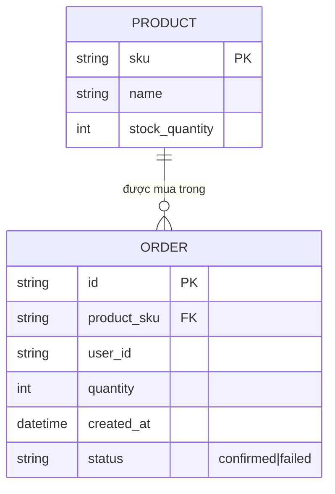
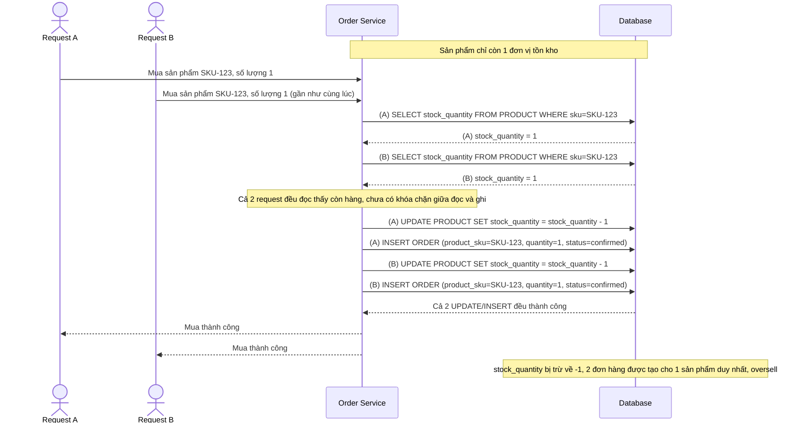
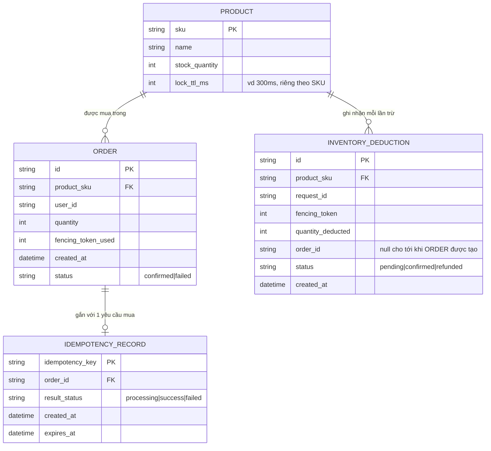
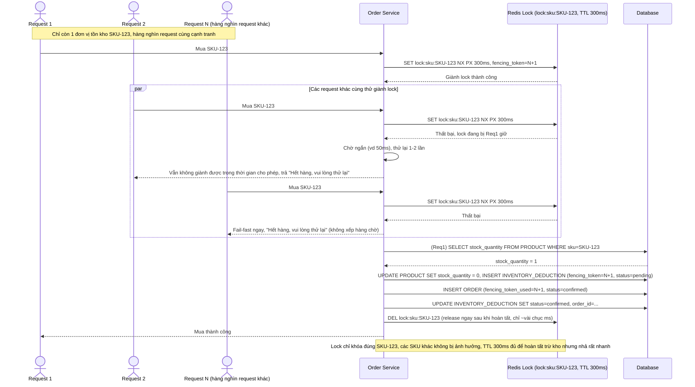
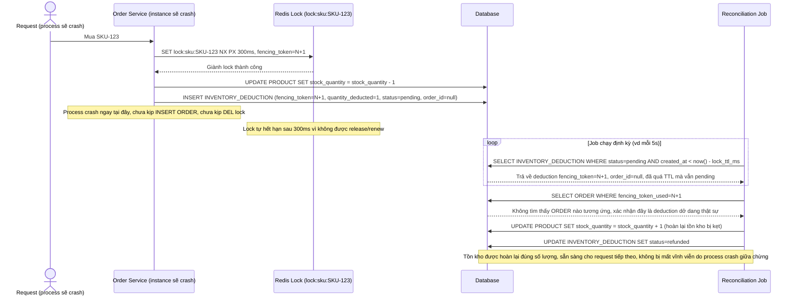
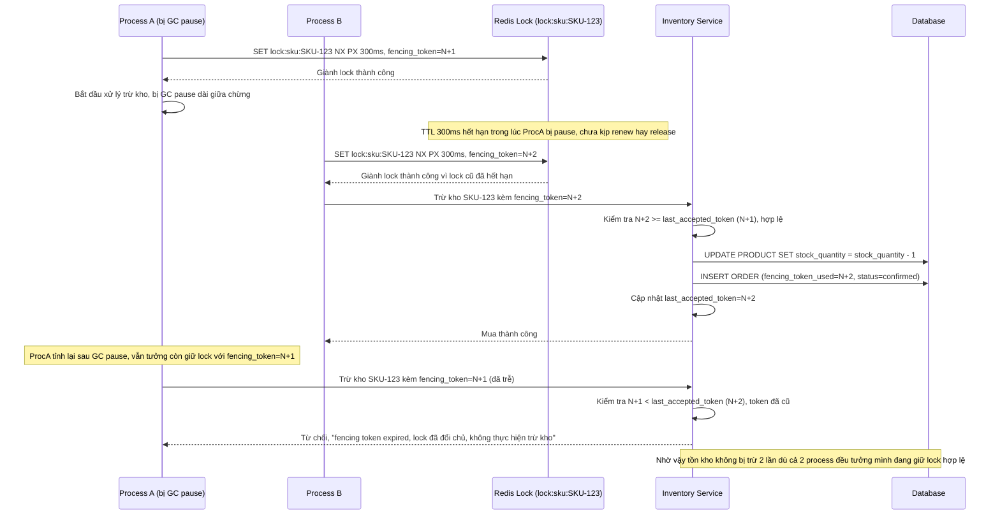
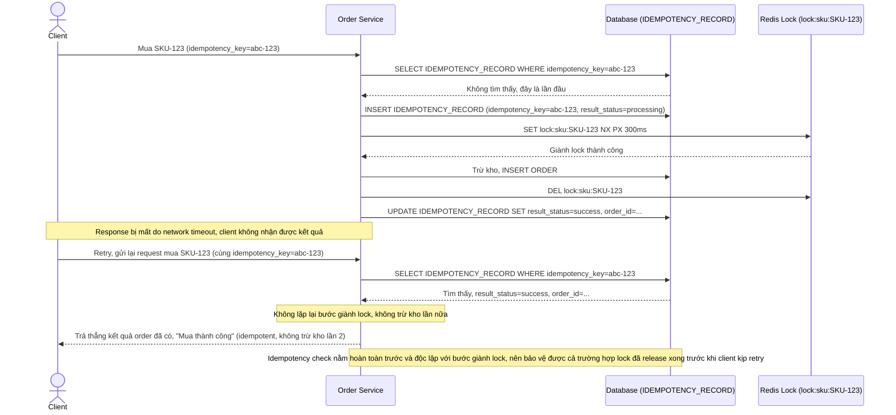

# Giữ chỗ tồn kho cho sản phẩm flash sale

**Hệ thống:** Sàn thương mại điện tử mở bán flash sale một sản phẩm số lượng giới hạn, hàng nghìn request mua hàng gửi tới cùng lúc trong vài giây đầu mở bán.

**Vai trò của flow:** Distributed lock theo từng sản phẩm (per-SKU) đảm bảo tại một thời điểm chỉ một tiến trình được đọc-và-trừ tồn kho cho sản phẩm đó, tránh oversell do nhiều request đọc cùng số tồn kho rồi cùng trừ.

**Yêu cầu cụ thể:**
- Lock phải được khóa ở granularity đúng mức (per-SKU, không lock toàn catalog gây nghẽn cổ chai, không lock quá lỏng theo warehouse chung gây oversell chéo sản phẩm), với TTL đủ ngắn để nhả nhanh cho request tiếp theo nhưng đủ dài để hoàn tất thao tác trừ kho — quá ngắn thì lock hết hạn giữa chừng gây 2 tiến trình cùng trừ, quá dài thì hàng nghìn request xếp hàng chờ gây timeout hàng loạt.
- Nếu tiến trình giữ lock crash ngay sau khi đã trừ số dư tồn kho trong DB nhưng chưa kịp tạo record đơn hàng/release lock, phải có cơ chế phát hiện trạng thái dở dang này khi lock hết hạn (ví dụ đối chiếu số đã trừ với đơn hàng tồn tại tương ứng) để hoàn lại tồn kho bị "kẹt" thay vì mất vĩnh viễn.
- Dùng fencing token gắn với lock để tránh trường hợp một tiến trình bị treo (GC pause, network delay) tưởng mình còn giữ lock, ghi trừ kho sau khi lock đã hết hạn và bị tiến trình khác giành mất — thao tác trừ kho với token cũ phải bị service tồn kho từ chối.
- Với hàng nghìn request cạnh tranh cùng 1 lock, phải có chiến lược fail-fast cho request không giành được lock trong thời gian ngắn (trả "hết hàng/thử lại" thay vì xếp hàng chờ vô hạn), tránh hàng đợi lock phình to làm nghẽn toàn hệ thống.
- Retry của client (do timeout network) không được gây trừ kho 2 lần cho cùng một yêu cầu mua — cần idempotency key gắn với request mua hàng độc lập với cơ chế lock, vì lock chỉ đảm bảo tuần tự xử lý chứ không đảm bảo request không bị gửi lặp.

---

# Base ERD — Tồn kho và đơn hàng chưa có cơ chế khóa khi mua đồng thời

Đây là **base**: trạng thái sàn thương mại điện tử *trước khi* có distributed lock per-SKU. Suy luận từ đề bài, base đã có `PRODUCT` với `stock_quantity` đại diện số lượng tồn kho, và mỗi lần mua thành công tạo 1 `ORDER` tham chiếu tới product. Base xử lý mua hàng bằng đọc số tồn kho rồi trừ trực tiếp trong 1 transaction DB thông thường, không có khóa nào bảo vệ giữa lúc đọc và lúc trừ khi nhiều request cùng mua 1 sản phẩm.

---

# Base sequence — Đọc-trừ tồn kho trực tiếp, oversell khi mua đồng thời

Đây là **base**, flow mua hàng hiện tại: server đọc `stock_quantity`, kiểm tra còn hàng rồi trừ đi trong 1 transaction DB thông thường, không có khóa nào bảo vệ khoảng giữa đọc và ghi. Đây chính là kịch bản oversell nêu trong đề bài — hàng nghìn request mua hàng gửi tới cùng lúc khi mở bán flash sale, nhiều request cùng đọc thấy còn hàng rồi cùng trừ.

---

# Enhance ERD — Thêm idempotency, fencing token và log trừ kho để reconcile

Đây là ERD **sau khi** enhance được áp dụng lên base. `PRODUCT` giữ nguyên (khóa per-SKU trên Redis là coordination ephemeral, key dạng `lock:sku:{sku}`, không phải dữ liệu bền vững nên không xuất hiện là entity riêng). Có 2 entity mới và `ORDER` được bổ sung trường, ứng trực tiếp với các yêu cầu:

- `INVENTORY_DEDUCTION.fencing_token` và `ORDER.fencing_token_used` — đáp ứng yêu cầu 3 (fencing token gắn với lock, request dùng token cũ sau khi lock hết hạn bị từ chối ghi).
- `INVENTORY_DEDUCTION.status` (`pending`/`confirmed`/`refunded`) — đáp ứng yêu cầu 2 (khi lock hết hạn mà process crash giữa lúc đã trừ kho nhưng chưa tạo order, job reconcile phát hiện deduction còn `pending` không có order tương ứng để hoàn lại tồn kho).
- `IDEMPOTENCY_RECORD` (mới), độc lập với cơ chế lock — đáp ứng yêu cầu 5 (client retry do timeout network không được trừ kho 2 lần cho cùng 1 yêu cầu mua, dùng idempotency key gắn với request thay vì dựa vào lock).
- `PRODUCT.lock_ttl_ms` — đáp ứng yêu cầu 1 (TTL cấu hình theo từng SKU, đủ ngắn để nhả nhanh nhưng đủ dài để hoàn tất thao tác trừ kho).

---

# Enhance sequence — Lock per-SKU với TTL hợp lý và fail-fast cho request thua cuộc

Đây là **enhance** của flow `purchase-flash-sale` đã có ở base. So với base (đọc-trừ trực tiếp không khóa), enhance thêm distributed lock theo đúng granularity per-SKU (không lock toàn catalog, không lock chung theo warehouse) với TTL ngắn vừa đủ, và fail-fast cho request không giành được lock trong thời gian ngắn. Đáp ứng yêu cầu 1 (granularity per-SKU, TTL đủ ngắn để nhả nhanh nhưng đủ dài để hoàn tất trừ kho) và yêu cầu 4 (fail-fast, không xếp hàng chờ vô hạn khi có hàng nghìn request cạnh tranh).

---

# Enhance sequence — Reconcile tồn kho bị kẹt khi process crash giữa chừng

Đây là **enhance**, flow hoàn toàn mới xử lý trường hợp process giữ lock crash ngay sau khi đã trừ tồn kho trong DB nhưng chưa kịp tạo `ORDER`/release lock. Đáp ứng yêu cầu 2: phát hiện trạng thái dở dang này khi lock hết hạn (đối chiếu số đã trừ với đơn hàng tồn tại tương ứng), để hoàn lại tồn kho bị kẹt thay vì mất vĩnh viễn.

---

# Enhance sequence — Fencing token chặn ghi trừ kho từ process đã mất lock

Đây là **enhance**, flow hoàn toàn mới xử lý trường hợp process bị GC pause/network delay tưởng mình còn giữ lock. Đáp ứng yêu cầu 3: dùng fencing token gắn với lock để tránh process bị treo ghi trừ kho sau khi lock đã hết hạn và bị process khác giành mất — thao tác trừ kho với token cũ phải bị inventory service từ chối.

---

# Enhance sequence — Idempotency key chống trừ kho 2 lần khi client retry

Đây là **enhance**, flow hoàn toàn mới xử lý trường hợp client retry do timeout network. Đáp ứng yêu cầu 5: lock chỉ đảm bảo tuần tự xử lý chứ không đảm bảo request không bị gửi lặp, nên cần idempotency key gắn với request mua hàng, độc lập hoàn toàn với cơ chế lock, để đảm bảo retry không gây trừ kho 2 lần cho cùng 1 yêu cầu.

