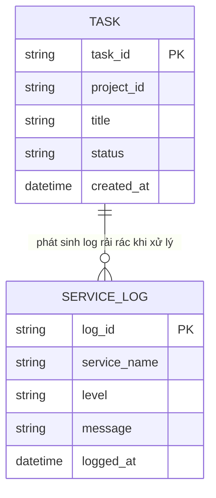
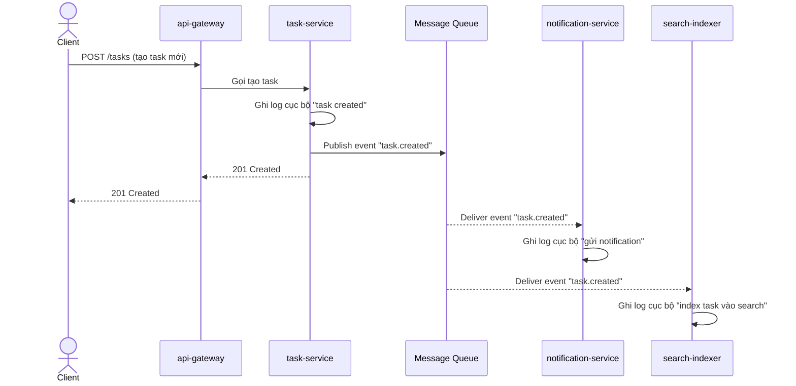
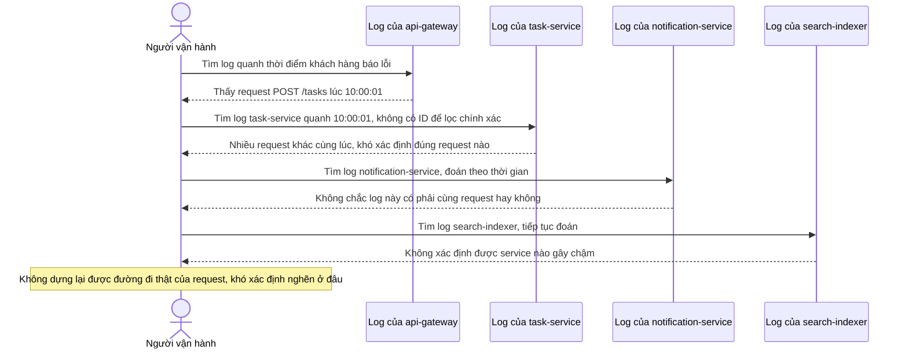
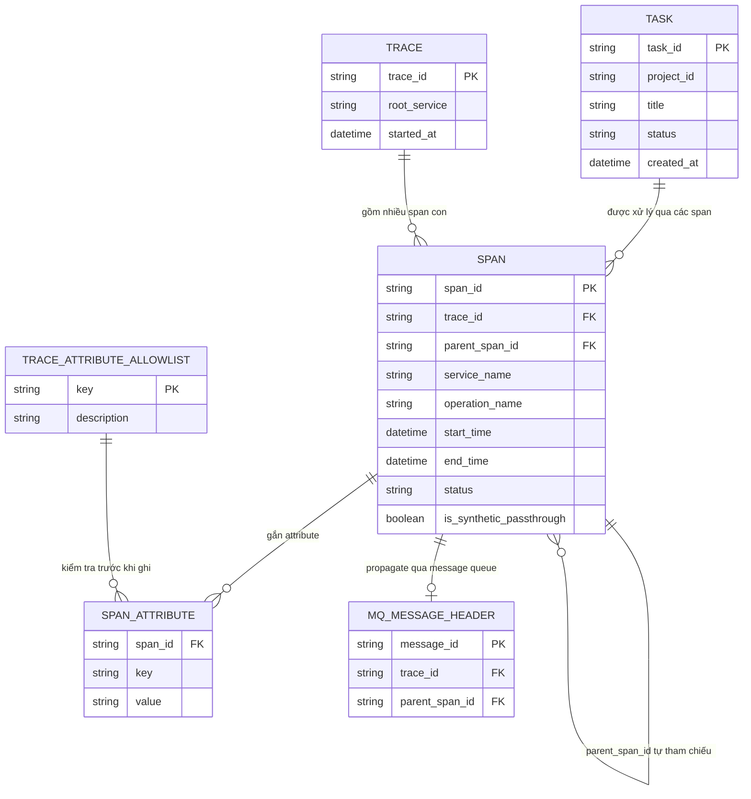
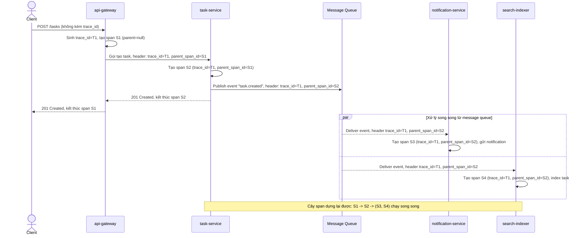
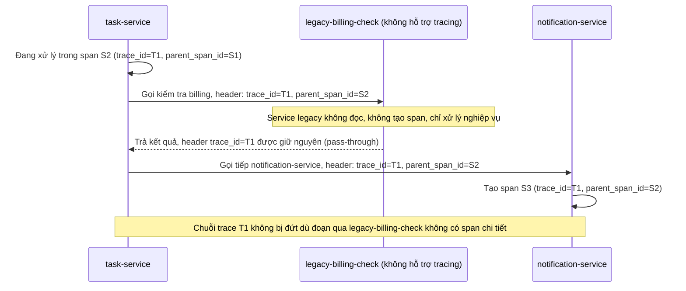
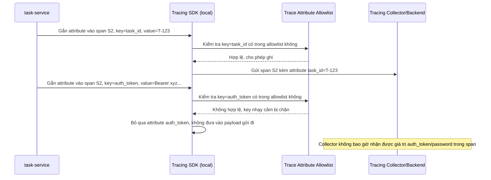
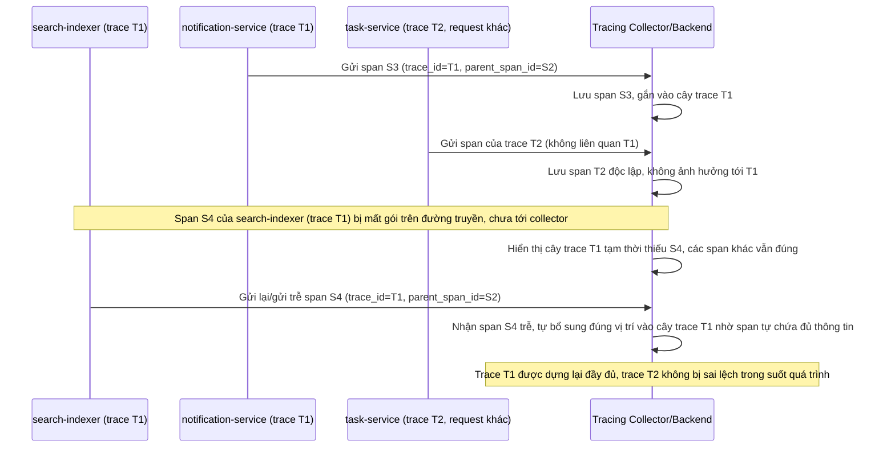

# Truy vết request xuyên nhiều service trong nền tảng SaaS B2B

**Hệ thống:** Một nền tảng SaaS quản lý dự án, một request tạo task đi qua service `api-gateway` → `task-service` → `notification-service` → `search-indexer` (bất đồng bộ).

**Vai trò của flow:** Distributed tracing dùng để nối các bước xử lý rải rác trên nhiều service thành một trace duy nhất, giúp debug khi một request "tạo task" bị chậm hoặc lỗi mà không rõ nghẽn ở đâu.

**Yêu cầu cụ thể:**
- Mỗi request phải được gắn một `trace_id` sinh ở gateway (nếu chưa có từ client) và propagate qua toàn bộ header của các lời gọi nội bộ tiếp theo, bao gồm cả lời gọi bất đồng bộ qua message queue.
- Mỗi service khi xử lý phải tạo một `span` con gắn với `trace_id` gốc và `parent_span_id` đúng, để dựng lại được cây gọi (call tree) đúng thứ tự và đúng quan hệ cha-con, kể cả khi các service gọi song song nhau.
- Xử lý được trường hợp một service không hỗ trợ tracing (legacy service bên thứ ba) — vẫn phải giữ được `trace_id` liên tục qua service đó (pass-through header) dù không có span chi tiết bên trong.
- Đảm bảo dữ liệu trace không làm rò rỉ thông tin nhạy cảm (không được gắn giá trị field chứa password/token vào tên span hay tag) — có allowlist rõ ràng cho các attribute được phép ghi vào trace.
- Tracing pipeline phải chịu được việc một service gửi trace data trễ hoặc mất gói (network drop) mà không làm sai lệch cây trace của các request khác — mỗi span phải tự đứng độc lập được, không phụ thuộc thứ tự nhận.

---

# ERD - Base (trước khi có distributed tracing)

Đây là trạng thái **base**: nền tảng SaaS quản lý dự án đã có luồng tạo `TASK` đi qua nhiều service (`api-gateway`, `task-service`, `notification-service`, `search-indexer`), mỗi service tự ghi log cục bộ khi xử lý, nhưng **không có bất kỳ định danh chung nào** nối các log của cùng 1 request lại với nhau. Đây là tiền đề khiến enhance cần thêm `trace_id`/`span` để dựng lại được toàn bộ hành trình của 1 request.

---

# Sequence Diagram - Base: create-task

Đây là flow **base**: request tạo task đi qua `api-gateway` -> `task-service` -> `notification-service` -> `search-indexer` (bất đồng bộ qua message queue), mỗi service chỉ ghi log cục bộ của riêng nó, không kèm bất kỳ ID chung nào. Flow này là nền để so sánh với enhance, nơi mỗi bước sẽ được gắn `trace_id`/`span` xuyên suốt.

---

# Sequence Diagram - Base: debug-slow-request

Đây là flow **base** minh hoạ chính vấn đề mà đề bài cần giải quyết: khi khách hàng báo request tạo task bị chậm, người vận hành phải tự tra log rời rạc trên từng service theo timestamp gần đúng và đoán mò, vì không có `trace_id` nào nối các log của cùng 1 request. Đây là lý do enhance cần distributed tracing.

---

# ERD - Enhance (distributed tracing xuyên các service)

Đây là trạng thái **enhance**: giữ nguyên `TASK` từ base, thay `SERVICE_LOG` rời rạc bằng mô hình tracing có cấu trúc:
- `TRACE`: đại diện cho toàn bộ hành trình 1 request, có `trace_id` sinh ở gateway (hoặc nhận từ client) - đáp ứng yêu cầu 1.
- `SPAN`: mỗi service tạo 1 span con gắn `trace_id` gốc và `parent_span_id`, có `is_synthetic_passthrough` để đánh dấu đoạn đi qua service không hỗ trợ tracing (chỉ pass-through header, không có span chi tiết) - đáp ứng yêu cầu 2 và 3. Span tự chứa đủ thông tin (`trace_id`, `span_id`, `start_time`, `end_time`, `status`) để đứng độc lập, không phụ thuộc thứ tự nhận - đáp ứng yêu cầu 5.
- `SPAN_ATTRIBUTE`: cặp key/value gắn vào span, chỉ được ghi nếu `key` nằm trong `TRACE_ATTRIBUTE_ALLOWLIST` - đáp ứng yêu cầu 4.
- `TRACE_ATTRIBUTE_ALLOWLIST`: danh sách các attribute key được phép ghi vào trace, dùng để lọc trước khi ghi `SPAN_ATTRIBUTE`, ngăn rò rỉ password/token - đáp ứng yêu cầu 4.
- `MQ_MESSAGE_HEADER`: đại diện cho việc propagate `trace_id`/`parent_span_id` qua header của message queue khi gọi bất đồng bộ - đáp ứng yêu cầu 1.

---

# Sequence Diagram - Enhance: create-task

Đây là flow **enhance** của `create-task` (so với base ở file `2-base-create-task-sqd.md`): `api-gateway` sinh `trace_id` nếu client chưa gửi, mỗi service tạo span con gắn `parent_span_id` đúng (kể cả khi `notification-service` và `search-indexer` được gọi song song qua message queue), và `trace_id`/`parent_span_id` được propagate qua cả header HTTP lẫn header của message queue. Đáp ứng yêu cầu 1 (propagate trace_id qua header, kể cả async qua MQ) và yêu cầu 2 (mỗi service tạo span con đúng quan hệ cha-con, kể cả gọi song song).

---

# Sequence Diagram - Enhance: legacy-service-passthrough

Đây là flow **enhance mới**: `task-service` gọi thêm một service bên thứ ba đã cũ (`legacy-billing-check`) không hỗ trợ tracing, không tạo span nào cả, nhưng vẫn nhận và trả lại nguyên vẹn header `trace_id` (pass-through) để chuỗi trace không bị đứt quãng khi các service tiếp theo tiếp tục xử lý. Đáp ứng yêu cầu 3.

---

# Sequence Diagram - Enhance: sensitive-attribute-allowlist

Đây là flow **enhance mới**: khi `task-service` gắn attribute vào span (ví dụ thông tin request), tracing SDK kiểm tra từng key với `TRACE_ATTRIBUTE_ALLOWLIST` trước khi ghi - key hợp lệ như `task_id`, `project_id` được ghi bình thường, còn key nhạy cảm như `auth_token`/`password` bị chặn, không bao giờ xuất hiện trong tên span hay tag. Đáp ứng yêu cầu 4.

---

# Sequence Diagram - Enhance: late-or-dropped-span

Đây là flow **enhance mới**: mỗi span được gửi độc lập tới collector (không phụ thuộc thứ tự nhận), nên khi span của `search-indexer` cho trace T1 bị gửi trễ do network drop, collector vẫn dựng đúng cây trace của T1 ngay khi span tới muộn, và trace T2 của 1 request khác xử lý song song hoàn toàn không bị ảnh hưởng. Đáp ứng yêu cầu 5.

