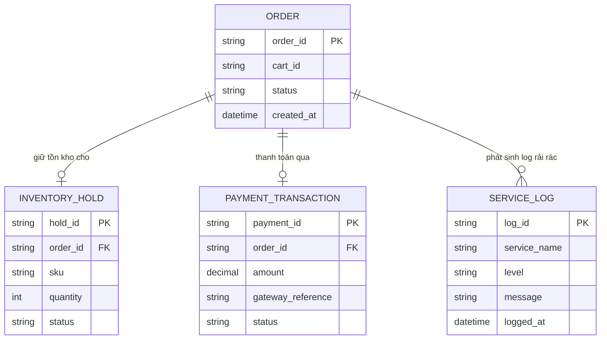
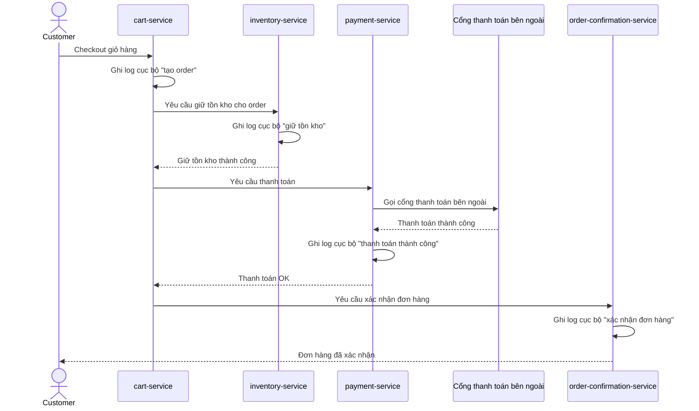
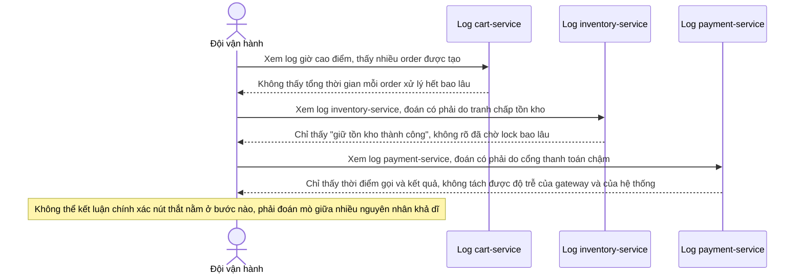
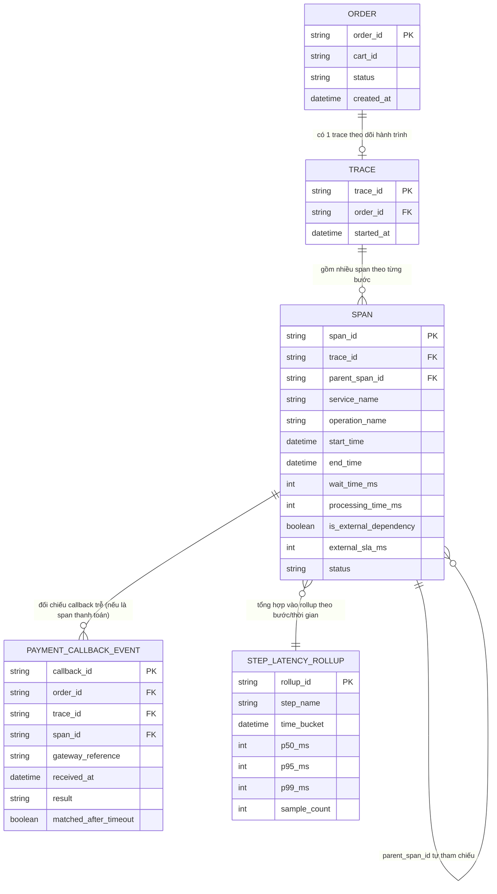
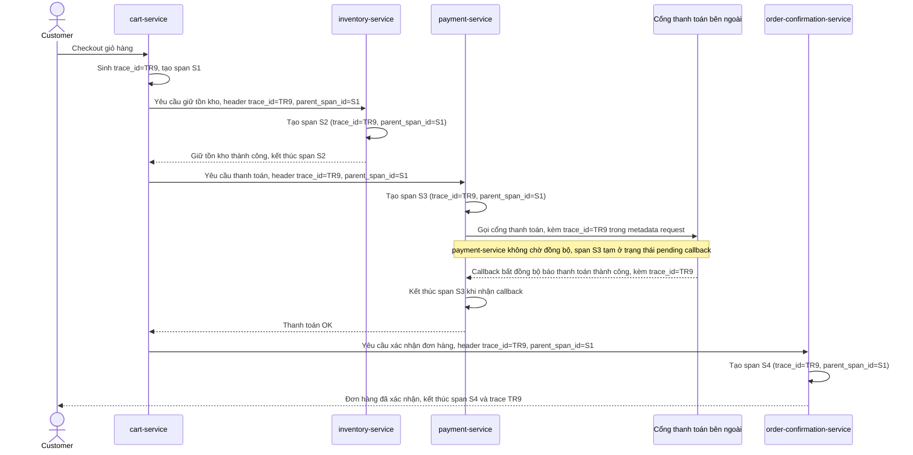
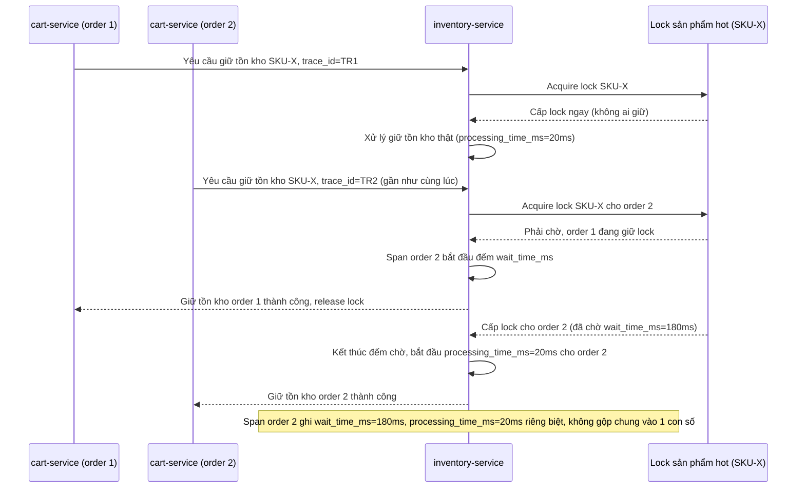
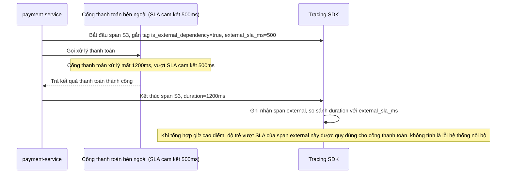
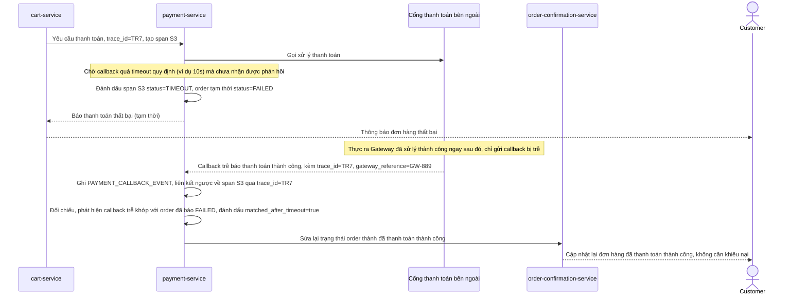
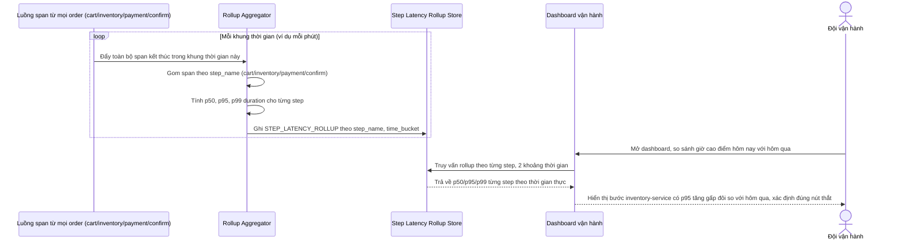

# Truy vết một đơn hàng e-commerce qua giỏ hàng, tồn kho, thanh toán và xác nhận

**Hệ thống:** Một sàn e-commerce có luồng đặt hàng đi qua bốn service tách biệt: `cart-service` → `inventory-service` (kiểm tra và giữ tồn kho) → `payment-service` (gọi cổng thanh toán bên ngoài) → `order-confirmation-service`, mỗi service có tài nguyên và tốc độ scale khác nhau.

**Vai trò của flow:** Khi checkout bị chậm vào giờ cao điểm, tracing phải chỉ ra chính xác bước nào đang là nút thắt (tồn kho đang bị lock tranh chấp, hay cổng thanh toán bên ngoài đang chậm, hay chỉ đơn giản là hàng đợi nội bộ đang nghẽn) để đội vận hành không phải đoán mò giữa nhiều nguyên nhân khả dĩ.

**Yêu cầu cụ thể:**
- Trace của một đơn hàng phải giữ nguyên `trace_id` xuyên suốt bốn bước dù chúng chạy trên các service độc lập với vòng đời request khác nhau (một số đồng bộ, một số phải chờ callback bất đồng bộ từ cổng thanh toán), để dựng lại được toàn bộ hành trình của một đơn hàng cụ thể khi khách hàng báo lỗi.
- Bước kiểm tra tồn kho thường liên quan tới việc chờ lock (nhiều đơn hàng cùng tranh chấp một sản phẩm hot), span của bước này phải tách riêng thời gian chờ lock khỏi thời gian xử lý logic thật, để phân biệt được "chậm vì tranh chấp tồn kho" với "chậm vì code xử lý nặng".
- Bước gọi cổng thanh toán bên ngoài phải được đánh dấu rõ là external dependency với SLA riêng, để khi tổng hợp thống kê "checkout chậm ở bước nào" vào giờ cao điểm, đội vận hành không nhầm lẫn giữa độ trễ do chính hệ thống gây ra và độ trễ nằm ngoài tầm kiểm soát của cổng thanh toán đối tác.
- Thiết kế dashboard tổng hợp theo từng bước trên toàn bộ traffic (không chỉ theo từng đơn hàng riêng lẻ) để trả lời câu hỏi "giờ cao điểm hôm nay chậm hơn hôm qua, chậm chủ yếu ở bước nào" — cho phép so sánh phân phối độ trễ (p50/p95/p99) từng bước theo thời gian thực.
- Xử lý trường hợp một đơn hàng bị timeout ở bước thanh toán nhưng cổng thanh toán thực ra đã xử lý thành công phía họ và gửi callback trễ — trace phải ghi lại đủ để đối chiếu, tránh tình huống hệ thống báo "đơn hàng thất bại" trong khi thực tế tiền đã bị trừ, gây khiếu nại khó điều tra nếu thiếu dữ liệu trace đầy đủ.

---

# ERD - Base (trước khi có distributed tracing)

Đây là trạng thái **base**: sàn e-commerce đã có luồng đặt hàng đi qua 4 service tách biệt (`cart-service`, `inventory-service`, `payment-service`, `order-confirmation-service`), có các entity nghiệp vụ cốt lõi là `ORDER`, `INVENTORY_HOLD` (giữ tồn kho) và `PAYMENT_TRANSACTION`, nhưng mỗi service chỉ ghi log cục bộ, không có định danh chung nối các bước lại với nhau. Đây là tiền đề khiến enhance cần thêm tracing để chỉ ra chính xác bước nào đang là nút thắt.

---

# Sequence Diagram - Base: checkout-order

Đây là flow **base**: đơn hàng đi qua `cart-service` -> `inventory-service` -> `payment-service` (gọi cổng thanh toán bên ngoài) -> `order-confirmation-service`, mỗi service chỉ ghi log cục bộ của riêng nó. Flow này là nền để so sánh với enhance, nơi mỗi bước sẽ được gắn `trace_id`/`span` xuyên suốt kể cả đoạn chờ callback bất đồng bộ.

---

# Sequence Diagram - Base: diagnose-slow-checkout

Đây là flow **base** minh hoạ chính vấn đề mà đề bài cần giải quyết: vào giờ cao điểm, checkout bị chậm nhưng đội vận hành không có cách nào xác định chính xác nguyên nhân - có thể do tồn kho bị lock tranh chấp, cổng thanh toán bên ngoài chậm, hay chỉ đơn giản hàng đợi nội bộ nghẽn - vì log của từng service không liên kết với nhau và không tách được thời gian chờ khỏi thời gian xử lý thật. Đây là lý do enhance cần tracing chi tiết theo từng bước.

---

# ERD - Enhance (distributed tracing xuyên checkout, tách nguyên nhân nghẽn)

Đây là trạng thái **enhance**: giữ nguyên `ORDER`, `INVENTORY_HOLD`, `PAYMENT_TRANSACTION` từ base, thay `SERVICE_LOG` rời rạc bằng mô hình tracing có cấu trúc:
- `TRACE`: mỗi order gắn 1 trace xuyên suốt 4 bước dù có bước chờ callback bất đồng bộ - đáp ứng yêu cầu 1.
- `SPAN`: mỗi bước là 1 span, tách riêng `wait_time_ms` (thời gian chờ lock/hàng đợi) và `processing_time_ms` (thời gian xử lý logic thật) để phân biệt "chậm vì tranh chấp" với "chậm vì code nặng" - đáp ứng yêu cầu 2; có `is_external_dependency` và `external_sla_ms` để đánh dấu bước gọi cổng thanh toán là phụ thuộc ngoài với SLA riêng - đáp ứng yêu cầu 3.
- `STEP_LATENCY_ROLLUP`: bảng tổng hợp độ trễ p50/p95/p99 theo từng bước theo khung thời gian, phục vụ dashboard toàn traffic (không theo từng order riêng lẻ) - đáp ứng yêu cầu 4.
- `PAYMENT_CALLBACK_EVENT`: ghi lại callback bất đồng bộ từ cổng thanh toán, liên kết ngược về span thanh toán qua `trace_id`/`span_id`, để đối chiếu khi order bị timeout nhưng cổng thanh toán thực ra đã xử lý thành công - đáp ứng yêu cầu 5.

---

# Sequence Diagram - Enhance: checkout-order

Đây là flow **enhance** của `checkout-order` (so với base ở file `2-base-checkout-order-sqd.md`): `trace_id` được giữ nguyên xuyên suốt cả 4 bước, kể cả đoạn `payment-service` phải chờ callback bất đồng bộ từ cổng thanh toán thay vì trả lời đồng bộ ngay, giúp dựng lại được toàn bộ hành trình của 1 đơn hàng cụ thể khi khách hàng báo lỗi. Đáp ứng yêu cầu 1.

---

# Sequence Diagram - Enhance: inventory-lock-wait-vs-processing

Đây là flow **enhance mới**: hai order cùng tranh chấp giữ tồn kho cho cùng 1 sản phẩm hot, span của `inventory-service` tách rõ `wait_time_ms` (thời gian order 2 phải chờ lock được order 1 nhả) khỏi `processing_time_ms` (thời gian xử lý logic giữ tồn kho thật sự), giúp phân biệt "chậm vì tranh chấp tồn kho" với "chậm vì code xử lý nặng". Đáp ứng yêu cầu 2.

---

# Sequence Diagram - Enhance: payment-external-dependency

Đây là flow **enhance mới**: span của bước gọi cổng thanh toán được đánh dấu `is_external_dependency=true` kèm `external_sla_ms` riêng, để khi tổng hợp thống kê "checkout chậm ở bước nào" vào giờ cao điểm, đội vận hành phân biệt được độ trễ do cổng thanh toán đối tác (nằm ngoài tầm kiểm soát, so với SLA riêng của họ) và độ trễ do chính hệ thống nội bộ gây ra. Đáp ứng yêu cầu 3.

---

# Sequence Diagram - Enhance: payment-timeout-late-callback-reconciliation

Đây là flow **enhance mới**: order bị timeout ở bước chờ callback thanh toán và tạm thời được đánh dấu thất bại, nhưng cổng thanh toán thực ra đã xử lý thành công phía họ và gửi callback trễ sau đó. Nhờ span thanh toán và `PAYMENT_CALLBACK_EVENT` đều lưu đủ `trace_id`/`span_id`, hệ thống đối chiếu được callback trễ với đúng order để sửa lại trạng thái, tránh báo "thất bại" trong khi tiền đã bị trừ. Đáp ứng yêu cầu 5.

---

# Sequence Diagram - Enhance: realtime-latency-dashboard

Đây là flow **enhance mới**: một pipeline tổng hợp liên tục gom span từ toàn bộ order (không chỉ 1 order riêng lẻ) thành `STEP_LATENCY_ROLLUP` theo từng bước theo khung thời gian, để dashboard trả lời được câu hỏi "giờ cao điểm hôm nay chậm hơn hôm qua, chậm chủ yếu ở bước nào" bằng cách so sánh p50/p95/p99 theo thời gian thực. Đáp ứng yêu cầu 4.

