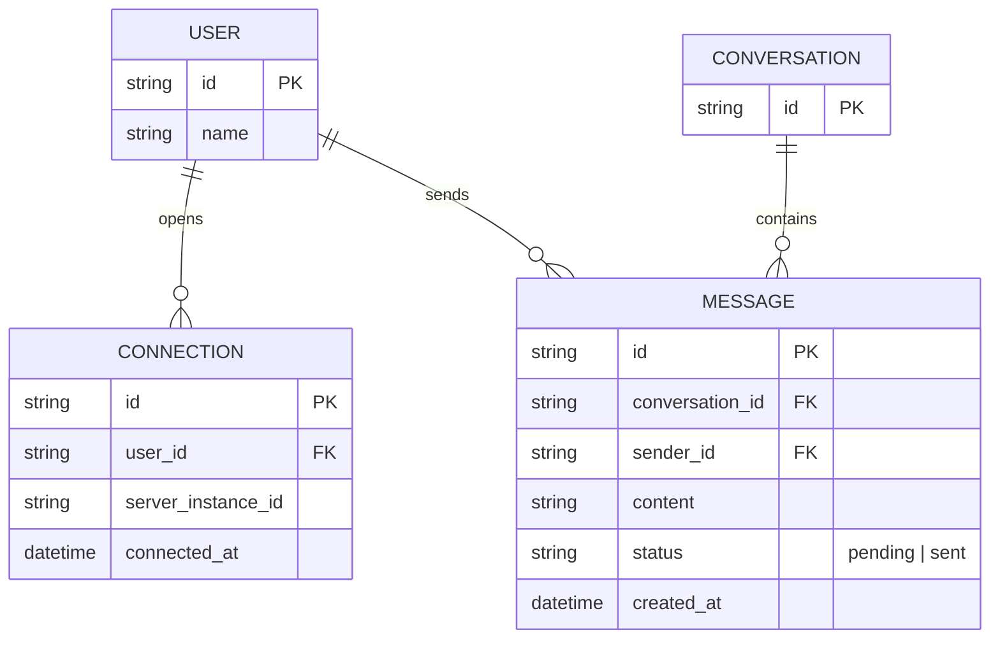
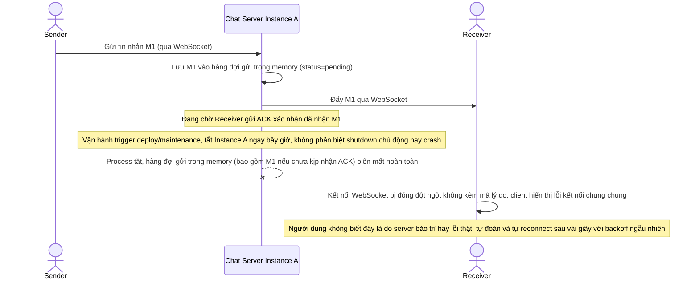
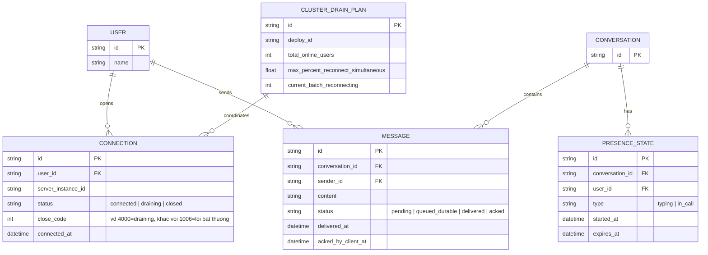
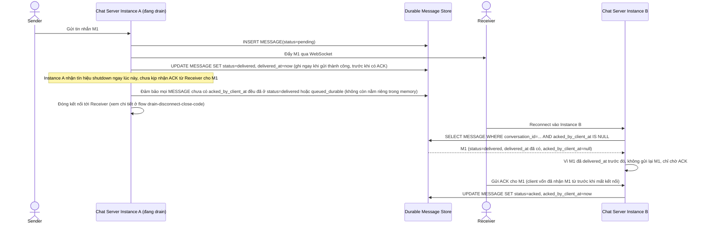
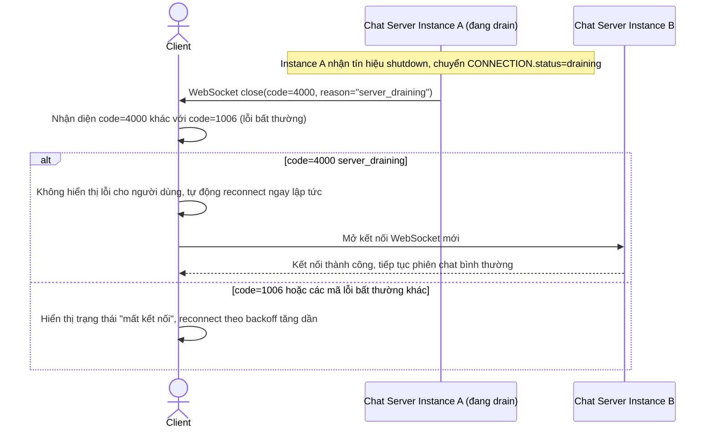
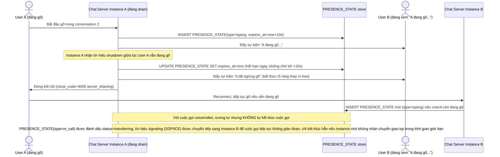
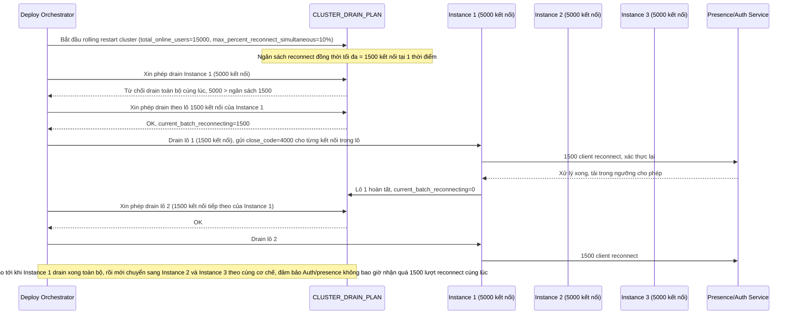

# Chat server real-time cho ứng dụng nhắn tin

**Hệ thống:** Một backend chat real-time giữ kết nối WebSocket cho hàng chục nghìn user, mỗi kết nối gắn với một session hội thoại.

**Vai trò của flow:** Đảm bảo khi một chat server instance cần tắt (maintenance/deploy), user không bị mất tin nhắn đang gửi và được chuyển êm sang instance khác.

**Yêu cầu cụ thể:**
- Tin nhắn đang trong hàng đợi gửi (chưa được ACK bởi client) tại thời điểm shutdown phải được đảm bảo không mất — chuyển giao lại cho hàng đợi bền (message queue/DB) để instance khác tiếp tục gửi, không được chỉ giữ trong memory rồi mất khi tắt.
- Khi ngắt kết nối WebSocket để drain, phải gửi kèm mã lý do (close code) riêng cho "server draining" khác với "lỗi bất thường", để client phân biệt và tự reconnect ngay, không hiển thị lỗi gây hoang mang cho người dùng.
- Đảm bảo tính idempotent: nếu một tin nhắn đã được gửi thành công tới client trước khi server bị ngắt giữa lúc gửi ACK, khi reconnect vào instance mới, tin nhắn không được gửi lại trùng lặp.
- Xử lý trường hợp user đang gõ (typing indicator) hoặc đang trong cuộc gọi voice/video khi server drain — trạng thái này phải được chuyển giao hoặc kết thúc rõ ràng, không để lại trạng thái "đang gõ" treo vĩnh viễn ở phía người nhận.
- Thiết kế cơ chế rolling restart cho toàn cluster chat server sao cho tại mọi thời điểm, tổng số kết nối bị buộc reconnect đồng thời không vượt quá X% tổng số user online, tránh gây spike tải lên hệ thống presence/auth khi hàng loạt client reconnect cùng lúc.

---

# Base ERD — Chat server real-time trước khi có graceful shutdown

Đây là **base**: mô hình dữ liệu suy luận từ ngữ cảnh đề bài, thể hiện trạng thái hệ thống **trước khi** chat server biết xử lý shutdown an toàn. Đề bài nói tới backend giữ kết nối WebSocket cho hàng chục nghìn user, mỗi kết nối gắn với 1 session hội thoại — nên base chỉ cần đủ: user, cuộc hội thoại, tin nhắn, và kết nối WebSocket hiện tại của user. Tin nhắn chưa gửi/chưa ACK chỉ tồn tại trong bộ nhớ của instance đang giữ kết nối, không có nơi lưu bền vững nào khác — đây chính là lỗ hổng mà enhance sẽ vá. Chưa có trạng thái draining, chưa có close code phân biệt, chưa có theo dõi typing/call, chưa có kế hoạch giới hạn % reconnect đồng thời — tất cả là phần enhance.

Ghi chú: `MESSAGE.status=pending` (đã tạo nhưng chưa gửi được qua WebSocket, hoặc đã gửi nhưng chưa nhận ACK từ client) chỉ được theo dõi trong bộ nhớ tiến trình của `server_instance_id` đang giữ `CONNECTION`, không có bảng/queue bền vững nào lưu lại phần này ở base.

---

# Base sequence — Send message (chỉ giữ trong memory, mất khi instance tắt)

Đây là **base**, flow "Gửi tin nhắn qua WebSocket" ở trạng thái hiện tại — tin nhắn đang chờ gửi/chờ ACK chỉ tồn tại trong bộ nhớ của instance đang giữ kết nối, và khi instance tắt (không phân biệt lý do), kết nối bị đóng đột ngột không kèm mã lý do rõ ràng. Flow này liên quan mật thiết tới enhance vì toàn bộ yêu cầu của đề bài đều nhằm vá đúng những lỗ hổng này.

---

# Enhance ERD — Thêm hàng đợi bền vững, presence có TTL, kế hoạch giới hạn reconnect

Đây là **enhance**, mô hình dữ liệu sau khi áp toàn bộ đề bài lên base. So với base, các thay đổi:
- `MESSAGE` có thêm trạng thái `queued_durable` và cột `delivered_at`/`acked_by_client_at` — tin nhắn chưa được client ACK nay được ghi vào store bền vững thay vì chỉ giữ trong memory, và server theo dõi được đã gửi/đã ACK để tránh gửi trùng khi reconnect — đáp ứng yêu cầu 1 và yêu cầu 3.
- `CONNECTION` có thêm trạng thái `draining` và cột `close_code` — đáp ứng yêu cầu 2 (mã lý do riêng cho "server draining").
- Entity mới `PRESENCE_STATE` — đại diện trạng thái tạm thời như đang gõ hoặc đang trong cuộc gọi, có `expires_at` để không bao giờ treo vĩnh viễn — đáp ứng yêu cầu 4.
- Entity mới `CLUSTER_DRAIN_PLAN` — giới hạn tổng số kết nối bị buộc reconnect đồng thời không vượt quá X% tổng số user online — đáp ứng yêu cầu 5.

---

# Enhance sequence — Send message (chuyển giao hàng đợi bền vững, không gửi trùng khi reconnect)

Đây là **enhance** của flow `send-message` đã có ở base, đáp ứng **yêu cầu 1 và yêu cầu 3** của đề bài. So với base: tin nhắn chưa được ACK tại thời điểm shutdown được ghi vào store bền vững (`status=queued_durable`) thay vì chỉ giữ trong memory, để instance khác tiếp tục gửi. Song song đó, mỗi tin nhắn có `delivered_at` được ghi lại ngay khi gửi thành công, nên nếu server bị ngắt giữa lúc gửi ACK, instance mới khi reconnect biết tin nhắn đã delivered và không gửi lại trùng.

---

# Enhance sequence — Ngắt kết nối để drain kèm close code riêng biệt

Đây là flow **enhance** hoàn toàn mới so với base, đáp ứng **yêu cầu 2** của đề bài: khi ngắt kết nối WebSocket để drain, server gửi kèm close code riêng cho "server draining" (ví dụ 4000), khác với close code lỗi bất thường (ví dụ 1006), để client phân biệt và tự reconnect ngay thay vì hiển thị lỗi gây hoang mang.

---

# Enhance sequence — Chuyển giao/kết thúc rõ ràng typing indicator và cuộc gọi khi drain

Đây là flow **enhance** hoàn toàn mới so với base, đáp ứng **yêu cầu 4** của đề bài: khi server drain lúc user đang gõ hoặc đang trong cuộc gọi voice/video, các `PRESENCE_STATE` này phải được chuyển giao hoặc kết thúc rõ ràng, không để lại trạng thái "đang gõ" treo vĩnh viễn ở phía người nhận.

---

# Enhance sequence — Rolling restart toàn cluster giới hạn % kết nối reconnect đồng thời

Đây là flow **enhance** hoàn toàn mới so với base, đáp ứng **yêu cầu 5** của đề bài: rolling restart toàn cluster chat server sao cho tại mọi thời điểm, tổng số kết nối bị buộc reconnect đồng thời không vượt quá X% tổng số user online, tránh spike tải lên hệ thống presence/auth.

