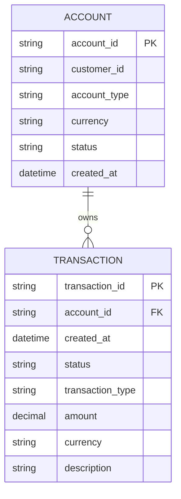
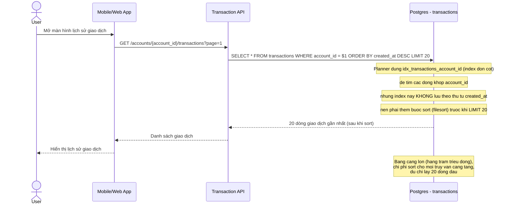
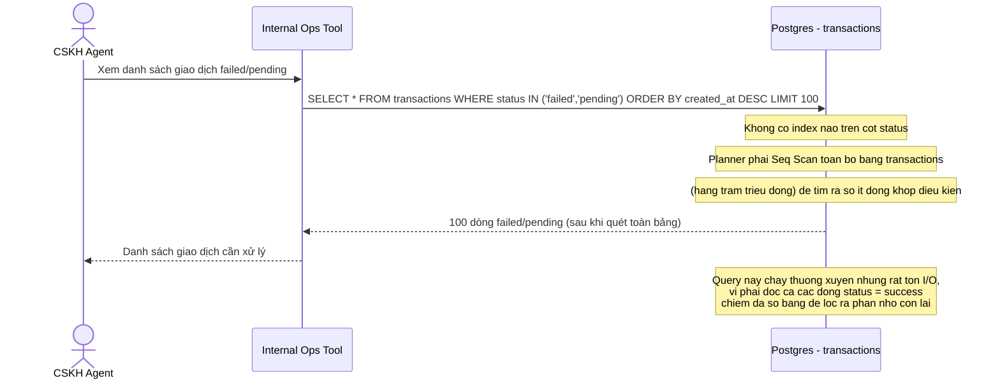
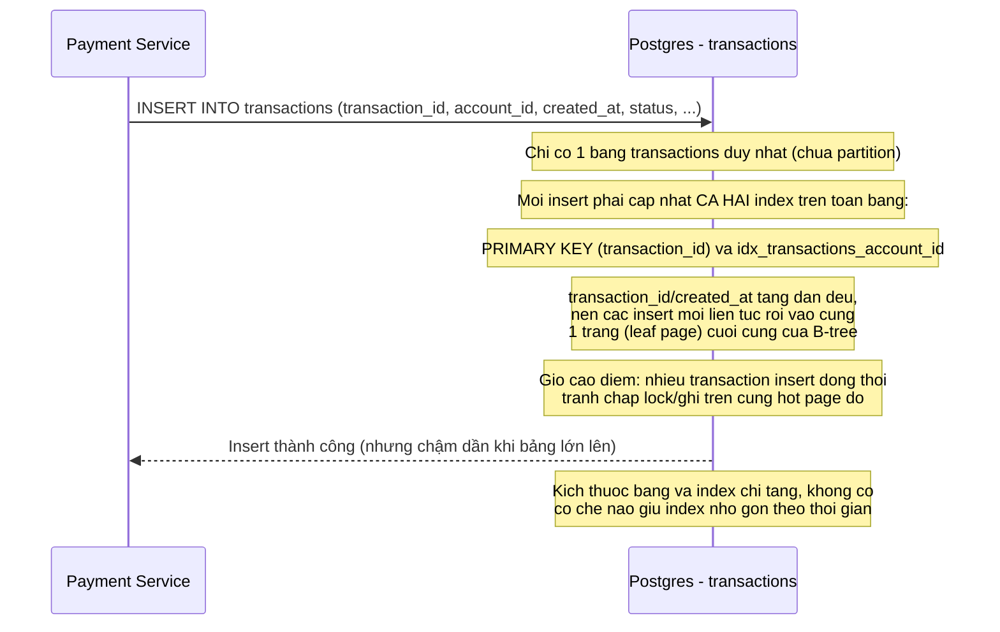
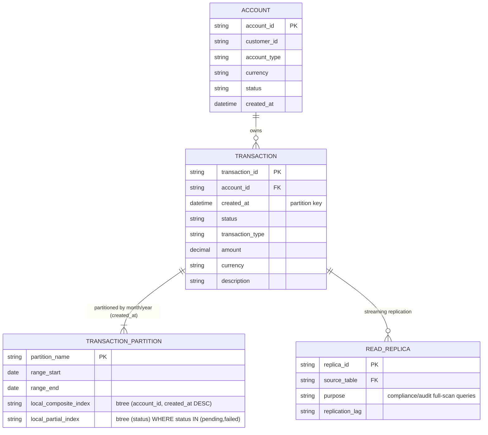
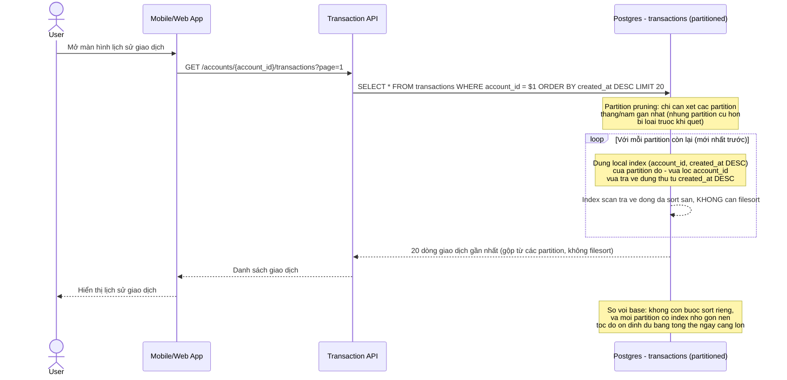
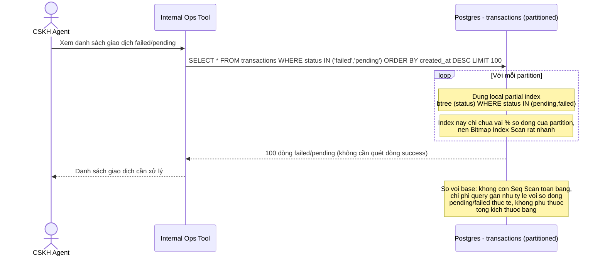
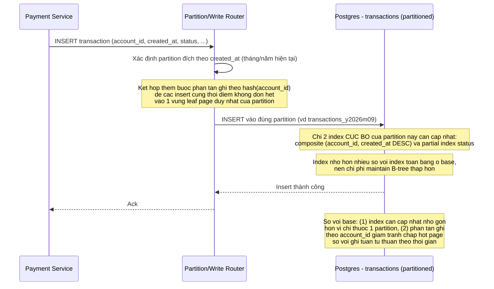
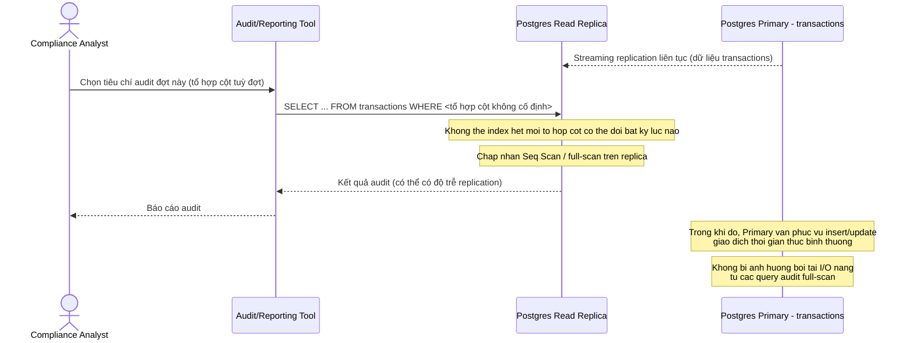

# Fintech tra cứu lịch sử giao dịch trên bảng transaction khổng lồ

**Hệ thống:** Ngân hàng số/ví điện tử có bảng `transactions` append-only với hàng trăm triệu dòng, phục vụ cả user tra cứu lịch sử giao dịch của mình lẫn CSKH/vận hành tra cứu theo nhiều tiêu chí khác nhau.

**Vai trò của flow:** Đảm bảo tra cứu nhanh và chính xác trong khi bảng vẫn đang bị ghi liên tục với tốc độ cao (giao dịch mới insert từng giây), mà không phá vỡ yêu cầu audit trail toàn vẹn.

**Yêu cầu cụ thể:**
- User tra lịch sử giao dịch của tài khoản mình cần composite index (account_id, created_at DESC) để lấy nhanh giao dịch gần nhất, nhưng CSKH lại cần lọc thêm theo status hoặc transaction_type trên cùng bảng — quyết định rõ có thêm cột vào index hiện tại, tạo index riêng, hay chấp nhận index intersection cho các trường hợp ít gặp hơn.
- Bảng append-only tăng kích thước liên tục khiến index B-tree ngày càng phình to, làm chậm dần cả tốc độ ghi lẫn thời gian bảo trì index — cần cân nhắc range-partition bảng theo tháng/năm (dựa trên created_at) kết hợp local index riêng từng partition để giữ mỗi index luôn nhỏ gọn.
- Truy vấn "toàn bộ giao dịch failed/pending" chỉ chiếm tỉ lệ rất nhỏ trên tổng bảng nhưng được CSKH chạy thường xuyên để xử lý sự cố — index toàn bảng theo status sẽ lãng phí vì đa số giao dịch đã success; cần dùng partial index (chỉ index các dòng có status IN pending/failed) để index nhỏ và nhanh hơn hẳn.
- Bộ phận compliance cần chạy query audit full-scan theo nhiều tổ hợp cột không thể index hết (đổi tiêu chí liên tục theo từng đợt kiểm toán) — cần quyết định có tách hẳn read replica riêng cho audit/reporting để không cạnh tranh tài nguyên index/buffer pool với luồng giao dịch thời gian thực.
- Giờ cao điểm có rất nhiều giao dịch insert đồng thời, index có cột đơn điệu tăng dần (như created_at hoặc id tự tăng) dễ tạo hot page ở cuối B-tree gây lock contention khi nhiều transaction cùng ghi — cần xem xét chiến lược giảm contention (vd tách theo shard/account_id trước khi index theo thời gian).

---

# ERD - Base: bảng transactions cơ bản, chưa tối ưu index/partition

Đây là **base**, trạng thái dữ liệu ngay trước khi áp đề bài. Hệ thống ngân hàng số/ví điện tử đã có `ACCOUNT` và bảng `TRANSACTION` append-only lưu mọi giao dịch, nhưng bảng chưa được partition và chỉ có index tối thiểu (khóa chính trên `transaction_id`, index đơn cột trên `account_id`) - đây chính là điểm xuất phát mà đề bài (composite index, partial index, partition, read replica) cần cải thiện.

---

# Sequence - Base: User tra cứu lịch sử giao dịch

Đây là **base**, flow "user tra cứu lịch sử giao dịch của tài khoản mình". Flow này được chọn vì đây chính là truy vấn mà đề bài muốn tối ưu bằng composite index `(account_id, created_at DESC)` - ở base, bảng chỉ có index đơn cột trên `account_id` nên DB phải tự sort kết quả, minh hoạ rõ vấn đề cần giải quyết.

---

# Sequence - Base: CSKH lọc giao dịch failed/pending

Đây là **base**, flow "CSKH tra cứu toàn bộ giao dịch failed/pending để xử lý sự cố". Flow này được chọn vì đề bài đề xuất partial index cho đúng use case này - ở base, bảng chưa có bất kỳ index nào trên cột `status`, nên minh hoạ vấn đề: dù số dòng failed/pending chỉ là phần rất nhỏ, DB vẫn phải quét toàn bộ bảng.

---

# Sequence - Base: Insert giao dịch mới (append-only)

Đây là **base**, flow "hệ thống thanh toán insert giao dịch mới vào bảng transactions". Flow này được chọn vì đề bài nhắc tới 2 vấn đề trực tiếp liên quan tới insert: (1) B-tree của bảng đơn (chưa partition) ngày càng phình to làm chậm ghi và bảo trì index, (2) giờ cao điểm insert đồng thời vào cột tăng dần (created_at/id) gây hot page ở cuối B-tree.

---

# ERD - Enhance: transactions range-partition + partial index + read replica

Đây là **enhance**, đúng nguyên văn nội dung đề bài. So với base, bảng `TRANSACTION` logic nay được range-partition theo tháng/năm dựa trên `created_at`, mỗi partition mang bộ index riêng nhỏ gọn (composite `(account_id, created_at DESC)` cho user, partial index theo `status` cho CSKH), và có thêm `READ_REPLICA` tách riêng cho compliance/audit để không cạnh tranh tài nguyên với luồng giao dịch thời gian thực.

---

# Sequence - Enhance: User tra cứu lịch sử giao dịch

Đây là **enhance** của flow "user tra cứu lịch sử giao dịch" đã có ở base (file `2-base-user-transaction-history-lookup-sqd.md`). So với base, DB không còn phải filesort: bảng đã range-partition theo `created_at` nên planner prune bớt partition không liên quan, rồi dùng local composite index `(account_id, created_at DESC)` của từng partition còn lại để lấy dữ liệu đã sẵn đúng thứ tự.

---

# Sequence - Enhance: CSKH lọc giao dịch failed/pending

Đây là **enhance** của flow "CSKH lọc giao dịch failed/pending" đã có ở base (file `3-base-cskh-filter-failed-pending-sqd.md`). So với base, mỗi partition nay có sẵn partial index chỉ chứa các dòng `status IN (pending, failed)`, nên thay vì Seq Scan toàn bảng, DB chỉ cần Bitmap Index Scan trên partial index rất nhỏ của từng partition.

---

# Sequence - Enhance: Insert giao dịch mới (partition + giảm hot page contention)

Đây là **enhance** của flow "insert giao dịch mới" đã có ở base (file `4-base-insert-transaction-sqd.md`). So với base, insert nay chỉ cần cập nhật index của đúng 1 partition (nhỏ gọn hơn nhiều so với index toàn bảng cũ), và có thêm bước phân tán ghi theo `account_id` để giảm tình trạng nhiều transaction cùng tranh chấp một hot page ở cuối B-tree trong giờ cao điểm.

---

# Sequence - Enhance: Compliance chạy audit query trên read replica

Đây là **enhance**, flow hoàn toàn mới phát sinh từ đề bài, chưa tồn tại ở base. Bộ phận compliance cần chạy các query full-scan với tổ hợp cột thay đổi liên tục theo từng đợt kiểm toán, không thể index hết - flow này tách các truy vấn đó sang read replica riêng để không cạnh tranh index/buffer pool với luồng giao dịch thời gian thực (OLTP) trên primary.

